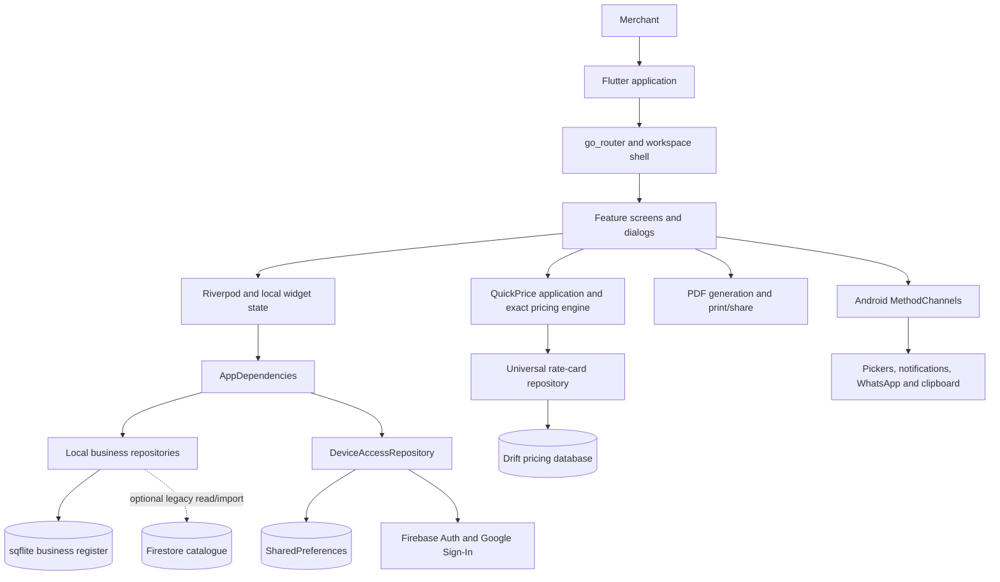
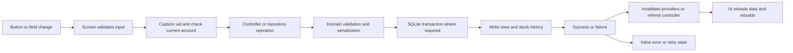
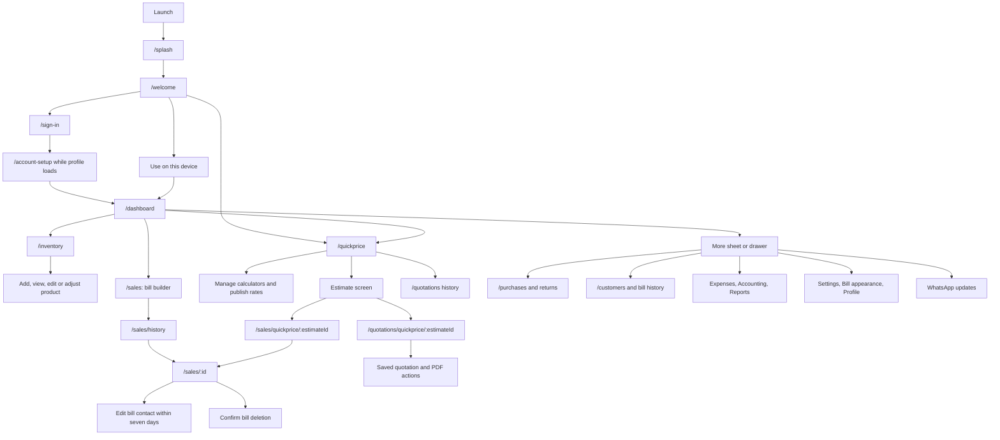
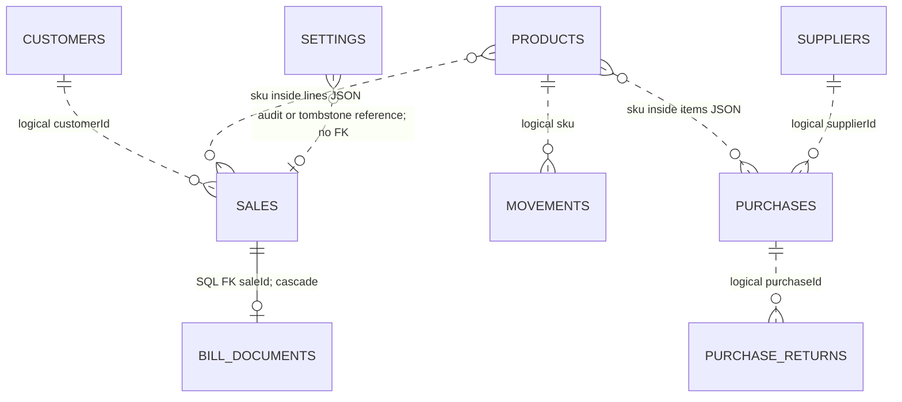
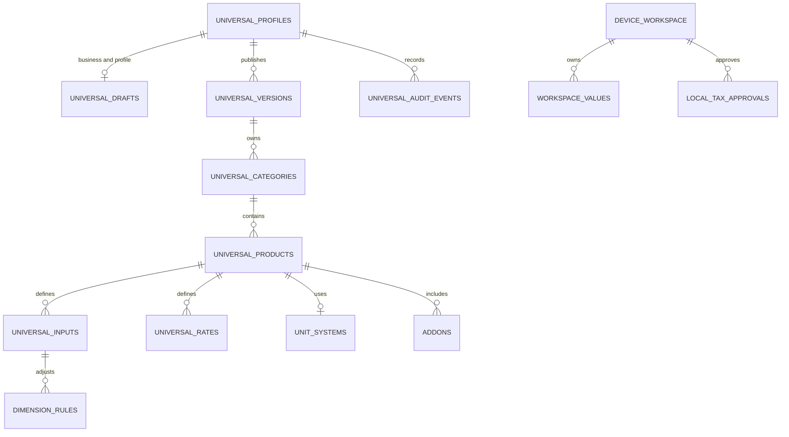
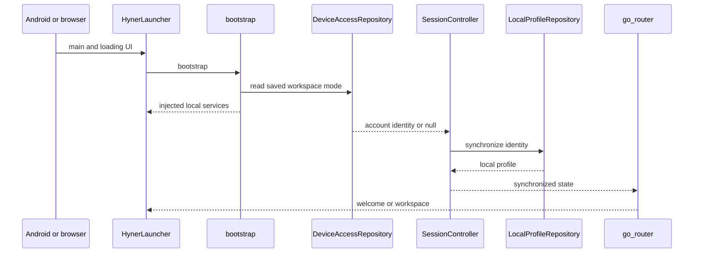
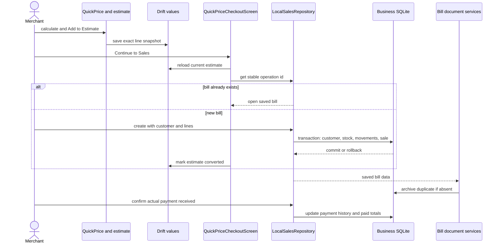
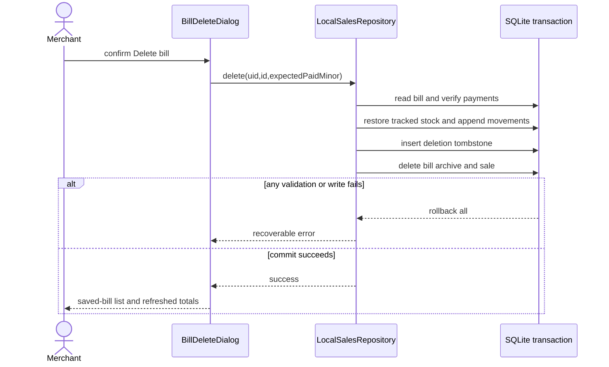

# Hyner — Application Master Documentation

> **Repository audit date:** 2026-11-13, Asia/Kolkata. **Current application version:** `0.8.4+16` in `pubspec.yaml` (build code 16 carries the calculator-management APK). **Branch:** `test1`. **HEAD:** `256b79a661944b29e7f82605899b86cb692a87d6` at original audit time.
>
> This documents the **working tree**, including existing uncommitted and untracked implementation files, not just HEAD. The original documentation was generated as a static, read-only audit. The subsequent **authorized UI polish update (0.8.2)** is documented in section 22 and updates the relevant references here. That later implementation runs synthetic tests and release builds; it does not change business schemas, rules, integrations or merchant records. Original audit-only verification statements below are historical to that audit phase; section 22 records current UI verification.
>
> **Evidence vocabulary:** **Verified** means supported by inspected repository source or configuration; **Historical evidence** means an existing log/report, not a fresh check; **Potential risk** is a reasoned concern, not a reproduced failure; **Unknown / Not verified** identifies missing evidence. No credentials, configuration values identifying cloud registrations, authentication tokens, connection strings, or private database records are reproduced here.

## Contents

1. [Application overview](#1-application-overview)
2. [Project folders and file reference](#2-complete-project-folder-structure)
3. [Application architecture](#3-complete-application-architecture)
4. [Screens and navigation](#4-screen-by-screen-explanation)
5. [Database architecture and schemas](#5-database-architecture)
6. [Storage and capacity](#6-database-storage-and-capacity)
7. [Feature inventory](#7-complete-feature-inventory)
8. [Authentication and security](#8-authentication-and-security)
9. [APIs, backend and native bridges](#9-api-and-backend-documentation)
10. [End-to-end workflows](#10-complete-end-to-end-user-flows)
11. [File change impact guide](#11-file-change-impact-guide)
12. [State and data lifecycle](#12-state-management-and-data-lifecycle)
13. [Dependencies and configuration](#13-dependencies-and-configuration)
14. [Performance and scalability](#14-performance-and-scalability)
15. [Code quality and technical debt](#15-code-quality-and-technical-debt)
16. [Testing and builds](#16-testing-and-build-process)
17. [Development status](#17-current-development-status)
18. [Continuing development](#18-how-to-continue-developing-this-app)
19. [AI agent handoff](#19-ai-agent-handoff-context)
20. [Glossary](#20-glossary)
21. [Verification and evidence](#21-repository-verification-and-evidence)
22. [UI polish update, audit and implementation report](#22-ui-polish-update-082)

# 1. Application overview

Hyner is a merchant business workspace and configurable product-price calculator. It helps a shop calculate measured-product prices, prepare multi-item estimates and quotations, maintain inventory, issue bills, record payments and supplier purchases, and review business activity. Doors and other cut-to-size products are supported by pricing templates, but the universal pricing engine is broader than a door calculator. Target users inferred from the screens and models are shop owners and sellers who need offline records; a deployed customer population is **Unknown**.

The source is predominantly **Dart/Flutter**, with **Kotlin** for Android platform bridges, **SQL** for SQLite schemas, **Python** for developer tooling, HTML/JSON for the web wrapper, Gradle Kotlin DSL for Android builds, and vendored C for SQLite. Riverpod supplies application state and dependency injection; go_router supplies navigation. Firebase Authentication and Google Sign-In provide optional accounts. Business operations use local SQLite through sqflite, while pricing uses a separate SQLite database through Drift. SharedPreferences stores appearance, workspace selection and local profile fields. There is no application-owned HTTP server in this repository.

| Platform | Repository evidence | Actual support boundary |
|---|---|---|
| Android | `android/`, Kotlin bridges, release build tooling and historical APKs | Primary implemented platform. Current physical-device behavior was not verified during this audit. |
| Web | `web/`, conditional workspace export, historical web-build logs | QuickPrice is an explicitly transient in-memory preview. The full sqflite business workspace is not established as a supported browser implementation. A successful web compile does not prove all business screens work. |
| iOS | Some platform-neutral Flutter code and native-file photo helper | No `ios/` project or iOS bridge implementation. Not verified as buildable or supported. |
| macOS / Windows / Linux | Reusable Flutter/domain code and host-side tests | No desktop runner projects. Not verified as shipped applications. |

Implemented features include four saved colour presets independent of light/dark/system appearance, consistent financial typography, device access, Google/email authentication adapters, local profile editing, business/bill appearance settings, inventory and movement history, configurable pricing and varieties, customer-specific calculator rate overrides, persistent estimates, sales checkout, original/duplicate PDFs, payment records and UPI QR, seven-day bill-contact correction, bill deletion, purchases and supplier returns, customer history, operating expenses, reports/PDFs, manual accounting and purchase-order registers, quotation PDFs, image crop/rotation, Android notifications and manual WhatsApp handoffs.

Partial or absent capabilities must not be inferred from marketing text: no automatic business cloud synchronization; no backend-enforced staff roles; no paid-plan enforcement; no payment gateway verification, automatic refund, WhatsApp delivery tracking or silent message sending; no full saved-bill item/amount editing; no dedicated customer sale-return/credit-note workflow. Manual purchase orders and accounting are basic registers, not complete procurement or double-entry accounting systems. `module_catalog.dart` uses a property named `planned` even for available modules; that name alone is not reliable implementation status.



Primary evidence: `lib/main.dart:17` (`main`), `lib/app/bootstrap/bootstrap.dart:40` (`bootstrap`), `lib/app/bootstrap/app_dependencies.dart`, `lib/core/storage/local_business_database.dart`, `lib/core/storage/pricing_database.dart`, `lib/features/pricing/data/device_workspace.dart`, and `android/app/src/main/kotlin/com/hyner/hyner/MainActivity.kt`.

# 2. Complete project folder structure

The tree below omits generated build output, IDE caches, binary artwork variants and most generated plugin scaffolding. The file reference after it inventories authored application files individually, including direct imports, reverse importers, major declarations, affected features and change impact. Import relationships are static references, **not proof of runtime execution**. No inbound production import is reported explicitly rather than automatically calling a file dead code.

```text
hyner2/
├── lib/
│   ├── main.dart
│   ├── app/
│   │   ├── bootstrap/
│   │   ├── config/
│   │   ├── routing/
│   │   ├── theme/
│   ├── core/
│   │   ├── errors/
│   │   ├── firebase/
│   │   ├── images/
│   │   ├── notifications/
│   │   ├── performance/
│   │   ├── storage/
│   │   ├── widgets/
│   └── features/
│       ├── accounting/  → presentation/
│       ├── auth/  → data/, domain/, presentation/
│       ├── customers/  → data/, domain/, presentation/
│       ├── dashboard/  → presentation/
│       ├── expenses/  → data/, domain/, presentation/
│       ├── inventory/  → data/, domain/, presentation/
│       ├── onboarding/  → presentation/
│       ├── pricing/  → application/, data/, domain/, presentation/
│       ├── profile/  → data/, domain/, presentation/
│       ├── purchase_orders/  → presentation/
│       ├── purchases/  → data/, domain/, presentation/
│       ├── quotations/  → data/, domain/, presentation/
│       ├── reports/  → data/, domain/, presentation/
│       ├── sales/  → data/, domain/, presentation/
│       ├── settings/  → data/, domain/, presentation/
│       ├── whatsapp/  → presentation/
│       ├── workspace/  → presentation/
├── android/
│   ├── app/
│   │   ├── build.gradle.kts
│   │   ├── google-services.json  (values omitted)
│   │   └── src/
│   │       ├── main/AndroidManifest.xml
│   │       ├── main/kotlin/com/hyner/hyner/
│   │       │   ├── MainActivity.kt
│   │       │   ├── FileWorkQueue.kt
│   │       │   └── SharedTempFiles.kt
│   │       ├── main/res/  (icons, themes, extraction rules)
│   │       ├── debug/AndroidManifest.xml
│   │       ├── profile/AndroidManifest.xml
│   │       └── test/kotlin/com/hyner/hyner/  (two JUnit tests)
│   ├── build.gradle.kts
│   ├── settings.gradle.kts
│   ├── gradle.properties
│   ├── gradle/wrapper/
│   └── gradlew, gradlew.bat, local.properties  (local/ignored scaffolding present)
├── web/  → index.html, manifest.json, favicon.png, icons/
├── assets/  → branding/, fonts/
├── test/  → business/support/, support/, fixtures/, performance/, root tests
├── tool/  → build/check/profile/benchmark/icon scripts and size budgets
├── third_party/sqlite/  → sqlite3.c, sqlite3.h, README.md
├── docs/  → feature/release notes, performance/, ux-redesign/before/, ux-redesign/after/
├── pubspec.yaml, pubspec.lock, analysis_options.yaml
├── README.md and prior optimization/UX reports
└── build/, .dart_tool/, .idea/, android/.gradle/  (generated/local, summarized)
```

| Top-level path | Purpose and boundary |
|---|---|
| `lib/main.dart` | Process entry and launcher. Also contains an older standalone QuickPrice `HynerApp`; the active launcher uses the separate business `HynerApp` via an alias. |
| `lib/app/` | Bootstrap, injected dependencies, configuration, theme and router. |
| `lib/core/` | Shared storage, errors, images, notifications, performance and layout primitives. |
| `lib/features/` | Feature-organized UI, controllers, domain types and repository implementations. Pricing also has an explicit `application/` layer. |
| `android/` | Android host project, Gradle configuration, manifests/resources, Kotlin channels and JUnit tests. |
| `web/` | Browser loader, PWA-style manifest and icons. No separate JavaScript business backend. |
| `assets/` | Brand artwork and Manrope font/license; some artwork is source material rather than a declared Flutter runtime asset. |
| `test/` | Dart unit, SQLite FFI, widget, regression, optional visual and performance tests; synthetic fixtures. |
| `tool/` | Build verification, ABI packaging, size budgets, synthetic query benchmark, designated-device profiling and icon generation. |
| `third_party/sqlite/` | SQLite amalgamation C/header and provenance README. Do not treat it as app business logic. |
| `docs/` | Historical feature/storage contracts, release notes, Firebase setup notes, performance guidance and UX images. Older documents can be superseded by current code. |
| `README.md` | Current feature/build overview. |
| `pubspec.yaml`, `pubspec.lock` | Flutter/Dart dependencies, assets, version, SDK constraints and SQLite source hook. |
| `analysis_options.yaml` | Flutter lint configuration; excludes build, Android and web paths from Dart analysis. |
| `.gitignore`, `.metadata` | Exclusions and Flutter project metadata. |
| `FLUTTER_OPTIMIZATION_AUDIT.md`, `FLUTTER_OPTIMIZATION_FINAL_REPORT.md`, `UX_REDESIGN_REPORT.md` | Prior analysis evidence, not independent confirmation of current runtime properties. |
| `build/`, `.dart_tool/`, Android build caches, `.idea/` | Generated binaries, logs, code/tool caches and IDE state. Summarized separately; not relevant source to edit. |

## 2.1 Application and configuration file reference

### lib/main.dart
#### `lib/main.dart`
- **Purpose:** Initialize Flutter, notifications and profiling; paint a retryable launcher, inject business dependencies; retains an alternate standalone pricing root.
- **Major declarations / operations (name:line):** `HynerLauncher:25`, `_HynerLauncherState:32`, `HynerApp:81`, `_HynerAppState:89`, `main:15`, `createState:29`.
- **Imported/exported by production:** None in authored Dart imports.
- **Direct test consumers:** `test/app_smoke_test.dart:2`, `test/business/combined_workspace_test.dart:17`, `test/calculator_varieties_ui_test.dart:11`, `test/firebase_bootstrap_test.dart:7`, `test/owner_setup_ui_test.dart:5`
- **Local dependencies:** `lib/app/bootstrap/app_dependencies.dart`, `lib/app/bootstrap/bootstrap.dart`, `lib/app/hyner_app.dart`, `lib/core/notifications/local_notification_service.dart`, `lib/core/performance/performance_recorder.dart`, `lib/core/firebase/firebase_bootstrap.dart`, `lib/features/pricing/application/open_workspace.dart`, `lib/features/pricing/application/workspace.dart`, `lib/features/pricing/presentation/pricing_widgets.dart`, `lib/features/pricing/presentation/quickprice_screen.dart`
- **External packages directly imported:** `flutter`, `flutter_riverpod`
- **Change impact:** Shared callers can change startup, routing, appearance or platform behavior; follow the direct dependency and feature guides before editing.
- **Feature dependency:** app startup. Exact consumers above may cross module boundaries.

### lib/app
#### `lib/app/bootstrap/app_dependencies.dart`
- **Purpose:** Declare injected business services, initial appearance/preset values and independent ThemeController/ThemePresetController state; serialize preset preference writes.
- **Major declarations / operations (name:line):** `AppDependencies:18`, `ThemeController:64`, `ThemePresetController:79`, `select:68`.
- **Imported/exported by production:** `lib/app/bootstrap/bootstrap.dart:22`, `lib/app/hyner_app.dart:4`, `lib/features/auth/presentation/session_controller.dart:5`, `lib/features/auth/presentation/sign_in_screen.dart:5`, `lib/features/customers/presentation/customers_controller.dart:3`, `lib/features/expenses/presentation/expenses_controller.dart:3`, `lib/features/inventory/presentation/inventory_controller.dart:5`, `lib/features/onboarding/presentation/welcome_screen.dart:9`, `lib/features/pricing/presentation/workspace_quickprice_screen.dart:9`, `lib/features/purchases/presentation/purchases_controller.dart:5`, `lib/features/reports/presentation/reports_controller.dart:3`, `lib/features/sales/presentation/sale_detail_screen.dart:14`, `lib/features/sales/presentation/sales_controller.dart:5`, `lib/features/settings/presentation/payment_settings_controller.dart:3`, `lib/features/settings/presentation/settings_screen.dart:11`, `lib/features/settings/presentation/theme_preset_picker.dart:4`, `lib/main.dart:4`
- **Direct test consumers:** `test/business/app_navigation_test.dart:7`, `test/business/bill_settings_screen_test.dart:9`, `test/business/combined_workspace_test.dart:6`, `test/business/inventory_controller_test.dart:5`, `test/business/inventory_screen_test.dart:6`, `test/business/sales_controller_test.dart:5`, `test/business/sales_estimate_checkout_screen_test.dart:7`, `test/business/sales_refinement_ui_test.dart:9`, `test/business/sales_screen_test.dart:9`, `test/business/session_controller_test.dart:5`, `test/business/support/fakes.dart:4`, `test/dashboard_inventory_widget_test.dart:4`, `test/estimate_checkout_flow_test.dart:7`, `test/estimate_visual_verification_test.dart:9`, `test/profile_media_flow_test.dart:10`, `test/quotation_flow_test.dart:9`, `test/theme_presets_test.dart:9`, `test/ux_redesign_test.dart:4`, `test/ux_redesign_visual_test.dart:9`, `test/ux_visual_verification_test.dart:9`
- **Local dependencies:** `lib/features/auth/domain/auth_repository.dart`, `lib/features/customers/domain/customer_repository.dart`, `lib/features/expenses/domain/expense_repository.dart`, `lib/features/inventory/domain/inventory_repository.dart`, `lib/features/profile/domain/profile_repository.dart`, `lib/features/purchases/domain/purchase_repository.dart`, `lib/features/reports/domain/reports_repository.dart`, `lib/features/sales/domain/sales_repository.dart`, `lib/features/sales/domain/bill_document_repository.dart`, `lib/features/settings/domain/payment_settings.dart`, `lib/app/config/app_config.dart`, `lib/app/theme/appearance_repository.dart`, `lib/app/theme/theme_preset.dart`
- **External packages directly imported:** `flutter`, `flutter_riverpod`
- **Change impact:** Shared callers can change startup, routing, appearance or platform behavior; follow the direct dependency and feature guides before editing.
- **Feature dependency:** application shell. Exact consumers above may cross module boundaries.

#### `lib/app/bootstrap/bootstrap.dart`
- **Purpose:** Construct active local repositories and launch optional Firebase authentication setup without blocking device records.
- **Major declarations / operations (name:line):** `_accountServices:23`, `bootstrap:43`.
- **Imported/exported by production:** `lib/main.dart:5`
- **Direct test consumers:** None in authored Dart imports.
- **Local dependencies:** `lib/features/auth/data/device_access_repository.dart`, `lib/features/auth/data/firebase_auth_repository.dart`, `lib/features/auth/domain/auth_repository.dart`, `lib/features/customers/data/local_customer_repository.dart`, `lib/features/expenses/data/local_expense_repository.dart`, `lib/features/inventory/data/local_inventory_repository.dart`, `lib/features/inventory/data/account_legacy_inventory_repository.dart`, `lib/features/profile/data/local_profile_repository.dart`, `lib/features/purchases/data/local_purchase_repository.dart`, `lib/features/reports/data/local_reports_repository.dart`, `lib/features/sales/data/local_sales_repository.dart`, `lib/features/sales/data/local_bill_document_repository.dart`, `lib/features/settings/data/local_payment_settings_repository.dart`, `lib/core/storage/local_business_database.dart`, `lib/app/config/app_config.dart`, `lib/app/theme/appearance_repository.dart`, `lib/app/theme/theme_preset.dart`, `lib/app/bootstrap/app_dependencies.dart`
- **External packages directly imported:** `firebase_auth`, `firebase_core`, `flutter`
- **Change impact:** Shared callers can change startup, routing, appearance or platform behavior; follow the direct dependency and feature guides before editing.
- **Feature dependency:** application shell. Exact consumers above may cross module boundaries.

#### `lib/app/config/app_config.dart`
- **Purpose:** Validate compile-time account-service options and development/production environment; does not carry server authorization.
- **Major declarations / operations (name:line):** `AppEnvironment:3`, `AppConfig:5`.
- **Imported/exported by production:** `lib/app/bootstrap/app_dependencies.dart:14`, `lib/app/bootstrap/bootstrap.dart:19`
- **Direct test consumers:** `test/business/routing_and_profile_test.dart:2`, `test/business/support/fakes.dart:5`
- **Local dependencies:** None in authored Dart imports.
- **External packages directly imported:** `firebase_core`
- **Change impact:** Shared callers can change startup, routing, appearance or platform behavior; follow the direct dependency and feature guides before editing.
- **Feature dependency:** application shell. Exact consumers above may cross module boundaries.

#### `lib/app/hyner_app.dart`
- **Purpose:** Build the active themed MaterialApp.router using injected Riverpod router and appearance.
- **Major declarations / operations (name:line):** `HynerApp:8`.
- **Imported/exported by production:** `lib/main.dart:6`
- **Direct test consumers:** `test/business/app_navigation_test.dart:8`, `test/business/bill_settings_screen_test.dart:10`, `test/business/combined_workspace_test.dart:8`, `test/business/inventory_screen_test.dart:7`, `test/business/sales_refinement_ui_test.dart:10`, `test/business/sales_screen_test.dart:10`, `test/dashboard_inventory_widget_test.dart:5`, `test/estimate_checkout_flow_test.dart:8`, `test/estimate_visual_verification_test.dart:10`, `test/profile_media_flow_test.dart:11`, `test/quotation_flow_test.dart:10`, `test/theme_presets_test.dart:10`, `test/ux_redesign_test.dart:5`, `test/ux_redesign_visual_test.dart:10`, `test/ux_visual_verification_test.dart:10`
- **Local dependencies:** `lib/app/bootstrap/app_dependencies.dart`, `lib/app/routing/app_router.dart`, `lib/app/theme/app_theme.dart`
- **External packages directly imported:** `flutter`, `flutter_riverpod`
- **Change impact:** Shared callers can change startup, routing, appearance or platform behavior; follow the direct dependency and feature guides before editing.
- **Feature dependency:** application shell. Exact consumers above may cross module boundaries.

#### `lib/app/routing/app_router.dart`
- **Purpose:** Define all client routes, session redirects, workspace wrapping and unknown-page recovery.
- **Major declarations / operations (name:line):** `_RouterRefresh:56`, `refresh:57`, `_page:199`.
- **Imported/exported by production:** `lib/app/hyner_app.dart:5`
- **Direct test consumers:** `test/business/app_navigation_test.dart:9`, `test/business/bill_settings_screen_test.dart:11`, `test/business/combined_workspace_test.dart:7`, `test/business/inventory_screen_test.dart:8`, `test/business/routing_and_profile_test.dart:3`, `test/business/sales_refinement_ui_test.dart:11`, `test/business/sales_screen_test.dart:11`, `test/dashboard_inventory_widget_test.dart:6`, `test/estimate_checkout_flow_test.dart:9`, `test/estimate_visual_verification_test.dart:11`, `test/profile_media_flow_test.dart:12`, `test/quotation_flow_test.dart:11`, `test/theme_presets_test.dart:11`, `test/ux_redesign_test.dart:6`, `test/ux_redesign_visual_test.dart:11`, `test/ux_visual_verification_test.dart:11`
- **Local dependencies:** `lib/features/auth/presentation/session_controller.dart`, `lib/features/auth/presentation/sign_in_screen.dart`, `lib/features/customers/presentation/customers_screen.dart`, `lib/features/customers/presentation/customer_detail_screen.dart`, `lib/features/accounting/presentation/accounting_screen.dart`, `lib/features/dashboard/presentation/dashboard_screen.dart`, `lib/features/expenses/presentation/expenses_screen.dart`, `lib/features/inventory/presentation/inventory_screen.dart`, `lib/features/inventory/presentation/product_detail_screen.dart`, `lib/features/inventory/presentation/product_editor_screen.dart`, `lib/features/onboarding/presentation/splash_screen.dart`, `lib/features/onboarding/presentation/welcome_screen.dart`, `lib/features/profile/presentation/profile_screen.dart`, `lib/features/purchases/presentation/purchase_detail_screen.dart`, `lib/features/purchases/presentation/purchase_editor_screen.dart`, `lib/features/purchases/presentation/purchases_screen.dart`, `lib/features/purchase_orders/presentation/purchase_orders_screen.dart`, `lib/features/quotations/presentation/quotations_screen.dart`, `lib/features/quotations/presentation/quotation_screen.dart`, `lib/features/reports/presentation/reports_screen.dart`, `lib/features/sales/presentation/sales_screen.dart`, `lib/features/sales/presentation/quickprice_checkout_screen.dart`, `lib/features/sales/presentation/sale_editor_screen.dart`, `lib/features/sales/presentation/sale_detail_screen.dart`, `lib/features/sales/presentation/remaining_payments_screen.dart`, `lib/features/settings/presentation/settings_screen.dart`, `lib/features/workspace/presentation/workspace_shell.dart`, `lib/features/whatsapp/presentation/whatsapp_screen.dart`, `lib/features/pricing/presentation/workspace_quickprice_screen.dart`
- **External packages directly imported:** `flutter`, `flutter_riverpod`, `go_router`
- **Change impact:** Shared callers can change startup, routing, appearance or platform behavior; follow the direct dependency and feature guides before editing.
- **Feature dependency:** application shell. Exact consumers above may cross module boundaries.

#### `lib/app/routing/workspace_navigation.dart`
- **Purpose:** Centralize top-level workspace navigation and avoid redundant route stacking.
- **Major declarations / operations (name:line):** `openWorkspacePage:6`.
- **Imported/exported by production:** `lib/features/dashboard/presentation/dashboard_screen.dart:5`, `lib/features/settings/presentation/settings_screen.dart:10`, `lib/features/workspace/presentation/workspace_shell.dart:5`
- **Direct test consumers:** None in authored Dart imports.
- **Local dependencies:** None in authored Dart imports.
- **External packages directly imported:** `go_router`
- **Change impact:** Shared callers can change startup, routing, appearance or platform behavior; follow the direct dependency and feature guides before editing.
- **Feature dependency:** application shell. Exact consumers above may cross module boundaries.

#### `lib/app/theme/app_theme.dart`
- **Purpose:** Build and cache eight semantic ThemeData combinations (four presets × two brightnesses) with shared typography, control styles and semantic status extension.
- **Major declarations / operations (name:line):** `HynerTheme:8`, `_build:19`.
- **Imported/exported by production:** `lib/app/hyner_app.dart:6`, `lib/features/pricing/presentation/pricing_widgets.dart:5`, `lib/features/settings/presentation/theme_preset_picker.dart:5`
- **Direct test consumers:** `test/business/sales_estimate_checkout_screen_test.dart:8`, `test/theme_presets_test.dart:12`, `test/ux_redesign_test.dart:7`
- **Local dependencies:** `lib/app/theme/theme_preset.dart`
- **External packages directly imported:** `flutter`
- **Change impact:** Shared callers can change startup, routing, appearance or platform behavior; follow the direct dependency and feature guides before editing.
- **Feature dependency:** application shell. Exact consumers above may cross module boundaries.

#### `lib/app/theme/appearance_repository.dart`
- **Purpose:** Persist/read independent ThemeMode and ThemePreset SharedPreferences keys; default unknown/absent presets to Sage Green.
- **Major declarations / operations (name:line):** `AppearanceRepository:6`, `LocalAppearanceRepository:13`, `read:7`, `write:8`, `readPreset:9`, `writePreset:10`.
- **Imported/exported by production:** `lib/app/bootstrap/app_dependencies.dart:15`, `lib/app/bootstrap/bootstrap.dart:20`
- **Direct test consumers:** `test/business/support/fakes.dart:6`, `test/theme_presets_test.dart:13`
- **Local dependencies:** `lib/app/theme/theme_preset.dart`
- **External packages directly imported:** `flutter`, `shared_preferences`
- **Change impact:** Shared callers can change startup, routing, appearance or platform behavior; follow the direct dependency and feature guides before editing.
- **Feature dependency:** application shell. Exact consumers above may cross module boundaries.

### lib/core
#### `lib/core/errors/app_failure.dart`
- **Purpose:** Translate Firebase/Google/platform/domain failures into typed user-facing errors and diagnostic references.
- **Major declarations / operations (name:line):** `FailureKind:6`, `AppFailure:15`, `from:25`, `toString:128`.
- **Imported/exported by production:** `lib/features/accounting/presentation/accounting_screen.dart:7`, `lib/features/auth/data/device_access_repository.dart:5`, `lib/features/auth/data/firebase_auth_repository.dart:4`, `lib/features/auth/presentation/session_controller.dart:6`, `lib/features/auth/presentation/sign_in_screen.dart:6`, `lib/features/expenses/presentation/expenses_screen.dart:6`, `lib/features/inventory/data/account_legacy_inventory_repository.dart:3`, `lib/features/inventory/data/firestore_inventory_repository.dart:3`, `lib/features/inventory/data/local_inventory_repository.dart:6`, `lib/features/inventory/domain/product.dart:1`, `lib/features/inventory/presentation/inventory_controller.dart:6`, `lib/features/inventory/presentation/inventory_feedback.dart:3`, `lib/features/inventory/presentation/product_detail_screen.dart:7`, `lib/features/inventory/presentation/product_editor_screen.dart:7`, `lib/features/inventory/presentation/stock_adjustment_dialog.dart:4`, `lib/features/pricing/presentation/workspace_quickprice_screen.dart:10`, `lib/features/profile/data/firestore_profile_repository.dart:3`, `lib/features/profile/domain/user_profile.dart:1`, `lib/features/profile/presentation/profile_screen.dart:12`, `lib/features/purchase_orders/presentation/purchase_orders_screen.dart:7`, `lib/features/purchases/presentation/purchase_detail_screen.dart:8`, `lib/features/purchases/presentation/purchase_editor_screen.dart:7`, `lib/features/purchases/presentation/purchases_controller.dart:6`, `lib/features/quotations/presentation/quotations_screen.dart:7`, `lib/features/sales/data/local_sales_repository.dart:4`, `lib/features/sales/presentation/bill_contact_dialog.dart:4`, `lib/features/sales/presentation/bill_delete_dialog.dart:4`, `lib/features/sales/presentation/quickprice_checkout_screen.dart:7`, `lib/features/sales/presentation/remaining_payments_screen.dart:5`, `lib/features/sales/presentation/sale_detail_screen.dart:17`, `lib/features/sales/presentation/sale_editor_screen.dart:7`, `lib/features/sales/presentation/sale_product_picker.dart:6`, `lib/features/sales/presentation/sales_controller.dart:6`, `lib/features/whatsapp/presentation/whatsapp_screen.dart:5`
- **Direct test consumers:** `test/business/app_failure_test.dart:6`, `test/business/app_navigation_test.dart:10`, `test/business/bill_deletion_test.dart:5`, `test/business/business_ui_regressions_test.dart:8`, `test/business/inventory_controller_test.dart:6`, `test/business/inventory_domain_test.dart:3`, `test/business/inventory_screen_test.dart:9`, `test/business/local_business_data_test.dart:5`, `test/business/quickprice_sale_storage_test.dart:5`, `test/business/quickprice_sales_domain_test.dart:3`, `test/business/routing_and_profile_test.dart:4`, `test/business/sales_controller_test.dart:6`, `test/business/sales_customer_storage_test.dart:4`, `test/business/sales_domain_test.dart:3`, `test/business/sales_estimate_checkout_screen_test.dart:9`, `test/business/sales_screen_test.dart:12`, `test/business/session_controller_test.dart:6`, `test/business/support/fakes.dart:8`, `test/business/support/inventory_fakes.dart:3`, `test/business/support/sales_fakes.dart:3`
- **Local dependencies:** None in authored Dart imports.
- **External packages directly imported:** `firebase_core`, `google_sign_in`
- **Change impact:** Shared callers can change startup, routing, appearance or platform behavior; follow the direct dependency and feature guides before editing.
- **Feature dependency:** shared platform/storage infrastructure. Exact consumers above may cross module boundaries.

#### `lib/core/firebase/firebase_bootstrap.dart`
- **Purpose:** Offer a separate Android Firebase registration check used by the standalone pricing status path; not a business sync adapter.
- **Major declarations / operations (name:line):** `FirebaseSetupStatus:4`, `FirebaseBootstrap:8`, `initialize:15`, `_initializeAndroid:41`.
- **Imported/exported by production:** `lib/features/pricing/presentation/quickprice_screen.dart:7`, `lib/main.dart:10`
- **Direct test consumers:** `test/firebase_bootstrap_test.dart:6`
- **Local dependencies:** None in authored Dart imports.
- **External packages directly imported:** `firebase_core`, `flutter`
- **Change impact:** Shared callers can change startup, routing, appearance or platform behavior; follow the direct dependency and feature guides before editing.
- **Feature dependency:** shared platform/storage infrastructure. Exact consumers above may cross module boundaries.

#### `lib/core/images/image_editor_screen.dart`
- **Purpose:** Decode bounded still images, implement crop/zoom/rotation and return PNG pixels without owning persistence.
- **Major declarations / operations (name:line):** `ImageEditorScreen:10`, `_ImageEditorScreenState:25`, `_CropPainter:429`, `createState:22`, `_load:41`, `_reset:69`, `_clamp:77`, `_source:86`, `_rotate:99`, `_save:134`.
- **Imported/exported by production:** `lib/features/profile/presentation/profile_screen.dart:4`, `lib/features/settings/presentation/settings_screen.dart:20`
- **Direct test consumers:** `test/image_editor_test.dart:5`
- **Local dependencies:** `lib/features/settings/presentation/settings_image_helper.dart`
- **External packages directly imported:** `flutter`
- **Change impact:** Shared callers can change startup, routing, appearance or platform behavior; follow the direct dependency and feature guides before editing.
- **Feature dependency:** shared platform/storage infrastructure. Exact consumers above may cross module boundaries.

#### `lib/core/images/profile_photo_store.dart`
- **Purpose:** Conditionally export native-file or browser-unsupported profile-image persistence.
- **Major declarations / operations (name:line):** None in authored Dart imports..
- **Imported/exported by production:** `lib/features/profile/presentation/profile_screen.dart:5`
- **Direct test consumers:** None in authored Dart imports.
- **Local dependencies:** `lib/core/images/profile_photo_store_native.dart`, `lib/core/images/profile_photo_store_web.dart`
- **External packages directly imported:** None in authored Dart imports.
- **Change impact:** Shared callers can change startup, routing, appearance or platform behavior; follow the direct dependency and feature guides before editing.
- **Feature dependency:** shared platform/storage infrastructure. Exact consumers above may cross module boundaries.

#### `lib/core/images/profile_photo_store_native.dart`
- **Purpose:** Write cropped PNGs to app support files and read bounded profile-image paths.
- **Major declarations / operations (name:line):** `storeProfilePhoto:6`, `readProfilePhotoFile:28`.
- **Imported/exported by production:** `lib/core/images/profile_photo_store.dart:1`
- **Direct test consumers:** None in authored Dart imports.
- **Local dependencies:** None in authored Dart imports.
- **External packages directly imported:** `path_provider`
- **Change impact:** Shared callers can change startup, routing, appearance or platform behavior; follow the direct dependency and feature guides before editing.
- **Feature dependency:** shared platform/storage infrastructure. Exact consumers above may cross module boundaries.

#### `lib/core/images/profile_photo_store_web.dart`
- **Purpose:** Reject cropped-profile persistence on web with an explicit unsupported-operation message.
- **Major declarations / operations (name:line):** `storeProfilePhoto:2`, `readProfilePhotoFile:7`.
- **Imported/exported by production:** `lib/core/images/profile_photo_store.dart:1`
- **Direct test consumers:** None in authored Dart imports.
- **Local dependencies:** None in authored Dart imports.
- **External packages directly imported:** None in authored Dart imports.
- **Change impact:** Shared callers can change startup, routing, appearance or platform behavior; follow the direct dependency and feature guides before editing.
- **Feature dependency:** shared platform/storage infrastructure. Exact consumers above may cross module boundaries.

#### `lib/core/notifications/local_notification_service.dart`
- **Purpose:** Queue low-stock/activity alerts, check/request native permission and flush on lifecycle changes.
- **Major declarations / operations (name:line):** `LocalNotificationService:6`, `_QueuedNotification:133`, `initialize:17`, `isEnabled:24`, `requestPermission:34`, `openSettings:44`, `activity:54`, `lowStock:59`, `clearLowStock:79`, `_enqueue:95`, `_flush:103`, `didChangeAppLifecycleState:123`.
- **Imported/exported by production:** `lib/features/customers/presentation/customers_screen.dart:6`, `lib/features/expenses/presentation/expenses_screen.dart:7`, `lib/features/inventory/presentation/inventory_controller.dart:7`, `lib/features/inventory/presentation/product_editor_screen.dart:8`, `lib/features/inventory/presentation/stock_adjustment_dialog.dart:5`, `lib/features/purchases/presentation/purchase_detail_screen.dart:9`, `lib/features/purchases/presentation/purchase_editor_screen.dart:8`, `lib/features/sales/presentation/sale_detail_screen.dart:18`, `lib/features/sales/presentation/sale_editor_screen.dart:8`, `lib/features/settings/presentation/settings_screen.dart:14`, `lib/main.dart:7`
- **Direct test consumers:** None in authored Dart imports.
- **Local dependencies:** None in authored Dart imports.
- **External packages directly imported:** `flutter`
- **Change impact:** Shared callers can change startup, routing, appearance or platform behavior; follow the direct dependency and feature guides before editing.
- **Feature dependency:** shared platform/storage infrastructure. Exact consumers above may cross module boundaries.

#### `lib/core/performance/performance_recorder.dart`
- **Purpose:** Record opt-in startup/frame timing metrics with a bounded frame window; disabled by default.
- **Major declarations / operations (name:line):** `PerformanceMilestone:8`, `PerformanceRecorder:11`, `FramePerformanceWindow:85`, `initialize:23`, `mark:33`, `afterFrame:44`, `_recordFrames:57`, `_emit:71`, `didChangeAppLifecycleState:77`, `add:92`.
- **Imported/exported by production:** `lib/features/dashboard/presentation/dashboard_screen.dart:9`, `lib/main.dart:8`
- **Direct test consumers:** `test/performance/performance_recorder_test.dart:2`
- **Local dependencies:** None in authored Dart imports.
- **External packages directly imported:** `flutter`
- **Change impact:** Shared callers can change startup, routing, appearance or platform behavior; follow the direct dependency and feature guides before editing.
- **Feature dependency:** shared platform/storage infrastructure. Exact consumers above may cross module boundaries.

#### `lib/core/storage/backup_service.dart`
- **Purpose:** Export/share a register snapshot and pick/parse a replacement backup; excludes pricing and profile files.
- **Major declarations / operations (name:line):** `BackupService:11`, `exportAndShare:14`, `pickAndRestore:37`.
- **Imported/exported by production:** `lib/features/settings/presentation/settings_screen.dart:15`
- **Direct test consumers:** None in authored Dart imports.
- **Local dependencies:** `lib/core/storage/local_business_database.dart`, `lib/core/storage/generated_backup_files.dart`
- **External packages directly imported:** `path_provider`, `share_plus`, `file_picker`
- **Change impact:** Changes can affect on-disk compatibility, recovery and multiple features; coordinate schema versions, generated output and restore contracts.
- **Feature dependency:** shared platform/storage infrastructure. Exact consumers above may cross module boundaries.

#### `lib/core/storage/business_database_provider.dart`
- **Purpose:** Expose the singleton business database for presentation paths using direct SQL.
- **Major declarations / operations (name:line):** None in authored Dart imports..
- **Imported/exported by production:** `lib/features/accounting/presentation/accounting_screen.dart:8`, `lib/features/purchase_orders/presentation/purchase_orders_screen.dart:8`, `lib/features/quotations/presentation/quotation_controller.dart:3`, `lib/features/quotations/presentation/quotations_screen.dart:8`
- **Direct test consumers:** `test/business/business_ui_regressions_test.dart:23`
- **Local dependencies:** `lib/core/storage/local_business_database.dart`
- **External packages directly imported:** `flutter_riverpod`
- **Change impact:** Changes can affect on-disk compatibility, recovery and multiple features; coordinate schema versions, generated output and restore contracts.
- **Feature dependency:** shared platform/storage infrastructure. Exact consumers above may cross module boundaries.

#### `lib/core/storage/generated_backup_files.dart`
- **Purpose:** Clean only eligible generated temporary backup files with age, activity and per-pass bounds.
- **Major declarations / operations (name:line):** `GeneratedBackupFiles:4`, `protect:14`, `release:15`, `cleanOccasionally:17`, `clean:36`.
- **Imported/exported by production:** `lib/core/storage/backup_service.dart:9`
- **Direct test consumers:** `test/business/generated_backup_files_test.dart:4`
- **Local dependencies:** None in authored Dart imports.
- **External packages directly imported:** None in authored Dart imports.
- **Change impact:** Changes can affect on-disk compatibility, recovery and multiple features; coordinate schema versions, generated output and restore contracts.
- **Feature dependency:** shared platform/storage infrastructure. Exact consumers above may cross module boundaries.

#### `lib/core/storage/local_business_database.dart`
- **Purpose:** Open uid-separated SQLite registers, define/migrate 13 tables and indexes, export/restore portable snapshots.
- **Major declarations / operations (name:line):** `LocalBusinessDatabase:11`, `databaseFor:20`, `close:37`, `_open:45`, `exportFor:252`, `restoreFor:292`, `_createBillDocuments:379`, `_exportBillDocument:389`, `_saleTotal:395`, `_createExpenseTable:432`, `_createPurchaseTables:449`, `_createQuotationTable:495`, `_createPurchaseOrderTable:517`, `_createAccountingTable:536`, `_createPerformanceIndexes:556`.
- **Imported/exported by production:** `lib/app/bootstrap/bootstrap.dart:18`, `lib/core/storage/backup_service.dart:8`, `lib/core/storage/business_database_provider.dart:3`, `lib/features/customers/data/local_customer_repository.dart:1`, `lib/features/expenses/data/local_expense_repository.dart:3`, `lib/features/inventory/data/local_inventory_repository.dart:7`, `lib/features/purchases/data/local_purchase_repository.dart:6`, `lib/features/quotations/data/local_quotation_repository.dart:1`, `lib/features/reports/data/local_reports_repository.dart:3`, `lib/features/sales/data/local_bill_document_repository.dart:5`, `lib/features/sales/data/local_sales_repository.dart:5`, `lib/features/settings/data/local_payment_settings_repository.dart:5`
- **Direct test consumers:** `test/business/bill_deletion_test.dart:6`, `test/business/bill_document_storage_test.dart:8`, `test/business/business_ui_regressions_test.dart:22`, `test/business/customer_migration_test.dart:5`, `test/business/local_business_data_test.dart:6`, `test/business/plan_a_indexes_test.dart:5`, `test/business/quickprice_sale_storage_test.dart:6`, `test/business/sales_customer_storage_test.dart:5`, `test/business/sales_refinement_test.dart:5`, `test/calculator_varieties_test.dart:6`, `test/dashboard_inventory_data_test.dart:4`, `test/performance/plan_a_resources_benchmark_test.dart:6`, `test/quotation_documents_test.dart:7`
- **Local dependencies:** `lib/features/customers/data/customer_rows.dart`, `lib/features/sales/data/bill_document_codec.dart`, `lib/features/sales/domain/sale_price_snapshot.dart`
- **External packages directly imported:** `sqflite`
- **Change impact:** Changes can affect on-disk compatibility, recovery and multiple features; coordinate schema versions, generated output and restore contracts.
- **Feature dependency:** shared platform/storage infrastructure. Exact consumers above may cross module boundaries.

#### `lib/core/storage/open_pricing_database.dart`
- **Purpose:** Validate pricing account scope, choose the native Drift database name and reject a browser-local authoritative store.
- **Major declarations / operations (name:line):** `localPricingDatabaseName:10`, `openLocalPricingDatabase:20`.
- **Imported/exported by production:** `lib/features/pricing/application/open_workspace_native.dart:1`
- **Direct test consumers:** `test/business/pricing_scope_test.dart:3`
- **Local dependencies:** `lib/core/storage/pricing_database.dart`
- **External packages directly imported:** `flutter`, `drift_flutter`
- **Change impact:** Changes can affect on-disk compatibility, recovery and multiple features; coordinate schema versions, generated output and restore contracts.
- **Feature dependency:** shared platform/storage infrastructure. Exact consumers above may cross module boundaries.

#### `lib/core/storage/pricing_database.dart`
- **Purpose:** Define Drift database version/migrations and install foreign-key/immutability guards.
- **Major declarations / operations (name:line):** `PricingDatabase:6`, `_installUniversalGuards:46`, `_installImmutabilityGuards:89`.
- **Imported/exported by production:** `lib/core/storage/open_pricing_database.dart:6`, `lib/features/pricing/data/device_workspace.dart:3`, `lib/features/pricing/data/local_rate_card_repository.dart:3`, `lib/features/pricing/data/local_universal_rate_card_repository.dart:5`
- **Direct test consumers:** `test/business/pricing_scope_test.dart:4`, `test/calculator_varieties_test.dart:5`, `test/estimate_builder_test.dart:5`, `test/pricing_repository_test.dart:5`, `test/universal_repository_test.dart:5`, `test/workspace_persistence_test.dart:5`
- **Local dependencies:** `lib/core/storage/pricing_database.g.dart`
- **External packages directly imported:** `drift`
- **Change impact:** Changes can affect on-disk compatibility, recovery and multiple features; coordinate schema versions, generated output and restore contracts.
- **Feature dependency:** shared platform/storage infrastructure. Exact consumers above may cross module boundaries.

#### `lib/core/widgets/account_avatar.dart`
- **Purpose:** Render profile photo/initials with local/remote image failure fallback.
- **Major declarations / operations (name:line):** `AccountAvatar:7`.
- **Imported/exported by production:** `lib/features/profile/presentation/profile_screen.dart:13`, `lib/features/workspace/presentation/workspace_shell.dart:6`
- **Direct test consumers:** None in authored Dart imports.
- **Local dependencies:** `lib/features/profile/domain/user_profile.dart`
- **External packages directly imported:** `flutter`
- **Change impact:** Shared callers can change startup, routing, appearance or platform behavior; follow the direct dependency and feature guides before editing.
- **Feature dependency:** shared platform/storage infrastructure. Exact consumers above may cross module boundaries.

#### `lib/core/widgets/account_scope_guard.dart`
- **Purpose:** Hide and dismiss an account-specific route when its captured uid no longer matches.
- **Major declarations / operations (name:line):** `AccountScopeGuard:7`.
- **Imported/exported by production:** `lib/features/profile/presentation/profile_screen.dart:6`, `lib/features/quotations/presentation/quotation_screen.dart:13`, `lib/features/sales/presentation/bill_delete_dialog.dart:5`, `lib/features/settings/presentation/bill_template_selector.dart:7`, `lib/features/settings/presentation/settings_screen.dart:22`
- **Direct test consumers:** None in authored Dart imports.
- **Local dependencies:** `lib/features/inventory/presentation/inventory_controller.dart`
- **External packages directly imported:** `flutter`, `flutter_riverpod`
- **Change impact:** Shared callers can change startup, routing, appearance or platform behavior; follow the direct dependency and feature guides before editing.
- **Feature dependency:** shared platform/storage infrastructure. Exact consumers above may cross module boundaries.

#### `lib/core/widgets/hyner_mark.dart`
- **Purpose:** Render the shared brand mark through a custom painter.
- **Major declarations / operations (name:line):** `HynerMark:3`, `_MarkPainter:18`.
- **Imported/exported by production:** `lib/features/auth/presentation/sign_in_screen.dart:7`, `lib/features/onboarding/presentation/splash_screen.dart:3`, `lib/features/onboarding/presentation/welcome_screen.dart:5`, `lib/features/workspace/presentation/workspace_shell.dart:7`
- **Direct test consumers:** None in authored Dart imports.
- **Local dependencies:** None in authored Dart imports.
- **External packages directly imported:** `flutter`
- **Change impact:** Shared callers can change startup, routing, appearance or platform behavior; follow the direct dependency and feature guides before editing.
- **Feature dependency:** shared platform/storage infrastructure. Exact consumers above may cross module boundaries.

#### `lib/core/widgets/page_content.dart`
- **Purpose:** Provide responsive/sliver content wrappers, headings, notices and expandable detail hints.
- **Major declarations / operations (name:line):** `PageContent:3`, `SliverPageContent:34`, `Eyebrow:73`, `InlineNotice:87`, `DetailHint:135`.
- **Imported/exported by production:** `lib/features/accounting/presentation/accounting_screen.dart:9`, `lib/features/auth/presentation/sign_in_screen.dart:8`, `lib/features/customers/presentation/customer_detail_screen.dart:7`, `lib/features/customers/presentation/customers_screen.dart:5`, `lib/features/dashboard/presentation/dashboard_screen.dart:6`, `lib/features/expenses/presentation/expenses_screen.dart:8`, `lib/features/inventory/presentation/inventory_feedback.dart:4`, `lib/features/inventory/presentation/inventory_screen.dart:7`, `lib/features/inventory/presentation/product_detail_screen.dart:8`, `lib/features/inventory/presentation/product_editor_screen.dart:9`, `lib/features/inventory/presentation/stock_adjustment_dialog.dart:6`, `lib/features/onboarding/presentation/welcome_screen.dart:6`, `lib/features/profile/presentation/profile_screen.dart:14`, `lib/features/purchase_orders/presentation/purchase_orders_screen.dart:9`, `lib/features/purchases/presentation/purchase_detail_screen.dart:10`, `lib/features/purchases/presentation/purchase_editor_screen.dart:9`, `lib/features/purchases/presentation/purchases_screen.dart:7`, `lib/features/quotations/presentation/quotation_screen.dart:12`, `lib/features/quotations/presentation/quotations_screen.dart:9`, `lib/features/reports/presentation/reports_screen.dart:9`, `lib/features/sales/presentation/bill_contact_dialog.dart:5`, `lib/features/sales/presentation/bill_delete_dialog.dart:6`, `lib/features/sales/presentation/remaining_payments_screen.dart:6`, `lib/features/sales/presentation/sale_detail_screen.dart:19`, `lib/features/sales/presentation/sale_editor_screen.dart:9`, `lib/features/sales/presentation/sale_product_picker.dart:7`, `lib/features/sales/presentation/sales_screen.dart:5`, `lib/features/settings/presentation/settings_screen.dart:12`, `lib/features/settings/presentation/theme_preset_picker.dart:6`, `lib/features/whatsapp/presentation/whatsapp_screen.dart:6`
- **Direct test consumers:** None in authored Dart imports.
- **Local dependencies:** None in authored Dart imports.
- **External packages directly imported:** `flutter`
- **Change impact:** Shared callers can change startup, routing, appearance or platform behavior; follow the direct dependency and feature guides before editing.
- **Feature dependency:** shared platform/storage infrastructure. Exact consumers above may cross module boundaries.

#### `lib/core/widgets/workspace_components.dart`
- **Purpose:** Reusable disclosure section, responsive pair and labeled record fact layouts.
- **Major declarations / operations (name:line):** `DisclosureSection:7`, `_DisclosureSectionState:25`, `ResponsivePair:64`, `RecordFact:100`, `createState:22`.
- **Imported/exported by production:** `lib/features/accounting/presentation/accounting_screen.dart:10`, `lib/features/dashboard/presentation/dashboard_screen.dart:8`, `lib/features/inventory/presentation/product_editor_screen.dart:10`, `lib/features/reports/presentation/report_charts.dart:6`, `lib/features/reports/presentation/reports_screen.dart:10`, `lib/features/sales/presentation/sale_detail_screen.dart:20`, `lib/features/sales/presentation/sale_editor_screen.dart:11`, `lib/features/settings/presentation/settings_screen.dart:13`
- **Direct test consumers:** `test/ux_redesign_test.dart:8`
- **Local dependencies:** `lib/core/widgets/financial_amount.dart`
- **External packages directly imported:** `flutter`
- **Change impact:** Shared callers can change startup, routing, appearance or platform behavior; follow the direct dependency and feature guides before editing.
- **Feature dependency:** shared platform/storage infrastructure. Exact consumers above may cross module boundaries.

### lib/features/accounting
#### `lib/features/accounting/presentation/accounting_screen.dart`
- **Purpose:** Read latest 100 manual accounting rows, compute visible totals and insert income/expense/tax entries directly.
- **Major declarations / operations (name:line):** `AccountingScreen:26`, `_AccountingScreenState:32`, `_EntryDraft:196`, `_EntryDialog:209`, `_EntryDialogState:215`, `createState:29`, `_current:37`, `_addEntry:42`, `_metric:192`.
- **Imported/exported by production:** `lib/app/routing/app_router.dart:9`
- **Direct test consumers:** `test/business/business_ui_regressions_test.dart:9`
- **Local dependencies:** `lib/core/widgets/financial_amount.dart`, `lib/core/errors/app_failure.dart`, `lib/core/storage/business_database_provider.dart`, `lib/core/widgets/page_content.dart`, `lib/core/widgets/workspace_components.dart`, `lib/features/inventory/domain/product.dart`, `lib/features/inventory/presentation/inventory_controller.dart`
- **External packages directly imported:** `flutter`, `flutter_riverpod`, `sqflite`
- **Change impact:** Changes affect this workflow, navigation and local/provider state; preserve loading/error/cancel/account-change and large-text behavior.
- **Feature dependency:** accounting. Exact consumers above may cross module boundaries.

### lib/features/auth
#### `lib/features/auth/data/device_access_repository.dart`
- **Purpose:** Wrap remote AuthRepository with explicit device/account/signed-out modes and local identity events.
- **Major declarations / operations (name:line):** `DeviceAccessRepository:18`, `open:23`, `_attachRemote:50`, `authStateChanges:76`, `useDevice:86`, `_signIn:92`, `signInWithGoogle:104`, `signInWithEmail:107`, `createAccountWithEmail:114`, `sendPasswordResetEmail:121`, `linkEmailPassword:124`, `signOut:141`, `close:149`.
- **Imported/exported by production:** `lib/app/bootstrap/bootstrap.dart:5`
- **Direct test consumers:** `test/business/combined_workspace_test.dart:9`, `test/business/device_access_test.dart:4`, `test/dashboard_inventory_data_test.dart:5`, `test/dashboard_inventory_widget_test.dart:7`, `test/estimate_checkout_flow_test.dart:11`
- **Local dependencies:** `lib/core/errors/app_failure.dart`, `lib/features/auth/domain/auth_repository.dart`
- **External packages directly imported:** `shared_preferences`
- **Change impact:** Changes alter persistence/serialization or integration behavior; check transactions, account scope, migrations, backup and all downstream views.
- **Feature dependency:** auth. Exact consumers above may cross module boundaries.

#### `lib/features/auth/data/firebase_auth_repository.dart`
- **Purpose:** Implement Google/email Firebase sign-in, registration, password reset/link and sign-out; provide unconfigured fallback.
- **Major declarations / operations (name:line):** `FirebaseAuthRepository:7`, `UnconfiguredAuthRepository:161`, `_initializeGoogle:15`, `_identity:18`, `authStateChanges:39`, `signInWithGoogle:44`, `_emailResult:72`, `signInWithEmail:85`, `createAccountWithEmail:102`, `linkEmailPassword:119`, `sendPasswordResetEmail:140`, `signOut:149`.
- **Imported/exported by production:** `lib/app/bootstrap/bootstrap.dart:6`
- **Direct test consumers:** None in authored Dart imports.
- **Local dependencies:** `lib/core/errors/app_failure.dart`, `lib/features/auth/domain/auth_repository.dart`
- **External packages directly imported:** `firebase_auth`, `google_sign_in`
- **Change impact:** Changes alter persistence/serialization or integration behavior; check transactions, account scope, migrations, backup and all downstream views.
- **Feature dependency:** auth. Exact consumers above may cross module boundaries.

#### `lib/features/auth/domain/auth_repository.dart`
- **Purpose:** Define account identity, authentication methods and deliberate device access contract.
- **Major declarations / operations (name:line):** `AccountIdentity:1`, `DeviceAccess:18`, `AuthRepository:22`, `useDevice:19`, `authStateChanges:24`, `signInWithGoogle:25`, `signInWithEmail:26`, `createAccountWithEmail:30`, `linkEmailPassword:34`, `sendPasswordResetEmail:38`, `signOut:39`.
- **Imported/exported by production:** `lib/app/bootstrap/app_dependencies.dart:4`, `lib/app/bootstrap/bootstrap.dart:7`, `lib/features/auth/data/device_access_repository.dart:6`, `lib/features/auth/data/firebase_auth_repository.dart:5`, `lib/features/auth/presentation/session_controller.dart:8`, `lib/features/auth/presentation/sign_in_screen.dart:10`, `lib/features/inventory/data/account_legacy_inventory_repository.dart:4`, `lib/features/onboarding/presentation/welcome_screen.dart:8`, `lib/features/pricing/presentation/workspace_quickprice_screen.dart:8`, `lib/features/profile/data/firestore_profile_repository.dart:4`, `lib/features/profile/data/local_profile_repository.dart:3`, `lib/features/profile/domain/profile_repository.dart:1`
- **Direct test consumers:** `test/business/combined_workspace_test.dart:10`, `test/business/device_access_test.dart:5`, `test/business/inventory_controller_test.dart:7`, `test/business/inventory_screen_test.dart:10`, `test/business/sales_controller_test.dart:7`, `test/business/sales_screen_test.dart:13`, `test/business/support/fakes.dart:9`, `test/estimate_checkout_flow_test.dart:10`
- **Local dependencies:** None in authored Dart imports.
- **External packages directly imported:** None in authored Dart imports.
- **Change impact:** Changes can alter validation, serialized compatibility and every repository/UI consumer; preserve historical snapshots and tests.
- **Feature dependency:** auth. Exact consumers above may cross module boundaries.

#### `lib/features/auth/presentation/session_controller.dart`
- **Purpose:** Own authentication subscription, profile synchronization, stale-result guards and session actions.
- **Major declarations / operations (name:line):** `SessionStatus:10`, `SessionState:19`, `SessionController:38`, `_onAccount:70`, `signIn:108`, `useDevice:129`, `signInWithEmail:148`, `createAccountWithEmail:155`, `Function:163`, `sendPasswordReset:181`, `linkEmailPassword:185`, `retryProfile:190`, `updateProfile:195`, `signOut:211`.
- **Imported/exported by production:** `lib/app/routing/app_router.dart:5`, `lib/features/auth/presentation/sign_in_screen.dart:9`, `lib/features/dashboard/presentation/dashboard_screen.dart:10`, `lib/features/inventory/presentation/inventory_controller.dart:8`, `lib/features/inventory/presentation/inventory_screen.dart:8`, `lib/features/onboarding/presentation/welcome_screen.dart:7`, `lib/features/pricing/presentation/workspace_quickprice_screen.dart:7`, `lib/features/profile/presentation/profile_screen.dart:15`, `lib/features/quotations/presentation/quotation_screen.dart:20`, `lib/features/reports/presentation/reports_screen.dart:11`, `lib/features/sales/presentation/quickprice_checkout_screen.dart:8`, `lib/features/workspace/presentation/workspace_shell.dart:8`
- **Direct test consumers:** `test/business/app_navigation_test.dart:11`, `test/business/bill_settings_screen_test.dart:12`, `test/business/combined_workspace_test.dart:11`, `test/business/inventory_controller_test.dart:8`, `test/business/routing_and_profile_test.dart:5`, `test/business/sales_controller_test.dart:8`, `test/business/session_controller_test.dart:7`, `test/estimate_checkout_flow_test.dart:12`, `test/profile_media_flow_test.dart:13`
- **Local dependencies:** `lib/app/bootstrap/app_dependencies.dart`, `lib/core/errors/app_failure.dart`, `lib/features/profile/domain/user_profile.dart`, `lib/features/auth/domain/auth_repository.dart`
- **External packages directly imported:** `flutter_riverpod`
- **Change impact:** Changes affect this workflow, navigation and local/provider state; preserve loading/error/cancel/account-change and large-text behavior.
- **Feature dependency:** auth. Exact consumers above may cross module boundaries.

#### `lib/features/auth/presentation/sign_in_screen.dart`
- **Purpose:** Show Google/email/device access UI plus account-profile synchronization recovery screen.
- **Major declarations / operations (name:line):** `SignInScreen:12`, `_EmailAccessForm:146`, `_EmailAccessFormState:152`, `AccountSetupScreen:303`, `createState:149`, `_submit:165`, `_resetPassword:194`.
- **Imported/exported by production:** `lib/app/routing/app_router.dart:6`
- **Direct test consumers:** None in authored Dart imports.
- **Local dependencies:** `lib/app/bootstrap/app_dependencies.dart`, `lib/core/errors/app_failure.dart`, `lib/core/widgets/hyner_mark.dart`, `lib/core/widgets/page_content.dart`, `lib/features/auth/presentation/session_controller.dart`, `lib/features/auth/domain/auth_repository.dart`
- **External packages directly imported:** `flutter`, `flutter_riverpod`, `go_router`
- **Change impact:** Changes affect this workflow, navigation and local/provider state; preserve loading/error/cancel/account-change and large-text behavior.
- **Feature dependency:** auth. Exact consumers above may cross module boundaries.

### lib/features/customers
#### `lib/features/customers/data/customer_rows.dart`
- **Purpose:** Serialize customers, match normalized identity during checkout and repair legacy customer links in bounded pages.
- **Major declarations / operations (name:line):** `customerFromRow:6`, `saveCustomerRow:20`, `repairCustomerLinks:102`.
- **Imported/exported by production:** `lib/core/storage/local_business_database.dart:5`, `lib/features/customers/data/local_customer_repository.dart:4`, `lib/features/sales/data/local_sales_repository.dart:6`
- **Direct test consumers:** `test/business/sales_refinement_test.dart:6`
- **Local dependencies:** `lib/features/customers/domain/customer.dart`
- **External packages directly imported:** `sqflite`
- **Change impact:** Changes alter persistence/serialization or integration behavior; check transactions, account scope, migrations, backup and all downstream views.
- **Feature dependency:** customers. Exact consumers above may cross module boundaries.

#### `lib/features/customers/data/local_customer_repository.dart`
- **Purpose:** List the directory and save validated customers within business SQLite transactions.
- **Major declarations / operations (name:line):** `LocalCustomerRepository:6`, `list:11`, `save:21`.
- **Imported/exported by production:** `lib/app/bootstrap/bootstrap.dart:8`
- **Direct test consumers:** `test/business/customer_migration_test.dart:6`, `test/business/plan_a_indexes_test.dart:6`, `test/business/sales_customer_storage_test.dart:6`, `test/dashboard_inventory_data_test.dart:6`
- **Local dependencies:** `lib/core/storage/local_business_database.dart`, `lib/features/customers/domain/customer.dart`, `lib/features/customers/domain/customer_repository.dart`, `lib/features/customers/data/customer_rows.dart`
- **External packages directly imported:** None in authored Dart imports.
- **Change impact:** Changes alter persistence/serialization or integration behavior; check transactions, account scope, migrations, backup and all downstream views.
- **Feature dependency:** customers. Exact consumers above may cross module boundaries.

#### `lib/features/customers/domain/customer.dart`
- **Purpose:** Define customer/draft models, readable references, normalized identity and mobile validation.
- **Major declarations / operations (name:line):** `Customer:3`, `CustomerDraft:54`, `normalizedCustomerName:25`, `normalizedCustomerPhone:28`, `customerReference:38`, `validate:69`, `validCustomerMobile:80`.
- **Imported/exported by production:** `lib/features/customers/data/customer_rows.dart:5`, `lib/features/customers/data/local_customer_repository.dart:2`, `lib/features/customers/domain/customer_repository.dart:1`, `lib/features/customers/presentation/customer_detail_screen.dart:8`, `lib/features/customers/presentation/customer_directory.dart:1`, `lib/features/customers/presentation/customers_controller.dart:7`, `lib/features/customers/presentation/customers_screen.dart:7`, `lib/features/quotations/domain/quotation.dart:3`, `lib/features/quotations/presentation/quotation_screen.dart:14`, `lib/features/sales/data/bill_pdf_service.dart:11`, `lib/features/sales/data/local_sales_repository.dart:7`, `lib/features/sales/domain/sale.dart:2`, `lib/features/sales/presentation/bill_contact_dialog.dart:6`, `lib/features/sales/presentation/sale_editor_screen.dart:12`, `lib/features/whatsapp/presentation/whatsapp_screen.dart:7`
- **Direct test consumers:** `test/business/business_ui_regressions_test.dart:10`, `test/business/customer_history_screen_test.dart:5`, `test/business/customer_migration_test.dart:7`, `test/business/plan_a_indexes_test.dart:7`, `test/business/sales_customer_storage_test.dart:7`, `test/business/sales_estimate_checkout_screen_test.dart:10`, `test/business/sales_refinement_test.dart:7`, `test/business/sales_screen_test.dart:19`, `test/business/support/fakes.dart:10`, `test/dashboard_inventory_data_test.dart:7`, `test/dashboard_inventory_widget_test.dart:8`, `test/ux_visual_verification_test.dart:20`
- **Local dependencies:** None in authored Dart imports.
- **External packages directly imported:** None in authored Dart imports.
- **Change impact:** Changes can alter validation, serialized compatibility and every repository/UI consumer; preserve historical snapshots and tests.
- **Feature dependency:** customers. Exact consumers above may cross module boundaries.

#### `lib/features/customers/domain/customer_repository.dart`
- **Purpose:** Declare directory read/save interface used by controllers/forms.
- **Major declarations / operations (name:line):** `CustomerRepository:3`, `list:4`, `save:5`.
- **Imported/exported by production:** `lib/app/bootstrap/app_dependencies.dart:5`, `lib/features/customers/data/local_customer_repository.dart:3`, `lib/features/customers/presentation/customers_controller.dart:8`
- **Direct test consumers:** `test/business/support/fakes.dart:11`
- **Local dependencies:** `lib/features/customers/domain/customer.dart`
- **External packages directly imported:** None in authored Dart imports.
- **Change impact:** Changes can alter validation, serialized compatibility and every repository/UI consumer; preserve historical snapshots and tests.
- **Feature dependency:** customers. Exact consumers above may cross module boundaries.

#### `lib/features/customers/presentation/customer_detail_screen.dart`
- **Purpose:** Show customer contacts/consent, cross-bill totals and history; start a preselected-customer bill.
- **Major declarations / operations (name:line):** `CustomerDetailScreen:15`, `_CustomerHistorySummary:185`, `_CustomerBill:246`, `_setWhatsAppConsent:19`.
- **Imported/exported by production:** `lib/app/routing/app_router.dart:8`
- **Direct test consumers:** `test/business/customer_history_screen_test.dart:6`
- **Local dependencies:** `lib/core/widgets/financial_amount.dart`, `lib/core/widgets/page_content.dart`, `lib/features/customers/domain/customer.dart`, `lib/features/inventory/domain/product.dart`, `lib/features/inventory/presentation/inventory_controller.dart`, `lib/features/sales/domain/sale.dart`, `lib/features/customers/presentation/customer_directory.dart`, `lib/features/customers/presentation/customers_controller.dart`
- **External packages directly imported:** `flutter`, `flutter_riverpod`, `go_router`
- **Change impact:** Changes affect this workflow, navigation and local/provider state; preserve loading/error/cancel/account-change and large-text behavior.
- **Feature dependency:** customers. Exact consumers above may cross module boundaries.

#### `lib/features/customers/presentation/customer_directory.dart`
- **Purpose:** Match directory search against normalized name/mobile/id and multiple added-date representations.
- **Major declarations / operations (name:line):** `customerAddedDate:17`, `matchesCustomerDirectoryQuery:24`.
- **Imported/exported by production:** `lib/features/customers/presentation/customer_detail_screen.dart:12`, `lib/features/customers/presentation/customers_screen.dart:8`
- **Direct test consumers:** None in authored Dart imports.
- **Local dependencies:** `lib/features/customers/domain/customer.dart`
- **External packages directly imported:** None in authored Dart imports.
- **Change impact:** Changes affect this workflow, navigation and local/provider state; preserve loading/error/cancel/account-change and large-text behavior.
- **Feature dependency:** customers. Exact consumers above may cross module boundaries.

#### `lib/features/customers/presentation/customers_controller.dart`
- **Purpose:** Expose customer directory, detail and customer-bill FutureProviders scoped to active uid.
- **Major declarations / operations (name:line):** None in authored Dart imports..
- **Imported/exported by production:** `lib/features/customers/presentation/customer_detail_screen.dart:13`, `lib/features/customers/presentation/customers_screen.dart:9`, `lib/features/dashboard/presentation/dashboard_screen.dart:11`, `lib/features/sales/presentation/sale_detail_screen.dart:21`, `lib/features/sales/presentation/sale_editor_screen.dart:13`, `lib/features/whatsapp/presentation/whatsapp_screen.dart:8`
- **Direct test consumers:** `test/business/business_ui_regressions_test.dart:11`, `test/business/customer_history_screen_test.dart:7`, `test/business/sales_screen_test.dart:21`, `test/dashboard_inventory_widget_test.dart:9`
- **Local dependencies:** `lib/app/bootstrap/app_dependencies.dart`, `lib/features/sales/domain/sale.dart`, `lib/features/sales/presentation/sales_controller.dart`, `lib/features/inventory/presentation/inventory_controller.dart`, `lib/features/customers/domain/customer.dart`, `lib/features/customers/domain/customer_repository.dart`
- **External packages directly imported:** `flutter_riverpod`
- **Change impact:** Changes affect this workflow, navigation and local/provider state; preserve loading/error/cancel/account-change and large-text behavior.
- **Feature dependency:** customers. Exact consumers above may cross module boundaries.

#### `lib/features/customers/presentation/customers_screen.dart`
- **Purpose:** Display/filter the full local customer list and open the validated add-customer dialog.
- **Major declarations / operations (name:line):** `CustomersScreen:12`, `_CustomersScreenState:19`, `_CustomerDialog:181`, `_CustomerDialogState:187`, `createState:16`, `_add:29`, `_submit:204`.
- **Imported/exported by production:** `lib/app/routing/app_router.dart:7`
- **Direct test consumers:** `test/business/customer_history_screen_test.dart:8`
- **Local dependencies:** `lib/core/widgets/page_content.dart`, `lib/core/notifications/local_notification_service.dart`, `lib/features/customers/domain/customer.dart`, `lib/features/customers/presentation/customer_directory.dart`, `lib/features/customers/presentation/customers_controller.dart`, `lib/features/inventory/presentation/inventory_controller.dart`
- **External packages directly imported:** `flutter`, `flutter_riverpod`, `go_router`
- **Change impact:** Changes affect this workflow, navigation and local/provider state; preserve loading/error/cancel/account-change and large-text behavior.
- **Feature dependency:** customers. Exact consumers above may cross module boundaries.

### lib/features/dashboard
#### `lib/features/dashboard/presentation/dashboard_screen.dart`
- **Purpose:** Show local all-time INR business snapshot/customer count and navigation to calculator/billing/reports.
- **Major declarations / operations (name:line):** `DashboardScreen:16`, `_DashboardMetrics:153`.
- **Imported/exported by production:** `lib/app/routing/app_router.dart:10`
- **Direct test consumers:** `test/dashboard_inventory_widget_test.dart:10`
- **Local dependencies:** `lib/app/routing/workspace_navigation.dart`, `lib/core/widgets/page_content.dart`, `lib/core/widgets/financial_amount.dart`, `lib/core/widgets/workspace_components.dart`, `lib/core/performance/performance_recorder.dart`, `lib/features/auth/presentation/session_controller.dart`, `lib/features/customers/presentation/customers_controller.dart`, `lib/features/reports/domain/business_report.dart`, `lib/features/reports/presentation/report_charts.dart`, `lib/features/reports/presentation/reports_controller.dart`
- **External packages directly imported:** `flutter`, `flutter_riverpod`, `go_router`
- **Change impact:** Changes affect this workflow, navigation and local/provider state; preserve loading/error/cancel/account-change and large-text behavior.
- **Feature dependency:** dashboard. Exact consumers above may cross module boundaries.

### lib/features/expenses
#### `lib/features/expenses/data/local_expense_repository.dart`
- **Purpose:** Persist/list/delete validated operating expenses in the active local register.
- **Major declarations / operations (name:line):** `LocalExpenseRepository:7`, `newId:13`, `list:22`, `create:35`, `delete:61`, `_fromRow:67`, `_checkUid:76`.
- **Imported/exported by production:** `lib/app/bootstrap/bootstrap.dart:9`
- **Direct test consumers:** None in authored Dart imports.
- **Local dependencies:** `lib/core/storage/local_business_database.dart`, `lib/features/expenses/domain/expense_repository.dart`, `lib/features/expenses/domain/operating_expense.dart`
- **External packages directly imported:** None in authored Dart imports.
- **Change impact:** Changes alter persistence/serialization or integration behavior; check transactions, account scope, migrations, backup and all downstream views.
- **Feature dependency:** expenses. Exact consumers above may cross module boundaries.

#### `lib/features/expenses/domain/expense_repository.dart`
- **Purpose:** Define operating-expense persistence and unconfigured fallback interface.
- **Major declarations / operations (name:line):** `ExpenseRepository:3`, `UnconfiguredExpenseRepository:14`, `newId:4`, `list:5`, `create:6`, `delete:11`, `_unavailable:17`.
- **Imported/exported by production:** `lib/app/bootstrap/app_dependencies.dart:6`, `lib/features/expenses/data/local_expense_repository.dart:4`, `lib/features/expenses/presentation/expenses_controller.dart:5`
- **Direct test consumers:** `test/business/business_ui_regressions_test.dart:12`
- **Local dependencies:** `lib/features/expenses/domain/operating_expense.dart`
- **External packages directly imported:** None in authored Dart imports.
- **Change impact:** Changes can alter validation, serialized compatibility and every repository/UI consumer; preserve historical snapshots and tests.
- **Feature dependency:** expenses. Exact consumers above may cross module boundaries.

#### `lib/features/expenses/domain/operating_expense.dart`
- **Purpose:** Define expense categories, amount/date validation and typed record/draft.
- **Major declarations / operations (name:line):** `OperatingExpense:13`, `OperatingExpenseDraft:31`, `validate:46`.
- **Imported/exported by production:** `lib/features/expenses/data/local_expense_repository.dart:5`, `lib/features/expenses/domain/expense_repository.dart:1`, `lib/features/expenses/presentation/expenses_controller.dart:6`, `lib/features/expenses/presentation/expenses_screen.dart:12`
- **Direct test consumers:** `test/business/business_ui_regressions_test.dart:13`
- **Local dependencies:** `lib/features/inventory/domain/product.dart`
- **External packages directly imported:** None in authored Dart imports.
- **Change impact:** Changes can alter validation, serialized compatibility and every repository/UI consumer; preserve historical snapshots and tests.
- **Feature dependency:** expenses. Exact consumers above may cross module boundaries.

#### `lib/features/expenses/presentation/expenses_controller.dart`
- **Purpose:** Expose local expense service/list provider scoped to account.
- **Major declarations / operations (name:line):** None in authored Dart imports..
- **Imported/exported by production:** `lib/features/expenses/presentation/expenses_screen.dart:13`
- **Direct test consumers:** `test/business/business_ui_regressions_test.dart:14`
- **Local dependencies:** `lib/app/bootstrap/app_dependencies.dart`, `lib/features/inventory/presentation/inventory_controller.dart`, `lib/features/expenses/domain/expense_repository.dart`, `lib/features/expenses/domain/operating_expense.dart`
- **External packages directly imported:** `flutter_riverpod`
- **Change impact:** Changes affect this workflow, navigation and local/provider state; preserve loading/error/cancel/account-change and large-text behavior.
- **Feature dependency:** expenses. Exact consumers above may cross module boundaries.

#### `lib/features/expenses/presentation/expenses_screen.dart`
- **Purpose:** Create/delete operating expense records, select dates/currency and refresh report consumers.
- **Major declarations / operations (name:line):** `ExpensesScreen:15`, `_ExpensesScreenState:22`, `_ExpenseDialog:237`, `_ExpenseDialogState:244`, `createState:19`, `_current:26`, `_add:31`, `_delete:65`, `_submit:261`, `_formatExpenseDate:374`.
- **Imported/exported by production:** `lib/app/routing/app_router.dart:11`
- **Direct test consumers:** `test/business/business_ui_regressions_test.dart:15`
- **Local dependencies:** `lib/core/widgets/financial_amount.dart`, `lib/core/errors/app_failure.dart`, `lib/core/notifications/local_notification_service.dart`, `lib/core/widgets/page_content.dart`, `lib/features/inventory/domain/product.dart`, `lib/features/inventory/presentation/inventory_controller.dart`, `lib/features/reports/presentation/reports_controller.dart`, `lib/features/expenses/domain/operating_expense.dart`, `lib/features/expenses/presentation/expenses_controller.dart`
- **External packages directly imported:** `flutter`, `flutter_riverpod`
- **Change impact:** Changes affect this workflow, navigation and local/provider state; preserve loading/error/cancel/account-change and large-text behavior.
- **Feature dependency:** expenses. Exact consumers above may cross module boundaries.

### lib/features/inventory
#### `lib/features/inventory/data/account_legacy_inventory_repository.dart`
- **Purpose:** Allow matching signed-in users to read old Firestore catalogue/history while rejecting every write method.
- **Major declarations / operations (name:line):** `AccountLegacyInventoryRepository:11`, `_forOwner:16`, `list:28`, `get:34`, `movements:37`, `_readOnly:43`, `newOperationId:47`, `create:49`, `update:55`, `setArchived:61`, `adjust:64`.
- **Imported/exported by production:** `lib/app/bootstrap/bootstrap.dart:11`
- **Direct test consumers:** None in authored Dart imports.
- **Local dependencies:** `lib/core/errors/app_failure.dart`, `lib/features/auth/domain/auth_repository.dart`, `lib/features/inventory/domain/inventory_repository.dart`, `lib/features/inventory/domain/product.dart`, `lib/features/inventory/data/firestore_inventory_repository.dart`
- **External packages directly imported:** `cloud_firestore`
- **Change impact:** Changes alter persistence/serialization or integration behavior; check transactions, account scope, migrations, backup and all downstream views.
- **Feature dependency:** inventory. Exact consumers above may cross module boundaries.

#### `lib/features/inventory/data/firestore_inventory_repository.dart`
- **Purpose:** Implement shipped Firestore inventory queries/transactions and error translation; current active use is legacy import reads.
- **Major declarations / operations (name:line):** `FirestoreInventoryRepository:14`, `UnconfiguredInventoryRepository:340`, `_products:18`, `_product:25`, `newOperationId:33`, `Function:35`, `list:60`, `get:101`, `_metadata:113`, `create:126`, `update:188`, `setArchived:215`, `adjust:239`, `movements:310`, `_unavailable:341`.
- **Imported/exported by production:** `lib/features/inventory/data/account_legacy_inventory_repository.dart:7`
- **Direct test consumers:** None in authored Dart imports.
- **Local dependencies:** `lib/core/errors/app_failure.dart`, `lib/features/inventory/domain/inventory_repository.dart`, `lib/features/inventory/domain/product.dart`, `lib/features/inventory/data/inventory_codec.dart`
- **External packages directly imported:** `cloud_firestore`
- **Change impact:** Changes alter persistence/serialization or integration behavior; check transactions, account scope, migrations, backup and all downstream views.
- **Feature dependency:** inventory. Exact consumers above may cross module boundaries.

#### `lib/features/inventory/data/inventory_codec.dart`
- **Purpose:** Strictly decode legacy Firestore products/movements and validate ids/ranges; not the full local movement decoder.
- **Major declarations / operations (name:line):** `InventoryCodec:6`, `product:7`, `validOperationId:95`, `movement:98`.
- **Imported/exported by production:** `lib/features/inventory/data/firestore_inventory_repository.dart:6`, `lib/features/inventory/data/local_inventory_repository.dart:11`, `lib/features/purchases/data/local_purchase_repository.dart:7`, `lib/features/sales/data/local_sales_repository.dart:8`, `lib/features/sales/data/sale_codec.dart:3`
- **Direct test consumers:** `test/business/inventory_domain_test.dart:4`, `test/business/sales_domain_test.dart:4`
- **Local dependencies:** `lib/features/inventory/domain/product.dart`, `lib/features/inventory/domain/pricing_formula.dart`
- **External packages directly imported:** `cloud_firestore`
- **Change impact:** Changes alter persistence/serialization or integration behavior; check transactions, account scope, migrations, backup and all downstream views.
- **Feature dependency:** inventory. Exact consumers above may cross module boundaries.

#### `lib/features/inventory/data/local_inventory_repository.dart`
- **Purpose:** Implement paged local inventory, revisions, stock ledger writes and bounded-time optional legacy import.
- **Major declarations / operations (name:line):** `LocalInventoryRepository:15`, `legacyImportFailedFor:28`, `allowLegacyImportRetry:31`, `newOperationId:34`, `list:37`, `get:100`, `create:119`, `update:206`, `setArchived:248`, `adjust:275`, `movements:355`, `_readProduct:388`, `_tryImportLegacyInventory:403`, `_importLegacy:435`, `_checkOwner:539`, `_productFromRow:545`, `_productValues:591`, `_movementValues:629`, `_movementFromRow:652`, `_localId:664`.
- **Imported/exported by production:** `lib/app/bootstrap/bootstrap.dart:10`, `lib/features/inventory/presentation/inventory_screen.dart:9`, `lib/features/sales/presentation/sale_product_picker.dart:8`
- **Direct test consumers:** `test/business/bill_deletion_test.dart:7`, `test/business/bill_document_storage_test.dart:9`, `test/business/local_business_data_test.dart:7`, `test/business/quickprice_sale_storage_test.dart:7`, `test/business/sales_customer_storage_test.dart:8`, `test/dashboard_inventory_data_test.dart:11`
- **Local dependencies:** `lib/core/errors/app_failure.dart`, `lib/core/storage/local_business_database.dart`, `lib/features/inventory/domain/inventory_repository.dart`, `lib/features/inventory/domain/product.dart`, `lib/features/inventory/domain/pricing_formula.dart`, `lib/features/inventory/data/inventory_codec.dart`
- **External packages directly imported:** `sqflite`
- **Change impact:** Changes alter persistence/serialization or integration behavior; check transactions, account scope, migrations, backup and all downstream views.
- **Feature dependency:** inventory. Exact consumers above may cross module boundaries.

#### `lib/features/inventory/domain/inventory_repository.dart`
- **Purpose:** Declare product filters/cursors/pages and inventory operations.
- **Major declarations / operations (name:line):** `ProductSearch:3`, `InventoryQuery:5`, `InventoryCursor:16`, `InventoryPage:22`, `MovementCursor:28`, `MovementPage:34`, `InventoryRepository:40`, `newOperationId:41`, `list:42`, `get:47`, `create:48`, `update:49`, `setArchived:50`, `adjust:51`, `movements:58`.
- **Imported/exported by production:** `lib/app/bootstrap/app_dependencies.dart:7`, `lib/features/inventory/data/account_legacy_inventory_repository.dart:5`, `lib/features/inventory/data/firestore_inventory_repository.dart:4`, `lib/features/inventory/data/local_inventory_repository.dart:8`, `lib/features/inventory/presentation/inventory_controller.dart:9`, `lib/features/inventory/presentation/inventory_screen.dart:10`, `lib/features/inventory/presentation/product_detail_screen.dart:10`, `lib/features/inventory/presentation/product_editor_screen.dart:12`, `lib/features/sales/presentation/sale_product_picker.dart:9`, `lib/features/whatsapp/presentation/whatsapp_screen.dart:9`
- **Direct test consumers:** `test/business/inventory_controller_test.dart:9`, `test/business/local_business_data_test.dart:8`, `test/business/support/inventory_fakes.dart:4`, `test/dashboard_inventory_data_test.dart:12`, `test/dashboard_inventory_widget_test.dart:12`
- **Local dependencies:** `lib/features/inventory/domain/product.dart`
- **External packages directly imported:** None in authored Dart imports.
- **Change impact:** Changes can alter validation, serialized compatibility and every repository/UI consumer; preserve historical snapshots and tests.
- **Feature dependency:** inventory. Exact consumers above may cross module boundaries.

#### `lib/features/inventory/domain/pricing_formula.dart`
- **Purpose:** Validate and safely parse the older inventory-product formula expression and project bill-visible measurements.
- **Major declarations / operations (name:line):** `PricingInput:4`, `PricingFormula:21`, `PricingFormulaCalculator:122`, `_PricingParser:194`, `toMap:12`, `validate:42`, `pricingMeasurementParameters:83`, `calculateMinor:123`, `_tokenize:161`, `_evaluate:184`, `parseExpression:204`, `parseTerm:214`, `parseFactor:231`, `_match:253`, `_decimal:259`.
- **Imported/exported by production:** `lib/features/inventory/data/inventory_codec.dart:4`, `lib/features/inventory/data/local_inventory_repository.dart:10`, `lib/features/inventory/domain/product.dart:2`, `lib/features/inventory/presentation/product_editor_screen.dart:13`, `lib/features/sales/presentation/sale_editor_screen.dart:15`
- **Direct test consumers:** `test/business/pricing_formula_test.dart:2`, `test/business/sales_screen_test.dart:20`, `test/business/support/inventory_fakes.dart:6`
- **Local dependencies:** `lib/features/inventory/domain/product.dart`, `lib/features/pricing/domain/exact.dart`
- **External packages directly imported:** None in authored Dart imports.
- **Change impact:** Changes can alter validation, serialized compatibility and every repository/UI consumer; preserve historical snapshots and tests.
- **Feature dependency:** inventory. Exact consumers above may cross module boundaries.

#### `lib/features/inventory/domain/product.dart`
- **Purpose:** Define stock/product/parameter/movement types, integer money/unit parsers and business bounds.
- **Major declarations / operations (name:line):** `ProductDraft:49`, `ProductParameter:107`, `Product:144`, `StockMovement:193`, `inventoryInvalid:7`, `normalizeSku:10`, `parseUnits:12`, `parseMoney:27`, `moneyDecimal:43`, `formatMoney:46`, `validate:73`, `toMap:113`, `fromMap:115`, `validateList:121`.
- **Imported/exported by production:** `lib/features/accounting/presentation/accounting_screen.dart:11`, `lib/features/customers/presentation/customer_detail_screen.dart:9`, `lib/features/expenses/domain/operating_expense.dart:1`, `lib/features/expenses/presentation/expenses_screen.dart:9`, `lib/features/inventory/data/account_legacy_inventory_repository.dart:6`, `lib/features/inventory/data/firestore_inventory_repository.dart:5`, `lib/features/inventory/data/inventory_codec.dart:3`, `lib/features/inventory/data/local_inventory_repository.dart:9`, `lib/features/inventory/domain/inventory_repository.dart:1`, `lib/features/inventory/domain/pricing_formula.dart:1`, `lib/features/inventory/presentation/inventory_controller.dart:10`, `lib/features/inventory/presentation/inventory_screen.dart:11`, `lib/features/inventory/presentation/product_detail_screen.dart:11`, `lib/features/inventory/presentation/product_editor_screen.dart:11`, `lib/features/inventory/presentation/stock_adjustment_dialog.dart:7`, `lib/features/pricing/application/estimate_builder.dart:1`, `lib/features/purchase_orders/presentation/purchase_orders_screen.dart:10`, `lib/features/purchases/data/local_purchase_repository.dart:8`, `lib/features/purchases/domain/purchase.dart:1`, `lib/features/purchases/presentation/purchase_detail_screen.dart:11`, `lib/features/purchases/presentation/purchase_editor_screen.dart:11`, `lib/features/purchases/presentation/purchases_screen.dart:8`, `lib/features/quotations/domain/quotation.dart:4`, `lib/features/quotations/presentation/quotation_screen.dart:15`, `lib/features/quotations/presentation/quotations_screen.dart:10`, `lib/features/reports/presentation/reports_screen.dart:12`, `lib/features/sales/data/bill_pdf_service.dart:8`, `lib/features/sales/data/local_sales_repository.dart:9`, `lib/features/sales/data/sale_codec.dart:4`, `lib/features/sales/domain/sale.dart:1`, `lib/features/sales/domain/sale_checkout_seed.dart:1`, `lib/features/sales/domain/sale_price_snapshot.dart:3`, `lib/features/sales/domain/sale_search.dart:1`, `lib/features/sales/presentation/bill_delete_dialog.dart:7`, `lib/features/sales/presentation/bill_summary.dart:7`, `lib/features/sales/presentation/remaining_payments_screen.dart:8`, `lib/features/sales/presentation/sale_detail_screen.dart:22`, `lib/features/sales/presentation/sale_editor_screen.dart:14`, `lib/features/sales/presentation/sale_product_picker.dart:10`, `lib/features/settings/domain/payment_settings.dart:1`, `lib/features/whatsapp/presentation/whatsapp_screen.dart:10`
- **Direct test consumers:** `test/business/bill_deletion_test.dart:8`, `test/business/bill_document_storage_test.dart:10`, `test/business/bill_pdf_service_test.dart:6`, `test/business/customer_history_screen_test.dart:9`, `test/business/inventory_domain_test.dart:5`, `test/business/inventory_screen_test.dart:11`, `test/business/local_business_data_test.dart:9`, `test/business/pricing_formula_test.dart:3`, `test/business/quickprice_sale_storage_test.dart:8`, `test/business/quickprice_sales_domain_test.dart:4`, `test/business/sales_customer_storage_test.dart:9`, `test/business/sales_domain_test.dart:5`, `test/business/sales_estimate_checkout_screen_test.dart:11`, `test/business/support/inventory_fakes.dart:5`, `test/business/support/quickprice_sales_fixture.dart:1`, `test/business/support/sales_fakes.dart:4`, `test/dashboard_inventory_data_test.dart:13`, `test/ux_visual_verification_test.dart:23`
- **Local dependencies:** `lib/core/errors/app_failure.dart`, `lib/features/inventory/domain/pricing_formula.dart`
- **External packages directly imported:** None in authored Dart imports.
- **Change impact:** Changes can alter validation, serialized compatibility and every repository/UI consumer; preserve historical snapshots and tests.
- **Feature dependency:** inventory. Exact consumers above may cross module boundaries.

#### `lib/features/inventory/presentation/inventory_controller.dart`
- **Purpose:** Own account-scoped paged inventory state, stale-request guards, product detail and low-stock refresh.
- **Major declarations / operations (name:line):** `InventoryState:24`, `InventoryController:41`, `_current:58`, `didWrite:61`, `checkStock:68`, `checkAllLowStock:73`, `_syncStockAlert:99`, `refresh:118`, `loadMore:141`.
- **Imported/exported by production:** `lib/core/widgets/account_scope_guard.dart:4`, `lib/features/accounting/presentation/accounting_screen.dart:12`, `lib/features/customers/presentation/customer_detail_screen.dart:10`, `lib/features/customers/presentation/customers_controller.dart:6`, `lib/features/customers/presentation/customers_screen.dart:10`, `lib/features/expenses/presentation/expenses_controller.dart:4`, `lib/features/expenses/presentation/expenses_screen.dart:10`, `lib/features/inventory/presentation/inventory_screen.dart:12`, `lib/features/inventory/presentation/product_detail_screen.dart:12`, `lib/features/inventory/presentation/product_editor_screen.dart:14`, `lib/features/inventory/presentation/stock_adjustment_dialog.dart:8`, `lib/features/pricing/presentation/workspace_quickprice_screen.dart:11`, `lib/features/purchase_orders/presentation/purchase_orders_screen.dart:11`, `lib/features/purchases/presentation/purchase_detail_screen.dart:12`, `lib/features/purchases/presentation/purchase_editor_screen.dart:12`, `lib/features/purchases/presentation/purchases_controller.dart:7`, `lib/features/purchases/presentation/purchases_screen.dart:9`, `lib/features/quotations/presentation/quotation_controller.dart:4`, `lib/features/quotations/presentation/quotation_screen.dart:16`, `lib/features/quotations/presentation/quotations_screen.dart:11`, `lib/features/reports/presentation/reports_controller.dart:4`, `lib/features/sales/presentation/bill_contact_dialog.dart:7`, `lib/features/sales/presentation/bill_delete_dialog.dart:8`, `lib/features/sales/presentation/bill_summary.dart:8`, `lib/features/sales/presentation/quickprice_checkout_screen.dart:9`, `lib/features/sales/presentation/sale_detail_screen.dart:23`, `lib/features/sales/presentation/sale_editor_screen.dart:16`, `lib/features/sales/presentation/sale_product_picker.dart:11`, `lib/features/sales/presentation/sales_controller.dart:7`, `lib/features/sales/presentation/sales_screen.dart:6`, `lib/features/settings/presentation/payment_settings_controller.dart:4`, `lib/features/settings/presentation/settings_screen.dart:16`, `lib/features/whatsapp/presentation/whatsapp_screen.dart:11`
- **Direct test consumers:** `test/business/business_ui_regressions_test.dart:16`, `test/business/customer_history_screen_test.dart:10`, `test/business/inventory_controller_test.dart:10`, `test/business/sales_estimate_checkout_screen_test.dart:12`, `test/dashboard_inventory_widget_test.dart:11`
- **Local dependencies:** `lib/app/bootstrap/app_dependencies.dart`, `lib/core/errors/app_failure.dart`, `lib/core/notifications/local_notification_service.dart`, `lib/features/auth/presentation/session_controller.dart`, `lib/features/inventory/domain/inventory_repository.dart`, `lib/features/inventory/domain/product.dart`
- **External packages directly imported:** `flutter_riverpod`
- **Change impact:** Changes affect this workflow, navigation and local/provider state; preserve loading/error/cancel/account-change and large-text behavior.
- **Feature dependency:** inventory. Exact consumers above may cross module boundaries.

#### `lib/features/inventory/presentation/inventory_feedback.dart`
- **Purpose:** Display stock-operation failures with useful recovery and retry actions.
- **Major declarations / operations (name:line):** `InventoryFeedback:6`.
- **Imported/exported by production:** `lib/features/inventory/presentation/product_detail_screen.dart:13`, `lib/features/inventory/presentation/product_editor_screen.dart:15`, `lib/features/sales/presentation/sale_detail_screen.dart:26`
- **Direct test consumers:** None in authored Dart imports.
- **Local dependencies:** `lib/core/errors/app_failure.dart`, `lib/core/widgets/page_content.dart`
- **External packages directly imported:** `flutter`
- **Change impact:** Changes affect this workflow, navigation and local/provider state; preserve loading/error/cancel/account-change and large-text behavior.
- **Feature dependency:** inventory. Exact consumers above may cross module boundaries.

#### `lib/features/inventory/presentation/inventory_screen.dart`
- **Purpose:** List/search/filter active or archived products with pagination and import-retry feedback.
- **Major declarations / operations (name:line):** `InventoryScreen:14`, `_InventoryScreenState:20`, `createState:17`, `_refresh:36`, `_clearFilters:45`, `_addProduct:50`.
- **Imported/exported by production:** `lib/app/routing/app_router.dart:12`
- **Direct test consumers:** None in authored Dart imports.
- **Local dependencies:** `lib/core/widgets/financial_amount.dart`, `lib/core/widgets/page_content.dart`, `lib/features/auth/presentation/session_controller.dart`, `lib/features/inventory/data/local_inventory_repository.dart`, `lib/features/inventory/domain/inventory_repository.dart`, `lib/features/inventory/domain/product.dart`, `lib/features/inventory/presentation/inventory_controller.dart`
- **External packages directly imported:** `flutter`, `flutter_riverpod`, `go_router`
- **Change impact:** Changes affect this workflow, navigation and local/provider state; preserve loading/error/cancel/account-change and large-text behavior.
- **Feature dependency:** inventory. Exact consumers above may cross module boundaries.

#### `lib/features/inventory/presentation/product_detail_screen.dart`
- **Purpose:** Display product metadata and paged movement history; edit, adjust, archive/restore.
- **Major declarations / operations (name:line):** `ProductDetailScreen:16`, `_ProductDetailScreenState:24`, `_ProductDetails:125`, `_ProductDetailsState:143`, `createState:20`, `_refresh:27`, `_archive:32`, `_adjust:90`, `_load:155`.
- **Imported/exported by production:** `lib/app/routing/app_router.dart:13`
- **Direct test consumers:** None in authored Dart imports.
- **Local dependencies:** `lib/core/errors/app_failure.dart`, `lib/core/widgets/page_content.dart`, `lib/core/widgets/financial_amount.dart`, `lib/features/inventory/domain/inventory_repository.dart`, `lib/features/inventory/domain/product.dart`, `lib/features/inventory/presentation/inventory_controller.dart`, `lib/features/inventory/presentation/inventory_feedback.dart`, `lib/features/inventory/presentation/stock_adjustment_dialog.dart`
- **External packages directly imported:** `flutter`, `flutter_riverpod`, `go_router`
- **Change impact:** Changes affect this workflow, navigation and local/provider state; preserve loading/error/cancel/account-change and large-text behavior.
- **Feature dependency:** inventory. Exact consumers above may cross module boundaries.

#### `lib/features/inventory/presentation/product_editor_screen.dart`
- **Purpose:** Validate create/edit product metadata, parameters and optional measurement formula while preserving revision semantics.
- **Major declarations / operations (name:line):** `ProductEditorScreen:17`, `_ProductForm:47`, `_ProductFormState:54`, `_ParameterFields:684`, `_PricingInputFields:698`, `createState:51`, `_pop:127`, `_tryLeave:142`, `_save:185`.
- **Imported/exported by production:** `lib/app/routing/app_router.dart:14`
- **Direct test consumers:** None in authored Dart imports.
- **Local dependencies:** `lib/core/errors/app_failure.dart`, `lib/core/notifications/local_notification_service.dart`, `lib/core/widgets/page_content.dart`, `lib/core/widgets/workspace_components.dart`, `lib/features/inventory/domain/product.dart`, `lib/features/inventory/domain/inventory_repository.dart`, `lib/features/inventory/domain/pricing_formula.dart`, `lib/features/inventory/presentation/inventory_controller.dart`, `lib/features/inventory/presentation/inventory_feedback.dart`
- **External packages directly imported:** `flutter`, `flutter_riverpod`, `go_router`
- **Change impact:** Changes affect this workflow, navigation and local/provider state; preserve loading/error/cancel/account-change and large-text behavior.
- **Feature dependency:** inventory. Exact consumers above may cross module boundaries.

#### `lib/features/inventory/presentation/stock_adjustment_dialog.dart`
- **Purpose:** Collect direction/units/reason and apply one idempotent stock adjustment with busy/account checks.
- **Major declarations / operations (name:line):** `StockAdjustmentDialog:10`, `_StockAdjustmentDialogState:18`, `createState:14`, `_save:34`.
- **Imported/exported by production:** `lib/features/inventory/presentation/product_detail_screen.dart:14`
- **Direct test consumers:** None in authored Dart imports.
- **Local dependencies:** `lib/core/errors/app_failure.dart`, `lib/core/notifications/local_notification_service.dart`, `lib/core/widgets/page_content.dart`, `lib/features/inventory/domain/product.dart`, `lib/features/inventory/presentation/inventory_controller.dart`
- **External packages directly imported:** `flutter`, `flutter_riverpod`
- **Change impact:** Changes affect this workflow, navigation and local/provider state; preserve loading/error/cancel/account-change and large-text behavior.
- **Feature dependency:** inventory. Exact consumers above may cross module boundaries.

### lib/features/onboarding
#### `lib/features/onboarding/presentation/splash_screen.dart`
- **Purpose:** Render branded waiting state while session initialization completes.
- **Major declarations / operations (name:line):** `SplashScreen:5`.
- **Imported/exported by production:** `lib/app/routing/app_router.dart:15`
- **Direct test consumers:** None in authored Dart imports.
- **Local dependencies:** `lib/core/widgets/hyner_mark.dart`
- **External packages directly imported:** `flutter`
- **Change impact:** Changes affect this workflow, navigation and local/provider state; preserve loading/error/cancel/account-change and large-text behavior.
- **Feature dependency:** onboarding. Exact consumers above may cross module boundaries.

#### `lib/features/onboarding/presentation/welcome_screen.dart`
- **Purpose:** Present deliberate local access, account sign-in and public QuickPrice entry.
- **Major declarations / operations (name:line):** `WelcomeScreen:11`.
- **Imported/exported by production:** `lib/app/routing/app_router.dart:16`
- **Direct test consumers:** None in authored Dart imports.
- **Local dependencies:** `lib/core/widgets/hyner_mark.dart`, `lib/core/widgets/page_content.dart`, `lib/features/auth/presentation/session_controller.dart`, `lib/features/auth/domain/auth_repository.dart`, `lib/app/bootstrap/app_dependencies.dart`
- **External packages directly imported:** `flutter`, `flutter_riverpod`, `go_router`
- **Change impact:** Changes affect this workflow, navigation and local/provider state; preserve loading/error/cancel/account-change and large-text behavior.
- **Feature dependency:** onboarding. Exact consumers above may cross module boundaries.

### lib/features/pricing
#### `lib/features/pricing/application/calculator_session.dart`
- **Purpose:** Manage live calculator inputs, exact unit conversion, linked units, varieties, overrides, result and persistence snapshot.
- **Major declarations / operations (name:line):** `CalculatorSession:44`, `pricingError:8`, `decimalText:15`, `moneyText:28`, `setBaseRateOverride:100`, `resetBaseRateOverride:109`, `usesCommonUnit:137`, `setUseSameUnit:142`, `changeLengthUnit:152`, `isRounded:163`, `_initial:165`, `select:178`, `visible:246`, `_sourceEntry:265`, `_number:275`, `_rawNumber:278`, `_renderNumber:298`, `_convertEntry:336`, `change:365`, `changeQuantity:397`, `stepQuantity:402`, `_calculationRule:408`, `recalculate:468`, `toJson:529`, `_boundedText:548`, `restore:551`, `publicPriceText:637`.
- **Imported/exported by production:** `lib/features/pricing/application/estimate_builder.dart:10`, `lib/features/pricing/presentation/estimate_screen.dart:7`, `lib/features/pricing/presentation/pricing_widgets.dart:7`, `lib/features/pricing/presentation/product_setup_screen.dart:5`, `lib/features/pricing/presentation/quickprice_screen.dart:8`, `lib/features/pricing/presentation/rate_cards_screen.dart:3`, `lib/features/pricing/presentation/simple_calculator_screen.dart:5`, `lib/features/quotations/presentation/quotation_screen.dart:17`, `lib/features/sales/presentation/quickprice_checkout_screen.dart:10`
- **Direct test consumers:** `test/calculator_session_test.dart:2`, `test/calculator_varieties_test.dart:7`, `test/estimate_builder_test.dart:6`, `test/estimate_checkout_flow_test.dart:15`, `test/estimate_visual_verification_test.dart:12`, `test/product_setup_test.dart:3`, `test/quotation_documents_test.dart:8`, `test/ux_visual_verification_test.dart:12`, `test/visual_verification_test.dart:9`
- **Local dependencies:** `lib/features/pricing/domain/exact.dart`, `lib/features/pricing/domain/universal/rate_card.dart`, `lib/features/pricing/domain/universal/universal_pricing.dart`, `lib/features/pricing/application/product_setup.dart`, `lib/features/pricing/application/simple_calculator.dart`
- **External packages directly imported:** `flutter`
- **Change impact:** Changes affect calculator orchestration, exact snapshots and save/checkout boundaries; review related pricing, quotation and sale tests.
- **Feature dependency:** pricing. Exact consumers above may cross module boundaries.

#### `lib/features/pricing/application/estimate_builder.dart`
- **Purpose:** Define exact estimate-line snapshots, editable current estimate, public projections, checkout conversion and repository conflict checks.
- **Major declarations / operations (name:line):** `EstimateLine:15`, `QuickPriceEstimate:169`, `EstimateRepository:418`, `toSaleLine:73`, `_withId:82`, `toJson:91`, `_validate:207`, `_editable:240`, `_index:248`, `_change:254`, `append:268`, `replace:270`, `remove:277`, `duplicate:283`, `reorder:292`, `markConverted:306`, `toCheckoutSeed:313`, `publicText:330`, `load:424`, `save:432`, `_estimateId:465`, `_keys:471`, `_freezeMap:477`, `_restore:490`, `_projectSources:525`, `_privateName:586`, `_unit:591`, `_measurement:593`.
- **Imported/exported by production:** `lib/features/pricing/presentation/estimate_screen.dart:8`, `lib/features/pricing/presentation/quickprice_screen.dart:9`, `lib/features/pricing/presentation/workspace_quickprice_screen.dart:13`, `lib/features/quotations/presentation/quotation_screen.dart:18`, `lib/features/sales/presentation/quickprice_checkout_screen.dart:11`
- **Direct test consumers:** `test/calculator_varieties_test.dart:8`, `test/estimate_builder_test.dart:7`, `test/estimate_checkout_flow_test.dart:14`, `test/estimate_visual_verification_test.dart:13`, `test/quotation_documents_test.dart:9`, `test/quotation_flow_test.dart:12`
- **Local dependencies:** `lib/features/inventory/domain/product.dart`, `lib/features/sales/domain/sale.dart`, `lib/features/sales/domain/sale_checkout_seed.dart`, `lib/features/sales/domain/sale_price_snapshot.dart`, `lib/features/pricing/domain/exact.dart`, `lib/features/pricing/domain/pricing_models.dart`, `lib/features/pricing/domain/serialization.dart`, `lib/features/pricing/domain/universal/rate_card.dart`, `lib/features/pricing/domain/universal/universal_pricing.dart`, `lib/features/pricing/application/calculator_session.dart`, `lib/features/pricing/application/product_setup.dart`, `lib/features/pricing/application/workspace.dart`
- **External packages directly imported:** None in authored Dart imports.
- **Change impact:** Changes affect calculator orchestration, exact snapshots and save/checkout boundaries; review related pricing, quotation and sale tests.
- **Feature dependency:** pricing. Exact consumers above may cross module boundaries.

#### `lib/features/pricing/application/open_workspace.dart`
- **Purpose:** Select native or browser workspace implementation with conditional export.
- **Major declarations / operations (name:line):** None in authored Dart imports..
- **Imported/exported by production:** `lib/features/pricing/presentation/workspace_quickprice_screen.dart:14`, `lib/main.dart:11`
- **Direct test consumers:** None in authored Dart imports.
- **Local dependencies:** `lib/features/pricing/application/open_workspace_web.dart`, `lib/features/pricing/application/open_workspace_native.dart`
- **External packages directly imported:** None in authored Dart imports.
- **Change impact:** Changes affect calculator orchestration, exact snapshots and save/checkout boundaries; review related pricing, quotation and sale tests.
- **Feature dependency:** pricing. Exact consumers above may cross module boundaries.

#### `lib/features/pricing/application/open_workspace_native.dart`
- **Purpose:** Open scoped pricing DB and close it on failed workspace construction.
- **Major declarations / operations (name:line):** `openQuickPriceWorkspace:4`.
- **Imported/exported by production:** `lib/features/pricing/application/open_workspace.dart:1`
- **Direct test consumers:** None in authored Dart imports.
- **Local dependencies:** `lib/core/storage/open_pricing_database.dart`, `lib/features/pricing/data/device_workspace.dart`, `lib/features/pricing/application/workspace.dart`
- **External packages directly imported:** None in authored Dart imports.
- **Change impact:** Changes affect calculator orchestration, exact snapshots and save/checkout boundaries; review related pricing, quotation and sale tests.
- **Feature dependency:** pricing. Exact consumers above may cross module boundaries.

#### `lib/features/pricing/application/open_workspace_web.dart`
- **Purpose:** Return an explicit in-memory preview rather than opening persistent browser business pricing.
- **Major declarations / operations (name:line):** `openQuickPriceWorkspace:3`.
- **Imported/exported by production:** `lib/features/pricing/application/open_workspace.dart:1`
- **Direct test consumers:** None in authored Dart imports.
- **Local dependencies:** `lib/features/pricing/data/preview_workspace.dart`, `lib/features/pricing/application/workspace.dart`
- **External packages directly imported:** None in authored Dart imports.
- **Change impact:** Changes affect calculator orchestration, exact snapshots and save/checkout boundaries; review related pricing, quotation and sale tests.
- **Feature dependency:** pricing. Exact consumers above may cross module boundaries.

#### `lib/features/pricing/application/product_setup.dart`
- **Purpose:** Compile guided/advanced product setup maps and expressions into validated universal pricing rules.
- **Major declarations / operations (name:line):** `ProductSetup:143`, `compatibleUnits:61`, `inputDraft:70`, `refDraft:89`, `literalDraft:93`, `opDraft:98`, `compileExpression:103`, `rows:185`, `setKind:187`, `setBasis:224`, `componentDraft:273`, `compile:284`, `_components:542`.
- **Imported/exported by production:** `lib/features/pricing/application/calculator_session.dart:6`, `lib/features/pricing/application/estimate_builder.dart:11`, `lib/features/pricing/application/simple_calculator.dart:6`, `lib/features/pricing/presentation/pricing_widgets.dart:8`, `lib/features/pricing/presentation/product_setup_screen.dart:6`, `lib/features/pricing/presentation/quickprice_screen.dart:11`, `lib/features/pricing/presentation/rate_cards_screen.dart:4`, `lib/features/pricing/presentation/rule_editors.dart:3`, `lib/features/pricing/presentation/simple_calculator_screen.dart:6`
- **Direct test consumers:** `test/calculator_session_test.dart:3`, `test/calculator_varieties_test.dart:9`, `test/estimate_builder_test.dart:8`, `test/product_setup_test.dart:2`, `test/support/setup_fixture.dart:1`
- **Local dependencies:** `lib/features/pricing/domain/exact.dart`, `lib/features/pricing/domain/pricing_models.dart`, `lib/features/pricing/domain/serialization.dart`, `lib/features/pricing/domain/universal/rate_card.dart`, `lib/features/pricing/domain/universal/universal_pricing.dart`, `lib/features/pricing/application/workspace.dart`
- **External packages directly imported:** None in authored Dart imports.
- **Change impact:** Changes affect calculator orchestration, exact snapshots and save/checkout boundaries; review related pricing, quotation and sale tests.
- **Feature dependency:** pricing. Exact consumers above may cross module boundaries.

#### `lib/features/pricing/application/simple_calculator.dart`
- **Purpose:** Build template products and replace base/variety rates while retaining advanced rule semantics.
- **Major declarations / operations (name:line):** `simpleVarieties:12`, `_validateVarieties:53`, `configureSimpleVarieties:80`, `replaceSimpleVarieties:121`, `quickProduct:194`, `replaceSimpleRate:230`.
- **Imported/exported by production:** `lib/features/pricing/application/calculator_session.dart:7`, `lib/features/pricing/presentation/simple_calculator_screen.dart:7`
- **Direct test consumers:** `test/calculator_varieties_test.dart:10`, `test/calculator_varieties_ui_test.dart:8`, `test/ux_redesign_test.dart:9`, `test/ux_visual_verification_test.dart:13`
- **Local dependencies:** `lib/features/pricing/domain/exact.dart`, `lib/features/pricing/domain/pricing_models.dart`, `lib/features/pricing/domain/serialization.dart`, `lib/features/pricing/domain/universal/rate_card.dart`, `lib/features/pricing/domain/universal/universal_pricing.dart`, `lib/features/pricing/application/product_setup.dart`
- **External packages directly imported:** None in authored Dart imports.
- **Change impact:** Changes affect calculator orchestration, exact snapshots and save/checkout boundaries; review related pricing, quotation and sale tests.
- **Feature dependency:** pricing. Exact consumers above may cross module boundaries.

#### `lib/features/pricing/application/workspace.dart`
- **Purpose:** Declare workspace values and ownership, generate ids, enforce payload bounds and serialize draft writes.
- **Major declarations / operations (name:line):** `WorkspaceValues:17`, `QuickPriceWorkspace:29`, `DraftWriter:60`, `newPricingId:8`, `read:18`, `write:19`, `approve:20`, `validateWorkspaceValue:22`, `close:42`, `profiles:46`, `flush:71`.
- **Imported/exported by production:** `lib/features/pricing/application/estimate_builder.dart:12`, `lib/features/pricing/application/open_workspace_native.dart:3`, `lib/features/pricing/application/open_workspace_web.dart:2`, `lib/features/pricing/application/product_setup.dart:6`, `lib/features/pricing/data/device_workspace.dart:4`, `lib/features/pricing/data/preview_workspace.dart:1`, `lib/features/pricing/presentation/product_setup_screen.dart:7`, `lib/features/pricing/presentation/quickprice_screen.dart:10`, `lib/features/pricing/presentation/rate_cards_screen.dart:5`, `lib/features/pricing/presentation/rule_editors.dart:4`, `lib/features/pricing/presentation/simple_calculator_screen.dart:8`, `lib/features/pricing/presentation/workspace_quickprice_screen.dart:15`, `lib/features/sales/presentation/quickprice_checkout_screen.dart:12`, `lib/main.dart:12`
- **Direct test consumers:** `test/calculator_ui_test.dart:3`, `test/estimate_builder_test.dart:9`, `test/visual_verification_test.dart:10`, `test/workspace_persistence_test.dart:6`
- **Local dependencies:** `lib/features/pricing/domain/pricing_models.dart`, `lib/features/pricing/domain/pricing_repository.dart`, `lib/features/pricing/domain/serialization.dart`, `lib/features/pricing/domain/universal/rate_card.dart`
- **External packages directly imported:** None in authored Dart imports.
- **Change impact:** Changes affect calculator orchestration, exact snapshots and save/checkout boundaries; review related pricing, quotation and sale tests.
- **Feature dependency:** pricing. Exact consumers above may cross module boundaries.

#### `lib/features/pricing/data/device_workspace.dart`
- **Purpose:** Persist workspace JSON and tax approvals; create local business singleton and full local-owner pricing session.
- **Major declarations / operations (name:line):** `DeviceWorkspaceValues:10`, `read:15`, `write:26`, `approve:42`, `isApproved:51`, `openDeviceWorkspace:65`.
- **Imported/exported by production:** `lib/features/pricing/application/open_workspace_native.dart:2`
- **Direct test consumers:** `test/business/pricing_scope_test.dart:5`, `test/calculator_varieties_test.dart:11`, `test/estimate_builder_test.dart:10`, `test/workspace_persistence_test.dart:7`
- **Local dependencies:** `lib/core/storage/pricing_database.dart`, `lib/features/pricing/application/workspace.dart`, `lib/features/pricing/domain/pricing_models.dart`, `lib/features/pricing/domain/pricing_repository.dart`, `lib/features/pricing/domain/serialization.dart`, `lib/features/pricing/data/local_universal_rate_card_repository.dart`
- **External packages directly imported:** `drift`
- **Change impact:** Changes alter persistence/serialization or integration behavior; check transactions, account scope, migrations, backup and all downstream views.
- **Feature dependency:** pricing. Exact consumers above may cross module boundaries.

#### `lib/features/pricing/data/local_rate_card_repository.dart`
- **Purpose:** Persist legacy quickprice rate-card profiles/drafts/immutable versions/audit with permission and revision checks.
- **Major declarations / operations (name:line):** `LocalRateCardRepository:10`, `_scope:22`, `profiles:28`, `createProfile:61`, `readDraft:86`, `_readDraft:91`, `_assertEditable:108`, `saveDraft:124`, `publish:148`, `activeCard:275`, `readVersion:301`, `history:316`, `archive:345`, `_snapshot:362`, `_audit:370`.
- **Imported/exported by production:** None in authored Dart imports.
- **Direct test consumers:** `test/pricing_repository_test.dart:6`
- **Local dependencies:** `lib/core/storage/pricing_database.dart`, `lib/features/pricing/domain/pricing_models.dart`, `lib/features/pricing/domain/pricing_repository.dart`, `lib/features/pricing/domain/serialization.dart`
- **External packages directly imported:** `drift`
- **Change impact:** Changes alter persistence/serialization or integration behavior; check transactions, account scope, migrations, backup and all downstream views.
- **Feature dependency:** pricing. Exact consumers above may cross module boundaries.

#### `lib/features/pricing/data/local_universal_rate_card_repository.dart`
- **Purpose:** Persist active universal rate-card profiles/drafts/published normalized snapshots/audit and scoped queries.
- **Major declarations / operations (name:line):** `LocalUniversalRateCardRepository:14`, `_scope:27`, `_limit:32`, `_snapshot:36`, `profiles:46`, `createProfile:77`, `readDraft:100`, `_readDraft:105`, `_editable:122`, `saveDraft:140`, `publish:163`, `_decode:346`, `activeCard:361`, `readVersion:381`, `history:396`, `archive:413`, `_audit:431`.
- **Imported/exported by production:** `lib/features/pricing/data/device_workspace.dart:8`
- **Direct test consumers:** `test/universal_repository_test.dart:6`
- **Local dependencies:** `lib/core/storage/pricing_database.dart`, `lib/features/pricing/domain/pricing_models.dart`, `lib/features/pricing/domain/pricing_repository.dart`, `lib/features/pricing/domain/serialization.dart`, `lib/features/pricing/domain/universal/engine.dart`, `lib/features/pricing/domain/universal/rate_card.dart`
- **External packages directly imported:** `drift`
- **Change impact:** Changes alter persistence/serialization or integration behavior; check transactions, account scope, migrations, backup and all downstream views.
- **Feature dependency:** pricing. Exact consumers above may cross module boundaries.

#### `lib/features/pricing/data/preview_workspace.dart`
- **Purpose:** Implement transient browser values/rate-card repository with serialized writes; no cloud identity or durable storage.
- **Major declarations / operations (name:line):** `PreviewValues:19`, `PreviewRepository:46`, `createPreviewWorkspace:9`, `read:23`, `write:26`, `approve:36`, `isApproved:41`, `Function:53`, `_limit:59`, `_editable:63`, `profiles:75`, `createProfile:99`, `readDraft:109`, `saveDraft:112`, `publish:122`, `activeCard:164`, `readVersion:179`, `history:186`, `archive:199`.
- **Imported/exported by production:** `lib/features/pricing/application/open_workspace_web.dart:1`
- **Direct test consumers:** `test/app_smoke_test.dart:3`, `test/business/combined_workspace_test.dart:12`, `test/calculator_ui_test.dart:4`, `test/calculator_varieties_ui_test.dart:9`, `test/estimate_builder_test.dart:11`, `test/firebase_bootstrap_test.dart:8`, `test/owner_setup_ui_test.dart:3`, `test/ux_redesign_test.dart:10`, `test/ux_visual_verification_test.dart:14`
- **Local dependencies:** `lib/features/pricing/application/workspace.dart`, `lib/features/pricing/domain/pricing_models.dart`, `lib/features/pricing/domain/pricing_repository.dart`, `lib/features/pricing/domain/serialization.dart`, `lib/features/pricing/domain/universal/rate_card.dart`
- **External packages directly imported:** None in authored Dart imports.
- **Change impact:** Changes alter persistence/serialization or integration behavior; check transactions, account scope, migrations, backup and all downstream views.
- **Feature dependency:** pricing. Exact consumers above may cross module boundaries.

#### `lib/features/pricing/domain/door_template.dart`
- **Purpose:** Construct the legacy door-specific starter rate-card model.
- **Major declarations / operations (name:line):** `doorTemplate:5`.
- **Imported/exported by production:** None in authored Dart imports.
- **Direct test consumers:** `test/pricing_repository_test.dart:7`, `test/pricing_values_test.dart:2`
- **Local dependencies:** `lib/features/pricing/domain/exact.dart`, `lib/features/pricing/domain/pricing_models.dart`
- **External packages directly imported:** None in authored Dart imports.
- **Change impact:** Changes can alter validation, serialized compatibility and every repository/UI consumer; preserve historical snapshots and tests.
- **Feature dependency:** pricing. Exact consumers above may cross module boundaries.

#### `lib/features/pricing/domain/exact.dart`
- **Purpose:** Provide BigInt rational arithmetic, money rounding and currency precision; a cross-feature numerical contract.
- **Major declarations / operations (name:line):** `Exact:2`, `MoneyRounding:86`, `Currency:88`, `max:44`, `ceilTo:45`, `roundInteger:57`, `compareTo:73`, `toString:83`, `minor:98`, `toJson:100`.
- **Imported/exported by production:** `lib/features/inventory/domain/pricing_formula.dart:2`, `lib/features/pricing/application/calculator_session.dart:3`, `lib/features/pricing/application/estimate_builder.dart:5`, `lib/features/pricing/application/product_setup.dart:1`, `lib/features/pricing/application/simple_calculator.dart:1`, `lib/features/pricing/domain/door_template.dart:1`, `lib/features/pricing/domain/measurements.dart:1`, `lib/features/pricing/domain/pricing_engine.dart:1`, `lib/features/pricing/domain/pricing_models.dart:1`, `lib/features/pricing/domain/universal/engine.dart:1`, `lib/features/pricing/domain/universal/formulas.dart:1`, `lib/features/pricing/domain/universal/inputs.dart:1`, `lib/features/pricing/domain/universal/rate_card.dart:1`, `lib/features/pricing/domain/universal/rates.dart:1`, `lib/features/pricing/domain/universal/strategies.dart:1`, `lib/features/pricing/domain/universal/units.dart:1`, `lib/features/pricing/presentation/pricing_widgets.dart:9`, `lib/features/pricing/presentation/product_setup_screen.dart:8`, `lib/features/pricing/presentation/rate_cards_screen.dart:6`, `lib/features/pricing/presentation/simple_calculator_screen.dart:9`, `lib/features/sales/domain/sale_price_snapshot.dart:4`
- **Direct test consumers:** `test/calculator_session_test.dart:4`, `test/calculator_varieties_test.dart:12`, `test/estimate_builder_test.dart:12`, `test/pricing_engine_test.dart:4`, `test/pricing_repository_test.dart:8`, `test/pricing_values_test.dart:3`, `test/product_setup_test.dart:4`, `test/support/setup_fixture.dart:2`, `test/support/universal_fixture.dart:1`, `test/universal_pricing_test.dart:2`, `test/universal_repository_test.dart:7`, `test/universal_units_inputs_test.dart:2`, `test/ux_redesign_test.dart:12`
- **Local dependencies:** None in authored Dart imports.
- **External packages directly imported:** None in authored Dart imports.
- **Change impact:** Changes can alter validation, serialized compatibility and every repository/UI consumer; preserve historical snapshots and tests.
- **Feature dependency:** pricing. Exact consumers above may cross module boundaries.

#### `lib/features/pricing/domain/measurements.dart`
- **Purpose:** Represent legacy dimensions/axes/length conversions and feet-inch input.
- **Major declarations / operations (name:line):** `LengthUnit:3`, `Axis:5`, `Dimensions:20`, `toMetres:15`, `fromMetres:16`, `feetAndInches:38`, `require:48`, `toJson:55`.
- **Imported/exported by production:** `lib/features/pricing/domain/pricing_engine.dart:2`, `lib/features/pricing/domain/pricing_models.dart:2`
- **Direct test consumers:** `test/pricing_engine_test.dart:5`, `test/pricing_repository_test.dart:9`, `test/pricing_values_test.dart:4`
- **Local dependencies:** `lib/features/pricing/domain/exact.dart`
- **External packages directly imported:** None in authored Dart imports.
- **Change impact:** Changes can alter validation, serialized compatibility and every repository/UI consumer; preserve historical snapshots and tests.
- **Feature dependency:** pricing. Exact consumers above may cross module boundaries.

#### `lib/features/pricing/domain/pricing_engine.dart`
- **Purpose:** Compute legacy quickprice breakdowns; unsupported advanced legacy branches remain separate from universal engine.
- **Major declarations / operations (name:line):** `PricingInput:6`, `PriceBreakdown:64`, `PricingEngine:151`, `toJson:53`, `calculate:153`, `_measure:340`, `_checkRanges:354`.
- **Imported/exported by production:** None in authored Dart imports.
- **Direct test consumers:** `test/pricing_engine_test.dart:6`, `test/pricing_repository_test.dart:10`
- **Local dependencies:** `lib/features/pricing/domain/exact.dart`, `lib/features/pricing/domain/measurements.dart`, `lib/features/pricing/domain/pricing_models.dart`, `lib/features/pricing/domain/serialization.dart`
- **External packages directly imported:** None in authored Dart imports.
- **Change impact:** Changes can alter validation, serialized compatibility and every repository/UI consumer; preserve historical snapshots and tests.
- **Feature dependency:** pricing. Exact consumers above may cross module boundaries.

#### `lib/features/pricing/domain/pricing_models.dart`
- **Purpose:** Define legacy/shared money, policy, category, variant, rule, draft/version models and validators.
- **Major declarations / operations (name:line):** `PricingMethod:4`, `AddonMethod:18`, `TaxBehavior:27`, `DimensionRange:29`, `BillingPolicy:47`, `TaxPolicy:111`, `DiscountPolicy:140`, `PricingAddon:169`, `PricingCategory:213`, `PricingVariant:246`, `PricingRule:285`, `RateCardDraft:344`, `PublishedRateCard:481`, `toJson:37`, `validateForPublish:413`, `validateId:524`, `validateName:530`, `_unique:536`.
- **Imported/exported by production:** `lib/features/pricing/application/estimate_builder.dart:6`, `lib/features/pricing/application/product_setup.dart:2`, `lib/features/pricing/application/simple_calculator.dart:2`, `lib/features/pricing/application/workspace.dart:4`, `lib/features/pricing/data/device_workspace.dart:5`, `lib/features/pricing/data/local_rate_card_repository.dart:4`, `lib/features/pricing/data/local_universal_rate_card_repository.dart:6`, `lib/features/pricing/data/preview_workspace.dart:2`, `lib/features/pricing/domain/door_template.dart:2`, `lib/features/pricing/domain/pricing_engine.dart:3`, `lib/features/pricing/domain/pricing_repository.dart:1`, `lib/features/pricing/domain/universal/engine.dart:2`, `lib/features/pricing/domain/universal/formulas.dart:2`, `lib/features/pricing/domain/universal/inputs.dart:2`, `lib/features/pricing/domain/universal/rate_card.dart:2`, `lib/features/pricing/domain/universal/rates.dart:2`, `lib/features/pricing/domain/universal/strategies.dart:2`, `lib/features/pricing/domain/universal/units.dart:2`, `lib/features/pricing/presentation/product_setup_screen.dart:9`, `lib/features/pricing/presentation/rate_cards_screen.dart:7`, `lib/features/pricing/presentation/simple_calculator_screen.dart:10`
- **Direct test consumers:** `test/business/pricing_scope_test.dart:6`, `test/business/quickprice_sales_domain_test.dart:5`, `test/business/support/quickprice_sales_fixture.dart:2`, `test/calculator_ui_test.dart:5`, `test/calculator_varieties_test.dart:13`, `test/estimate_builder_test.dart:13`, `test/pricing_engine_test.dart:7`, `test/pricing_repository_test.dart:11`, `test/pricing_values_test.dart:5`, `test/support/universal_fixture.dart:2`, `test/universal_pricing_test.dart:3`, `test/universal_repository_test.dart:8`, `test/ux_redesign_test.dart:11`, `test/ux_visual_verification_test.dart:15`, `test/workspace_persistence_test.dart:8`
- **Local dependencies:** `lib/features/pricing/domain/exact.dart`, `lib/features/pricing/domain/measurements.dart`
- **External packages directly imported:** None in authored Dart imports.
- **Change impact:** Changes can alter validation, serialized compatibility and every repository/UI consumer; preserve historical snapshots and tests.
- **Feature dependency:** pricing. Exact consumers above may cross module boundaries.

#### `lib/features/pricing/domain/pricing_repository.dart`
- **Purpose:** Define pricing permissions/local session, tax approval contract and legacy repository API.
- **Major declarations / operations (name:line):** `PricingPermission:3`, `PricingSession:29`, `StoredDraft:48`, `PricingProfileSummary:55`, `BusinessTaxPolicies:64`, `RateCardRepository:68`, `require:41`, `isApproved:65`, `profiles:69`, `createProfile:73`, `readDraft:74`, `saveDraft:75`, `publish:80`, `activeCard:86`, `readVersion:90`, `history:91`, `archive:96`.
- **Imported/exported by production:** `lib/features/pricing/application/workspace.dart:5`, `lib/features/pricing/data/device_workspace.dart:6`, `lib/features/pricing/data/local_rate_card_repository.dart:5`, `lib/features/pricing/data/local_universal_rate_card_repository.dart:7`, `lib/features/pricing/data/preview_workspace.dart:3`, `lib/features/pricing/domain/universal/rate_card.dart:3`, `lib/features/pricing/presentation/quickprice_screen.dart:12`, `lib/features/pricing/presentation/rate_cards_screen.dart:8`
- **Direct test consumers:** `test/pricing_repository_test.dart:12`, `test/universal_repository_test.dart:9`
- **Local dependencies:** `lib/features/pricing/domain/pricing_models.dart`
- **External packages directly imported:** None in authored Dart imports.
- **Change impact:** Changes can alter validation, serialized compatibility and every repository/UI consumer; preserve historical snapshots and tests.
- **Feature dependency:** pricing. Exact consumers above may cross module boundaries.

#### `lib/features/pricing/domain/serialization.dart`
- **Purpose:** Canonicalize JSON and decode validated JSON objects used for immutable snapshot comparisons.
- **Major declarations / operations (name:line):** `canonicalJson:4`, `jsonObject:24`.
- **Imported/exported by production:** `lib/features/pricing/application/estimate_builder.dart:7`, `lib/features/pricing/application/product_setup.dart:3`, `lib/features/pricing/application/simple_calculator.dart:3`, `lib/features/pricing/application/workspace.dart:6`, `lib/features/pricing/data/device_workspace.dart:7`, `lib/features/pricing/data/local_rate_card_repository.dart:6`, `lib/features/pricing/data/local_universal_rate_card_repository.dart:8`, `lib/features/pricing/data/preview_workspace.dart:4`, `lib/features/pricing/domain/pricing_engine.dart:4`, `lib/features/pricing/domain/universal/engine.dart:4`, `lib/features/sales/domain/sale_price_snapshot.dart:5`
- **Direct test consumers:** `test/calculator_session_test.dart:5`, `test/calculator_varieties_test.dart:14`, `test/estimate_builder_test.dart:15`, `test/pricing_repository_test.dart:13`, `test/pricing_values_test.dart:6`, `test/universal_pricing_test.dart:5`, `test/universal_repository_test.dart:10`, `test/universal_units_inputs_test.dart:3`, `test/workspace_persistence_test.dart:9`
- **Local dependencies:** None in authored Dart imports.
- **External packages directly imported:** None in authored Dart imports.
- **Change impact:** Changes can alter validation, serialized compatibility and every repository/UI consumer; preserve historical snapshots and tests.
- **Feature dependency:** pricing. Exact consumers above may cross module boundaries.

#### `lib/features/pricing/domain/universal/engine.dart`
- **Purpose:** Validate universal pricing rule/request and calculate exact contributions, discounts, tax and final money breakdown.
- **Major declarations / operations (name:line):** `InputBillingRule:10`, `UniversalPricingRule:44`, `UniversalPricingRequest:196`, `FinancialAmounts:220`, `DiscountCalculator:249`, `TaxCalculator:261`, `FinancialRounding:274`, `PricingResult:304`, `UniversalPricingEngine:355`, `toJson:26`, `calculate:250`.
- **Imported/exported by production:** `lib/features/pricing/data/local_universal_rate_card_repository.dart:9`, `lib/features/pricing/domain/universal/rate_card.dart:4`, `lib/features/pricing/domain/universal/universal_pricing.dart:1`
- **Direct test consumers:** None in authored Dart imports.
- **Local dependencies:** `lib/features/pricing/domain/exact.dart`, `lib/features/pricing/domain/pricing_models.dart`, `lib/features/pricing/domain/serialization.dart`, `lib/features/pricing/domain/universal/inputs.dart`, `lib/features/pricing/domain/universal/rates.dart`, `lib/features/pricing/domain/universal/strategies.dart`, `lib/features/pricing/domain/universal/units.dart`
- **External packages directly imported:** None in authored Dart imports.
- **Change impact:** Changes can alter validation, serialized compatibility and every repository/UI consumer; preserve historical snapshots and tests.
- **Feature dependency:** pricing. Exact consumers above may cross module boundaries.

#### `lib/features/pricing/domain/universal/formulas.dart`
- **Purpose:** Define a bounded typed expression tree/program with dimensional validation and safe evaluation.
- **Major declarations / operations (name:line):** `ArithmeticOperation:5`, `Expression:17`, `Literal:49`, `Reference:61`, `Arithmetic:68`, `FormulaProgram:82`, `toJson:46`, `validate:138`, `evaluate:190`.
- **Imported/exported by production:** `lib/features/pricing/domain/universal/strategies.dart:3`, `lib/features/pricing/domain/universal/universal_pricing.dart:2`
- **Direct test consumers:** None in authored Dart imports.
- **Local dependencies:** `lib/features/pricing/domain/exact.dart`, `lib/features/pricing/domain/pricing_models.dart`, `lib/features/pricing/domain/universal/units.dart`
- **External packages directly imported:** None in authored Dart imports.
- **Change impact:** Changes can alter validation, serialized compatibility and every repository/UI consumer; preserve historical snapshots and tests.
- **Feature dependency:** pricing. Exact consumers above may cross module boundaries.

#### `lib/features/pricing/domain/universal/inputs.dart`
- **Purpose:** Define numeric/choice/boolean fields, visibility, units/defaults/bounds and input validation.
- **Major declarations / operations (name:line):** `InputDataType:5`, `InputValue:7`, `NumberInput:21`, `ChoiceInput:33`, `BooleanInput:40`, `VisibilityCondition:47`, `InputDefinition:65`, `ValidatedInputs:190`, `InputSchema:206`, `toJson:9`, `matches:55`, `validate:262`, `preserveFrom:335`.
- **Imported/exported by production:** `lib/features/pricing/domain/universal/engine.dart:5`, `lib/features/pricing/domain/universal/rates.dart:3`, `lib/features/pricing/domain/universal/strategies.dart:4`, `lib/features/pricing/domain/universal/universal_pricing.dart:3`
- **Direct test consumers:** None in authored Dart imports.
- **Local dependencies:** `lib/features/pricing/domain/exact.dart`, `lib/features/pricing/domain/pricing_models.dart`, `lib/features/pricing/domain/universal/units.dart`
- **External packages directly imported:** None in authored Dart imports.
- **Change impact:** Changes can alter validation, serialized compatibility and every repository/UI consumer; preserve historical snapshots and tests.
- **Feature dependency:** pricing. Exact consumers above may cross module boundaries.

#### `lib/features/pricing/domain/universal/rate_card.dart`
- **Purpose:** Define universal products, draft/published versions and repository contract with business-scope validation.
- **Major declarations / operations (name:line):** `UniversalProduct:7`, `UniversalRateCardDraft:52`, `UniversalStoredDraft:140`, `PublishedUniversalRateCard:147`, `UniversalRateCardRepository:208`, `withRule:29`, `toJson:35`, `validateForBusiness:101`, `profiles:209`, `createProfile:213`, `readDraft:217`, `saveDraft:218`, `publish:223`, `activeCard:229`, `readVersion:233`, `history:234`, `archive:239`.
- **Imported/exported by production:** `lib/features/pricing/application/calculator_session.dart:4`, `lib/features/pricing/application/estimate_builder.dart:8`, `lib/features/pricing/application/product_setup.dart:4`, `lib/features/pricing/application/simple_calculator.dart:4`, `lib/features/pricing/application/workspace.dart:7`, `lib/features/pricing/data/local_universal_rate_card_repository.dart:10`, `lib/features/pricing/data/preview_workspace.dart:5`, `lib/features/pricing/presentation/product_setup_screen.dart:10`, `lib/features/pricing/presentation/quickprice_screen.dart:13`, `lib/features/pricing/presentation/rate_cards_screen.dart:9`, `lib/features/pricing/presentation/simple_calculator_screen.dart:11`
- **Direct test consumers:** `test/business/pricing_scope_test.dart:7`, `test/calculator_ui_test.dart:6`, `test/calculator_varieties_test.dart:15`, `test/estimate_builder_test.dart:16`, `test/universal_repository_test.dart:11`, `test/ux_redesign_test.dart:13`, `test/ux_visual_verification_test.dart:16`, `test/workspace_persistence_test.dart:10`
- **Local dependencies:** `lib/features/pricing/domain/exact.dart`, `lib/features/pricing/domain/pricing_models.dart`, `lib/features/pricing/domain/pricing_repository.dart`, `lib/features/pricing/domain/universal/engine.dart`
- **External packages directly imported:** None in authored Dart imports.
- **Change impact:** Changes can alter validation, serialized compatibility and every repository/UI consumer; preserve historical snapshots and tests.
- **Feature dependency:** pricing. Exact consumers above may cross module boundaries.

#### `lib/features/pricing/domain/universal/rates.dart`
- **Purpose:** Resolve decimal/rational selling rates with selector specificity and dimensional compatibility.
- **Major declarations / operations (name:line):** `SellingRate:6`, `RateLookup:41`, `toJson:25`, `dimension:83`, `resolve:89`, `asFormulaValue:115`.
- **Imported/exported by production:** `lib/features/pricing/domain/universal/engine.dart:6`, `lib/features/pricing/domain/universal/strategies.dart:5`, `lib/features/pricing/domain/universal/universal_pricing.dart:4`
- **Direct test consumers:** None in authored Dart imports.
- **Local dependencies:** `lib/features/pricing/domain/exact.dart`, `lib/features/pricing/domain/pricing_models.dart`, `lib/features/pricing/domain/universal/inputs.dart`, `lib/features/pricing/domain/universal/units.dart`
- **External packages directly imported:** None in authored Dart imports.
- **Change impact:** Changes can alter validation, serialized compatibility and every repository/UI consumer; preserve historical snapshots and tests.
- **Feature dependency:** pricing. Exact consumers above may cross module boundaries.

#### `lib/features/pricing/domain/universal/strategies.dart`
- **Purpose:** Implement per-unit/area/linear/weight/volume/package/slab/tier/component/formula strategy models and evaluation.
- **Major declarations / operations (name:line):** `StrategyKind:8`, `StrategyContext:21`, `StrategyCharge:57`, `BillableQuantityPolicy:104`, `PricingStrategy:161`, `MeasuredRateStrategy:247`, `PackageStrategy:332`, `SlabRange:415`, `SizeBand:438`, `SizeSlabStrategy:464`, `QuantityTier:554`, `QuantityTierStrategy:568`, `PriceComponent:611`, `ComponentStrategy:636`, `FormulaPriceStrategy:678`, `symbols:27`, `formulaTypes:45`, `withScope:80`, `toJson:91`, `billing:127`, `validate:164`, `calculate:165`.
- **Imported/exported by production:** `lib/features/pricing/domain/universal/engine.dart:7`, `lib/features/pricing/domain/universal/universal_pricing.dart:5`
- **Direct test consumers:** None in authored Dart imports.
- **Local dependencies:** `lib/features/pricing/domain/exact.dart`, `lib/features/pricing/domain/pricing_models.dart`, `lib/features/pricing/domain/universal/formulas.dart`, `lib/features/pricing/domain/universal/inputs.dart`, `lib/features/pricing/domain/universal/rates.dart`, `lib/features/pricing/domain/universal/units.dart`
- **External packages directly imported:** None in authored Dart imports.
- **Change impact:** Changes can alter validation, serialized compatibility and every repository/UI consumer; preserve historical snapshots and tests.
- **Feature dependency:** pricing. Exact consumers above may cross module boundaries.

#### `lib/features/pricing/domain/universal/units.dart`
- **Purpose:** Define dimensions, unit registry, exact physical conversions and product-specific commercial-unit conversions.
- **Major declarations / operations (name:line):** `MeasureDimension:6`, `MeasuredValue:74`, `UnitDefinition:84`, `UnitRegistry:119`, `ProductUnitConversion:216`, `CommercialUnitRole:247`, `ProductUnitSystem:251`, `count:26`, `package:28`, `money:30`, `_combine:43`, `toJson:51`, `toString:66`, `normalize:101`, `require:135`, `convert:137`, `_standardDefinitions:153`.
- **Imported/exported by production:** `lib/features/pricing/domain/universal/engine.dart:8`, `lib/features/pricing/domain/universal/formulas.dart:3`, `lib/features/pricing/domain/universal/inputs.dart:3`, `lib/features/pricing/domain/universal/rates.dart:4`, `lib/features/pricing/domain/universal/strategies.dart:6`, `lib/features/pricing/domain/universal/universal_pricing.dart:6`
- **Direct test consumers:** None in authored Dart imports.
- **Local dependencies:** `lib/features/pricing/domain/exact.dart`, `lib/features/pricing/domain/pricing_models.dart`
- **External packages directly imported:** None in authored Dart imports.
- **Change impact:** Changes can alter validation, serialized compatibility and every repository/UI consumer; preserve historical snapshots and tests.
- **Feature dependency:** pricing. Exact consumers above may cross module boundaries.

#### `lib/features/pricing/domain/universal/universal_pricing.dart`
- **Purpose:** Re-export the universal pricing domain as one import facade.
- **Major declarations / operations (name:line):** None in authored Dart imports..
- **Imported/exported by production:** `lib/features/pricing/application/calculator_session.dart:5`, `lib/features/pricing/application/estimate_builder.dart:9`, `lib/features/pricing/application/product_setup.dart:5`, `lib/features/pricing/application/simple_calculator.dart:5`, `lib/features/pricing/presentation/pricing_widgets.dart:10`, `lib/features/sales/domain/sale_price_snapshot.dart:6`
- **Direct test consumers:** `test/business/quickprice_sales_domain_test.dart:7`, `test/business/support/quickprice_sales_fixture.dart:4`, `test/product_setup_test.dart:5`, `test/support/setup_fixture.dart:3`, `test/support/universal_fixture.dart:4`, `test/universal_pricing_test.dart:6`, `test/universal_repository_test.dart:12`, `test/universal_units_inputs_test.dart:4`
- **Local dependencies:** `lib/features/pricing/domain/universal/engine.dart`, `lib/features/pricing/domain/universal/formulas.dart`, `lib/features/pricing/domain/universal/inputs.dart`, `lib/features/pricing/domain/universal/rates.dart`, `lib/features/pricing/domain/universal/strategies.dart`, `lib/features/pricing/domain/universal/units.dart`
- **External packages directly imported:** None in authored Dart imports.
- **Change impact:** Changes can alter validation, serialized compatibility and every repository/UI consumer; preserve historical snapshots and tests.
- **Feature dependency:** pricing. Exact consumers above may cross module boundaries.

#### `lib/features/pricing/presentation/estimate_screen.dart`
- **Purpose:** Display/edit/duplicate/remove/reorder current estimate; copy/share, quotation, checkout and new-estimate actions.
- **Major declarations / operations (name:line):** `EstimateScreen:11`, `_EstimateScreenState:27`, `createState:24`, `_change:32`, `_share:48`, `_quotation:70`, `_checkout:86`, `_newEstimate:115`.
- **Imported/exported by production:** `lib/features/pricing/presentation/quickprice_screen.dart:15`
- **Direct test consumers:** `test/estimate_checkout_flow_test.dart:16`, `test/quotation_flow_test.dart:13`
- **Local dependencies:** `lib/core/widgets/financial_amount.dart`, `lib/features/pricing/application/calculator_session.dart`, `lib/features/pricing/application/estimate_builder.dart`
- **External packages directly imported:** `flutter`
- **Change impact:** Changes affect this workflow, navigation and local/provider state; preserve loading/error/cancel/account-change and large-text behavior.
- **Feature dependency:** pricing. Exact consumers above may cross module boundaries.

#### `lib/features/pricing/presentation/pricing_widgets.dart`
- **Purpose:** Shared calculator fields, dynamic inputs, quantity controls, price/result panel and form sections.
- **Major declarations / operations (name:line):** `ValueField:14`, `_ValueFieldState:34`, `SelectField:81`, `FormSection:113`, `MessageLine:150`, `DynamicInputs:171`, `QuantityControl:339`, `PricePanel:380`, `hynerTheme:11`, `createState:31`, `_field:250`.
- **Imported/exported by production:** `lib/features/pricing/presentation/product_setup_screen.dart:11`, `lib/features/pricing/presentation/quickprice_screen.dart:14`, `lib/features/pricing/presentation/rate_cards_screen.dart:10`, `lib/features/pricing/presentation/rule_editors.dart:5`, `lib/features/pricing/presentation/simple_calculator_screen.dart:12`, `lib/main.dart:13`
- **Direct test consumers:** `test/calculator_ui_test.dart:7`, `test/calculator_varieties_ui_test.dart:10`, `test/owner_setup_ui_test.dart:4`, `test/ux_redesign_test.dart:14`, `test/ux_visual_verification_test.dart:19`, `test/visual_verification_test.dart:11`
- **Local dependencies:** `lib/core/widgets/financial_amount.dart`, `lib/app/theme/app_theme.dart`, `lib/features/pricing/application/calculator_session.dart`, `lib/features/pricing/application/product_setup.dart`, `lib/features/pricing/domain/exact.dart`, `lib/features/pricing/domain/universal/universal_pricing.dart`
- **External packages directly imported:** `flutter`
- **Change impact:** Changes affect this workflow, navigation and local/provider state; preserve loading/error/cancel/account-change and large-text behavior.
- **Feature dependency:** pricing. Exact consumers above may cross module boundaries.

#### `lib/features/pricing/presentation/product_setup_screen.dart`
- **Purpose:** Render advanced guided fields, expressions, units, strategy/tiers/bands/extras/tax setup and save draft product.
- **Major declarations / operations (name:line):** `ProductSetupScreen:14`, `_ProductSetupScreenState:34`, `createState:31`, `_persist:76`, `_changed:94`, `_previewChanged:99`, `_set:105`, `_text:110`, `_next:123`, `_save:141`, `_product:267`, `_pricing:410`, `_tiers:573`, `_bands:624`, `_conversions:705`.
- **Imported/exported by production:** `lib/features/pricing/presentation/rate_cards_screen.dart:11`
- **Direct test consumers:** `test/visual_verification_test.dart:12`
- **Local dependencies:** `lib/features/pricing/application/calculator_session.dart`, `lib/features/pricing/application/product_setup.dart`, `lib/features/pricing/application/workspace.dart`, `lib/features/pricing/domain/exact.dart`, `lib/features/pricing/domain/pricing_models.dart`, `lib/features/pricing/domain/universal/rate_card.dart`, `lib/features/pricing/presentation/pricing_widgets.dart`, `lib/features/pricing/presentation/rule_editors.dart`
- **External packages directly imported:** `flutter`
- **Change impact:** Changes affect this workflow, navigation and local/provider state; preserve loading/error/cancel/account-change and large-text behavior.
- **Feature dependency:** pricing. Exact consumers above may cross module boundaries.

#### `lib/features/pricing/presentation/quickprice_screen.dart`
- **Purpose:** Coordinate calculator loading/selection, persisted fields/estimate, rate management and public actions.
- **Major declarations / operations (name:line):** `QuickPriceScreen:19`, `_QuickPriceScreenState:39`, `createState:36`, `didChangeAppLifecycleState:85`, `_changed:93`, `_load:117`, `_manage:197`, `_editRates:212`, `_retryEstimate:227`, `_addToEstimate:241`, `_openEstimate:283`, `_quotation:315`, `_copy:336`, `_info:364`, `_secondaryActions:719`, `_showBreakdown:767`, `_emptyView:778`, `_errorView:821`.
- **Imported/exported by production:** `lib/features/pricing/presentation/workspace_quickprice_screen.dart:16`, `lib/main.dart:14`
- **Direct test consumers:** `test/calculator_ui_test.dart:8`, `test/estimate_checkout_flow_test.dart:17`, `test/ux_visual_verification_test.dart:18`, `test/visual_verification_test.dart:13`
- **Local dependencies:** `lib/core/firebase/firebase_bootstrap.dart`, `lib/features/pricing/application/calculator_session.dart`, `lib/features/pricing/application/estimate_builder.dart`, `lib/features/pricing/application/workspace.dart`, `lib/features/pricing/application/product_setup.dart`, `lib/features/pricing/domain/pricing_repository.dart`, `lib/features/pricing/domain/universal/rate_card.dart`, `lib/features/pricing/presentation/pricing_widgets.dart`, `lib/features/pricing/presentation/estimate_screen.dart`, `lib/features/pricing/presentation/rate_cards_screen.dart`, `lib/features/pricing/presentation/simple_calculator_screen.dart`
- **External packages directly imported:** `flutter`
- **Change impact:** Changes affect this workflow, navigation and local/provider state; preserve loading/error/cancel/account-change and large-text behavior.
- **Feature dependency:** pricing. Exact consumers above may cross module boundaries.

#### `lib/features/pricing/presentation/rate_cards_screen.dart`
- **Purpose:** Render calculator list/editor/history/archive and Preview & publish workflow.
- **Major declarations / operations (name:line):** `RateCardsScreen:14`, `_RateCardsScreenState:26`, `RateCardEditor:278`, `_RateCardEditorState:292`, `PublishRateCardScreen:645`, `_PublishRateCardScreenState:657`, `createState:23`, `_load:41`, `_create:55`, `_editRates:71`, `_advancedCreate:98`, `_edit:322`, `_remove:405`, `_history:452`, `_archive:493`, `_changed:676`, `_select:681`, `_publish:698`.
- **Imported/exported by production:** `lib/features/pricing/presentation/quickprice_screen.dart:16`
- **Direct test consumers:** `test/business/combined_workspace_test.dart:14`
- **Local dependencies:** `lib/features/pricing/application/calculator_session.dart`, `lib/features/pricing/application/product_setup.dart`, `lib/features/pricing/application/workspace.dart`, `lib/features/pricing/domain/exact.dart`, `lib/features/pricing/domain/pricing_models.dart`, `lib/features/pricing/domain/pricing_repository.dart`, `lib/features/pricing/domain/universal/rate_card.dart`, `lib/features/pricing/presentation/pricing_widgets.dart`, `lib/features/pricing/presentation/product_setup_screen.dart`, `lib/features/pricing/presentation/simple_calculator_screen.dart`
- **External packages directly imported:** `flutter`
- **Change impact:** Changes affect this workflow, navigation and local/provider state; preserve loading/error/cancel/account-change and large-text behavior.
- **Feature dependency:** pricing. Exact consumers above may cross module boundaries.

#### `lib/features/pricing/presentation/rule_editors.dart`
- **Purpose:** Reusable expression, dynamic-input, rate-selector and component configuration editors.
- **Major declarations / operations (name:line):** `ExpressionEditor:7`, `InputSchemaEditor:122`, `RatesEditor:335`, `ComponentsEditor:450`, `_field:154`.
- **Imported/exported by production:** `lib/features/pricing/presentation/product_setup_screen.dart:12`
- **Direct test consumers:** None in authored Dart imports.
- **Local dependencies:** `lib/features/pricing/application/product_setup.dart`, `lib/features/pricing/application/workspace.dart`, `lib/features/pricing/presentation/pricing_widgets.dart`
- **External packages directly imported:** `flutter`
- **Change impact:** Changes affect this workflow, navigation and local/provider state; preserve loading/error/cancel/account-change and large-text behavior.
- **Feature dependency:** pricing. Exact consumers above may cross module boundaries.

#### `lib/features/pricing/presentation/simple_calculator_screen.dart`
- **Purpose:** Render template/rate/variety form, persisted setup draft, optional tax and save-and-use publication.
- **Major declarations / operations (name:line):** `SimpleCalculatorScreen:14`, `_SimpleRow:26`, `_SimpleCalculatorScreenState:48`, `createState:23`, `_load:66`, `_changed:134`, `_save:162`, `_confirmLeave:527`, `_varietyFields:555`.
- **Imported/exported by production:** `lib/features/pricing/presentation/quickprice_screen.dart:17`, `lib/features/pricing/presentation/rate_cards_screen.dart:12`
- **Direct test consumers:** `test/business/combined_workspace_test.dart:15`, `test/ux_redesign_test.dart:15`, `test/ux_visual_verification_test.dart:17`
- **Local dependencies:** `lib/features/pricing/application/calculator_session.dart`, `lib/features/pricing/application/product_setup.dart`, `lib/features/pricing/application/simple_calculator.dart`, `lib/features/pricing/application/workspace.dart`, `lib/features/pricing/domain/exact.dart`, `lib/features/pricing/domain/pricing_models.dart`, `lib/features/pricing/domain/universal/rate_card.dart`, `lib/features/pricing/presentation/pricing_widgets.dart`
- **External packages directly imported:** `flutter`
- **Change impact:** Changes affect this workflow, navigation and local/provider state; preserve loading/error/cancel/account-change and large-text behavior.
- **Feature dependency:** pricing. Exact consumers above may cross module boundaries.

#### `lib/features/pricing/presentation/workspace_quickprice_screen.dart`
- **Purpose:** Open account/device scoped pricing provider and nested navigation; safely hand estimate to quotation/checkout routes.
- **Major declarations / operations (name:line):** `WorkspaceQuickPriceScreen:31`, `_ScopedPricingNavigator:211`, `_ScopedPricingNavigatorState:230`, `_continueToSales:86`, `checkNavigation:171`, `changed:180`, `createState:226`.
- **Imported/exported by production:** `lib/app/routing/app_router.dart:33`, `lib/features/quotations/presentation/quotation_screen.dart:19`, `lib/features/sales/presentation/quickprice_checkout_screen.dart:13`
- **Direct test consumers:** `test/business/combined_workspace_test.dart:13`, `test/estimate_checkout_flow_test.dart:18`, `test/estimate_visual_verification_test.dart:14`, `test/quotation_flow_test.dart:14`
- **Local dependencies:** `lib/features/auth/presentation/session_controller.dart`, `lib/features/auth/domain/auth_repository.dart`, `lib/app/bootstrap/app_dependencies.dart`, `lib/core/errors/app_failure.dart`, `lib/features/inventory/presentation/inventory_controller.dart`, `lib/features/sales/presentation/sales_controller.dart`, `lib/features/pricing/application/estimate_builder.dart`, `lib/features/pricing/application/open_workspace.dart`, `lib/features/pricing/application/workspace.dart`, `lib/features/pricing/presentation/quickprice_screen.dart`
- **External packages directly imported:** `flutter`, `flutter_riverpod`, `go_router`
- **Change impact:** Changes affect this workflow, navigation and local/provider state; preserve loading/error/cancel/account-change and large-text behavior.
- **Feature dependency:** pricing. Exact consumers above may cross module boundaries.

### lib/features/profile
#### `lib/features/profile/data/firestore_profile_repository.dart`
- **Purpose:** Implement optional Firestore users profile synchronization/update, with strict decoding; not active bootstrap profile service.
- **Major declarations / operations (name:line):** `FirestoreProfileRepository:8`, `UnconfiguredProfileRepository:113`, `synchronize:13`, `update:49`, `_decode:72`.
- **Imported/exported by production:** None in authored Dart imports.
- **Direct test consumers:** None in authored Dart imports.
- **Local dependencies:** `lib/core/errors/app_failure.dart`, `lib/features/auth/domain/auth_repository.dart`, `lib/features/profile/domain/profile_repository.dart`, `lib/features/profile/domain/user_profile.dart`
- **External packages directly imported:** `cloud_firestore`
- **Change impact:** Changes alter persistence/serialization or integration behavior; check transactions, account scope, migrations, backup and all downstream views.
- **Feature dependency:** profile. Exact consumers above may cross module boundaries.

#### `lib/features/profile/data/local_profile_repository.dart`
- **Purpose:** Read/write uid-scoped local profile preferences and synchronize login identity with saved display/contact fields.
- **Major declarations / operations (name:line):** `LocalProfileRepository:7`, `_key:10`, `synchronize:13`, `update:48`.
- **Imported/exported by production:** `lib/app/bootstrap/bootstrap.dart:12`
- **Direct test consumers:** None in authored Dart imports.
- **Local dependencies:** `lib/features/auth/domain/auth_repository.dart`, `lib/features/profile/domain/profile_repository.dart`, `lib/features/profile/domain/user_profile.dart`
- **External packages directly imported:** `shared_preferences`
- **Change impact:** Changes alter persistence/serialization or integration behavior; check transactions, account scope, migrations, backup and all downstream views.
- **Feature dependency:** profile. Exact consumers above may cross module boundaries.

#### `lib/features/profile/domain/profile_repository.dart`
- **Purpose:** Define profile synchronization and update interface.
- **Major declarations / operations (name:line):** `ProfileRepository:4`, `synchronize:5`, `update:6`.
- **Imported/exported by production:** `lib/app/bootstrap/app_dependencies.dart:8`, `lib/features/profile/data/firestore_profile_repository.dart:5`, `lib/features/profile/data/local_profile_repository.dart:4`
- **Direct test consumers:** `test/business/support/fakes.dart:12`
- **Local dependencies:** `lib/features/auth/domain/auth_repository.dart`, `lib/features/profile/domain/user_profile.dart`
- **External packages directly imported:** None in authored Dart imports.
- **Change impact:** Changes can alter validation, serialized compatibility and every repository/UI consumer; preserve historical snapshots and tests.
- **Feature dependency:** profile. Exact consumers above may cross module boundaries.

#### `lib/features/profile/domain/user_profile.dart`
- **Purpose:** Define user profile/contact/photo draft validation and presentation helpers.
- **Major declarations / operations (name:line):** `UserProfile:3`, `ProfileDraft:72`, `validate:85`, `_validPhoto:116`.
- **Imported/exported by production:** `lib/core/widgets/account_avatar.dart:5`, `lib/features/auth/presentation/session_controller.dart:7`, `lib/features/profile/data/firestore_profile_repository.dart:6`, `lib/features/profile/data/local_profile_repository.dart:5`, `lib/features/profile/domain/profile_repository.dart:2`, `lib/features/profile/presentation/profile_screen.dart:16`
- **Direct test consumers:** `test/business/combined_workspace_test.dart:16`, `test/business/inventory_controller_test.dart:11`, `test/business/inventory_screen_test.dart:12`, `test/business/routing_and_profile_test.dart:6`, `test/business/sales_controller_test.dart:9`, `test/business/sales_screen_test.dart:14`, `test/business/session_controller_test.dart:8`, `test/business/support/fakes.dart:13`, `test/dashboard_inventory_widget_test.dart:16`, `test/estimate_checkout_flow_test.dart:13`
- **Local dependencies:** `lib/core/errors/app_failure.dart`
- **External packages directly imported:** None in authored Dart imports.
- **Change impact:** Changes can alter validation, serialized compatibility and every repository/UI consumer; preserve historical snapshots and tests.
- **Feature dependency:** profile. Exact consumers above may cross module boundaries.

#### `lib/features/profile/presentation/profile_screen.dart`
- **Purpose:** Edit/save profile, crop/replace/remove photo, link password login and sign out.
- **Major declarations / operations (name:line):** `ProfileScreen:18`, `_ProfileScreenState:25`, `_DetailRow:509`, `createState:22`, `_loadFields:44`, `_save:62`, `_pickPhoto:104`, `_addPasswordLogin:175`.
- **Imported/exported by production:** `lib/app/routing/app_router.dart:17`
- **Direct test consumers:** None in authored Dart imports.
- **Local dependencies:** `lib/core/images/image_editor_screen.dart`, `lib/core/images/profile_photo_store.dart`, `lib/core/widgets/account_scope_guard.dart`, `lib/features/settings/presentation/settings_image_helper.dart`, `lib/core/errors/app_failure.dart`, `lib/core/widgets/account_avatar.dart`, `lib/core/widgets/page_content.dart`, `lib/features/auth/presentation/session_controller.dart`, `lib/features/profile/domain/user_profile.dart`
- **External packages directly imported:** `flutter`, `file_picker`, `flutter_riverpod`
- **Change impact:** Changes affect this workflow, navigation and local/provider state; preserve loading/error/cancel/account-change and large-text behavior.
- **Feature dependency:** profile. Exact consumers above may cross module boundaries.

### lib/features/purchase_orders
#### `lib/features/purchase_orders/presentation/purchase_orders_screen.dart`
- **Purpose:** Read all manual purchase orders and insert validated draft orders directly through business database provider.
- **Major declarations / operations (name:line):** `PurchaseOrdersScreen:21`, `_PurchaseOrdersScreenState:28`, `_OrderDraft:157`, `_OrderDialog:169`, `_OrderDialogState:175`, `createState:24`, `_current:33`, `_add:38`.
- **Imported/exported by production:** `lib/app/routing/app_router.dart:21`
- **Direct test consumers:** `test/business/business_ui_regressions_test.dart:17`
- **Local dependencies:** `lib/core/widgets/financial_amount.dart`, `lib/core/errors/app_failure.dart`, `lib/core/storage/business_database_provider.dart`, `lib/core/widgets/page_content.dart`, `lib/features/inventory/domain/product.dart`, `lib/features/inventory/presentation/inventory_controller.dart`
- **External packages directly imported:** `flutter`, `flutter_riverpod`, `sqflite`
- **Change impact:** Changes affect this workflow, navigation and local/provider state; preserve loading/error/cancel/account-change and large-text behavior.
- **Feature dependency:** purchase_orders. Exact consumers above may cross module boundaries.

### lib/features/purchases
#### `lib/features/purchases/data/local_purchase_repository.dart`
- **Purpose:** Save suppliers, page invoices, record purchases/returns and update stock/weighted cost atomically.
- **Major declarations / operations (name:line):** `LocalPurchaseRepository:14`, `newId:19`, `suppliers:22`, `saveSupplier:33`, `list:71`, `get:99`, `returns:115`, `create:128`, `recordReturn:231`, `markPaid:395`, `_supplierFromRow:423`, `_purchaseFromRow:432`, `_returnFromRow:486`, `_productFromRow:518`, `_weightedAverageCost:534`, `_sameQuantities:550`, `_checkUid:554`, `_randomId:560`.
- **Imported/exported by production:** `lib/app/bootstrap/bootstrap.dart:13`
- **Direct test consumers:** `test/business/local_business_data_test.dart:10`
- **Local dependencies:** `lib/core/storage/local_business_database.dart`, `lib/features/inventory/data/inventory_codec.dart`, `lib/features/inventory/domain/product.dart`, `lib/features/purchases/domain/purchase.dart`, `lib/features/purchases/domain/purchase_repository.dart`
- **External packages directly imported:** `sqflite`
- **Change impact:** Changes alter persistence/serialization or integration behavior; check transactions, account scope, migrations, backup and all downstream views.
- **Feature dependency:** purchases. Exact consumers above may cross module boundaries.

#### `lib/features/purchases/domain/purchase.dart`
- **Purpose:** Define supplier/purchase/return types, totals, quantity constraints and payment states.
- **Major declarations / operations (name:line):** `Supplier:3`, `SupplierDraft:21`, `PurchaseLine:39`, `PurchaseDraft:68`, `PurchasePaymentStatus:121`, `Purchase:123`, `PurchaseReturnLine:147`, `PurchaseReturn:159`, `validate:27`, `matches:106`, `returnedQuantity:140`.
- **Imported/exported by production:** `lib/features/purchases/data/local_purchase_repository.dart:9`, `lib/features/purchases/domain/purchase_repository.dart:1`, `lib/features/purchases/presentation/purchase_detail_screen.dart:14`, `lib/features/purchases/presentation/purchase_editor_screen.dart:14`, `lib/features/purchases/presentation/purchases_controller.dart:8`, `lib/features/purchases/presentation/purchases_screen.dart:11`
- **Direct test consumers:** `test/business/local_business_data_test.dart:11`, `test/business/support/fakes.dart:14`
- **Local dependencies:** `lib/features/inventory/domain/product.dart`
- **External packages directly imported:** None in authored Dart imports.
- **Change impact:** Changes can alter validation, serialized compatibility and every repository/UI consumer; preserve historical snapshots and tests.
- **Feature dependency:** purchases. Exact consumers above may cross module boundaries.

#### `lib/features/purchases/domain/purchase_repository.dart`
- **Purpose:** Define supplier/invoice/return operations and cursor pages.
- **Major declarations / operations (name:line):** `PurchaseCursor:3`, `PurchasePage:9`, `PurchaseRepository:15`, `newId:16`, `suppliers:17`, `saveSupplier:18`, `list:19`, `get:20`, `returns:21`, `create:22`, `recordReturn:23`, `markPaid:30`.
- **Imported/exported by production:** `lib/app/bootstrap/app_dependencies.dart:9`, `lib/features/purchases/data/local_purchase_repository.dart:10`, `lib/features/purchases/presentation/purchases_controller.dart:9`
- **Direct test consumers:** `test/business/support/fakes.dart:15`
- **Local dependencies:** `lib/features/purchases/domain/purchase.dart`
- **External packages directly imported:** None in authored Dart imports.
- **Change impact:** Changes can alter validation, serialized compatibility and every repository/UI consumer; preserve historical snapshots and tests.
- **Feature dependency:** purchases. Exact consumers above may cross module boundaries.

#### `lib/features/purchases/presentation/purchase_detail_screen.dart`
- **Purpose:** Show invoice/returns and confirm supplier-paid or return-items operations.
- **Major declarations / operations (name:line):** `PurchaseDetailScreen:17`, `_ReturnDraft:277`, `_ReturnDialog:283`, `_ReturnDialogState:290`, `_markPaid:21`, `_returnItems:68`, `purchaseDate:274`, `createState:287`, `_submit:312`.
- **Imported/exported by production:** `lib/app/routing/app_router.dart:18`
- **Direct test consumers:** None in authored Dart imports.
- **Local dependencies:** `lib/core/widgets/financial_amount.dart`, `lib/core/errors/app_failure.dart`, `lib/core/notifications/local_notification_service.dart`, `lib/core/widgets/page_content.dart`, `lib/features/inventory/domain/product.dart`, `lib/features/inventory/presentation/inventory_controller.dart`, `lib/features/sales/domain/sale.dart`, `lib/features/purchases/domain/purchase.dart`, `lib/features/purchases/presentation/purchases_controller.dart`
- **External packages directly imported:** `flutter`, `flutter_riverpod`
- **Change impact:** Changes affect this workflow, navigation and local/provider state; preserve loading/error/cancel/account-change and large-text behavior.
- **Feature dependency:** purchases. Exact consumers above may cross module boundaries.

#### `lib/features/purchases/presentation/purchase_editor_screen.dart`
- **Purpose:** Select inventory lines, supplier, unit costs and quantities then persist a purchase.
- **Major declarations / operations (name:line):** `PurchaseEditorScreen:17`, `_PurchaseForm:29`, `_PurchaseFormState:36`, `createState:33`, `_draft:56`, `_add:75`, `_save:97`.
- **Imported/exported by production:** `lib/app/routing/app_router.dart:19`
- **Direct test consumers:** None in authored Dart imports.
- **Local dependencies:** `lib/core/errors/app_failure.dart`, `lib/core/notifications/local_notification_service.dart`, `lib/core/widgets/page_content.dart`, `lib/core/widgets/financial_amount.dart`, `lib/features/inventory/domain/product.dart`, `lib/features/inventory/presentation/inventory_controller.dart`, `lib/features/sales/presentation/sale_product_picker.dart`, `lib/features/purchases/domain/purchase.dart`, `lib/features/purchases/presentation/purchases_controller.dart`
- **External packages directly imported:** `flutter`, `flutter_riverpod`, `go_router`
- **Change impact:** Changes affect this workflow, navigation and local/provider state; preserve loading/error/cancel/account-change and large-text behavior.
- **Feature dependency:** purchases. Exact consumers above may cross module boundaries.

#### `lib/features/purchases/presentation/purchases_controller.dart`
- **Purpose:** Provide account-scoped supplier, purchase, return and paginated list state.
- **Major declarations / operations (name:line):** `PurchasesState:26`, `PurchasesController:42`, `_current:59`, `refresh:62`, `loadMore:79`.
- **Imported/exported by production:** `lib/features/purchases/presentation/purchase_detail_screen.dart:15`, `lib/features/purchases/presentation/purchase_editor_screen.dart:15`, `lib/features/purchases/presentation/purchases_screen.dart:12`
- **Direct test consumers:** None in authored Dart imports.
- **Local dependencies:** `lib/app/bootstrap/app_dependencies.dart`, `lib/core/errors/app_failure.dart`, `lib/features/inventory/presentation/inventory_controller.dart`, `lib/features/purchases/domain/purchase.dart`, `lib/features/purchases/domain/purchase_repository.dart`
- **External packages directly imported:** `flutter_riverpod`
- **Change impact:** Changes affect this workflow, navigation and local/provider state; preserve loading/error/cancel/account-change and large-text behavior.
- **Feature dependency:** purchases. Exact consumers above may cross module boundaries.

#### `lib/features/purchases/presentation/purchases_screen.dart`
- **Purpose:** List supplier purchases with pagination, create supplier and navigate to invoice/detail forms.
- **Major declarations / operations (name:line):** `PurchasesScreen:14`, `_SupplierDialog:170`, `_SupplierDialogState:176`, `_addSupplier:17`, `purchaseDate:167`, `createState:173`, `_submit:190`.
- **Imported/exported by production:** `lib/app/routing/app_router.dart:20`
- **Direct test consumers:** None in authored Dart imports.
- **Local dependencies:** `lib/core/widgets/financial_amount.dart`, `lib/core/widgets/page_content.dart`, `lib/features/inventory/domain/product.dart`, `lib/features/inventory/presentation/inventory_controller.dart`, `lib/features/sales/domain/sale.dart`, `lib/features/purchases/domain/purchase.dart`, `lib/features/purchases/presentation/purchases_controller.dart`
- **External packages directly imported:** `flutter`, `flutter_riverpod`, `go_router`
- **Change impact:** Changes affect this workflow, navigation and local/provider state; preserve loading/error/cancel/account-change and large-text behavior.
- **Feature dependency:** purchases. Exact consumers above may cross module boundaries.

### lib/features/quotations
#### `lib/features/quotations/data/local_quotation_repository.dart`
- **Purpose:** Save immutable/retry-safe quotation row snapshots and load compact cursor pages or full detail.
- **Major declarations / operations (name:line):** `QuotationRepository:4`, `LocalQuotationRepository:14`, `save:5`, `list:6`, `get:11`, `_check:17`.
- **Imported/exported by production:** `lib/features/quotations/presentation/quotation_controller.dart:5`
- **Direct test consumers:** `test/quotation_documents_test.dart:10`, `test/quotation_flow_test.dart:15`
- **Local dependencies:** `lib/core/storage/local_business_database.dart`, `lib/features/quotations/domain/quotation.dart`
- **External packages directly imported:** None in authored Dart imports.
- **Change impact:** Changes alter persistence/serialization or integration behavior; check transactions, account scope, migrations, backup and all downstream views.
- **Feature dependency:** quotations. Exact consumers above may cross module boundaries.

#### `lib/features/quotations/domain/quotation.dart`
- **Purpose:** Encode/replay-validate versioned QuickPrice quotation snapshots in existing description column; adapt for PDF only.
- **Major declarations / operations (name:line):** `Quotation:9`, `toRow:35`.
- **Imported/exported by production:** `lib/features/quotations/data/local_quotation_repository.dart:2`, `lib/features/quotations/presentation/quotation_screen.dart:26`, `lib/features/quotations/presentation/quotations_screen.dart:16`
- **Direct test consumers:** `test/quotation_documents_test.dart:11`, `test/quotation_flow_test.dart:16`
- **Local dependencies:** `lib/features/customers/domain/customer.dart`, `lib/features/inventory/domain/product.dart`, `lib/features/sales/domain/sale.dart`, `lib/features/sales/domain/sale_price_snapshot.dart`
- **External packages directly imported:** None in authored Dart imports.
- **Change impact:** Changes can alter validation, serialized compatibility and every repository/UI consumer; preserve historical snapshots and tests.
- **Feature dependency:** quotations. Exact consumers above may cross module boundaries.

#### `lib/features/quotations/presentation/quotation_controller.dart`
- **Purpose:** Inject quotation repository and expose first compact history page for active uid.
- **Major declarations / operations (name:line):** None in authored Dart imports..
- **Imported/exported by production:** `lib/features/quotations/presentation/quotation_screen.dart:27`, `lib/features/quotations/presentation/quotations_screen.dart:15`, `lib/features/quotations/presentation/quotations_screen.dart:18`
- **Direct test consumers:** `test/quotation_flow_test.dart:17`
- **Local dependencies:** `lib/core/storage/business_database_provider.dart`, `lib/features/inventory/presentation/inventory_controller.dart`, `lib/features/quotations/data/local_quotation_repository.dart`
- **External packages directly imported:** `flutter_riverpod`
- **Change impact:** Changes affect this workflow, navigation and local/provider state; preserve loading/error/cancel/account-change and large-text behavior.
- **Feature dependency:** quotations. Exact consumers above may cross module boundaries.

#### `lib/features/quotations/presentation/quotation_screen.dart`
- **Purpose:** Load estimate, validate customer, save quotation and provide account-guarded PDF preview/download/copy/share.
- **Major declarations / operations (name:line):** `QuickPriceQuotationScreen:29`, `_EstimateQuotationLoader:74`, `_EstimateQuotationLoaderState:88`, `QuotationEditor:121`, `_QuotationEditorState:129`, `SavedQuotationScreen:330`, `_SavedQuotation:344`, `_SavedQuotationState:351`, `QuotationDocument:379`, `_QuotationDocumentState:387`, `createState:84`, `_leave:144`, `_generate:172`, `_bytes:394`, `_action:407`.
- **Imported/exported by production:** `lib/app/routing/app_router.dart:23`
- **Direct test consumers:** None in authored Dart imports.
- **Local dependencies:** `lib/core/widgets/document_action_button.dart`, `lib/core/widgets/financial_amount.dart`, `lib/core/widgets/page_content.dart`, `lib/core/widgets/account_scope_guard.dart`, `lib/features/customers/domain/customer.dart`, `lib/features/inventory/domain/product.dart`, `lib/features/inventory/presentation/inventory_controller.dart`, `lib/features/pricing/application/calculator_session.dart`, `lib/features/pricing/application/estimate_builder.dart`, `lib/features/pricing/presentation/workspace_quickprice_screen.dart`, `lib/features/auth/presentation/session_controller.dart`, `lib/features/sales/data/bill_pdf_actions.dart`, `lib/features/sales/data/bill_pdf_service.dart`, `lib/features/sales/domain/sale.dart`, `lib/features/settings/domain/payment_settings.dart`, `lib/features/settings/presentation/payment_settings_controller.dart`, `lib/features/quotations/domain/quotation.dart`, `lib/features/quotations/presentation/quotation_controller.dart`
- **External packages directly imported:** `flutter`, `flutter_riverpod`, `go_router`, `printing`
- **Change impact:** Changes affect this workflow, navigation and local/provider state; preserve loading/error/cancel/account-change and large-text behavior.
- **Feature dependency:** quotations. Exact consumers above may cross module boundaries.

#### `lib/features/quotations/presentation/quotations_screen.dart`
- **Purpose:** Page both legacy/manual and snapshot quotations; insert older manual scope/tax quotations.
- **Major declarations / operations (name:line):** `QuotationsScreen:27`, `_QuotationsScreenState:33`, `_QuoteDraft:242`, `_QuoteDialog:255`, `_QuoteDialogState:261`, `quotationTaxMinor:21`, `createState:30`, `_more:39`, `_current:73`, `_add:78`, `_description:364`.
- **Imported/exported by production:** `lib/app/routing/app_router.dart:22`
- **Direct test consumers:** `test/business/business_ui_regressions_test.dart:18`
- **Local dependencies:** `lib/core/widgets/financial_amount.dart`, `lib/core/errors/app_failure.dart`, `lib/core/storage/business_database_provider.dart`, `lib/core/widgets/page_content.dart`, `lib/features/inventory/domain/product.dart`, `lib/features/inventory/presentation/inventory_controller.dart`, `lib/features/quotations/presentation/quotation_controller.dart`, `lib/features/quotations/domain/quotation.dart`
- **External packages directly imported:** `flutter`, `flutter_riverpod`, `sqflite`, `go_router`
- **Change impact:** Changes affect this workflow, navigation and local/provider state; preserve loading/error/cancel/account-change and large-text behavior.
- **Feature dependency:** quotations. Exact consumers above may cross module boundaries.

### lib/features/reports
#### `lib/features/reports/data/local_reports_repository.dart`
- **Purpose:** Read one business snapshot and derive exact revenue, costs, due/payment, expense, stock and activity metrics.
- **Major declarations / operations (name:line):** `LocalReportsRepository:8`, `_MutableProductStat:368`, `_MutableActivityPoint:376`, `load:13`, `_bucketStart:342`, `_monthName:346`, `_bounded:361`.
- **Imported/exported by production:** `lib/app/bootstrap/bootstrap.dart:14`
- **Direct test consumers:** `test/business/bill_deletion_test.dart:9`, `test/business/local_business_data_test.dart:12`, `test/business/quickprice_sale_storage_test.dart:9`, `test/business/sales_refinement_test.dart:8`, `test/dashboard_inventory_data_test.dart:8`
- **Local dependencies:** `lib/core/storage/local_business_database.dart`, `lib/features/sales/domain/sale_price_snapshot.dart`, `lib/features/reports/domain/business_report.dart`, `lib/features/reports/domain/reports_repository.dart`
- **External packages directly imported:** None in authored Dart imports.
- **Change impact:** Changes alter persistence/serialization or integration behavior; check transactions, account scope, migrations, backup and all downstream views.
- **Feature dependency:** reports. Exact consumers above may cross module boundaries.

#### `lib/features/reports/data/report_pdf_service.dart`
- **Purpose:** Render paginated landscape business report PDF from saved report model.
- **Major declarations / operations (name:line):** `ReportPdfService:8`, `_chartPoints:420`, `_tablePages:540`, `_shortReference:556`, `_date:559`, `_dateTime:562`, `_rangeLabel:565`.
- **Imported/exported by production:** `lib/features/reports/presentation/reports_screen.dart:13`
- **Direct test consumers:** `test/report_pdf_refinement_test.dart:5`
- **Local dependencies:** `lib/features/reports/domain/business_report.dart`
- **External packages directly imported:** `pdf`
- **Change impact:** Changes alter persistence/serialization or integration behavior; check transactions, account scope, migrations, backup and all downstream views.
- **Feature dependency:** reports. Exact consumers above may cross module boundaries.

#### `lib/features/reports/domain/business_report.dart`
- **Purpose:** Typed report totals/records/activity and money formatting, including incomplete-cost earnings semantics.
- **Major declarations / operations (name:line):** `ProductSalesStat:1`, `ReportActivityPoint:14`, `ReportSaleRecord:28`, `ReportPurchaseRecord:46`, `ReportExpenseRecord:60`, `BusinessReport:74`, `formatBigMoney:138`.
- **Imported/exported by production:** `lib/features/dashboard/presentation/dashboard_screen.dart:12`, `lib/features/reports/data/local_reports_repository.dart:5`, `lib/features/reports/data/report_pdf_service.dart:6`, `lib/features/reports/domain/reports_repository.dart:1`, `lib/features/reports/presentation/report_charts.dart:5`, `lib/features/reports/presentation/reports_controller.dart:5`, `lib/features/reports/presentation/reports_screen.dart:14`
- **Direct test consumers:** `test/business/support/fakes.dart:16`, `test/dashboard_inventory_widget_test.dart:13`, `test/report_chart_focus_test.dart:3`, `test/support/design_fixture.dart:1`
- **Local dependencies:** None in authored Dart imports.
- **External packages directly imported:** None in authored Dart imports.
- **Change impact:** Changes can alter validation, serialized compatibility and every repository/UI consumer; preserve historical snapshots and tests.
- **Feature dependency:** reports. Exact consumers above may cross module boundaries.

#### `lib/features/reports/domain/reports_repository.dart`
- **Purpose:** Define a currency/date-range report load contract.
- **Major declarations / operations (name:line):** `ReportsRepository:3`, `load:4`.
- **Imported/exported by production:** `lib/app/bootstrap/app_dependencies.dart:10`, `lib/features/reports/data/local_reports_repository.dart:6`
- **Direct test consumers:** `test/business/support/fakes.dart:17`
- **Local dependencies:** `lib/features/reports/domain/business_report.dart`
- **External packages directly imported:** None in authored Dart imports.
- **Change impact:** Changes can alter validation, serialized compatibility and every repository/UI consumer; preserve historical snapshots and tests.
- **Feature dependency:** reports. Exact consumers above may cross module boundaries.

#### `lib/features/reports/presentation/report_charts.dart`
- **Purpose:** Draw activity and payment charts with scroll/latest-period behavior.
- **Major declarations / operations (name:line):** `ReportLegend:9`, `ActivityBarChart:31`, `_ActivityBarChartState:39`, `PaymentDonutChart:172`, `_LegendItem:236`, `_ActivityChartPainter:258`, `_PaymentDonutPainter:354`, `createState:36`, `_focusLatest:59`, `_visibleActivity:148`, `_drawLabel:332`.
- **Imported/exported by production:** `lib/features/dashboard/presentation/dashboard_screen.dart:13`, `lib/features/reports/presentation/reports_screen.dart:15`
- **Direct test consumers:** `test/dashboard_inventory_widget_test.dart:14`, `test/report_chart_focus_test.dart:4`, `test/ux_redesign_test.dart:16`
- **Local dependencies:** `lib/features/reports/domain/business_report.dart`, `lib/core/widgets/workspace_components.dart`, `lib/app/theme/theme_preset.dart`
- **External packages directly imported:** `flutter`
- **Change impact:** Changes affect this workflow, navigation and local/provider state; preserve loading/error/cancel/account-change and large-text behavior.
- **Feature dependency:** reports. Exact consumers above may cross module boundaries.

#### `lib/features/reports/presentation/reports_controller.dart`
- **Purpose:** Define value-equal period/currency query and account-scoped report provider.
- **Major declarations / operations (name:line):** `ReportPeriod:7`, `ReportQuery:9`.
- **Imported/exported by production:** `lib/features/dashboard/presentation/dashboard_screen.dart:14`, `lib/features/expenses/presentation/expenses_screen.dart:11`, `lib/features/reports/presentation/reports_screen.dart:16`, `lib/features/sales/presentation/sale_detail_screen.dart:15`, `lib/features/sales/presentation/sale_editor_screen.dart:22`
- **Direct test consumers:** `test/business/sales_refinement_ui_test.dart:12`, `test/dashboard_inventory_widget_test.dart:15`, `test/theme_presets_test.dart:15`, `test/ux_redesign_test.dart:17`, `test/ux_redesign_visual_test.dart:12`
- **Local dependencies:** `lib/app/bootstrap/app_dependencies.dart`, `lib/features/inventory/presentation/inventory_controller.dart`, `lib/features/reports/domain/business_report.dart`
- **External packages directly imported:** `flutter_riverpod`
- **Change impact:** Changes affect this workflow, navigation and local/provider state; preserve loading/error/cancel/account-change and large-text behavior.
- **Feature dependency:** reports. Exact consumers above may cross module boundaries.

#### `lib/features/reports/presentation/reports_screen.dart`
- **Purpose:** Select report period/currency, show shared financial amounts and charts, and guard/retry the accurately labeled Save or print PDF workflow.
- **Major declarations / operations (name:line):** `ReportsScreen:18`, `_ReportsScreenState:24`, `_ReportContent:120`, `_ReportContentState:134`, `_Metric:411`, `createState:21`, `_query:28`, `_downloadPdf:139`.
- **Imported/exported by production:** `lib/app/routing/app_router.dart:24`
- **Direct test consumers:** None in authored Dart imports.
- **Local dependencies:** `lib/core/widgets/financial_amount.dart`, `lib/core/widgets/document_action_button.dart`, `lib/core/widgets/page_content.dart`, `lib/core/widgets/workspace_components.dart`, `lib/features/auth/presentation/session_controller.dart`, `lib/features/inventory/domain/product.dart`, `lib/features/reports/data/report_pdf_service.dart`, `lib/features/reports/domain/business_report.dart`, `lib/features/reports/presentation/report_charts.dart`, `lib/features/reports/presentation/reports_controller.dart`
- **External packages directly imported:** `flutter`, `flutter_riverpod`, `go_router`, `printing`
- **Change impact:** Changes affect this workflow, navigation and local/provider state; preserve loading/error/cancel/account-change and large-text behavior.
- **Feature dependency:** reports. Exact consumers above may cross module boundaries.

### lib/features/sales
#### `lib/features/sales/data/bill_document_codec.dart`
- **Purpose:** Validate, compress/decompress duplicate PDFs with hard output and integrity bounds.
- **Major declarations / operations (name:line):** `BillDocumentCodec:6`, `_BoundedPdfOutput:77`, `decodePdf:17`, `_validatePdf:39`, `_inflate:51`, `_check:78`, `writeByte:85`, `writeBytes:91`, `writeStream:97`, `writeBackReference:103`.
- **Imported/exported by production:** `lib/core/storage/local_business_database.dart:6`, `lib/features/sales/data/local_bill_document_repository.dart:7`
- **Direct test consumers:** `test/business/bill_document_storage_test.dart:11`
- **Local dependencies:** None in authored Dart imports.
- **External packages directly imported:** `archive`
- **Change impact:** Changes alter persistence/serialization or integration behavior; check transactions, account scope, migrations, backup and all downstream views.
- **Feature dependency:** sales. Exact consumers above may cross module boundaries.

#### `lib/features/sales/data/bill_pdf_actions.dart`
- **Purpose:** Expose platform PDF share/copy/save operations with Android channel and plugin fallbacks.
- **Major declarations / operations (name:line):** `BillPdfActions:8`, `shareWhatsApp:11`, `copyPdf:33`, `save:44`.
- **Imported/exported by production:** `lib/features/quotations/presentation/quotation_screen.dart:21`, `lib/features/sales/presentation/sale_detail_screen.dart:29`
- **Direct test consumers:** `test/business/bill_pdf_actions_test.dart:4`, `test/business/sales_screen_test.dart:18`, `test/quotation_flow_test.dart:18`
- **Local dependencies:** None in authored Dart imports.
- **External packages directly imported:** `file_picker`, `flutter`, `printing`
- **Change impact:** Changes alter persistence/serialization or integration behavior; check transactions, account scope, migrations, backup and all downstream views.
- **Feature dependency:** sales. Exact consumers above may cross module boundaries.

#### `lib/features/sales/data/bill_pdf_service.dart`
- **Purpose:** Build original/compact-duplicate bill or quotation PDFs for three layouts, with bounded branding cache.
- **Major declarations / operations (name:line):** `BillCopy:13`, `BillPdfService:15`, `BillBrandingCache:485`, `PreparedBillBranding:515`, `_page:66`, `_parameterText:387`, `prepare:489`, `clear:508`.
- **Imported/exported by production:** `lib/features/quotations/presentation/quotation_screen.dart:22`, `lib/features/sales/presentation/sale_detail_screen.dart:28`, `lib/features/settings/presentation/bill_template_selector.dart:8`
- **Direct test consumers:** `test/business/bill_pdf_service_test.dart:7`, `test/estimate_visual_verification_test.dart:15`, `test/performance/plan_a_resources_benchmark_test.dart:7`, `test/quotation_documents_test.dart:13`
- **Local dependencies:** `lib/features/inventory/domain/product.dart`, `lib/features/settings/domain/payment_settings.dart`, `lib/features/sales/domain/sale.dart`, `lib/features/customers/domain/customer.dart`
- **External packages directly imported:** `pdf`, `image`
- **Change impact:** Changes alter persistence/serialization or integration behavior; check transactions, account scope, migrations, backup and all downstream views.
- **Feature dependency:** sales. Exact consumers above may cross module boundaries.

#### `lib/features/sales/data/local_bill_document_repository.dart`
- **Purpose:** Deduplicate pending archive jobs, store duplicate once with parent-sale check and decode saved BLOB.
- **Major declarations / operations (name:line):** `LocalBillDocumentRepository:9`, `hasDuplicate:15`, `ensureDuplicate:28`, `duplicate:49`, `saveDuplicate:65`.
- **Imported/exported by production:** `lib/app/bootstrap/bootstrap.dart:16`
- **Direct test consumers:** `test/business/bill_deletion_test.dart:10`, `test/business/bill_document_storage_test.dart:12`, `test/business/sales_refinement_test.dart:9`, `test/performance/plan_a_resources_benchmark_test.dart:8`
- **Local dependencies:** `lib/core/storage/local_business_database.dart`, `lib/features/sales/domain/bill_document_repository.dart`, `lib/features/sales/data/bill_document_codec.dart`
- **External packages directly imported:** `sqflite`
- **Change impact:** Changes alter persistence/serialization or integration behavior; check transactions, account scope, migrations, backup and all downstream views.
- **Feature dependency:** sales. Exact consumers above may cross module boundaries.

#### `lib/features/sales/data/local_sales_repository.dart`
- **Purpose:** Page/search/get/create bills, correct contacts, record payments/follow-ups and atomically delete/restore stock with tombstones.
- **Major declarations / operations (name:line):** `LocalSalesRepository:17`, `newSaleId:24`, `list:27`, `recent:60`, `_search:70`, `updateContact:126`, `forCustomer:190`, `remainingPayments:237`, `scheduledFollowUps:248`, `setFollowUp:265`, `get:308`, `create:342`, `delete:481`, `markPaid:580`, `recordPayment:593`, `_saleFromRow:665`, `_productFromRow:777`, `_checkOwner:797`, `_localId:803`.
- **Imported/exported by production:** `lib/app/bootstrap/bootstrap.dart:15`
- **Direct test consumers:** `test/business/bill_deletion_test.dart:11`, `test/business/bill_document_storage_test.dart:13`, `test/business/customer_migration_test.dart:8`, `test/business/local_business_data_test.dart:13`, `test/business/quickprice_sale_storage_test.dart:10`, `test/business/sales_customer_storage_test.dart:10`, `test/business/sales_refinement_test.dart:10`, `test/calculator_varieties_test.dart:16`, `test/dashboard_inventory_data_test.dart:9`
- **Local dependencies:** `lib/core/errors/app_failure.dart`, `lib/core/storage/local_business_database.dart`, `lib/features/customers/data/customer_rows.dart`, `lib/features/customers/domain/customer.dart`, `lib/features/inventory/data/inventory_codec.dart`, `lib/features/inventory/domain/product.dart`, `lib/features/sales/domain/sale.dart`, `lib/features/sales/domain/sale_search.dart`, `lib/features/sales/domain/sale_price_snapshot.dart`, `lib/features/sales/domain/sales_repository.dart`
- **External packages directly imported:** None in authored Dart imports.
- **Change impact:** Changes alter persistence/serialization or integration behavior; check transactions, account scope, migrations, backup and all downstream views.
- **Feature dependency:** sales. Exact consumers above may cross module boundaries.

#### `lib/features/sales/data/sale_codec.dart`
- **Purpose:** Decode a legacy/cloud-shaped sale payload (actorUid, Timestamp, currency, totalMinor and items); this is not the active local SQL sale decoder and does not define a deployed sales collection.
- **Major declarations / operations (name:line):** `SaleCodec:8`, `decode:9`.
- **Imported/exported by production:** None in authored Dart imports.
- **Direct test consumers:** `test/business/quickprice_sales_domain_test.dart:10`, `test/business/sales_domain_test.dart:6`
- **Local dependencies:** `lib/features/inventory/data/inventory_codec.dart`, `lib/features/inventory/domain/product.dart`, `lib/features/sales/domain/sale.dart`, `lib/features/sales/domain/sale_price_snapshot.dart`
- **External packages directly imported:** `cloud_firestore`
- **Change impact:** Changes alter persistence/serialization or integration behavior; check transactions, account scope, migrations, backup and all downstream views.
- **Feature dependency:** sales. Exact consumers above may cross module boundaries.

#### `lib/features/sales/domain/bill_document_repository.dart`
- **Purpose:** Declare duplicate archive has/ensure/get/save contract; independent of sale creation.
- **Major declarations / operations (name:line):** `BillDocumentRepository:3`, `hasDuplicate:4`, `ensureDuplicate:7`, `duplicate:12`, `saveDuplicate:13`.
- **Imported/exported by production:** `lib/app/bootstrap/app_dependencies.dart:12`, `lib/features/sales/data/local_bill_document_repository.dart:6`
- **Direct test consumers:** `test/business/sales_screen_test.dart:16`, `test/business/support/fakes.dart:19`
- **Local dependencies:** None in authored Dart imports.
- **External packages directly imported:** None in authored Dart imports.
- **Change impact:** Changes can alter validation, serialized compatibility and every repository/UI consumer; preserve historical snapshots and tests.
- **Feature dependency:** sales. Exact consumers above may cross module boundaries.

#### `lib/features/sales/domain/sale.dart`
- **Purpose:** Define immutable line/draft/sale/payment types, totals, stock-tracked distinction and contact-edit deadline.
- **Major declarations / operations (name:line):** `SaleLine:5`, `SaleDraft:78`, `PaymentStatus:194`, `PaymentEntry:196`, `Sale:214`, `validate:38`, `toMap:67`, `linkedTo:104`, `validateForNewBill:146`, `matches:161`, `_parametersEqual:182`, `canEditContactAt:238`, `saleDate:249`, `two:252`.
- **Imported/exported by production:** `lib/features/customers/presentation/customer_detail_screen.dart:11`, `lib/features/customers/presentation/customers_controller.dart:4`, `lib/features/pricing/application/estimate_builder.dart:2`, `lib/features/purchases/presentation/purchase_detail_screen.dart:13`, `lib/features/purchases/presentation/purchases_screen.dart:10`, `lib/features/quotations/domain/quotation.dart:5`, `lib/features/quotations/presentation/quotation_screen.dart:23`, `lib/features/sales/data/bill_pdf_service.dart:10`, `lib/features/sales/data/local_sales_repository.dart:10`, `lib/features/sales/data/sale_codec.dart:5`, `lib/features/sales/domain/sale_checkout_seed.dart:2`, `lib/features/sales/domain/sale_search.dart:2`, `lib/features/sales/domain/sales_repository.dart:1`, `lib/features/sales/presentation/bill_contact_dialog.dart:8`, `lib/features/sales/presentation/bill_delete_dialog.dart:9`, `lib/features/sales/presentation/bill_summary.dart:9`, `lib/features/sales/presentation/remaining_payments_screen.dart:9`, `lib/features/sales/presentation/sale_detail_screen.dart:27`, `lib/features/sales/presentation/sale_editor_screen.dart:17`, `lib/features/sales/presentation/sales_controller.dart:8`, `lib/features/settings/domain/payment_settings.dart:2`, `lib/features/settings/presentation/bill_template_selector.dart:9`, `lib/features/whatsapp/presentation/whatsapp_screen.dart:12`
- **Direct test consumers:** `test/business/bill_deletion_test.dart:12`, `test/business/bill_document_storage_test.dart:14`, `test/business/bill_pdf_service_test.dart:8`, `test/business/customer_history_screen_test.dart:11`, `test/business/local_business_data_test.dart:14`, `test/business/quickprice_sale_storage_test.dart:11`, `test/business/quickprice_sales_domain_test.dart:8`, `test/business/sales_controller_test.dart:10`, `test/business/sales_customer_storage_test.dart:11`, `test/business/sales_domain_test.dart:7`, `test/business/sales_estimate_checkout_screen_test.dart:13`, `test/business/sales_refinement_ui_test.dart:13`, `test/business/sales_screen_test.dart:15`, `test/business/support/quickprice_sales_fixture.dart:5`, `test/business/support/sales_fakes.dart:5`, `test/calculator_varieties_test.dart:17`, `test/dashboard_inventory_data_test.dart:10`, `test/estimate_visual_verification_test.dart:16`, `test/quotation_documents_test.dart:12`, `test/theme_presets_test.dart:16`, `test/ux_visual_verification_test.dart:21`
- **Local dependencies:** `lib/features/inventory/domain/product.dart`, `lib/features/customers/domain/customer.dart`, `lib/features/sales/domain/sale_price_snapshot.dart`
- **External packages directly imported:** None in authored Dart imports.
- **Change impact:** Changes can alter validation, serialized compatibility and every repository/UI consumer; preserve historical snapshots and tests.
- **Feature dependency:** sales. Exact consumers above may cross module boundaries.

#### `lib/features/sales/domain/sale_checkout_seed.dart`
- **Purpose:** Carry validated uid/operation id/custom lines and post-save callback from estimate to checkout.
- **Major declarations / operations (name:line):** `SaleCheckoutSeed:6`, `validate:25`.
- **Imported/exported by production:** `lib/features/pricing/application/estimate_builder.dart:3`, `lib/features/sales/presentation/quickprice_checkout_screen.dart:14`, `lib/features/sales/presentation/sale_editor_screen.dart:18`
- **Direct test consumers:** `test/business/sales_estimate_checkout_screen_test.dart:14`
- **Local dependencies:** `lib/features/inventory/domain/product.dart`, `lib/features/sales/domain/sale.dart`
- **External packages directly imported:** None in authored Dart imports.
- **Change impact:** Changes can alter validation, serialized compatibility and every repository/UI consumer; preserve historical snapshots and tests.
- **Feature dependency:** sales. Exact consumers above may cross module boundaries.

#### `lib/features/sales/domain/sale_price_snapshot.dart`
- **Purpose:** Canonicalize/replay exact custom-line pricing and project public specifications without claiming server authorization.
- **Major declarations / operations (name:line):** `SalePriceSnapshot:10`, `toJson:82`, `_validateLimits:101`, `validate:124`.
- **Imported/exported by production:** `lib/core/storage/local_business_database.dart:7`, `lib/features/pricing/application/estimate_builder.dart:4`, `lib/features/quotations/domain/quotation.dart:6`, `lib/features/reports/data/local_reports_repository.dart:4`, `lib/features/sales/data/local_sales_repository.dart:12`, `lib/features/sales/data/sale_codec.dart:6`, `lib/features/sales/domain/sale.dart:3`
- **Direct test consumers:** `test/business/bill_deletion_test.dart:13`, `test/business/quickprice_sale_storage_test.dart:12`, `test/business/quickprice_sales_domain_test.dart:9`, `test/business/sales_estimate_checkout_screen_test.dart:15`, `test/business/support/quickprice_sales_fixture.dart:6`
- **Local dependencies:** `lib/features/inventory/domain/product.dart`, `lib/features/pricing/domain/exact.dart`, `lib/features/pricing/domain/serialization.dart`, `lib/features/pricing/domain/universal/universal_pricing.dart`
- **External packages directly imported:** None in authored Dart imports.
- **Change impact:** Changes can alter validation, serialized compatibility and every repository/UI consumer; preserve historical snapshots and tests.
- **Feature dependency:** sales. Exact consumers above may cross module boundaries.

#### `lib/features/sales/domain/sale_search.dart`
- **Purpose:** Normalize saved-bill contact/reference/phone/exact-total matching, including formatted amount input.
- **Major declarations / operations (name:line):** `SaleSearch:5`, `contactMatches:24`, `matches:31`.
- **Imported/exported by production:** `lib/features/sales/data/local_sales_repository.dart:11`
- **Direct test consumers:** `test/business/support/sales_fakes.dart:6`
- **Local dependencies:** `lib/features/inventory/domain/product.dart`, `lib/features/sales/domain/sale.dart`
- **External packages directly imported:** None in authored Dart imports.
- **Change impact:** Changes can alter validation, serialized compatibility and every repository/UI consumer; preserve historical snapshots and tests.
- **Feature dependency:** sales. Exact consumers above may cross module boundaries.

#### `lib/features/sales/domain/sales_repository.dart`
- **Purpose:** Define saved-bill paging, create/get/delete, payment/contact and follow-up service contract.
- **Major declarations / operations (name:line):** `SalesCursor:3`, `SalesPage:9`, `SalesRepository:15`, `newSaleId:16`, `list:17`, `updateContact:18`, `recent:26`, `forCustomer:27`, `get:28`, `create:29`, `delete:30`, `markPaid:31`, `recordPayment:32`, `remainingPayments:38`, `setFollowUp:39`, `scheduledFollowUps:40`.
- **Imported/exported by production:** `lib/app/bootstrap/app_dependencies.dart:11`, `lib/features/sales/data/local_sales_repository.dart:13`, `lib/features/sales/presentation/sales_controller.dart:9`
- **Direct test consumers:** `test/business/sales_controller_test.dart:11`, `test/business/sales_refinement_test.dart:11`, `test/business/support/sales_fakes.dart:7`
- **Local dependencies:** `lib/features/sales/domain/sale.dart`
- **External packages directly imported:** None in authored Dart imports.
- **Change impact:** Changes can alter validation, serialized compatibility and every repository/UI consumer; preserve historical snapshots and tests.
- **Feature dependency:** sales. Exact consumers above may cross module boundaries.

#### `lib/features/sales/presentation/bill_contact_dialog.dart`
- **Purpose:** Edit bill-specific name/mobile with expected old values, expiry feedback and account/busy checks.
- **Major declarations / operations (name:line):** `BillContactDialog:11`, `_BillContactDialogState:19`, `createState:16`, `_save:36`.
- **Imported/exported by production:** `lib/features/sales/presentation/sale_detail_screen.dart:31`
- **Direct test consumers:** None in authored Dart imports.
- **Local dependencies:** `lib/core/errors/app_failure.dart`, `lib/core/widgets/page_content.dart`, `lib/features/customers/domain/customer.dart`, `lib/features/inventory/presentation/inventory_controller.dart`, `lib/features/sales/domain/sale.dart`, `lib/features/sales/presentation/sales_controller.dart`
- **External packages directly imported:** `flutter`, `flutter_riverpod`
- **Change impact:** Changes affect this workflow, navigation and local/provider state; preserve loading/error/cancel/account-change and large-text behavior.
- **Feature dependency:** sales. Exact consumers above may cross module boundaries.

#### `lib/features/sales/presentation/bill_delete_dialog.dart`
- **Purpose:** Present irreversible stock/payment/archive consequences and submit expected-payment-state deletion.
- **Major declarations / operations (name:line):** `BillDeleteDialog:12`, `_BillDeleteDialogState:21`, `createState:18`, `_delete:25`.
- **Imported/exported by production:** `lib/features/sales/presentation/sale_detail_screen.dart:32`
- **Direct test consumers:** None in authored Dart imports.
- **Local dependencies:** `lib/core/errors/app_failure.dart`, `lib/core/widgets/account_scope_guard.dart`, `lib/core/widgets/page_content.dart`, `lib/features/inventory/domain/product.dart`, `lib/features/inventory/presentation/inventory_controller.dart`, `lib/features/sales/domain/sale.dart`, `lib/features/sales/presentation/sales_controller.dart`
- **External packages directly imported:** `flutter`, `flutter_riverpod`
- **Change impact:** Changes affect this workflow, navigation and local/provider state; preserve loading/error/cancel/account-change and large-text behavior.
- **Feature dependency:** sales. Exact consumers above may cross module boundaries.

#### `lib/features/sales/presentation/bill_summary.dart`
- **Purpose:** Render reusable customer-first saved-bill summary and status.
- **Major declarations / operations (name:line):** `BillSummary:12`, `RecentBills:62`, `_RecentBillsState:68`, `createState:65`, `_open:76`.
- **Imported/exported by production:** `lib/features/sales/presentation/sale_editor_screen.dart:21`, `lib/features/sales/presentation/sales_screen.dart:7`
- **Direct test consumers:** None in authored Dart imports.
- **Local dependencies:** `lib/core/widgets/financial_amount.dart`, `lib/features/inventory/domain/product.dart`, `lib/features/inventory/presentation/inventory_controller.dart`, `lib/features/sales/domain/sale.dart`, `lib/features/sales/presentation/sales_controller.dart`
- **External packages directly imported:** `flutter`, `flutter_riverpod`, `go_router`
- **Change impact:** Changes affect this workflow, navigation and local/provider state; preserve loading/error/cancel/account-change and large-text behavior.
- **Feature dependency:** sales. Exact consumers above may cross module boundaries.

#### `lib/features/sales/presentation/quickprice_checkout_screen.dart`
- **Purpose:** Resolve active estimate against account, reconcile stable bill id and open seeded checkout or existing bill.
- **Major declarations / operations (name:line):** `QuickPriceCheckoutScreen:20`, `_CheckoutLoader:51`, `_CheckoutLoaderState:64`, `_CheckoutFailure:150`, `createState:61`, `_load:75`.
- **Imported/exported by production:** `lib/app/routing/app_router.dart:26`
- **Direct test consumers:** None in authored Dart imports.
- **Local dependencies:** `lib/core/errors/app_failure.dart`, `lib/features/auth/presentation/session_controller.dart`, `lib/features/inventory/presentation/inventory_controller.dart`, `lib/features/pricing/application/calculator_session.dart`, `lib/features/pricing/application/estimate_builder.dart`, `lib/features/pricing/application/workspace.dart`, `lib/features/pricing/presentation/workspace_quickprice_screen.dart`, `lib/features/sales/domain/sale_checkout_seed.dart`, `lib/features/sales/presentation/sale_editor_screen.dart`, `lib/features/sales/presentation/sales_controller.dart`
- **External packages directly imported:** `flutter`, `flutter_riverpod`, `go_router`
- **Change impact:** Changes affect this workflow, navigation and local/provider state; preserve loading/error/cancel/account-change and large-text behavior.
- **Feature dependency:** sales. Exact consumers above may cross module boundaries.

#### `lib/features/sales/presentation/remaining_payments_screen.dart`
- **Purpose:** Show unpaid/part-paid bill balances and grouped currency totals, linking saved bills.
- **Major declarations / operations (name:line):** `RemainingPaymentsScreen:12`.
- **Imported/exported by production:** `lib/app/routing/app_router.dart:29`
- **Direct test consumers:** None in authored Dart imports.
- **Local dependencies:** `lib/core/errors/app_failure.dart`, `lib/core/widgets/page_content.dart`, `lib/core/widgets/financial_amount.dart`, `lib/features/inventory/domain/product.dart`, `lib/features/sales/domain/sale.dart`, `lib/features/sales/presentation/sales_controller.dart`
- **External packages directly imported:** `flutter`, `flutter_riverpod`, `go_router`
- **Change impact:** Changes affect this workflow, navigation and local/provider state; preserve loading/error/cancel/account-change and large-text behavior.
- **Feature dependency:** sales. Exact consumers above may cross module boundaries.

#### `lib/features/sales/presentation/sale_detail_screen.dart`
- **Purpose:** Show saved bill, payment/QR/follow-up/PDF actions, contact correction and confirmed deletion.
- **Major declarations / operations (name:line):** `SaleDetailScreen:34`, `_SaleDetail:70`, `_SaleDetailState:83`, `_MoneyFact:864`, `_PaymentQr:875`, `createState:80`, `_archiveDuplicate:105`, `_syncAmount:145`, `_recordPayment:169`, `_scheduleFollowUp:237`, `_removeFollowUp:268`, `_documentCurrent:287`, `_printBill:290`, `_shareBill:322`, `_savePdf:349`, `_editContact:437`, `_deleteBill:461`.
- **Imported/exported by production:** `lib/app/routing/app_router.dart:28`
- **Direct test consumers:** `test/business/sales_estimate_checkout_screen_test.dart:16`
- **Local dependencies:** `lib/core/widgets/document_action_button.dart`, `lib/core/widgets/financial_amount.dart`, `lib/app/bootstrap/app_dependencies.dart`, `lib/features/reports/presentation/reports_controller.dart`, `lib/core/errors/app_failure.dart`, `lib/core/notifications/local_notification_service.dart`, `lib/core/widgets/page_content.dart`, `lib/core/widgets/workspace_components.dart`, `lib/features/customers/presentation/customers_controller.dart`, `lib/features/inventory/domain/product.dart`, `lib/features/inventory/presentation/inventory_controller.dart`, `lib/features/settings/presentation/payment_settings_controller.dart`, `lib/features/settings/domain/payment_settings.dart`, `lib/features/inventory/presentation/inventory_feedback.dart`, `lib/features/sales/domain/sale.dart`, `lib/features/sales/data/bill_pdf_service.dart`, `lib/features/sales/data/bill_pdf_actions.dart`, `lib/features/sales/presentation/sales_controller.dart`, `lib/features/sales/presentation/bill_contact_dialog.dart`, `lib/features/sales/presentation/bill_delete_dialog.dart`
- **External packages directly imported:** `flutter`, `flutter_riverpod`, `go_router`, `qr_flutter`, `printing`
- **Change impact:** Changes affect this workflow, navigation and local/provider state; preserve loading/error/cancel/account-change and large-text behavior.
- **Feature dependency:** sales. Exact consumers above may cross module boundaries.

#### `lib/features/sales/presentation/sale_editor_screen.dart`
- **Purpose:** Build validated inventory/custom checkout, customer/payment request, measured prices and idempotent saved bill.
- **Major declarations / operations (name:line):** `SaleEditorScreen:24`, `_SaleForm:64`, `_SaleFormState:80`, `_CheckoutLines:952`, `_ParameterFields:1002`, `createState:77`, `_loadInitialCustomer:115`, `_selectCustomer:128`, `_lines:157`, `_draft:174`, `_addParameter:204`, `_calculateMeasuredPrice:210`, `_add:327`, `_leave:369`, `_save:412`, `_priceChanged:936`, `_addProductButton:944`.
- **Imported/exported by production:** `lib/app/routing/app_router.dart:27`, `lib/features/sales/presentation/quickprice_checkout_screen.dart:15`
- **Direct test consumers:** `test/business/sales_estimate_checkout_screen_test.dart:17`
- **Local dependencies:** `lib/core/errors/app_failure.dart`, `lib/core/notifications/local_notification_service.dart`, `lib/core/widgets/page_content.dart`, `lib/core/widgets/financial_amount.dart`, `lib/core/widgets/workspace_components.dart`, `lib/features/customers/domain/customer.dart`, `lib/features/customers/presentation/customers_controller.dart`, `lib/features/inventory/domain/product.dart`, `lib/features/inventory/domain/pricing_formula.dart`, `lib/features/inventory/presentation/inventory_controller.dart`, `lib/features/sales/domain/sale.dart`, `lib/features/sales/domain/sale_checkout_seed.dart`, `lib/features/sales/presentation/sale_product_picker.dart`, `lib/features/sales/presentation/sales_controller.dart`, `lib/features/sales/presentation/bill_summary.dart`, `lib/features/reports/presentation/reports_controller.dart`
- **External packages directly imported:** `flutter`, `flutter_riverpod`, `go_router`
- **Change impact:** Changes affect this workflow, navigation and local/provider state; preserve loading/error/cancel/account-change and large-text behavior.
- **Feature dependency:** sales. Exact consumers above may cross module boundaries.

#### `lib/features/sales/presentation/sale_product_picker.dart`
- **Purpose:** Load/filter/page eligible inventory products for sale or purchase selection without duplicates/currency mismatch.
- **Major declarations / operations (name:line):** `SaleProductPicker:13`, `_SaleProductPickerState:29`, `createState:26`, `_load:50`.
- **Imported/exported by production:** `lib/features/purchases/presentation/purchase_editor_screen.dart:13`, `lib/features/sales/presentation/sale_editor_screen.dart:19`
- **Direct test consumers:** None in authored Dart imports.
- **Local dependencies:** `lib/core/errors/app_failure.dart`, `lib/core/widgets/page_content.dart`, `lib/features/inventory/data/local_inventory_repository.dart`, `lib/features/inventory/domain/inventory_repository.dart`, `lib/features/inventory/domain/product.dart`, `lib/features/inventory/presentation/inventory_controller.dart`
- **External packages directly imported:** `flutter`, `flutter_riverpod`
- **Change impact:** Changes affect this workflow, navigation and local/provider state; preserve loading/error/cancel/account-change and large-text behavior.
- **Feature dependency:** sales. Exact consumers above may cross module boundaries.

#### `lib/features/sales/presentation/sales_controller.dart`
- **Purpose:** Manage paged sales/search state and detail/recent/due/follow-up providers with uid/generation checks.
- **Major declarations / operations (name:line):** `SalesState:18`, `SalesController:34`, `_current:50`, `refresh:52`, `loadMore:72`.
- **Imported/exported by production:** `lib/features/customers/presentation/customers_controller.dart:5`, `lib/features/pricing/presentation/workspace_quickprice_screen.dart:12`, `lib/features/sales/presentation/bill_contact_dialog.dart:9`, `lib/features/sales/presentation/bill_delete_dialog.dart:10`, `lib/features/sales/presentation/bill_summary.dart:10`, `lib/features/sales/presentation/quickprice_checkout_screen.dart:16`, `lib/features/sales/presentation/remaining_payments_screen.dart:10`, `lib/features/sales/presentation/sale_detail_screen.dart:30`, `lib/features/sales/presentation/sale_editor_screen.dart:20`, `lib/features/sales/presentation/sales_screen.dart:8`, `lib/features/whatsapp/presentation/whatsapp_screen.dart:13`
- **Direct test consumers:** `test/business/business_ui_regressions_test.dart:19`, `test/business/customer_history_screen_test.dart:12`, `test/business/sales_controller_test.dart:12`, `test/business/sales_refinement_ui_test.dart:14`, `test/business/sales_screen_test.dart:17`
- **Local dependencies:** `lib/app/bootstrap/app_dependencies.dart`, `lib/core/errors/app_failure.dart`, `lib/features/inventory/presentation/inventory_controller.dart`, `lib/features/sales/domain/sale.dart`, `lib/features/sales/domain/sales_repository.dart`
- **External packages directly imported:** `flutter_riverpod`
- **Change impact:** Changes affect this workflow, navigation and local/provider state; preserve loading/error/cancel/account-change and large-text behavior.
- **Feature dependency:** sales. Exact consumers above may cross module boundaries.

#### `lib/features/sales/presentation/sales_screen.dart`
- **Purpose:** Show saved-bill search and cursor history with new-bill and remaining-payment actions.
- **Major declarations / operations (name:line):** `SalesScreen:10`, `_SalesScreenState:16`, `createState:13`, `didChangeDependencies:20`, `_submit:45`.
- **Imported/exported by production:** `lib/app/routing/app_router.dart:25`
- **Direct test consumers:** None in authored Dart imports.
- **Local dependencies:** `lib/core/widgets/page_content.dart`, `lib/features/inventory/presentation/inventory_controller.dart`, `lib/features/sales/presentation/bill_summary.dart`, `lib/features/sales/presentation/sales_controller.dart`
- **External packages directly imported:** `flutter`, `flutter_riverpod`, `go_router`
- **Change impact:** Changes affect this workflow, navigation and local/provider state; preserve loading/error/cancel/account-change and large-text behavior.
- **Feature dependency:** sales. Exact consumers above may cross module boundaries.

### lib/features/settings
#### `lib/features/settings/data/local_payment_settings_repository.dart`
- **Purpose:** Read/validate/save UPI and bill appearance/branding setting keys transactionally.
- **Major declarations / operations (name:line):** `LocalPaymentSettingsRepository:8`, `read:13`, `save:53`, `_readColors:112`.
- **Imported/exported by production:** `lib/app/bootstrap/bootstrap.dart:17`
- **Direct test consumers:** `test/business/sales_customer_storage_test.dart:12`, `test/quotation_documents_test.dart:14`
- **Local dependencies:** `lib/core/storage/local_business_database.dart`, `lib/features/settings/domain/payment_settings.dart`
- **External packages directly imported:** `sqflite`
- **Change impact:** Changes alter persistence/serialization or integration behavior; check transactions, account scope, migrations, backup and all downstream views.
- **Feature dependency:** settings. Exact consumers above may cross module boundaries.

#### `lib/features/settings/domain/payment_settings.dart`
- **Purpose:** Define three bill layouts, text sections, payment appearance data and exact outstanding UPI URI generation.
- **Major declarations / operations (name:line):** `BillLayout:4`, `BillTextSection:13`, `PaymentSettings:26`, `PaymentSettingsRepository:89`, `fontColor:53`, `read:90`, `save:91`.
- **Imported/exported by production:** `lib/app/bootstrap/app_dependencies.dart:13`, `lib/features/quotations/presentation/quotation_screen.dart:24`, `lib/features/sales/data/bill_pdf_service.dart:9`, `lib/features/sales/presentation/sale_detail_screen.dart:25`, `lib/features/settings/data/local_payment_settings_repository.dart:6`, `lib/features/settings/presentation/bill_template_selector.dart:10`, `lib/features/settings/presentation/payment_settings_controller.dart:5`, `lib/features/settings/presentation/settings_screen.dart:17`
- **Direct test consumers:** `test/business/bill_pdf_service_test.dart:9`, `test/business/bill_settings_screen_test.dart:13`, `test/business/sales_customer_storage_test.dart:13`, `test/business/support/fakes.dart:18`, `test/estimate_visual_verification_test.dart:17`, `test/performance/plan_a_resources_benchmark_test.dart:9`, `test/quotation_documents_test.dart:15`, `test/ux_visual_verification_test.dart:22`
- **Local dependencies:** `lib/features/inventory/domain/product.dart`, `lib/features/sales/domain/sale.dart`
- **External packages directly imported:** None in authored Dart imports.
- **Change impact:** Changes can alter validation, serialized compatibility and every repository/UI consumer; preserve historical snapshots and tests.
- **Feature dependency:** settings. Exact consumers above may cross module boundaries.

#### `lib/features/settings/presentation/bill_template_selector.dart`
- **Purpose:** Show three document style previews and current-unsaved-settings PDF preview with page-owned resources.
- **Major declarations / operations (name:line):** `BillTemplateSelector:50`, `_BillTemplateSelectorState:66`, `_TemplateOutline:292`, `billPreviewSale:11`, `settingsWithLayout:32`, `createState:63`, `_visualKey:72`, `_schedule:98`, `_preview:152`.
- **Imported/exported by production:** `lib/features/settings/presentation/settings_screen.dart:21`
- **Direct test consumers:** None in authored Dart imports.
- **Local dependencies:** `lib/core/widgets/account_scope_guard.dart`, `lib/features/sales/data/bill_pdf_service.dart`, `lib/features/sales/domain/sale.dart`, `lib/features/settings/domain/payment_settings.dart`
- **External packages directly imported:** `flutter`, `printing`
- **Change impact:** Changes affect this workflow, navigation and local/provider state; preserve loading/error/cancel/account-change and large-text behavior.
- **Feature dependency:** settings. Exact consumers above may cross module boundaries.

#### `lib/features/settings/presentation/payment_settings_controller.dart`
- **Purpose:** Expose account-scoped payment/bill appearance settings provider.
- **Major declarations / operations (name:line):** None in authored Dart imports..
- **Imported/exported by production:** `lib/features/quotations/presentation/quotation_screen.dart:25`, `lib/features/sales/presentation/sale_detail_screen.dart:24`, `lib/features/settings/presentation/settings_screen.dart:18`
- **Direct test consumers:** None in authored Dart imports.
- **Local dependencies:** `lib/app/bootstrap/app_dependencies.dart`, `lib/features/inventory/presentation/inventory_controller.dart`, `lib/features/settings/domain/payment_settings.dart`
- **External packages directly imported:** `flutter_riverpod`
- **Change impact:** Changes affect this workflow, navigation and local/provider state; preserve loading/error/cancel/account-change and large-text behavior.
- **Feature dependency:** settings. Exact consumers above may cross module boundaries.

#### `lib/features/settings/presentation/settings_image_helper.dart`
- **Purpose:** Validate image format/dimensions/frame count and normalize branding input to bounded PNG.
- **Major declarations / operations (name:line):** `prepareSettingsImage:11`.
- **Imported/exported by production:** `lib/core/images/image_editor_screen.dart:7`, `lib/features/profile/presentation/profile_screen.dart:7`, `lib/features/settings/presentation/settings_screen.dart:19`
- **Direct test consumers:** `test/business/bill_settings_screen_test.dart:15`
- **Local dependencies:** None in authored Dart imports.
- **External packages directly imported:** `image`
- **Change impact:** Changes affect this workflow, navigation and local/provider state; preserve loading/error/cancel/account-change and large-text behavior.
- **Feature dependency:** settings. Exact consumers above may cross module boundaries.

#### `lib/features/settings/presentation/settings_screen.dart`
- **Purpose:** Coordinate theme, UPI, notifications, register backup and bill appearance/image forms.
- **Major declarations / operations (name:line):** `SettingsScreen:25`, `BillAppearanceScreen:152`, `_BackupExport:184`, `_BackupExportState:191`, `_NotificationSettings:297`, `_NotificationSettingsState:305`, `_UpiSettingsForm:380`, `_UpiSettingsFormState:386`, `_BillSettingsForm:542`, `_BillSettingsFormState:548`, `_SettingsImagePreview:1052`, `_SettingsImagePreviewState:1062`, `createState:188`, `_export:194`, `_restore:244`, `didChangeAppLifecycleState:326`, `_refresh:330`, `_enable:339`, `_load:403`, `_save:430`, `_pickImage:693`, `_evict:1080`, `_decode:1086`.
- **Imported/exported by production:** `lib/app/routing/app_router.dart:30`
- **Direct test consumers:** `test/business/bill_settings_screen_test.dart:14`
- **Local dependencies:** `lib/app/routing/workspace_navigation.dart`, `lib/app/bootstrap/app_dependencies.dart`, `lib/core/widgets/page_content.dart`, `lib/core/widgets/workspace_components.dart`, `lib/core/notifications/local_notification_service.dart`, `lib/core/storage/backup_service.dart`, `lib/features/inventory/presentation/inventory_controller.dart`, `lib/features/settings/domain/payment_settings.dart`, `lib/features/settings/presentation/payment_settings_controller.dart`, `lib/features/settings/presentation/settings_image_helper.dart`, `lib/core/images/image_editor_screen.dart`, `lib/features/settings/presentation/bill_template_selector.dart`, `lib/core/widgets/account_scope_guard.dart`, `lib/features/settings/presentation/theme_preset_picker.dart`
- **External packages directly imported:** `flutter`, `flutter_riverpod`, `go_router`, `file_picker`
- **Change impact:** Changes affect this workflow, navigation and local/provider state; preserve loading/error/cancel/account-change and large-text behavior.
- **Feature dependency:** settings. Exact consumers above may cross module boundaries.

### lib/features/whatsapp
#### `lib/features/whatsapp/presentation/whatsapp_screen.dart`
- **Purpose:** Build opt-in manual product/contact campaigns and due follow-up drafts; queue one external chat at a time.
- **Major declarations / operations (name:line):** `WhatsAppScreen:38`, `_WhatsAppScreenState:45`, `createState:42`, `_current:58`, `_setUpdates:74`, `_recipientIds:121`, `_makeMessage:133`, `_openChat:150`, `_startCampaign:176`, `_openNextCampaignMessage:219`, `_sendFollowUp:260`, `_markFollowUpDone:282`.
- **Imported/exported by production:** `lib/app/routing/app_router.dart:32`
- **Direct test consumers:** `test/business/business_ui_regressions_test.dart:20`
- **Local dependencies:** `lib/core/errors/app_failure.dart`, `lib/core/widgets/page_content.dart`, `lib/features/customers/domain/customer.dart`, `lib/features/customers/presentation/customers_controller.dart`, `lib/features/inventory/domain/inventory_repository.dart`, `lib/features/inventory/domain/product.dart`, `lib/features/inventory/presentation/inventory_controller.dart`, `lib/features/sales/domain/sale.dart`, `lib/features/sales/presentation/sales_controller.dart`
- **External packages directly imported:** `flutter`, `flutter_riverpod`
- **Change impact:** Changes affect this workflow, navigation and local/provider state; preserve loading/error/cancel/account-change and large-text behavior.
- **Feature dependency:** whatsapp. Exact consumers above may cross module boundaries.

### lib/features/workspace
#### `lib/features/workspace/presentation/module_catalog.dart`
- **Purpose:** Declare module labels/paths/icons and descriptive capability lists; not an authorization or implementation registry.
- **Major declarations / operations (name:line):** `WorkspaceModule:3`.
- **Imported/exported by production:** `lib/features/workspace/presentation/workspace_shell.dart:9`
- **Direct test consumers:** None in authored Dart imports.
- **Local dependencies:** None in authored Dart imports.
- **External packages directly imported:** `flutter`
- **Change impact:** Changes affect this workflow, navigation and local/provider state; preserve loading/error/cancel/account-change and large-text behavior.
- **Feature dependency:** workspace. Exact consumers above may cross module boundaries.

#### `lib/features/workspace/presentation/workspace_shell.dart`
- **Purpose:** Wrap account pages with responsive sidebar/drawer/bottom navigation and profile/calculator entry.
- **Major declarations / operations (name:line):** `WorkspaceShell:11`, `_NavigationList:153`.
- **Imported/exported by production:** `lib/app/routing/app_router.dart:31`
- **Direct test consumers:** None in authored Dart imports.
- **Local dependencies:** `lib/app/routing/workspace_navigation.dart`, `lib/core/widgets/account_avatar.dart`, `lib/core/widgets/hyner_mark.dart`, `lib/features/auth/presentation/session_controller.dart`, `lib/features/workspace/presentation/module_catalog.dart`
- **External packages directly imported:** `flutter`, `flutter_riverpod`, `go_router`
- **Change impact:** Changes affect this workflow, navigation and local/provider state; preserve loading/error/cancel/account-change and large-text behavior.
- **Feature dependency:** workspace. Exact consumers above may cross module boundaries.

### Platform, configuration, generated boundaries and developer tooling
#### `lib/core/storage/pricing.drift`
- **Purpose / major surface:** All 23 pricing table/index definitions.
- **Used by:** PricingDatabase annotation + drift_dev/build_runner; generated pricing_database.g.dart.
- **Dependencies:** Pricing model/repository contracts and SQLite.
- **Change impact / features:** Calculator persistence/publication/estimates; schema edits require migration and regenerated code.

#### `lib/core/storage/pricing_database.g.dart`
- **Purpose / major surface:** Generated Drift table/DAO/accessor code; not manually maintained.
- **Used by:** part of pricing_database.dart.
- **Dependencies:** pricing.drift, drift_dev.
- **Change impact / features:** Regenerate after schema changes; hand edits will be overwritten.

#### `pubspec.yaml`
- **Purpose / major surface:** Package/SDK/asset/native build hook/version manifest.
- **Used by:** Flutter pub/build/test and build_android.py.
- **Dependencies:** pubspec.lock; third_party/sqlite/sqlite3.c.
- **Change impact / features:** Dependency/SDK/assets/version changes can affect every platform and update compatibility.

#### `pubspec.lock`
- **Purpose / major surface:** Resolved direct/transitive dependency versions.
- **Used by:** Flutter/Dart package tooling.
- **Dependencies:** pubspec.yaml, package sources.
- **Change impact / features:** Re-resolution can change native plugins, generated code and build reproducibility.

#### `analysis_options.yaml`
- **Purpose / major surface:** Dart lints and exclusions.
- **Used by:** flutter analyze / Dart analyzer.
- **Dependencies:** flutter_lints.
- **Change impact / features:** Changes alter static checks, not runtime validation.

#### `android/app/build.gradle.kts`
- **Purpose / major surface:** Android package, Flutter SDK levels, Java target, release signing, JUnit dependency.
- **Used by:** Gradle app build.
- **Dependencies:** Flutter Gradle plugin, Android SDK, parent settings.
- **Change impact / features:** Changes affect package updates, auth registration and signing; release currently uses debug key.

#### `android/settings.gradle.kts`
- **Purpose / major surface:** Resolve Flutter SDK and Gradle plugin versions.
- **Used by:** Gradle settings phase.
- **Dependencies:** local.properties, Flutter SDK, Google/Maven repositories.
- **Change impact / features:** Plugin/toolchain version mismatches can block all Android builds.

#### `android/build.gradle.kts`
- **Purpose / major surface:** Repository and shared output-directory setup.
- **Used by:** Gradle root project.
- **Dependencies:** app build and plugin subprojects.
- **Change impact / features:** Output path changes also affect build/check scripts.

#### `android/gradle.properties`
- **Purpose / major surface:** Gradle memory and Android compatibility flags.
- **Used by:** Gradle.
- **Dependencies:** Installed Java/toolchain/plugins.
- **Change impact / features:** Changes may affect build memory and Kotlin/AGP compatibility.

#### `android/gradle/wrapper/gradle-wrapper.properties`
- **Purpose / major surface:** Wrapper distribution selection.
- **Used by:** gradlew / wrapper JAR.
- **Dependencies:** Gradle download/runtime.
- **Change impact / features:** Changes affect developer build toolchain; no wrapper action executed in audit.

#### `android/app/google-services.json`
- **Purpose / major surface:** Android Firebase client registration; content omitted.
- **Used by:** Google Services plugin and build_android.py select matching package client.
- **Dependencies:** AppConfig compile-time key names; package id.
- **Change impact / features:** Changing registration can break sign-in; not a server-secret store or access policy.

#### `android/app/src/main/AndroidManifest.xml`
- **Purpose / major surface:** Launch activity, Internet/notification permissions, no backup/cleartext and text-query declaration.
- **Used by:** Android package merger/OS.
- **Dependencies:** MainActivity, styles, icons, extraction rules.
- **Change impact / features:** Permission/provider/activity changes affect launches, handoffs and security boundaries.

#### `android/app/src/debug/AndroidManifest.xml`
- **Purpose / major surface:** Debug-only manifest overlay.
- **Used by:** Android debug manifest merge.
- **Dependencies:** main manifest and Flutter debugging.
- **Change impact / features:** Check merged manifest for debug-specific permissions.

#### `android/app/src/profile/AndroidManifest.xml`
- **Purpose / major surface:** Profile-only manifest overlay.
- **Used by:** Android profile manifest merge.
- **Dependencies:** main manifest and Flutter profiling.
- **Change impact / features:** Keep measurement build behavior separate from released artifacts.

#### `android/app/src/main/res/xml/data_extraction_rules.xml`
- **Purpose / major surface:** Exclude app data from OS cloud backup and device transfer.
- **Used by:** main AndroidManifest.xml.
- **Dependencies:** Android backup APIs.
- **Change impact / features:** Changes alter backup exposure/recovery; app manual backup is a separate path.

#### `android/app/src/main/kotlin/com/hyner/hyner/MainActivity.kt`
- **Purpose / major surface:** Native MethodChannels for PDFs/text/media/notifications/WhatsApp.
- **Used by:** Android launch activity; Dart channel callers.
- **Dependencies:** FileWorkQueue, SharedTempFiles, Android APIs, printing FileProvider.
- **Change impact / features:** Channel names/payloads must match Dart; native errors and lifecycle need platform testing.

#### `android/app/src/main/kotlin/com/hyner/hyner/FileWorkQueue.kt`
- **Purpose / major surface:** Bounded process-wide worker, owned task cancellation and result delivery.
- **Used by:** MainActivity; FileWorkQueueTest.
- **Dependencies:** Java concurrent utilities and UI-thread callback.
- **Change impact / features:** Concurrency/lifecycle changes can leak memory, duplicate callbacks or lose picker results.

#### `android/app/src/main/kotlin/com/hyner/hyner/SharedTempFiles.kt`
- **Purpose / major surface:** Safe age-limited temp-share PDF cleanup.
- **Used by:** MainActivity; SharedTempFilesTest.
- **Dependencies:** File metadata, canonical paths and generated-name rules.
- **Change impact / features:** Broadening cleanup can delete protected files; preserve age/path/session constraints.

#### `android/app/src/test/kotlin/com/hyner/hyner/FileWorkQueueTest.kt`
- **Purpose / major surface:** Host JUnit behavior of bounded worker.
- **Used by:** Gradle unit test task.
- **Dependencies:** FileWorkQueue, JUnit.
- **Change impact / features:** Tests only; adjust with native queue semantics.

#### `android/app/src/test/kotlin/com/hyner/hyner/SharedTempFilesTest.kt`
- **Purpose / major surface:** Host JUnit safe temporary-file cleanup tests.
- **Used by:** Gradle unit test task.
- **Dependencies:** SharedTempFiles, JUnit, temporary fixtures.
- **Change impact / features:** Tests only; protects unrelated/current file retention.

#### `web/index.html`
- **Purpose / major surface:** Web base href, metadata and generated Flutter bootstrap loader.
- **Used by:** Browser / flutter build web.
- **Dependencies:** Flutter generated flutter_bootstrap.js; favicon/manifest.
- **Change impact / features:** Changes affect browser launch/routing base and branding, not business backend.

#### `web/manifest.json`
- **Purpose / major surface:** Browser standalone/install metadata and icon references.
- **Used by:** web/index.html / browser.
- **Dependencies:** web/icons.
- **Change impact / features:** Changes affect browser installation/appearance; no storage/sync semantics.

#### `tool/build_android.py`
- **Purpose / major surface:** main builds/packages and verifies versioned ABI/universal/AAB artifacts.
- **Used by:** Developer command.
- **Dependencies:** Flutter, Android registration, check_android_artifacts.py, pubspec.
- **Change impact / features:** Writes generated build output; package/signing/version/config-sensitive.

#### `tool/check_android_artifacts.py`
- **Purpose / major surface:** inspect, apk_contents, certificate and main validate packaged release.
- **Used by:** build_android.py / developer CLI.
- **Dependencies:** aapt, apksigner, JAR tools, size budgets.
- **Change impact / features:** Changing checks changes distribution assurance; test against real artifact classes.

#### `tool/android_size_budgets.json`
- **Purpose / major surface:** Reviewed artifact byte ceilings and baseline metadata.
- **Used by:** check_android_artifacts.py.
- **Dependencies:** Actual release APK/AAB type.
- **Change impact / features:** Relaxing budgets hides size growth; not provider quotas.

#### `tool/profile_android.py`
- **Purpose / major surface:** main gathers explicit-test-device startup/PSS samples.
- **Used by:** Developer profiling command.
- **Dependencies:** adb and synthetic test installation.
- **Change impact / features:** Can launch/force-stop designated app; not used in this read-only audit.

#### `tool/benchmark_plan_a_queries.py`
- **Purpose / major surface:** build, measure and main compare synthetic SQLite indexes.
- **Used by:** Developer benchmark command.
- **Dependencies:** Python sqlite3 and current sales schema text.
- **Change impact / features:** In-memory synthetic DB and report output; not phone latency.

#### `tool/render_brand_icons.py`
- **Purpose / major surface:** Generate icon resources from brand artwork.
- **Used by:** Developer maintenance command.
- **Dependencies:** Raster/image tooling and assets.
- **Change impact / features:** Writes icons; review platform resource outputs before release.

#### `third_party/sqlite/README.md`
- **Purpose / major surface:** SQLite version/provenance and upgrade guidance.
- **Used by:** Developers / pubspec hook context.
- **Dependencies:** sqlite3.c and sqlite3.h.
- **Change impact / features:** Upgrade both amalgamation files and validate migration/native builds.

#### `third_party/sqlite/sqlite3.c`
- **Purpose / major surface:** Vendored SQLite engine amalgamation.
- **Used by:** sqlite3 native build hook.
- **Dependencies:** sqlite3.h and C toolchain.
- **Change impact / features:** Engine-level changes affect native pricing SQLite behavior; do not patch casually.

#### `third_party/sqlite/sqlite3.h`
- **Purpose / major surface:** Vendored SQLite public C declarations.
- **Used by:** Native compilation.
- **Dependencies:** matching sqlite3.c.
- **Change impact / features:** Keep matching version/provenance with implementation.

#### `README.md`
- **Purpose / major surface:** Current user workflow, architecture boundaries and build overview.
- **Used by:** Humans/incoming agents.
- **Dependencies:** Feature release notes and current source.
- **Change impact / features:** Documentation only; old claims must be checked against source.

### Assets, resource groups and historical documentation
| Actual path / group | Purpose, consumers and change impact |
|---|---|
| `assets/fonts/Manrope.ttf`, `assets/fonts/OFL.txt` | Runtime UI font declared in pubspec plus license. Font changes affect text/layout and visual tests; preserve licensing. PDF output has separate font behavior. |
| `assets/branding/google-g.png` | Declared sign-in artwork; used by sign-in UI. Keep asset path/manifest/widget synchronized. |
| `assets/branding/hyner-mark.svg`, `hyner-icon.png` | Brand/source artwork; SVG declared as an asset, while widgets/native launcher resources can use painted/generated artwork. Inventory presence does not prove direct rendering of every asset. |
| `android/app/src/main/res/mipmap-*/`, `mipmap-anydpi-v26/`, `drawable*/`, `values*/` | Launcher icons, mark/splash/notification drawable, day/night/API-specific styles/colours. Main manifest and MainActivity reference these; mismatched names break resource build or OS appearance. |
| `web/favicon.png`, `web/icons/` | Browser/PWA icons referenced by index/manifest; visual-only changes still affect installed appearance. |
| `test/fixtures/bill_duplicate.pdf` | Synthetic PDF archive fixture used by storage/deletion tests; do not replace with merchant document data. |
| `test/fixtures/pricing_schema_v1.sql`, `pricing_schema_v2.sql`, `pricing_schema_v3.sql` | Historical pricing schema migration fixtures; keep historical definitions stable when adding a new upgrade test. |
| `docs/ux-redesign/before/`, `docs/ux-redesign/after/` | Existing layout capture evidence, not fresh runtime verification. |
| `.gitignore`, `.metadata`, `hyner.iml`, `.idea/` | Git/Flutter/IDE metadata. Only .gitignore/.metadata belong to meaningful shared project setup; IDE files are not application logic. |

Historical Markdown inventory (supporting evidence, not current implementation authority): `docs/bill-deletion-0.8.1.md`, `docs/billing-android-0.5.0.md`, `docs/calculator-varieties-0.6.1.md`, `docs/combined-android-0.3.0.md`, `docs/estimate-android-0.6.0.md`, `docs/firebase-android-setup.md`, `docs/module-06a.md`, `docs/performance/PLAN_A.md`, `docs/quotations-0.8.0.md`, `docs/sales-refinements-0.7.1.md`, `docs/universal-stage-a.md`, `docs/universal-stage-b.md`, `docs/universal-stages-c-d.md`, `docs/ux-android-0.4.0.md`, `docs/verification-06a.md`.

### Test/support file reference
Each entry gives its exact path, declared helpers and direct source dependencies. Test files are invoked by Flutter test discovery or imported by other tests; changing them changes verification coverage, not shipped app behavior. Feature linkage follows the named module and imports. Synthetic fixtures are not production volumes or records.
#### `test/app_smoke_test.dart`
- **Purpose / feature:** app smoke test; synthetic test or support definitions.
- **Major surface:** `main()` test entry and local fixture/helpers and test cases.
- **Imports / dependencies:** `lib/main.dart`, `lib/features/pricing/data/preview_workspace.dart`
- **Called by:** Flutter test discovery when the file is selected (support files are not independent app entry points).
- **Change impact:** Test/fixture assertions may stop detecting regressions or require updates with an intentional contract change. Do not weaken checks merely to make a refactor pass.

#### `test/business/app_failure_test.dart`
- **Purpose / feature:** app failure test; synthetic test or support definitions.
- **Major surface:** `main()` test entry and local fixture/helpers and test cases.
- **Imports / dependencies:** `lib/core/errors/app_failure.dart`
- **Called by:** Flutter test discovery when the file is selected (support files are not independent app entry points).
- **Change impact:** Test/fixture assertions may stop detecting regressions or require updates with an intentional contract change. Do not weaken checks merely to make a refactor pass.

#### `test/business/app_navigation_test.dart`
- **Purpose / feature:** app navigation test; synthetic test or support definitions.
- **Major surface:** `main()` test entry and local fixture/helpers and test cases.
- **Imports / dependencies:** `lib/app/bootstrap/app_dependencies.dart`, `lib/app/hyner_app.dart`, `lib/app/routing/app_router.dart`, `lib/core/errors/app_failure.dart`, `lib/features/auth/presentation/session_controller.dart`, `test/business/support/fakes.dart`
- **Called by:** Flutter test discovery when the file is selected (support files are not independent app entry points).
- **Change impact:** Test/fixture assertions may stop detecting regressions or require updates with an intentional contract change. Do not weaken checks merely to make a refactor pass.

#### `test/business/bill_deletion_test.dart`
- **Purpose / feature:** bill deletion test; synthetic test or support definitions.
- **Major surface:** `main()` test entry and local fixture/helpers and test cases.
- **Imports / dependencies:** `lib/core/errors/app_failure.dart`, `lib/core/storage/local_business_database.dart`, `lib/features/inventory/data/local_inventory_repository.dart`, `lib/features/inventory/domain/product.dart`, `lib/features/reports/data/local_reports_repository.dart`, `lib/features/sales/data/local_bill_document_repository.dart`, `lib/features/sales/data/local_sales_repository.dart`, `lib/features/sales/domain/sale.dart`, `lib/features/sales/domain/sale_price_snapshot.dart`, `test/support/universal_fixture.dart`
- **Called by:** Flutter test discovery when the file is selected (support files are not independent app entry points).
- **Change impact:** Test/fixture assertions may stop detecting regressions or require updates with an intentional contract change. Do not weaken checks merely to make a refactor pass.

#### `test/business/bill_document_storage_test.dart`
- **Purpose / feature:** bill document storage test; synthetic test or support definitions.
- **Major surface:** `main()` test entry and local fixture/helpers and test cases.
- **Imports / dependencies:** `lib/core/storage/local_business_database.dart`, `lib/features/inventory/data/local_inventory_repository.dart`, `lib/features/inventory/domain/product.dart`, `lib/features/sales/data/bill_document_codec.dart`, `lib/features/sales/data/local_bill_document_repository.dart`, `lib/features/sales/data/local_sales_repository.dart`, `lib/features/sales/domain/sale.dart`
- **Called by:** Flutter test discovery when the file is selected (support files are not independent app entry points).
- **Change impact:** Test/fixture assertions may stop detecting regressions or require updates with an intentional contract change. Do not weaken checks merely to make a refactor pass.

#### `test/business/bill_pdf_actions_test.dart`
- **Purpose / feature:** bill pdf actions test; synthetic test or support definitions.
- **Major surface:** `main()` test entry and local fixture/helpers and test cases.
- **Imports / dependencies:** `lib/features/sales/data/bill_pdf_actions.dart`
- **Called by:** Flutter test discovery when the file is selected (support files are not independent app entry points).
- **Change impact:** Test/fixture assertions may stop detecting regressions or require updates with an intentional contract change. Do not weaken checks merely to make a refactor pass.

#### `test/business/bill_pdf_service_test.dart`
- **Purpose / feature:** bill pdf service test; synthetic test or support definitions.
- **Major surface:** `main()` test entry and local fixture/helpers and test cases.
- **Imports / dependencies:** `lib/features/inventory/domain/product.dart`, `lib/features/sales/data/bill_pdf_service.dart`, `lib/features/sales/domain/sale.dart`, `lib/features/settings/domain/payment_settings.dart`, `test/business/support/quickprice_sales_fixture.dart`
- **Called by:** Flutter test discovery when the file is selected (support files are not independent app entry points).
- **Change impact:** Test/fixture assertions may stop detecting regressions or require updates with an intentional contract change. Do not weaken checks merely to make a refactor pass.

#### `test/business/bill_settings_screen_test.dart`
- **Purpose / feature:** bill settings screen test; synthetic test or support definitions.
- **Major surface:** `main()` test entry and `_SettingsRepository`.
- **Imports / dependencies:** `lib/app/bootstrap/app_dependencies.dart`, `lib/app/hyner_app.dart`, `lib/app/routing/app_router.dart`, `lib/features/auth/presentation/session_controller.dart`, `lib/features/settings/domain/payment_settings.dart`, `lib/features/settings/presentation/settings_screen.dart`, `lib/features/settings/presentation/settings_image_helper.dart`, `test/business/support/fakes.dart`
- **Called by:** Flutter test discovery when the file is selected (support files are not independent app entry points).
- **Change impact:** Test/fixture assertions may stop detecting regressions or require updates with an intentional contract change. Do not weaken checks merely to make a refactor pass.

#### `test/business/business_ui_regressions_test.dart`
- **Purpose / feature:** business ui regressions test; synthetic test or support definitions.
- **Major surface:** `main()` test entry and `_Account`, `_Database`, `_Factory`, `_Expenses`.
- **Imports / dependencies:** `lib/core/errors/app_failure.dart`, `lib/features/accounting/presentation/accounting_screen.dart`, `lib/features/customers/domain/customer.dart`, `lib/features/customers/presentation/customers_controller.dart`, `lib/features/expenses/domain/expense_repository.dart`, `lib/features/expenses/domain/operating_expense.dart`, `lib/features/expenses/presentation/expenses_controller.dart`, `lib/features/expenses/presentation/expenses_screen.dart`, `lib/features/inventory/presentation/inventory_controller.dart`, `lib/features/purchase_orders/presentation/purchase_orders_screen.dart`, `lib/features/quotations/presentation/quotations_screen.dart`, `lib/features/sales/presentation/sales_controller.dart`, `lib/features/whatsapp/presentation/whatsapp_screen.dart`, `lib/core/storage/local_business_database.dart`, `lib/core/storage/business_database_provider.dart`
- **Called by:** Flutter test discovery when the file is selected (support files are not independent app entry points).
- **Change impact:** Test/fixture assertions may stop detecting regressions or require updates with an intentional contract change. Do not weaken checks merely to make a refactor pass.

#### `test/business/combined_workspace_test.dart`
- **Purpose / feature:** combined workspace test; synthetic test or support definitions.
- **Major surface:** `main()` test entry and `_DeviceProfiles`.
- **Imports / dependencies:** `lib/app/bootstrap/app_dependencies.dart`, `lib/app/routing/app_router.dart`, `lib/app/hyner_app.dart`, `lib/features/auth/data/device_access_repository.dart`, `lib/features/auth/domain/auth_repository.dart`, `lib/features/auth/presentation/session_controller.dart`, `lib/features/pricing/data/preview_workspace.dart`, `lib/features/pricing/presentation/workspace_quickprice_screen.dart`, `lib/features/pricing/presentation/rate_cards_screen.dart`, `lib/features/pricing/presentation/simple_calculator_screen.dart`, `lib/features/profile/domain/user_profile.dart`, `lib/main.dart`, `test/business/support/fakes.dart`
- **Called by:** Flutter test discovery when the file is selected (support files are not independent app entry points).
- **Change impact:** Test/fixture assertions may stop detecting regressions or require updates with an intentional contract change. Do not weaken checks merely to make a refactor pass.

#### `test/business/customer_history_screen_test.dart`
- **Purpose / feature:** customer history screen test; synthetic test or support definitions.
- **Major surface:** `main()` test entry and local fixture/helpers and test cases.
- **Imports / dependencies:** `lib/features/customers/domain/customer.dart`, `lib/features/customers/presentation/customer_detail_screen.dart`, `lib/features/customers/presentation/customers_controller.dart`, `lib/features/customers/presentation/customers_screen.dart`, `lib/features/inventory/domain/product.dart`, `lib/features/inventory/presentation/inventory_controller.dart`, `lib/features/sales/domain/sale.dart`, `lib/features/sales/presentation/sales_controller.dart`, `test/business/support/fakes.dart`, `test/business/support/inventory_fakes.dart`, `test/business/support/sales_fakes.dart`
- **Called by:** Flutter test discovery when the file is selected (support files are not independent app entry points).
- **Change impact:** Test/fixture assertions may stop detecting regressions or require updates with an intentional contract change. Do not weaken checks merely to make a refactor pass.

#### `test/business/customer_migration_test.dart`
- **Purpose / feature:** customer migration test; synthetic test or support definitions.
- **Major surface:** `main()` test entry and local fixture/helpers and test cases.
- **Imports / dependencies:** `lib/core/storage/local_business_database.dart`, `lib/features/customers/data/local_customer_repository.dart`, `lib/features/customers/domain/customer.dart`, `lib/features/sales/data/local_sales_repository.dart`
- **Called by:** Flutter test discovery when the file is selected (support files are not independent app entry points).
- **Change impact:** Test/fixture assertions may stop detecting regressions or require updates with an intentional contract change. Do not weaken checks merely to make a refactor pass.

#### `test/business/device_access_test.dart`
- **Purpose / feature:** device access test; synthetic test or support definitions.
- **Major surface:** `main()` test entry and local fixture/helpers and test cases.
- **Imports / dependencies:** `lib/features/auth/data/device_access_repository.dart`, `lib/features/auth/domain/auth_repository.dart`, `test/business/support/fakes.dart`
- **Called by:** Flutter test discovery when the file is selected (support files are not independent app entry points).
- **Change impact:** Test/fixture assertions may stop detecting regressions or require updates with an intentional contract change. Do not weaken checks merely to make a refactor pass.

#### `test/business/generated_backup_files_test.dart`
- **Purpose / feature:** generated backup files test; synthetic test or support definitions.
- **Major surface:** `main()` test entry and local fixture/helpers and test cases.
- **Imports / dependencies:** `lib/core/storage/generated_backup_files.dart`
- **Called by:** Flutter test discovery when the file is selected (support files are not independent app entry points).
- **Change impact:** Test/fixture assertions may stop detecting regressions or require updates with an intentional contract change. Do not weaken checks merely to make a refactor pass.

#### `test/business/inventory_controller_test.dart`
- **Purpose / feature:** inventory controller test; synthetic test or support definitions.
- **Major surface:** `main()` test entry and local fixture/helpers and test cases.
- **Imports / dependencies:** `lib/app/bootstrap/app_dependencies.dart`, `lib/core/errors/app_failure.dart`, `lib/features/auth/domain/auth_repository.dart`, `lib/features/auth/presentation/session_controller.dart`, `lib/features/inventory/domain/inventory_repository.dart`, `lib/features/inventory/presentation/inventory_controller.dart`, `lib/features/profile/domain/user_profile.dart`, `test/business/support/fakes.dart`, `test/business/support/inventory_fakes.dart`
- **Called by:** Flutter test discovery when the file is selected (support files are not independent app entry points).
- **Change impact:** Test/fixture assertions may stop detecting regressions or require updates with an intentional contract change. Do not weaken checks merely to make a refactor pass.

#### `test/business/inventory_domain_test.dart`
- **Purpose / feature:** inventory domain test; synthetic test or support definitions.
- **Major surface:** `main()` test entry and local fixture/helpers and test cases.
- **Imports / dependencies:** `lib/core/errors/app_failure.dart`, `lib/features/inventory/data/inventory_codec.dart`, `lib/features/inventory/domain/product.dart`
- **Called by:** Flutter test discovery when the file is selected (support files are not independent app entry points).
- **Change impact:** Test/fixture assertions may stop detecting regressions or require updates with an intentional contract change. Do not weaken checks merely to make a refactor pass.

#### `test/business/inventory_screen_test.dart`
- **Purpose / feature:** inventory screen test; synthetic test or support definitions.
- **Major surface:** `main()` test entry and local fixture/helpers and test cases.
- **Imports / dependencies:** `lib/app/bootstrap/app_dependencies.dart`, `lib/app/hyner_app.dart`, `lib/app/routing/app_router.dart`, `lib/core/errors/app_failure.dart`, `lib/features/auth/domain/auth_repository.dart`, `lib/features/inventory/domain/product.dart`, `lib/features/profile/domain/user_profile.dart`, `test/business/support/fakes.dart`, `test/business/support/inventory_fakes.dart`
- **Called by:** Flutter test discovery when the file is selected (support files are not independent app entry points).
- **Change impact:** Test/fixture assertions may stop detecting regressions or require updates with an intentional contract change. Do not weaken checks merely to make a refactor pass.

#### `test/business/local_business_data_test.dart`
- **Purpose / feature:** local business data test; synthetic test or support definitions.
- **Major surface:** `main()` test entry and local fixture/helpers and test cases.
- **Imports / dependencies:** `lib/core/errors/app_failure.dart`, `lib/core/storage/local_business_database.dart`, `lib/features/inventory/data/local_inventory_repository.dart`, `lib/features/inventory/domain/inventory_repository.dart`, `lib/features/inventory/domain/product.dart`, `lib/features/purchases/data/local_purchase_repository.dart`, `lib/features/purchases/domain/purchase.dart`, `lib/features/reports/data/local_reports_repository.dart`, `lib/features/sales/data/local_sales_repository.dart`, `lib/features/sales/domain/sale.dart`, `test/business/support/inventory_fakes.dart`
- **Called by:** Flutter test discovery when the file is selected (support files are not independent app entry points).
- **Change impact:** Test/fixture assertions may stop detecting regressions or require updates with an intentional contract change. Do not weaken checks merely to make a refactor pass.

#### `test/business/plan_a_indexes_test.dart`
- **Purpose / feature:** plan a indexes test; synthetic test or support definitions.
- **Major surface:** `main()` test entry and local fixture/helpers and test cases.
- **Imports / dependencies:** `lib/core/storage/local_business_database.dart`, `lib/features/customers/data/local_customer_repository.dart`, `lib/features/customers/domain/customer.dart`
- **Called by:** Flutter test discovery when the file is selected (support files are not independent app entry points).
- **Change impact:** Test/fixture assertions may stop detecting regressions or require updates with an intentional contract change. Do not weaken checks merely to make a refactor pass.

#### `test/business/pricing_formula_test.dart`
- **Purpose / feature:** pricing formula test; synthetic test or support definitions.
- **Major surface:** `main()` test entry and local fixture/helpers and test cases.
- **Imports / dependencies:** `lib/features/inventory/domain/pricing_formula.dart`, `lib/features/inventory/domain/product.dart`
- **Called by:** Flutter test discovery when the file is selected (support files are not independent app entry points).
- **Change impact:** Test/fixture assertions may stop detecting regressions or require updates with an intentional contract change. Do not weaken checks merely to make a refactor pass.

#### `test/business/pricing_scope_test.dart`
- **Purpose / feature:** pricing scope test; synthetic test or support definitions.
- **Major surface:** `main()` test entry and local fixture/helpers and test cases.
- **Imports / dependencies:** `lib/core/storage/open_pricing_database.dart`, `lib/core/storage/pricing_database.dart`, `lib/features/pricing/data/device_workspace.dart`, `lib/features/pricing/domain/pricing_models.dart`, `lib/features/pricing/domain/universal/rate_card.dart`, `test/support/setup_fixture.dart`
- **Called by:** Flutter test discovery when the file is selected (support files are not independent app entry points).
- **Change impact:** Test/fixture assertions may stop detecting regressions or require updates with an intentional contract change. Do not weaken checks merely to make a refactor pass.

#### `test/business/quickprice_sale_storage_test.dart`
- **Purpose / feature:** quickprice sale storage test; synthetic test or support definitions.
- **Major surface:** `main()` test entry and local fixture/helpers and test cases.
- **Imports / dependencies:** `lib/core/errors/app_failure.dart`, `lib/core/storage/local_business_database.dart`, `lib/features/inventory/data/local_inventory_repository.dart`, `lib/features/inventory/domain/product.dart`, `lib/features/reports/data/local_reports_repository.dart`, `lib/features/sales/data/local_sales_repository.dart`, `lib/features/sales/domain/sale.dart`, `lib/features/sales/domain/sale_price_snapshot.dart`, `test/business/support/quickprice_sales_fixture.dart`
- **Called by:** Flutter test discovery when the file is selected (support files are not independent app entry points).
- **Change impact:** Test/fixture assertions may stop detecting regressions or require updates with an intentional contract change. Do not weaken checks merely to make a refactor pass.

#### `test/business/quickprice_sales_domain_test.dart`
- **Purpose / feature:** quickprice sales domain test; synthetic test or support definitions.
- **Major surface:** `main()` test entry and local fixture/helpers and test cases.
- **Imports / dependencies:** `lib/core/errors/app_failure.dart`, `lib/features/inventory/domain/product.dart`, `lib/features/pricing/domain/pricing_models.dart`, `lib/features/pricing/domain/universal/universal_pricing.dart`, `lib/features/sales/domain/sale.dart`, `lib/features/sales/domain/sale_price_snapshot.dart`, `lib/features/sales/data/sale_codec.dart`, `test/support/universal_fixture.dart`, `test/business/support/quickprice_sales_fixture.dart`
- **Called by:** Flutter test discovery when the file is selected (support files are not independent app entry points).
- **Change impact:** Test/fixture assertions may stop detecting regressions or require updates with an intentional contract change. Do not weaken checks merely to make a refactor pass.

#### `test/business/routing_and_profile_test.dart`
- **Purpose / feature:** routing and profile test; synthetic test or support definitions.
- **Major surface:** `main()` test entry and local fixture/helpers and test cases.
- **Imports / dependencies:** `lib/app/config/app_config.dart`, `lib/app/routing/app_router.dart`, `lib/core/errors/app_failure.dart`, `lib/features/auth/presentation/session_controller.dart`, `lib/features/profile/domain/user_profile.dart`, `test/business/support/fakes.dart`
- **Called by:** Flutter test discovery when the file is selected (support files are not independent app entry points).
- **Change impact:** Test/fixture assertions may stop detecting regressions or require updates with an intentional contract change. Do not weaken checks merely to make a refactor pass.

#### `test/business/sales_controller_test.dart`
- **Purpose / feature:** sales controller test; synthetic test or support definitions.
- **Major surface:** `main()` test entry and local fixture/helpers and test cases.
- **Imports / dependencies:** `lib/app/bootstrap/app_dependencies.dart`, `lib/core/errors/app_failure.dart`, `lib/features/auth/domain/auth_repository.dart`, `lib/features/auth/presentation/session_controller.dart`, `lib/features/profile/domain/user_profile.dart`, `lib/features/sales/domain/sale.dart`, `lib/features/sales/domain/sales_repository.dart`, `lib/features/sales/presentation/sales_controller.dart`, `test/business/support/fakes.dart`, `test/business/support/inventory_fakes.dart`, `test/business/support/sales_fakes.dart`
- **Called by:** Flutter test discovery when the file is selected (support files are not independent app entry points).
- **Change impact:** Test/fixture assertions may stop detecting regressions or require updates with an intentional contract change. Do not weaken checks merely to make a refactor pass.

#### `test/business/sales_customer_storage_test.dart`
- **Purpose / feature:** sales customer storage test; synthetic test or support definitions.
- **Major surface:** `main()` test entry and local fixture/helpers and test cases.
- **Imports / dependencies:** `lib/core/errors/app_failure.dart`, `lib/core/storage/local_business_database.dart`, `lib/features/customers/data/local_customer_repository.dart`, `lib/features/customers/domain/customer.dart`, `lib/features/inventory/data/local_inventory_repository.dart`, `lib/features/inventory/domain/product.dart`, `lib/features/sales/data/local_sales_repository.dart`, `lib/features/sales/domain/sale.dart`, `lib/features/settings/data/local_payment_settings_repository.dart`, `lib/features/settings/domain/payment_settings.dart`
- **Called by:** Flutter test discovery when the file is selected (support files are not independent app entry points).
- **Change impact:** Test/fixture assertions may stop detecting regressions or require updates with an intentional contract change. Do not weaken checks merely to make a refactor pass.

#### `test/business/sales_domain_test.dart`
- **Purpose / feature:** sales domain test; synthetic test or support definitions.
- **Major surface:** `main()` test entry and local fixture/helpers and test cases.
- **Imports / dependencies:** `lib/core/errors/app_failure.dart`, `lib/features/inventory/data/inventory_codec.dart`, `lib/features/inventory/domain/product.dart`, `lib/features/sales/data/sale_codec.dart`, `lib/features/sales/domain/sale.dart`
- **Called by:** Flutter test discovery when the file is selected (support files are not independent app entry points).
- **Change impact:** Test/fixture assertions may stop detecting regressions or require updates with an intentional contract change. Do not weaken checks merely to make a refactor pass.

#### `test/business/sales_estimate_checkout_screen_test.dart`
- **Purpose / feature:** sales estimate checkout screen test; synthetic test or support definitions.
- **Major surface:** `main()` test entry and `_Account`, `_CheckoutInventory`, `_CheckoutSales`.
- **Imports / dependencies:** `lib/app/bootstrap/app_dependencies.dart`, `lib/app/theme/app_theme.dart`, `lib/core/errors/app_failure.dart`, `lib/features/customers/domain/customer.dart`, `lib/features/inventory/domain/product.dart`, `lib/features/inventory/presentation/inventory_controller.dart`, `lib/features/sales/domain/sale.dart`, `lib/features/sales/domain/sale_checkout_seed.dart`, `lib/features/sales/domain/sale_price_snapshot.dart`, `lib/features/sales/presentation/sale_detail_screen.dart`, `lib/features/sales/presentation/sale_editor_screen.dart`, `test/support/universal_fixture.dart`, `test/business/support/fakes.dart`, `test/business/support/inventory_fakes.dart`, `test/business/support/sales_fakes.dart`
- **Called by:** Flutter test discovery when the file is selected (support files are not independent app entry points).
- **Change impact:** Test/fixture assertions may stop detecting regressions or require updates with an intentional contract change. Do not weaken checks merely to make a refactor pass.

#### `test/business/sales_refinement_test.dart`
- **Purpose / feature:** sales refinement test; synthetic test or support definitions.
- **Major surface:** `main()` test entry and local fixture/helpers and test cases.
- **Imports / dependencies:** `lib/core/storage/local_business_database.dart`, `lib/features/customers/data/customer_rows.dart`, `lib/features/customers/domain/customer.dart`, `lib/features/reports/data/local_reports_repository.dart`, `lib/features/sales/data/local_bill_document_repository.dart`, `lib/features/sales/data/local_sales_repository.dart`, `lib/features/sales/domain/sales_repository.dart`
- **Called by:** Flutter test discovery when the file is selected (support files are not independent app entry points).
- **Change impact:** Test/fixture assertions may stop detecting regressions or require updates with an intentional contract change. Do not weaken checks merely to make a refactor pass.

#### `test/business/sales_refinement_ui_test.dart`
- **Purpose / feature:** sales refinement ui test; synthetic test or support definitions.
- **Major surface:** `main()` test entry and local fixture/helpers and test cases.
- **Imports / dependencies:** `lib/app/bootstrap/app_dependencies.dart`, `lib/app/hyner_app.dart`, `lib/app/routing/app_router.dart`, `lib/features/reports/presentation/reports_controller.dart`, `lib/features/sales/domain/sale.dart`, `lib/features/sales/presentation/sales_controller.dart`, `test/support/design_fixture.dart`, `test/business/support/fakes.dart`, `test/business/support/inventory_fakes.dart`, `test/business/support/sales_fakes.dart`
- **Called by:** Flutter test discovery when the file is selected (support files are not independent app entry points).
- **Change impact:** Test/fixture assertions may stop detecting regressions or require updates with an intentional contract change. Do not weaken checks merely to make a refactor pass.

#### `test/business/sales_screen_test.dart`
- **Purpose / feature:** sales screen test; synthetic test or support definitions.
- **Major surface:** `main()` test entry and `_ArchiveReadCounter`.
- **Imports / dependencies:** `lib/app/bootstrap/app_dependencies.dart`, `lib/app/hyner_app.dart`, `lib/app/routing/app_router.dart`, `lib/core/errors/app_failure.dart`, `lib/features/auth/domain/auth_repository.dart`, `lib/features/profile/domain/user_profile.dart`, `lib/features/sales/domain/sale.dart`, `lib/features/sales/domain/bill_document_repository.dart`, `lib/features/sales/presentation/sales_controller.dart`, `lib/features/sales/data/bill_pdf_actions.dart`, `lib/features/customers/domain/customer.dart`, `lib/features/inventory/domain/pricing_formula.dart`, `lib/features/customers/presentation/customers_controller.dart`, `test/business/support/fakes.dart`, `test/business/support/inventory_fakes.dart`, `test/business/support/sales_fakes.dart`
- **Called by:** Flutter test discovery when the file is selected (support files are not independent app entry points).
- **Change impact:** Test/fixture assertions may stop detecting regressions or require updates with an intentional contract change. Do not weaken checks merely to make a refactor pass.

#### `test/business/session_controller_test.dart`
- **Purpose / feature:** session controller test; synthetic test or support definitions.
- **Major surface:** `main()` test entry and local fixture/helpers and test cases.
- **Imports / dependencies:** `lib/app/bootstrap/app_dependencies.dart`, `lib/core/errors/app_failure.dart`, `lib/features/auth/presentation/session_controller.dart`, `lib/features/profile/domain/user_profile.dart`, `test/business/support/fakes.dart`
- **Called by:** Flutter test discovery when the file is selected (support files are not independent app entry points).
- **Change impact:** Test/fixture assertions may stop detecting regressions or require updates with an intentional contract change. Do not weaken checks merely to make a refactor pass.

#### `test/business/support/fakes.dart`
- **Purpose / feature:** fakes; synthetic test or support definitions.
- **Major surface:** `FakeAuth`, `FakeProfiles`, `MemoryAppearance`, `FakeCustomers`, `MemoryPaymentSettings`, `FakePurchases`, `FakeReports`, `ConfiguredTestConfig`.
- **Imports / dependencies:** `lib/app/bootstrap/app_dependencies.dart`, `lib/app/config/app_config.dart`, `lib/app/theme/appearance_repository.dart`, `lib/core/errors/app_failure.dart`, `lib/features/auth/domain/auth_repository.dart`, `lib/features/customers/domain/customer.dart`, `lib/features/customers/domain/customer_repository.dart`, `lib/features/profile/domain/profile_repository.dart`, `lib/features/profile/domain/user_profile.dart`, `lib/features/purchases/domain/purchase.dart`, `lib/features/purchases/domain/purchase_repository.dart`, `lib/features/reports/domain/business_report.dart`, `lib/features/reports/domain/reports_repository.dart`, `lib/features/settings/domain/payment_settings.dart`, `lib/features/sales/domain/bill_document_repository.dart`, `test/business/support/inventory_fakes.dart`, `test/business/support/sales_fakes.dart`
- **Called by:** `test/business/app_navigation_test.dart`, `test/business/bill_settings_screen_test.dart`, `test/business/combined_workspace_test.dart`, `test/business/customer_history_screen_test.dart`, `test/business/device_access_test.dart`, `test/business/inventory_controller_test.dart`, `test/business/inventory_screen_test.dart`, `test/business/routing_and_profile_test.dart`, `test/business/sales_controller_test.dart`, `test/business/sales_estimate_checkout_screen_test.dart`, `test/business/sales_refinement_ui_test.dart`, `test/business/sales_screen_test.dart`, `test/business/session_controller_test.dart`, `test/dashboard_inventory_widget_test.dart`, `test/estimate_checkout_flow_test.dart`, `test/estimate_visual_verification_test.dart`, `test/profile_media_flow_test.dart`, `test/quotation_flow_test.dart`, `test/ux_redesign_test.dart`, `test/ux_redesign_visual_test.dart`, `test/ux_visual_verification_test.dart`
- **Change impact:** Test/fixture assertions may stop detecting regressions or require updates with an intentional contract change. Do not weaken checks merely to make a refactor pass.

#### `test/business/support/inventory_fakes.dart`
- **Purpose / feature:** inventory fakes; synthetic test or support definitions.
- **Major surface:** `FakeInventory`.
- **Imports / dependencies:** `lib/core/errors/app_failure.dart`, `lib/features/inventory/domain/inventory_repository.dart`, `lib/features/inventory/domain/product.dart`, `lib/features/inventory/domain/pricing_formula.dart`
- **Called by:** `test/business/customer_history_screen_test.dart`, `test/business/inventory_controller_test.dart`, `test/business/inventory_screen_test.dart`, `test/business/local_business_data_test.dart`, `test/business/sales_controller_test.dart`, `test/business/sales_estimate_checkout_screen_test.dart`, `test/business/sales_refinement_ui_test.dart`, `test/business/sales_screen_test.dart`, `test/business/support/fakes.dart`, `test/business/support/sales_fakes.dart`, `test/dashboard_inventory_data_test.dart`, `test/dashboard_inventory_widget_test.dart`, `test/estimate_checkout_flow_test.dart`, `test/estimate_visual_verification_test.dart`, `test/quotation_flow_test.dart`, `test/ux_redesign_test.dart`, `test/ux_redesign_visual_test.dart`, `test/ux_visual_verification_test.dart`
- **Change impact:** Test/fixture assertions may stop detecting regressions or require updates with an intentional contract change. Do not weaken checks merely to make a refactor pass.

#### `test/business/support/quickprice_sales_fixture.dart`
- **Purpose / feature:** quickprice sales fixture; synthetic test or support definitions.
- **Major surface:** local fixture/helpers and test cases.
- **Imports / dependencies:** `lib/features/inventory/domain/product.dart`, `lib/features/pricing/domain/pricing_models.dart`, `lib/features/pricing/domain/universal/universal_pricing.dart`, `lib/features/sales/domain/sale.dart`, `lib/features/sales/domain/sale_price_snapshot.dart`, `test/support/universal_fixture.dart`
- **Called by:** `test/business/bill_pdf_service_test.dart`, `test/business/quickprice_sale_storage_test.dart`, `test/business/quickprice_sales_domain_test.dart`, `test/estimate_visual_verification_test.dart`
- **Change impact:** Test/fixture assertions may stop detecting regressions or require updates with an intentional contract change. Do not weaken checks merely to make a refactor pass.

#### `test/business/support/sales_fakes.dart`
- **Purpose / feature:** sales fakes; synthetic test or support definitions.
- **Major surface:** `FakeSales`.
- **Imports / dependencies:** `lib/core/errors/app_failure.dart`, `lib/features/inventory/domain/product.dart`, `lib/features/sales/domain/sale.dart`, `lib/features/sales/domain/sale_search.dart`, `lib/features/sales/domain/sales_repository.dart`, `test/business/support/inventory_fakes.dart`
- **Called by:** `test/business/customer_history_screen_test.dart`, `test/business/sales_controller_test.dart`, `test/business/sales_estimate_checkout_screen_test.dart`, `test/business/sales_refinement_ui_test.dart`, `test/business/sales_screen_test.dart`, `test/business/support/fakes.dart`, `test/estimate_checkout_flow_test.dart`, `test/estimate_visual_verification_test.dart`, `test/quotation_flow_test.dart`, `test/ux_visual_verification_test.dart`
- **Change impact:** Test/fixture assertions may stop detecting regressions or require updates with an intentional contract change. Do not weaken checks merely to make a refactor pass.

#### `test/calculator_session_test.dart`
- **Purpose / feature:** calculator session test; synthetic test or support definitions.
- **Major surface:** `main()` test entry and local fixture/helpers and test cases.
- **Imports / dependencies:** `lib/features/pricing/application/calculator_session.dart`, `lib/features/pricing/application/product_setup.dart`, `lib/features/pricing/domain/exact.dart`, `lib/features/pricing/domain/serialization.dart`, `test/support/setup_fixture.dart`
- **Called by:** Flutter test discovery when the file is selected (support files are not independent app entry points).
- **Change impact:** Test/fixture assertions may stop detecting regressions or require updates with an intentional contract change. Do not weaken checks merely to make a refactor pass.

#### `test/calculator_ui_test.dart`
- **Purpose / feature:** calculator ui test; synthetic test or support definitions.
- **Major surface:** `main()` test entry and local fixture/helpers and test cases.
- **Imports / dependencies:** `lib/features/pricing/application/workspace.dart`, `lib/features/pricing/data/preview_workspace.dart`, `lib/features/pricing/domain/pricing_models.dart`, `lib/features/pricing/domain/universal/rate_card.dart`, `lib/features/pricing/presentation/pricing_widgets.dart`, `lib/features/pricing/presentation/quickprice_screen.dart`, `test/support/setup_fixture.dart`
- **Called by:** `test/calculator_varieties_ui_test.dart`, `test/estimate_checkout_flow_test.dart`, `test/estimate_visual_verification_test.dart`, `test/owner_setup_ui_test.dart`, `test/quotation_flow_test.dart`, `test/visual_verification_test.dart`
- **Change impact:** Test/fixture assertions may stop detecting regressions or require updates with an intentional contract change. Do not weaken checks merely to make a refactor pass.

#### `test/calculator_varieties_test.dart`
- **Purpose / feature:** calculator varieties test; synthetic test or support definitions.
- **Major surface:** `main()` test entry and local fixture/helpers and test cases.
- **Imports / dependencies:** `lib/core/storage/pricing_database.dart`, `lib/core/storage/local_business_database.dart`, `lib/features/pricing/application/calculator_session.dart`, `lib/features/pricing/application/estimate_builder.dart`, `lib/features/pricing/application/product_setup.dart`, `lib/features/pricing/application/simple_calculator.dart`, `lib/features/pricing/data/device_workspace.dart`, `lib/features/pricing/domain/exact.dart`, `lib/features/pricing/domain/pricing_models.dart`, `lib/features/pricing/domain/serialization.dart`, `lib/features/pricing/domain/universal/rate_card.dart`, `lib/features/sales/data/local_sales_repository.dart`, `lib/features/sales/domain/sale.dart`, `test/support/setup_fixture.dart`
- **Called by:** Flutter test discovery when the file is selected (support files are not independent app entry points).
- **Change impact:** Test/fixture assertions may stop detecting regressions or require updates with an intentional contract change. Do not weaken checks merely to make a refactor pass.

#### `test/calculator_varieties_ui_test.dart`
- **Purpose / feature:** calculator varieties ui test; synthetic test or support definitions.
- **Major surface:** `main()` test entry and local fixture/helpers and test cases.
- **Imports / dependencies:** `lib/features/pricing/application/simple_calculator.dart`, `lib/features/pricing/data/preview_workspace.dart`, `lib/features/pricing/presentation/pricing_widgets.dart`, `lib/main.dart`, `test/calculator_ui_test.dart`, `test/owner_setup_ui_test.dart`
- **Called by:** Flutter test discovery when the file is selected (support files are not independent app entry points).
- **Change impact:** Test/fixture assertions may stop detecting regressions or require updates with an intentional contract change. Do not weaken checks merely to make a refactor pass.

#### `test/dashboard_inventory_data_test.dart`
- **Purpose / feature:** dashboard inventory data test; synthetic test or support definitions.
- **Major surface:** `main()` test entry and local fixture/helpers and test cases.
- **Imports / dependencies:** `lib/core/storage/local_business_database.dart`, `lib/features/auth/data/device_access_repository.dart`, `lib/features/customers/data/local_customer_repository.dart`, `lib/features/customers/domain/customer.dart`, `lib/features/reports/data/local_reports_repository.dart`, `lib/features/sales/data/local_sales_repository.dart`, `lib/features/sales/domain/sale.dart`, `lib/features/inventory/data/local_inventory_repository.dart`, `lib/features/inventory/domain/inventory_repository.dart`, `lib/features/inventory/domain/product.dart`, `test/business/support/inventory_fakes.dart`
- **Called by:** Flutter test discovery when the file is selected (support files are not independent app entry points).
- **Change impact:** Test/fixture assertions may stop detecting regressions or require updates with an intentional contract change. Do not weaken checks merely to make a refactor pass.

#### `test/dashboard_inventory_widget_test.dart`
- **Purpose / feature:** dashboard inventory widget test; synthetic test or support definitions.
- **Major surface:** `main()` test entry and local fixture/helpers and test cases.
- **Imports / dependencies:** `lib/app/bootstrap/app_dependencies.dart`, `lib/app/hyner_app.dart`, `lib/app/routing/app_router.dart`, `lib/features/auth/data/device_access_repository.dart`, `lib/features/customers/domain/customer.dart`, `lib/features/customers/presentation/customers_controller.dart`, `lib/features/dashboard/presentation/dashboard_screen.dart`, `lib/features/inventory/presentation/inventory_controller.dart`, `lib/features/inventory/domain/inventory_repository.dart`, `lib/features/reports/domain/business_report.dart`, `lib/features/reports/presentation/report_charts.dart`, `lib/features/reports/presentation/reports_controller.dart`, `lib/features/profile/domain/user_profile.dart`, `test/business/support/fakes.dart`, `test/business/support/inventory_fakes.dart`
- **Called by:** Flutter test discovery when the file is selected (support files are not independent app entry points).
- **Change impact:** Test/fixture assertions may stop detecting regressions or require updates with an intentional contract change. Do not weaken checks merely to make a refactor pass.

#### `test/estimate_builder_test.dart`
- **Purpose / feature:** estimate builder test; synthetic test or support definitions.
- **Major surface:** `main()` test entry and `_FailOnceValues`.
- **Imports / dependencies:** `lib/core/storage/pricing_database.dart`, `lib/features/pricing/application/calculator_session.dart`, `lib/features/pricing/application/estimate_builder.dart`, `lib/features/pricing/application/product_setup.dart`, `lib/features/pricing/application/workspace.dart`, `lib/features/pricing/data/device_workspace.dart`, `lib/features/pricing/data/preview_workspace.dart`, `lib/features/pricing/domain/exact.dart`, `lib/features/pricing/domain/pricing_models.dart`, `lib/features/pricing/domain/serialization.dart`, `lib/features/pricing/domain/universal/rate_card.dart`, `test/support/setup_fixture.dart`
- **Called by:** Flutter test discovery when the file is selected (support files are not independent app entry points).
- **Change impact:** Test/fixture assertions may stop detecting regressions or require updates with an intentional contract change. Do not weaken checks merely to make a refactor pass.

#### `test/estimate_checkout_flow_test.dart`
- **Purpose / feature:** estimate checkout flow test; synthetic test or support definitions.
- **Major surface:** `main()` test entry and `_LocalEstimateProfiles`.
- **Imports / dependencies:** `lib/app/bootstrap/app_dependencies.dart`, `lib/app/hyner_app.dart`, `lib/app/routing/app_router.dart`, `lib/features/auth/domain/auth_repository.dart`, `lib/features/auth/data/device_access_repository.dart`, `lib/features/auth/presentation/session_controller.dart`, `lib/features/profile/domain/user_profile.dart`, `lib/features/pricing/application/estimate_builder.dart`, `lib/features/pricing/application/calculator_session.dart`, `lib/features/pricing/presentation/estimate_screen.dart`, `lib/features/pricing/presentation/quickprice_screen.dart`, `lib/features/pricing/presentation/workspace_quickprice_screen.dart`, `test/business/support/fakes.dart`, `test/business/support/inventory_fakes.dart`, `test/business/support/sales_fakes.dart`, `test/calculator_ui_test.dart`
- **Called by:** Flutter test discovery when the file is selected (support files are not independent app entry points).
- **Change impact:** Test/fixture assertions may stop detecting regressions or require updates with an intentional contract change. Do not weaken checks merely to make a refactor pass.

#### `test/estimate_visual_verification_test.dart`
- **Purpose / feature:** estimate visual verification test; synthetic test or support definitions.
- **Major surface:** `main()` test entry and local fixture/helpers and test cases.
- **Imports / dependencies:** `lib/app/bootstrap/app_dependencies.dart`, `lib/app/hyner_app.dart`, `lib/app/routing/app_router.dart`, `lib/features/pricing/application/calculator_session.dart`, `lib/features/pricing/application/estimate_builder.dart`, `lib/features/pricing/presentation/workspace_quickprice_screen.dart`, `lib/features/sales/data/bill_pdf_service.dart`, `lib/features/sales/domain/sale.dart`, `lib/features/settings/domain/payment_settings.dart`, `test/business/support/fakes.dart`, `test/business/support/inventory_fakes.dart`, `test/business/support/sales_fakes.dart`, `test/business/support/quickprice_sales_fixture.dart`, `test/calculator_ui_test.dart`
- **Called by:** Flutter test discovery when the file is selected (support files are not independent app entry points).
- **Change impact:** Test/fixture assertions may stop detecting regressions or require updates with an intentional contract change. Do not weaken checks merely to make a refactor pass.

#### `test/firebase_bootstrap_test.dart`
- **Purpose / feature:** firebase bootstrap test; synthetic test or support definitions.
- **Major surface:** `main()` test entry and local fixture/helpers and test cases.
- **Imports / dependencies:** `lib/core/firebase/firebase_bootstrap.dart`, `lib/main.dart`, `lib/features/pricing/data/preview_workspace.dart`
- **Called by:** Flutter test discovery when the file is selected (support files are not independent app entry points).
- **Change impact:** Test/fixture assertions may stop detecting regressions or require updates with an intentional contract change. Do not weaken checks merely to make a refactor pass.

#### `test/image_editor_test.dart`
- **Purpose / feature:** image editor test; synthetic test or support definitions.
- **Major surface:** `main()` test entry and local fixture/helpers and test cases.
- **Imports / dependencies:** `lib/core/images/image_editor_screen.dart`
- **Called by:** Flutter test discovery when the file is selected (support files are not independent app entry points).
- **Change impact:** Test/fixture assertions may stop detecting regressions or require updates with an intentional contract change. Do not weaken checks merely to make a refactor pass.

#### `test/owner_setup_ui_test.dart`
- **Purpose / feature:** owner setup ui test; synthetic test or support definitions.
- **Major surface:** `main()` test entry and local fixture/helpers and test cases.
- **Imports / dependencies:** `lib/features/pricing/data/preview_workspace.dart`, `lib/features/pricing/presentation/pricing_widgets.dart`, `lib/main.dart`, `test/calculator_ui_test.dart`
- **Called by:** `test/calculator_varieties_ui_test.dart`
- **Change impact:** Test/fixture assertions may stop detecting regressions or require updates with an intentional contract change. Do not weaken checks merely to make a refactor pass.

#### `test/performance/performance_recorder_test.dart`
- **Purpose / feature:** performance recorder test; synthetic test or support definitions.
- **Major surface:** `main()` test entry and local fixture/helpers and test cases.
- **Imports / dependencies:** `lib/core/performance/performance_recorder.dart`
- **Called by:** Flutter test discovery when the file is selected (support files are not independent app entry points).
- **Change impact:** Test/fixture assertions may stop detecting regressions or require updates with an intentional contract change. Do not weaken checks merely to make a refactor pass.

#### `test/performance/plan_a_resources_benchmark_test.dart`
- **Purpose / feature:** plan a resources benchmark test; synthetic test or support definitions.
- **Major surface:** `main()` test entry and local fixture/helpers and test cases.
- **Imports / dependencies:** `lib/core/storage/local_business_database.dart`, `lib/features/sales/data/bill_pdf_service.dart`, `lib/features/sales/data/local_bill_document_repository.dart`, `lib/features/settings/domain/payment_settings.dart`
- **Called by:** Flutter test discovery when the file is selected (support files are not independent app entry points).
- **Change impact:** Test/fixture assertions may stop detecting regressions or require updates with an intentional contract change. Do not weaken checks merely to make a refactor pass.

#### `test/pricing_engine_test.dart`
- **Purpose / feature:** pricing engine test; synthetic test or support definitions.
- **Major surface:** `main()` test entry and local fixture/helpers and test cases.
- **Imports / dependencies:** `lib/features/pricing/domain/exact.dart`, `lib/features/pricing/domain/measurements.dart`, `lib/features/pricing/domain/pricing_engine.dart`, `lib/features/pricing/domain/pricing_models.dart`
- **Called by:** Flutter test discovery when the file is selected (support files are not independent app entry points).
- **Change impact:** Test/fixture assertions may stop detecting regressions or require updates with an intentional contract change. Do not weaken checks merely to make a refactor pass.

#### `test/pricing_repository_test.dart`
- **Purpose / feature:** pricing repository test; synthetic test or support definitions.
- **Major surface:** `main()` test entry and `ApprovedTaxes`.
- **Imports / dependencies:** `lib/core/storage/pricing_database.dart`, `lib/features/pricing/data/local_rate_card_repository.dart`, `lib/features/pricing/domain/door_template.dart`, `lib/features/pricing/domain/exact.dart`, `lib/features/pricing/domain/measurements.dart`, `lib/features/pricing/domain/pricing_engine.dart`, `lib/features/pricing/domain/pricing_models.dart`, `lib/features/pricing/domain/pricing_repository.dart`, `lib/features/pricing/domain/serialization.dart`
- **Called by:** Flutter test discovery when the file is selected (support files are not independent app entry points).
- **Change impact:** Test/fixture assertions may stop detecting regressions or require updates with an intentional contract change. Do not weaken checks merely to make a refactor pass.

#### `test/pricing_values_test.dart`
- **Purpose / feature:** pricing values test; synthetic test or support definitions.
- **Major surface:** `main()` test entry and local fixture/helpers and test cases.
- **Imports / dependencies:** `lib/features/pricing/domain/door_template.dart`, `lib/features/pricing/domain/exact.dart`, `lib/features/pricing/domain/measurements.dart`, `lib/features/pricing/domain/pricing_models.dart`, `lib/features/pricing/domain/serialization.dart`
- **Called by:** Flutter test discovery when the file is selected (support files are not independent app entry points).
- **Change impact:** Test/fixture assertions may stop detecting regressions or require updates with an intentional contract change. Do not weaken checks merely to make a refactor pass.

#### `test/product_setup_test.dart`
- **Purpose / feature:** product setup test; synthetic test or support definitions.
- **Major surface:** `main()` test entry and local fixture/helpers and test cases.
- **Imports / dependencies:** `lib/features/pricing/application/product_setup.dart`, `lib/features/pricing/application/calculator_session.dart`, `lib/features/pricing/domain/exact.dart`, `lib/features/pricing/domain/universal/universal_pricing.dart`, `test/support/setup_fixture.dart`
- **Called by:** Flutter test discovery when the file is selected (support files are not independent app entry points).
- **Change impact:** Test/fixture assertions may stop detecting regressions or require updates with an intentional contract change. Do not weaken checks merely to make a refactor pass.

#### `test/profile_media_flow_test.dart`
- **Purpose / feature:** profile media flow test; synthetic test or support definitions.
- **Major surface:** `main()` test entry and `PhotoPicker`.
- **Imports / dependencies:** `lib/app/bootstrap/app_dependencies.dart`, `lib/app/hyner_app.dart`, `lib/app/routing/app_router.dart`, `lib/features/auth/presentation/session_controller.dart`, `test/business/support/fakes.dart`
- **Called by:** Flutter test discovery when the file is selected (support files are not independent app entry points).
- **Change impact:** Test/fixture assertions may stop detecting regressions or require updates with an intentional contract change. Do not weaken checks merely to make a refactor pass.

#### `test/quotation_documents_test.dart`
- **Purpose / feature:** quotation documents test; synthetic test or support definitions.
- **Major surface:** `main()` test entry and local fixture/helpers and test cases.
- **Imports / dependencies:** `lib/core/storage/local_business_database.dart`, `lib/features/pricing/application/calculator_session.dart`, `lib/features/pricing/application/estimate_builder.dart`, `lib/features/quotations/data/local_quotation_repository.dart`, `lib/features/quotations/domain/quotation.dart`, `lib/features/sales/domain/sale.dart`, `lib/features/sales/data/bill_pdf_service.dart`, `lib/features/settings/data/local_payment_settings_repository.dart`, `lib/features/settings/domain/payment_settings.dart`, `test/support/setup_fixture.dart`
- **Called by:** `test/quotation_flow_test.dart`
- **Change impact:** Test/fixture assertions may stop detecting regressions or require updates with an intentional contract change. Do not weaken checks merely to make a refactor pass.

#### `test/quotation_flow_test.dart`
- **Purpose / feature:** quotation flow test; synthetic test or support definitions.
- **Major surface:** `main()` test entry and `MemoryQuotations`.
- **Imports / dependencies:** `lib/app/bootstrap/app_dependencies.dart`, `lib/app/hyner_app.dart`, `lib/app/routing/app_router.dart`, `lib/features/pricing/application/estimate_builder.dart`, `lib/features/pricing/presentation/estimate_screen.dart`, `lib/features/pricing/presentation/workspace_quickprice_screen.dart`, `lib/features/quotations/data/local_quotation_repository.dart`, `lib/features/quotations/domain/quotation.dart`, `lib/features/quotations/presentation/quotation_controller.dart`, `lib/features/sales/data/bill_pdf_actions.dart`, `test/business/support/fakes.dart`, `test/business/support/inventory_fakes.dart`, `test/business/support/sales_fakes.dart`, `test/calculator_ui_test.dart`, `test/quotation_documents_test.dart`
- **Called by:** Flutter test discovery when the file is selected (support files are not independent app entry points).
- **Change impact:** Test/fixture assertions may stop detecting regressions or require updates with an intentional contract change. Do not weaken checks merely to make a refactor pass.

#### `test/report_chart_focus_test.dart`
- **Purpose / feature:** report chart focus test; synthetic test or support definitions.
- **Major surface:** `main()` test entry and local fixture/helpers and test cases.
- **Imports / dependencies:** `lib/features/reports/domain/business_report.dart`, `lib/features/reports/presentation/report_charts.dart`, `test/support/design_fixture.dart`
- **Called by:** Flutter test discovery when the file is selected (support files are not independent app entry points).
- **Change impact:** Test/fixture assertions may stop detecting regressions or require updates with an intentional contract change. Do not weaken checks merely to make a refactor pass.

#### `test/report_pdf_refinement_test.dart`
- **Purpose / feature:** report pdf refinement test; synthetic test or support definitions.
- **Major surface:** `main()` test entry and local fixture/helpers and test cases.
- **Imports / dependencies:** `lib/features/reports/data/report_pdf_service.dart`, `test/support/design_fixture.dart`
- **Called by:** Flutter test discovery when the file is selected (support files are not independent app entry points).
- **Change impact:** Test/fixture assertions may stop detecting regressions or require updates with an intentional contract change. Do not weaken checks merely to make a refactor pass.

#### `test/support/design_fixture.dart`
- **Purpose / feature:** design fixture; synthetic test or support definitions.
- **Major surface:** local fixture/helpers and test cases.
- **Imports / dependencies:** `lib/features/reports/domain/business_report.dart`
- **Called by:** `test/business/sales_refinement_ui_test.dart`, `test/report_chart_focus_test.dart`, `test/report_pdf_refinement_test.dart`, `test/ux_redesign_test.dart`, `test/ux_redesign_visual_test.dart`
- **Change impact:** Test/fixture assertions may stop detecting regressions or require updates with an intentional contract change. Do not weaken checks merely to make a refactor pass.

#### `test/support/setup_fixture.dart`
- **Purpose / feature:** setup fixture; synthetic test or support definitions.
- **Major surface:** local fixture/helpers and test cases.
- **Imports / dependencies:** `lib/features/pricing/application/product_setup.dart`, `lib/features/pricing/domain/exact.dart`, `lib/features/pricing/domain/universal/universal_pricing.dart`
- **Called by:** `test/business/pricing_scope_test.dart`, `test/calculator_session_test.dart`, `test/calculator_ui_test.dart`, `test/calculator_varieties_test.dart`, `test/estimate_builder_test.dart`, `test/product_setup_test.dart`, `test/quotation_documents_test.dart`, `test/ux_visual_verification_test.dart`, `test/visual_verification_test.dart`, `test/workspace_persistence_test.dart`
- **Change impact:** Test/fixture assertions may stop detecting regressions or require updates with an intentional contract change. Do not weaken checks merely to make a refactor pass.

#### `test/support/universal_fixture.dart`
- **Purpose / feature:** universal fixture; synthetic test or support definitions.
- **Major surface:** local fixture/helpers and test cases.
- **Imports / dependencies:** `lib/features/pricing/domain/exact.dart`, `lib/features/pricing/domain/pricing_models.dart`, `lib/features/pricing/domain/universal/universal_pricing.dart`
- **Called by:** `test/business/bill_deletion_test.dart`, `test/business/quickprice_sales_domain_test.dart`, `test/business/sales_estimate_checkout_screen_test.dart`, `test/business/support/quickprice_sales_fixture.dart`, `test/universal_pricing_test.dart`, `test/universal_repository_test.dart`, `test/universal_units_inputs_test.dart`
- **Change impact:** Test/fixture assertions may stop detecting regressions or require updates with an intentional contract change. Do not weaken checks merely to make a refactor pass.

#### `test/universal_pricing_test.dart`
- **Purpose / feature:** universal pricing test; synthetic test or support definitions.
- **Major surface:** `main()` test entry and local fixture/helpers and test cases.
- **Imports / dependencies:** `lib/features/pricing/domain/exact.dart`, `lib/features/pricing/domain/pricing_models.dart`, `lib/features/pricing/domain/serialization.dart`, `lib/features/pricing/domain/universal/universal_pricing.dart`, `test/support/universal_fixture.dart`
- **Called by:** Flutter test discovery when the file is selected (support files are not independent app entry points).
- **Change impact:** Test/fixture assertions may stop detecting regressions or require updates with an intentional contract change. Do not weaken checks merely to make a refactor pass.

#### `test/universal_repository_test.dart`
- **Purpose / feature:** universal repository test; synthetic test or support definitions.
- **Major surface:** `main()` test entry and `ApprovedTaxes`.
- **Imports / dependencies:** `lib/core/storage/pricing_database.dart`, `lib/features/pricing/data/local_universal_rate_card_repository.dart`, `lib/features/pricing/domain/exact.dart`, `lib/features/pricing/domain/pricing_models.dart`, `lib/features/pricing/domain/pricing_repository.dart`, `lib/features/pricing/domain/serialization.dart`, `lib/features/pricing/domain/universal/rate_card.dart`, `lib/features/pricing/domain/universal/universal_pricing.dart`, `test/support/universal_fixture.dart`
- **Called by:** Flutter test discovery when the file is selected (support files are not independent app entry points).
- **Change impact:** Test/fixture assertions may stop detecting regressions or require updates with an intentional contract change. Do not weaken checks merely to make a refactor pass.

#### `test/universal_units_inputs_test.dart`
- **Purpose / feature:** universal units inputs test; synthetic test or support definitions.
- **Major surface:** `main()` test entry and local fixture/helpers and test cases.
- **Imports / dependencies:** `lib/features/pricing/domain/exact.dart`, `lib/features/pricing/domain/serialization.dart`, `lib/features/pricing/domain/universal/universal_pricing.dart`, `test/support/universal_fixture.dart`
- **Called by:** Flutter test discovery when the file is selected (support files are not independent app entry points).
- **Change impact:** Test/fixture assertions may stop detecting regressions or require updates with an intentional contract change. Do not weaken checks merely to make a refactor pass.

#### `test/ux_redesign_test.dart`
- **Purpose / feature:** ux redesign test; synthetic test or support definitions.
- **Major surface:** `main()` test entry and local fixture/helpers and test cases.
- **Imports / dependencies:** `lib/app/bootstrap/app_dependencies.dart`, `lib/app/hyner_app.dart`, `lib/app/routing/app_router.dart`, `lib/app/theme/app_theme.dart`, `lib/core/widgets/workspace_components.dart`, `lib/features/pricing/application/simple_calculator.dart`, `lib/features/pricing/data/preview_workspace.dart`, `lib/features/pricing/domain/pricing_models.dart`, `lib/features/pricing/domain/exact.dart`, `lib/features/pricing/domain/universal/rate_card.dart`, `lib/features/pricing/presentation/pricing_widgets.dart`, `lib/features/pricing/presentation/simple_calculator_screen.dart`, `lib/features/reports/presentation/report_charts.dart`, `lib/features/reports/presentation/reports_controller.dart`, `test/business/support/fakes.dart`, `test/business/support/inventory_fakes.dart`, `test/support/design_fixture.dart`
- **Called by:** Flutter test discovery when the file is selected (support files are not independent app entry points).
- **Change impact:** Test/fixture assertions may stop detecting regressions or require updates with an intentional contract change. Do not weaken checks merely to make a refactor pass.

#### `test/ux_redesign_visual_test.dart`
- **Purpose / feature:** ux redesign visual test; synthetic test or support definitions.
- **Major surface:** `main()` test entry and local fixture/helpers and test cases.
- **Imports / dependencies:** `lib/app/bootstrap/app_dependencies.dart`, `lib/app/hyner_app.dart`, `lib/app/routing/app_router.dart`, `lib/features/reports/presentation/reports_controller.dart`, `test/business/support/fakes.dart`, `test/business/support/inventory_fakes.dart`, `test/support/design_fixture.dart`
- **Called by:** Flutter test discovery when the file is selected (support files are not independent app entry points).
- **Change impact:** Test/fixture assertions may stop detecting regressions or require updates with an intentional contract change. Do not weaken checks merely to make a refactor pass.

#### `test/ux_visual_verification_test.dart`
- **Purpose / feature:** ux visual verification test; synthetic test or support definitions.
- **Major surface:** `main()` test entry and local fixture/helpers and test cases.
- **Imports / dependencies:** `lib/app/bootstrap/app_dependencies.dart`, `lib/app/hyner_app.dart`, `lib/app/routing/app_router.dart`, `lib/features/pricing/application/calculator_session.dart`, `lib/features/pricing/application/simple_calculator.dart`, `lib/features/pricing/data/preview_workspace.dart`, `lib/features/pricing/domain/pricing_models.dart`, `lib/features/pricing/domain/universal/rate_card.dart`, `lib/features/pricing/presentation/simple_calculator_screen.dart`, `lib/features/pricing/presentation/quickprice_screen.dart`, `lib/features/pricing/presentation/pricing_widgets.dart`, `lib/features/customers/domain/customer.dart`, `lib/features/sales/domain/sale.dart`, `lib/features/settings/domain/payment_settings.dart`, `lib/features/inventory/domain/product.dart`, `test/business/support/fakes.dart`, `test/business/support/inventory_fakes.dart`, `test/business/support/sales_fakes.dart`, `test/support/setup_fixture.dart`
- **Called by:** Flutter test discovery when the file is selected (support files are not independent app entry points).
- **Change impact:** Test/fixture assertions may stop detecting regressions or require updates with an intentional contract change. Do not weaken checks merely to make a refactor pass.

#### `test/visual_verification_test.dart`
- **Purpose / feature:** visual verification test; synthetic test or support definitions.
- **Major surface:** `main()` test entry and local fixture/helpers and test cases.
- **Imports / dependencies:** `lib/features/pricing/application/calculator_session.dart`, `lib/features/pricing/application/workspace.dart`, `lib/features/pricing/presentation/pricing_widgets.dart`, `lib/features/pricing/presentation/product_setup_screen.dart`, `lib/features/pricing/presentation/quickprice_screen.dart`, `test/calculator_ui_test.dart`, `test/support/setup_fixture.dart`
- **Called by:** Flutter test discovery when the file is selected (support files are not independent app entry points).
- **Change impact:** Test/fixture assertions may stop detecting regressions or require updates with an intentional contract change. Do not weaken checks merely to make a refactor pass.

#### `test/workspace_persistence_test.dart`
- **Purpose / feature:** workspace persistence test; synthetic test or support definitions.
- **Major surface:** `main()` test entry and local fixture/helpers and test cases.
- **Imports / dependencies:** `lib/core/storage/pricing_database.dart`, `lib/features/pricing/application/workspace.dart`, `lib/features/pricing/data/device_workspace.dart`, `lib/features/pricing/domain/pricing_models.dart`, `lib/features/pricing/domain/serialization.dart`, `lib/features/pricing/domain/universal/rate_card.dart`, `test/support/setup_fixture.dart`
- **Called by:** Flutter test discovery when the file is selected (support files are not independent app entry points).
- **Change impact:** Test/fixture assertions may stop detecting regressions or require updates with an intentional contract change. Do not weaken checks merely to make a refactor pass.


### UI polish file additions (0.8.2)

#### `lib/app/theme/theme_preset.dart`
- **Purpose:** Define Slate Blue, Sage Green, Warm Copper and Muted Violet palettes and the success/warning ThemeExtension, separate from appearance mode.
- **Major declarations / operations (name:line):** `ThemePreset:4`, `HynerStatusColors:47`, `copyWith:52`, `lerp:59`.
- **Imported/exported by production:** `lib/app/bootstrap/app_dependencies.dart:16`, `lib/app/bootstrap/bootstrap.dart:21`, `lib/app/theme/app_theme.dart:3`, `lib/app/theme/app_theme.dart:5`, `lib/app/theme/appearance_repository.dart:4`, `lib/features/reports/presentation/report_charts.dart:7`
- **Direct test consumers:** `test/business/support/fakes.dart:7`
- **Local dependencies:** None in authored Dart imports.
- **External packages directly imported:** `flutter`
- **Change impact:** UI presentation/state only; preserve callbacks, accessibility, stored preference compatibility and business contracts.
- **Feature dependency:** Shared theme and financial/document presentation across workspace screens.

#### `lib/core/widgets/document_action_button.dart`
- **Purpose:** Share labeled filled/outlined document action styling and optional filename tooltip; callers retain generation, permission and platform behavior.
- **Major declarations / operations (name:line):** `DocumentActionButton:4`.
- **Imported/exported by production:** `lib/features/quotations/presentation/quotation_screen.dart:1`, `lib/features/reports/presentation/reports_screen.dart:2`, `lib/features/sales/presentation/sale_detail_screen.dart:1`
- **Direct test consumers:** None in authored Dart imports.
- **Local dependencies:** None in authored Dart imports.
- **External packages directly imported:** `flutter`
- **Change impact:** UI presentation/state only; preserve callbacks, accessibility, stored preference compatibility and business contracts.
- **Feature dependency:** Shared theme and financial/document presentation across workspace screens.

#### `lib/core/widgets/financial_amount.dart`
- **Purpose:** Display an already formatted financial value with responsive emphasis, tabular figures and optional selection; never parses/calculates money.
- **Major declarations / operations (name:line):** `FinancialAmount:4`.
- **Imported/exported by production:** `lib/core/widgets/workspace_components.dart:3`, `lib/features/accounting/presentation/accounting_screen.dart:1`, `lib/features/customers/presentation/customer_detail_screen.dart:1`, `lib/features/dashboard/presentation/dashboard_screen.dart:7`, `lib/features/expenses/presentation/expenses_screen.dart:1`, `lib/features/inventory/presentation/inventory_screen.dart:1`, `lib/features/inventory/presentation/product_detail_screen.dart:9`, `lib/features/pricing/presentation/estimate_screen.dart:1`, `lib/features/pricing/presentation/pricing_widgets.dart:1`, `lib/features/purchase_orders/presentation/purchase_orders_screen.dart:1`, `lib/features/purchases/presentation/purchase_detail_screen.dart:1`, `lib/features/purchases/presentation/purchase_editor_screen.dart:10`, `lib/features/purchases/presentation/purchases_screen.dart:1`, `lib/features/quotations/presentation/quotation_screen.dart:2`, `lib/features/quotations/presentation/quotations_screen.dart:1`, `lib/features/reports/presentation/reports_screen.dart:1`, `lib/features/sales/presentation/bill_summary.dart:1`, `lib/features/sales/presentation/remaining_payments_screen.dart:7`, `lib/features/sales/presentation/sale_detail_screen.dart:2`, `lib/features/sales/presentation/sale_editor_screen.dart:10`
- **Direct test consumers:** `test/theme_presets_test.dart:14`
- **Local dependencies:** None in authored Dart imports.
- **External packages directly imported:** `flutter`
- **Change impact:** UI presentation/state only; preserve callbacks, accessibility, stored preference compatibility and business contracts.
- **Feature dependency:** Shared theme and financial/document presentation across workspace screens.

#### `lib/features/settings/presentation/theme_preset_picker.dart`
- **Purpose:** Present accessible preview cards, persist selection, handle busy/failure/retry and retain independent light/dark/system preference.
- **Major declarations / operations (name:line):** `ThemePresetPicker:8`, `_ThemePresetPickerState:15`, `_PalettePreview:141`, `createState:12`, `_select:19`.
- **Imported/exported by production:** `lib/features/settings/presentation/settings_screen.dart:23`
- **Direct test consumers:** None in authored Dart imports.
- **Local dependencies:** `lib/app/bootstrap/app_dependencies.dart`, `lib/app/theme/app_theme.dart`, `lib/core/widgets/page_content.dart`
- **External packages directly imported:** `flutter`, `flutter_riverpod`
- **Change impact:** UI presentation/state only; preserve callbacks, accessibility, stored preference compatibility and business contracts.
- **Feature dependency:** Shared theme and financial/document presentation across workspace screens.

#### `test/theme_presets_test.dart`

- **Purpose:** Test all preset/brightness contrast pairs, cache reuse, real preference adapter persistence with an in-memory plugin backend, failed selection, accessibility semantics, navigation, report-cache isolation, alternate-theme bill edit cancellation and narrow layouts.
- **Major surface:** `main()` and test-only real-font capture helpers.
- **Dependencies:** Theme/appearance/controller/app classes, existing fake business repositories, synthetic fixtures and the existing shared_preferences transitive test backend. No dependency added.
- **Used by:** Flutter test discovery; optional `CAPTURE_UI_POLISH=true` writes synthetic screenshots to `build/ui-polish/screens/`.
- **Impact:** Verification only; no production records or application behavior changed by this test file.

# 3. Complete application architecture

## 3.1 Layers and actual wiring

The code mostly follows a **feature-first layered design**. A repository is an object that hides how data is stored; the screen calls a repository interface instead of knowing SQL details. That separation is strong in inventory, sales, purchases, customers and expenses, but not uniform. `AccountingScreen` and `PurchaseOrdersScreen`, and the older quotation-entry path, call sqflite directly from presentation code. They use `businessDatabaseProvider` rather than the injected repository interfaces. This is a verified architectural exception and affects testability and future sync work.

| Layer | Actual implementation | Important dependency direction |
|---|---|---|
| Presentation | `lib/features/*/presentation/`; Flutter screens, dialogs and reusable widgets | Reads providers and invokes controller/repository methods; most forms also keep local state. |
| State | Riverpod `NotifierProvider`, `FutureProvider`, families and `autoDispose`; `CalculatorSession extends ChangeNotifier` | Watches account identity, loads data and exposes loading/error/data; explicit invalidation after writes. |
| Application/domain | `pricing/application/`, `pricing/domain/`, feature `domain/` types | Validation, exact arithmetic, estimate transformations and data contracts. Pricing engine does not make network or stock calls. |
| Repository/data | `Local*Repository`, optional Firestore adapters, image/PDF services | Transactions and serialization; receives uid/business scope. |
| Storage | `LocalBusinessDatabase` + `PricingDatabase` + SharedPreferences + app files/cache | Separate stores with separate backup and lifetime behavior. |
| Authentication | `DeviceAccessRepository` wraps `FirebaseAuthRepository`; `SessionController` | Authentication stream drives profile synchronization and routing. Local access is an explicit mode, not a Firebase identity. |
| Integration | Firebase SDK, `printing`, `file_picker`, `share_plus`, custom Android channels | No custom REST API. OS and third-party apps own external actions. |

`AppDependencies` is the application's dependency-injection container. `bootstrap()` constructs it once; `HynerLauncher` overrides `dependenciesProvider` at the root `ProviderScope`. Tests override the same container with fakes. The active profile repository is **LocalProfileRepository**, not the shipped FirestoreProfileRepository. The active inventory repository is **LocalInventoryRepository** with an optional read-only legacy Firestore source. The active sales, customer, purchase, expense, report and payment-settings implementations are local.

## 3.2 User action to persisted data



Network interaction is not a mandatory step in ordinary local billing. A signed-in Firebase account selects a local uid-scoped register. There is no demonstrated upload queue for these records. An optional catalogue import reads legacy Firestore data and copies it into SQLite once, preserving local products rather than merging unrelated histories.

## 3.3 Storage boundaries and consistency

Inventory, customer linking and sale creation share one business-database transaction. Purchase/return stock changes and bill deletion also use transactions. Payment history is embedded in the sale row, so recording a payment updates status, amount and history together. PDF generation is separate from stock writes. Failure to archive or share a PDF does not make the bill unsaved.

QuickPrice lives in another database. Checkout uses stable ids (`QuickPriceEstimate.operationId`, `qp_<estimate id>`) and idempotent business writes to reconcile the two stores. There is **no single transaction across Drift pricing and the sqflite register**. Recovery checks for an existing saved bill before marking the estimate converted. Deletion retains a tombstone to block a stale checkout from resurrecting the same bill.

Client-side permissions and uid-shaped filenames are local consistency mechanisms. They do not substitute for server authorization, encryption or a production Firestore ruleset.

# 4. Screen-by-screen explanation

## 4.1 Navigation contract

The complete declarative route list is defined in `lib/app/routing/app_router.dart`. `sessionRedirect` gates business routes based on loading, signed-out, signing-in, profile-synchronizing, profile-error and signed-in states. `/quickprice` is deliberately public. `/` redirects to `/dashboard`; unknown routes show a recovery page linking back to the workspace. Route order matters: static paths such as `/sales/history` must appear before `/sales/:id`.

`WorkspaceShell` uses a sidebar at widths of at least 720 logical pixels; narrower layouts use Home, Inventory, Sales, Reports and More navigation plus a drawer. More is a bottom sheet, not a `/more` route. Quotations remain routable but are accessed through QuickPrice history rather than listed in the current More groups. Edit/add screens and QuickPrice's nested navigator can have their own Scaffold rather than the workspace shell.



## 4.2 Detailed screen and dialog catalogue

For all account business screens, access means a current `inventoryUidProvider` value derived from a synchronized session, including the deliberate local-device owner. There is no staff-role gate unless explicitly noted. Network calls below identify the SDK operation or optional import; a screen does not have an invented REST endpoint. Unless a screen-specific exception is stated, asynchronous providers show progress, recoverable errors and retry, while form operations disable relevant actions during saving.

### 4.2.1 Root redirect
- **Route / surface:** `/`.
- **Source / principal UI:** `lib/app/routing/app_router.dart:60` — `routerProvider / sessionRedirect`.
- **Reach / purpose:** Process router or explicit root navigation.
- **Actions, inputs and components:** No form or data actions; redirect to dashboard subject to session.
- **State / triggered functions:** GoRouter refreshes from sessionProvider.
- **Database reads/writes:** No direct database operation.
- **Backend / integration calls:** No routine remote API. Local repository/OS calls only.
- **Navigation:** /dashboard or session-specific welcome/splash/account-setup
- **Permissions:** Session redirect policy; no data access by redirect.
- **Practical flow and loading/error/empty boundary:** Opening / while signed out reaches welcome through redirect logic.

### 4.2.2 Splash
- **Route / surface:** `/splash`.
- **Source / principal UI:** `lib/features/onboarding/presentation/splash_screen.dart:5` — `SplashScreen`.
- **Reach / purpose:** Initial router location.
- **Actions, inputs and components:** Branded waiting screen; no input fields.
- **State / triggered functions:** SessionController performs initialization; route itself is StatelessWidget.
- **Database reads/writes:** No direct database writes; bootstrap/profile services work independently.
- **Backend / integration calls:** No routine remote API. Local repository/OS calls only.
- **Navigation:** Automatic /welcome, /account-setup or /dashboard
- **Permissions:** Public loading route governed by session redirect.
- **Practical flow and loading/error/empty boundary:** A saved device workspace finishes profile synchronization and automatically reaches Home.

### 4.2.3 Welcome
- **Route / surface:** `/welcome`.
- **Source / principal UI:** `lib/features/onboarding/presentation/welcome_screen.dart:11` — `WelcomeScreen`.
- **Reach / purpose:** Signed-out redirect.
- **Actions, inputs and components:** Use on this device; account sign-in; Open QuickPrice; account-error notice.
- **State / triggered functions:** sessionProvider; SessionController.useDevice; navigation callbacks.
- **Database reads/writes:** Workspace mode preference write through DeviceAccessRepository for device selection.
- **Backend / integration calls:** No routine remote API. Local repository/OS calls only.
- **Navigation:** /sign-in, /quickprice, automatic /dashboard after device profile ready
- **Permissions:** Public; local mode must be selected deliberately.
- **Practical flow and loading/error/empty boundary:** Tap Use on this device to reopen local records without Firebase login.

### 4.2.4 Sign in, register and reset password
- **Route / surface:** `/sign-in`.
- **Source / principal UI:** `lib/features/auth/presentation/sign_in_screen.dart:12` — `SignInScreen / _EmailAccessForm`.
- **Reach / purpose:** Welcome account action.
- **Actions, inputs and components:** Google sign-in; email and password; registration/login toggle; password visibility/reset; local-device alternative.
- **State / triggered functions:** sessionProvider; signIn, signInWithEmail, createAccountWithEmail; _submit and _resetPassword.
- **Database reads/writes:** Firebase SDK account operations; workspace preference and local profile synchronization follow successful identity stream. No register mutation.
- **Backend / integration calls:** Google/Firebase authentication, email registration/reset; live enabled providers Not verified.
- **Navigation:** /welcome, /account-setup, /dashboard
- **Permissions:** Public; linking/registration eligibility comes from Firebase, not a local role.
- **Practical flow and loading/error/empty boundary:** Enter email/password and register: form validation runs, Firebase returns identity, then local profile setup drives navigation. Invalid credentials/config show recoverable errors.

### 4.2.5 Account synchronization recovery
- **Route / surface:** `/account-setup`.
- **Source / principal UI:** `lib/features/auth/presentation/sign_in_screen.dart:303` — `AccountSetupScreen`.
- **Reach / purpose:** Router while synchronizing or profileError.
- **Actions, inputs and components:** Progress, failure message, retry profile and sign out.
- **State / triggered functions:** SessionController.retryProfile/signOut; sessionProvider.
- **Database reads/writes:** LocalProfileRepository preferences in active wiring; auth sign-out when requested.
- **Backend / integration calls:** Optional remote sign-out; active profile storage is local.
- **Navigation:** /dashboard or /welcome
- **Permissions:** Authenticated identity awaiting valid profile; protected from ordinary business navigation until synchronized.
- **Practical flow and loading/error/empty boundary:** If saved profile identity is invalid, retry instead of entering another user’s workspace.

### 4.2.6 Home
- **Route / surface:** `/dashboard`.
- **Source / principal UI:** `lib/features/dashboard/presentation/dashboard_screen.dart:15` — `DashboardScreen`.
- **Reach / purpose:** Successful session / Home navigation.
- **Actions, inputs and components:** Open QuickPrice; Build a bill; customer/sales/stock summary; earnings/due; expand activity charts; unpaid bills and reports links. No edit form.
- **State / triggered functions:** businessReportProvider(all-time INR), customersProvider, sessionProvider; openWorkspacePage.
- **Database reads/writes:** Reads all-time matching register report plus complete customer directory; no direct mutation.
- **Backend / integration calls:** No routine remote API. Local repository/OS calls only.
- **Navigation:** /quickprice, /sales, /sales/remaining, /reports
- **Permissions:** Current synchronized account or deliberate local-device owner; no staff role gate.
- **Practical flow and loading/error/empty boundary:** After a local bill commits and providers refresh, Home displays new revenue/due. Loading indicators and separate report/customer retry preserve error visibility.

### 4.2.7 Inventory list
- **Route / surface:** `/inventory`.
- **Source / principal UI:** `lib/features/inventory/presentation/inventory_screen.dart:12` — `InventoryScreen`.
- **Reach / purpose:** Inventory tab or drawer.
- **Actions, inputs and components:** Add product; active/archived filter; search by name/code prefix; explicit refresh, clear filters and load more.
- **State / triggered functions:** inventoryProvider / InventoryController.refresh/loadMore; _refresh, _clearFilters, _addProduct.
- **Database reads/writes:** Paged products read; optional legacy import may write imported products/movements and marker. Normal list/search does not edit stock.
- **Backend / integration calls:** Optional matching-account Firestore import; device-owner scope skips cloud import.
- **Navigation:** /inventory/add, /inventory/:sku
- **Permissions:** Current synchronized account or deliberate local-device owner; no staff role gate.
- **Practical flow and loading/error/empty boundary:** Search a prefix and load another cursor page. Empty filters and failed legacy import have distinct recovery; failed data load is not shown as successful empty list.

### 4.2.8 Create or edit product
- **Route / surface:** `/inventory/add; /inventory/:sku/edit`.
- **Source / principal UI:** `lib/features/inventory/presentation/product_editor_screen.dart:17` — `ProductEditorScreen / _ProductForm`.
- **Reach / purpose:** Add product or product detail Edit.
- **Actions, inputs and components:** SKU on create, name, currency, cost, selling price, opening stock, reorder threshold, optional category/name-value parameters and measurement formula/inputs. Save and discard controls.
- **State / triggered functions:** inventoryProductProvider for edit; _save, _tryLeave; ProductDraft.validate; repository create/update with revision/id.
- **Database reads/writes:** Read current product; create writes product+opening movement transactionally; edit changes metadata and revision, not silent opening-stock reset.
- **Backend / integration calls:** No routine remote API. Local repository/OS calls only.
- **Navigation:** Back to inventory/product flow
- **Permissions:** Current synchronized account or deliberate local-device owner; no staff role gate.
- **Practical flow and loading/error/empty boundary:** Create PANEL-1 with opening units: product and opening movement commit once. Existing SKU, invalid formula or stale revision yields validation/error feedback. Fields are disposed on leave.

### 4.2.9 Product detail and history
- **Route / surface:** `/inventory/:sku`.
- **Source / principal UI:** `lib/features/inventory/presentation/product_detail_screen.dart:15` — `ProductDetailScreen / _ProductDetails`.
- **Reach / purpose:** Select inventory row.
- **Actions, inputs and components:** View stock/prices/parameters/formula/history; Edit; Adjust stock; archive/restore; paged movement history.
- **State / triggered functions:** inventoryProductProvider; local movement cursor; _load, _archive, _adjust.
- **Database reads/writes:** Read product/movements; archive status update via repository; adjustment is a separate transaction/dialog.
- **Backend / integration calls:** No routine remote API. Local repository/OS calls only.
- **Navigation:** /inventory/:sku/edit; StockAdjustmentDialog; return /inventory
- **Permissions:** Current synchronized account or deliberate local-device owner; no staff role gate.
- **Practical flow and loading/error/empty boundary:** Adjust a product then return: revision-keyed history refreshes. Missing product/error has retry; archive constraints are checked before saving.

### 4.2.10 Bill builder and customer-prefilled variant
- **Route / surface:** `/sales; /sales/new`.
- **Source / principal UI:** `lib/features/sales/presentation/sale_editor_screen.dart:23` — `SaleEditorScreen / _SaleForm`.
- **Reach / purpose:** Sales tab, New bill or customer detail; /sales/new can carry customerId query.
- **Actions, inputs and components:** Products first; Add product; per-bill price/quantity; measured inputs; optional bill parameters; existing customer or required name/mobile and optional address at checkout; full/advance/later request. Recent three bills and history search when empty.
- **State / triggered functions:** customersProvider, recentSalesProvider and repository injection; _add, _calculateMeasuredPrice, _selectCustomer, _save, _leave.
- **Database reads/writes:** Read products/customers/recent bills; transactionally link customer, deduct tracked stock, append movements and insert sale. No actual payment is automatically confirmed.
- **Backend / integration calls:** No routine remote API. Local repository/OS calls only.
- **Navigation:** /sales/history, /sales/:id, /dashboard; custom seed can return QuickPrice
- **Permissions:** Current synchronized account or deliberate local-device owner; no staff role gate.
- **Practical flow and loading/error/empty boundary:** Add two units, choose Pay later and Generate bill. Shortage rolls back everything; required contact/amount validation and unsaved-work confirmation protect the form.

### 4.2.11 Saved bill history
- **Route / surface:** `/sales/history`.
- **Source / principal UI:** `lib/features/sales/presentation/sales_screen.dart:10` — `SalesScreen`.
- **Reach / purpose:** Saved bills link or reports history link.
- **Actions, inputs and components:** Find a bill by name/mobile/reference/exact total; submit/clear search; new bill; remaining payments; load more.
- **State / triggered functions:** salesProvider / SalesController.refresh/loadMore; _submit; optional search text passed through GoRouter extra rather than URL.
- **Database reads/writes:** Read date/id cursor pages or batch-scanned search over sales; no writes.
- **Backend / integration calls:** No routine remote API. Local repository/OS calls only.
- **Navigation:** /sales, /sales/remaining, /sales/:id
- **Permissions:** Current synchronized account or deliberate local-device owner; no staff role gate.
- **Practical flow and loading/error/empty boundary:** Search a formatted exact bill amount; matching old bills can be found beyond the first page. Shows loading, empty results, retry and more-page failures separately.

### 4.2.12 Remaining payments
- **Route / surface:** `/sales/remaining`.
- **Source / principal UI:** `lib/features/sales/presentation/remaining_payments_screen.dart:11` — `RemainingPaymentsScreen`.
- **Reach / purpose:** Saved bills or Home unpaid link.
- **Actions, inputs and components:** View due/partial bills, per-currency totals and saved-bill links; refresh/retry.
- **State / triggered functions:** remainingPaymentsProvider.
- **Database reads/writes:** Read all sales and filter positive remaining amount in repository; no write.
- **Backend / integration calls:** No routine remote API. Local repository/OS calls only.
- **Navigation:** /sales/:id
- **Permissions:** Current synchronized account or deliberate local-device owner; no staff role gate.
- **Practical flow and loading/error/empty boundary:** Open a pending bill, record a payment and revisit to see its remaining balance or removal when fully paid.

### 4.2.13 QuickPrice checkout loader
- **Route / surface:** `/sales/quickprice/:estimateId`.
- **Source / principal UI:** `lib/features/sales/presentation/quickprice_checkout_screen.dart:20` — `QuickPriceCheckoutScreen / _CheckoutLoader`.
- **Reach / purpose:** Estimate Continue to Sales.
- **Actions, inputs and components:** Loading/retry/back-to-QuickPrice; then the normal seeded bill form.
- **State / triggered functions:** pricingWorkspaceProvider, EstimateRepository.load, salesRepository.get; _load verifies current estimate/account and existing stable operation id.
- **Database reads/writes:** Read pricing estimate and existing sale; may reconcile converted marker; form uses normal sale creation transaction.
- **Backend / integration calls:** No routine remote API. Local repository/OS calls only.
- **Navigation:** /sales/:id, /quickprice
- **Permissions:** Current synchronized account or deliberate local-device owner; no staff role gate.
- **Practical flow and loading/error/empty boundary:** Reopen a checkout after a previous save response was interrupted: existing bill is opened without a second stock deduction. Deleted-bill tombstone yields an explicit new-bill/estimate message.

### 4.2.14 Saved bill detail
- **Route / surface:** `/sales/:id`.
- **Source / principal UI:** `lib/features/sales/presentation/sale_detail_screen.dart:31` — `SaleDetailScreen / _SaleDetail`.
- **Reach / purpose:** History, customer bill history, checkout success or remaining balances.
- **Actions, inputs and components:** View customer/reference/date/items/received/due; Edit customer details if eligible; Delete bill; payment confirmation and QR; reminder days; WhatsApp PDF, Print original, Save PDF, duplicate export, Bill appearance and archive retry.
- **State / triggered functions:** saleProvider, paymentSettingsProvider, customerProvider; _recordPayment, _scheduleFollowUp, _removeFollowUp, _editContact, _deleteBill, _archiveDuplicate, _shareBill/_savePdf/_printBill.
- **Database reads/writes:** Read sale/customer/settings/archive; write confirmed payment/followup or contact/delete transactions; archive duplicate once. PDFs do not create a sale.
- **Backend / integration calls:** No payment backend. Optional Android notification, file/WhatsApp/print handoffs.
- **Navigation:** /customers/:id, /bill-settings, /settings, /sales/history after deletion; OS handoffs
- **Permissions:** Current synchronized account or deliberate local-device owner; no staff role gate.
- **Practical flow and loading/error/empty boundary:** Confirm receipt of an advance: payment operation updates paid/due and report/history providers. QR setup failure, missing archive, invalid amount and native handoff failures remain recoverable.

### 4.2.15 Purchases and suppliers
- **Route / surface:** `/purchases`.
- **Source / principal UI:** `lib/features/purchases/presentation/purchases_screen.dart:12` — `PurchasesScreen`.
- **Reach / purpose:** More → Purchases.
- **Actions, inputs and components:** Record purchase; Add supplier dialog with name/phone/notes; invoice list and load more.
- **State / triggered functions:** purchasesProvider, suppliersProvider, PurchasesController; _addSupplier.
- **Database reads/writes:** Read paged purchases/full suppliers; supplier save/upsert.
- **Backend / integration calls:** No routine remote API. Local repository/OS calls only.
- **Navigation:** /purchases/new, /purchases/:id
- **Permissions:** Current synchronized account or deliberate local-device owner; no staff role gate.
- **Practical flow and loading/error/empty boundary:** Add a supplier and open a received-stock invoice form. Empty list/error/retry are distinct.

### 4.2.16 Record purchase
- **Route / surface:** `/purchases/new`.
- **Source / principal UI:** `lib/features/purchases/presentation/purchase_editor_screen.dart:16` — `PurchaseEditorScreen / _PurchaseForm`.
- **Reach / purpose:** Purchases Record purchase.
- **Actions, inputs and components:** Choose optional supplier; add existing inventory product; unit cost and whole units; manage suppliers; Save.
- **State / triggered functions:** suppliersProvider; _add, _save; local line maps and stable id.
- **Database reads/writes:** Read inventory/suppliers; create purchase + product quantities/weighted cost + movement records in one transaction.
- **Backend / integration calls:** No routine remote API. Local repository/OS calls only.
- **Navigation:** /purchases, /purchases/:id
- **Permissions:** Current synchronized account or deliberate local-device owner; no staff role gate.
- **Practical flow and loading/error/empty boundary:** Receive ten units at a new cost: stock increases and weighted average cost changes while selling price remains. Invalid/mixed-currency/unavailable products fail validation.

### 4.2.17 Purchase detail and returns
- **Route / surface:** `/purchases/:id`.
- **Source / principal UI:** `lib/features/purchases/presentation/purchase_detail_screen.dart:15` — `PurchaseDetailScreen`.
- **Reach / purpose:** Purchases list.
- **Actions, inputs and components:** View supplier/date/lines/returned quantities/payment state; confirm Mark paid; Return purchase items with quantities/reason; view returns.
- **State / triggered functions:** purchaseProvider, purchaseReturnsProvider; _markPaid, _returnItems; local _ReturnDialog.
- **Database reads/writes:** Read purchase/return rows; mark-paid changes status; return transaction decrements stock, inserts return/movement and cumulative returnedItems.
- **Backend / integration calls:** No routine remote API. Local repository/OS calls only.
- **Navigation:** Back to /purchases; return/payment dialogs
- **Permissions:** Current synchronized account or deliberate local-device owner; no staff role gate.
- **Practical flow and loading/error/empty boundary:** Return two units only if both unreturned purchased quantity and current stock permit it. Over-return/stock-shortage errors prevent partial mutation. Account-switch handler gaps are discussed in risks.

### 4.2.18 Operating expenses
- **Route / surface:** `/expenses`.
- **Source / principal UI:** `lib/features/expenses/presentation/expenses_screen.dart:13` — `ExpensesScreen`.
- **Reach / purpose:** More → Expenses or Reports record-expense link.
- **Actions, inputs and components:** Record expense with category, description, currency, amount and date; delete through confirmation; refresh.
- **State / triggered functions:** expensesProvider, expenseRepositoryProvider; _add/_delete and _ExpenseDialog._submit.
- **Database reads/writes:** Read operating_expenses; create/delete row; invalidate reports.
- **Backend / integration calls:** No routine remote API. Local repository/OS calls only.
- **Navigation:** Date picker / expense form; stays /expenses
- **Permissions:** Current synchronized account or deliberate local-device owner; no staff role gate.
- **Practical flow and loading/error/empty boundary:** Record rent for a chosen occurrence date; reports subtract it from known-cost earnings for that date range. Invalid amount/date and storage error show retry feedback.

### 4.2.19 Manual accounting register
- **Route / surface:** `/accounting`.
- **Source / principal UI:** `lib/features/accounting/presentation/accounting_screen.dart:23` — `AccountingScreen / _EntryDialog`.
- **Reach / purpose:** More → Accounting.
- **Actions, inputs and components:** Add income/expense entry; category/description/amount/tax/currency; visible income/expense/tax totals.
- **State / triggered functions:** accountingEntriesProvider; _addEntry and local generation/save flags.
- **Database reads/writes:** Direct SQL latest 100 rows and insert accounting_entries; not read by BusinessReport.
- **Backend / integration calls:** No routine remote API. Local repository/OS calls only.
- **Navigation:** Modal entry then same register
- **Permissions:** Current synchronized account or deliberate local-device owner; no staff role gate.
- **Practical flow and loading/error/empty boundary:** Add a manual tax entry: it appears in this register only. Multiple currencies suppress a misleading mixed total; older-than-100 records are not paged.

### 4.2.20 Quotations history and manual entry
- **Route / surface:** `/quotations`.
- **Source / principal UI:** `lib/features/quotations/presentation/quotations_screen.dart:25` — `QuotationsScreen / _QuoteDialog`.
- **Reach / purpose:** QuickPrice folder/history or existing direct link.
- **Actions, inputs and components:** New manual quotation: customer/optional phone/items scope/subtotal/currency/tax percent; open snapshot quotation; load older rows.
- **State / triggered functions:** quotationsProvider; _add, _more; quotationTaxMinor.
- **Database reads/writes:** Read 30 compact metadata rows/page; manual creation directly inserts quotation row. No sale/customer/stock write.
- **Backend / integration calls:** No routine remote API. Local repository/OS calls only.
- **Navigation:** /quotations/:id for snapshot records; legacy scope remains listable
- **Permissions:** Current synchronized account or deliberate local-device owner; no staff role gate.
- **Practical flow and loading/error/empty boundary:** A saved QuickPrice quote opens its document actions; an old plain-text scope is displayed as legacy and cannot invent detailed item snapshots.

### 4.2.21 Generate quotation from estimate
- **Route / surface:** `/quotations/quickprice/:estimateId`.
- **Source / principal UI:** `lib/features/quotations/presentation/quotation_screen.dart:26` — `QuickPriceQuotationScreen / QuotationEditor`.
- **Reach / purpose:** Calculator Quotation or estimate Quotation PDF.
- **Actions, inputs and components:** Required customer name/mobile, optional address; leave confirmation; Generate quotation; then saved document actions.
- **State / triggered functions:** pricingWorkspaceProvider; _EstimateQuotationLoader; QuotationEditor._generate/_leave; quotationRepositoryProvider.
- **Database reads/writes:** Read current estimate; save replay-validated quotation row with pending stable id; no customer/sale/payment/stock/converted-estimate write.
- **Backend / integration calls:** No routine remote API. Local repository/OS calls only.
- **Navigation:** QuotationDocument in same workflow; back to calculator; /bill-settings
- **Permissions:** Current synchronized account or deliberate local-device owner; no staff role gate.
- **Practical flow and loading/error/empty boundary:** Generate a ten-line quotation and retry Download PDF: one saved quotation remains and estimate is still available for later sale checkout.

### 4.2.22 Saved quotation and document actions
- **Route / surface:** `/quotations/:id`.
- **Source / principal UI:** `lib/features/quotations/presentation/quotation_screen.dart:326` — `SavedQuotationScreen / _SavedQuotation / QuotationDocument`.
- **Reach / purpose:** Select saved snapshot quotation.
- **Actions, inputs and components:** WhatsApp PDF; Download PDF; Copy PDF on Android; Preview PDF; bill appearance.
- **State / triggered functions:** FutureBuilder saved quote; paymentSettingsProvider; _bytes, _action, branding cache, account matching.
- **Database reads/writes:** Read full quotation/settings; document generation only; no stock/payment write or bill duplicate archive.
- **Backend / integration calls:** Android PDF MethodChannel or Printing/FilePicker fallback; copy explicitly Android-only.
- **Navigation:** Scoped PdfPreview page; /bill-settings; OS picker/share/clipboard
- **Permissions:** Current synchronized account or deliberate local-device owner; no staff role gate.
- **Practical flow and loading/error/empty boundary:** Download a previously saved quotation using current branding but original saved item prices. Missing/legacy/corrupt snapshots show recoverable error instead of fabricated totals.

### 4.2.23 Purchase order draft register
- **Route / surface:** `/purchase-orders`.
- **Source / principal UI:** `lib/features/purchase_orders/presentation/purchase_orders_screen.dart:19` — `PurchaseOrdersScreen / _OrderDialog`.
- **Reach / purpose:** More → Purchase orders.
- **Actions, inputs and components:** New order: supplier/optional phone/items scope/expected total/currency; list drafts.
- **State / triggered functions:** purchaseOrdersProvider; _add; local _saving/_generation.
- **Database reads/writes:** Direct full-table read and insert purchase_orders with status draft, expectedAt null. No receiving/stock mutation.
- **Backend / integration calls:** No routine remote API. Local repository/OS calls only.
- **Navigation:** Modal then same register
- **Permissions:** Current synchronized account or deliberate local-device owner; no staff role gate.
- **Practical flow and loading/error/empty boundary:** Save an expected supplier order: stock stays unchanged until a separate purchase is recorded. Missing required scope/supplier or invalid money prevents save.

### 4.2.24 Customer directory
- **Route / surface:** `/customers`.
- **Source / principal UI:** `lib/features/customers/presentation/customers_screen.dart:12` — `CustomersScreen / _CustomerDialog`.
- **Reach / purpose:** More → Customers.
- **Actions, inputs and components:** Search name/mobile/reference/added date; add name/optional phone/notes/address and WhatsApp flag; open detail.
- **State / triggered functions:** customersProvider; local query; _add; matchesCustomerDirectoryQuery.
- **Database reads/writes:** Full customers read; repository save/identity matching; no sale mutation.
- **Backend / integration calls:** No routine remote API. Local repository/OS calls only.
- **Navigation:** /customers/:id
- **Permissions:** Current synchronized account or deliberate local-device owner; no staff role gate.
- **Practical flow and loading/error/empty boundary:** Search an added date or formatted phone to find a saved contact. Duplicate identity handling and form validation prevent inconsistent directory entries.

### 4.2.25 Customer details and bills
- **Route / surface:** `/customers/:id`.
- **Source / principal UI:** `lib/features/customers/presentation/customer_detail_screen.dart:13` — `CustomerDetailScreen`.
- **Reach / purpose:** Directory or bill All customer bills.
- **Actions, inputs and components:** View contact/address/reference/consent; toggle WhatsApp updates; Build bill for this customer; list bill products/specifications/payment totals.
- **State / triggered functions:** customerProvider, customerSalesProvider; _setWhatsAppConsent; per-currency summary.
- **Database reads/writes:** Read customer and matching/legacy-linked bills; save consent via customer repository.
- **Backend / integration calls:** No routine remote API. Local repository/OS calls only.
- **Navigation:** /sales/new?customerId=..., /sales/:id
- **Permissions:** Current synchronized account or deliberate local-device owner; no staff role gate.
- **Practical flow and loading/error/empty boundary:** Open a customer’s bill history, then start a prefilled new bill. Multiple currencies remain separate; missing customer/data error has retry.

### 4.2.26 Reports and PDF
- **Route / surface:** `/reports`.
- **Source / principal UI:** `lib/features/reports/presentation/reports_screen.dart:15` — `ReportsScreen / _ReportContent`.
- **Reach / purpose:** Reports tab, More or Home.
- **Actions, inputs and components:** Currency and today/month/last30/all-time period; activity/payment charts; recent bills; earnings/cost detail; PDF report; expenses link.
- **State / triggered functions:** businessReportProvider(ReportQuery); local selected filters; _downloadPdf.
- **Database reads/writes:** Transactional local report reads sales/purchases/returns/operating expenses/active products; no writes.
- **Backend / integration calls:** Printing plugin for report PDF; no business HTTP call.
- **Navigation:** /sales/:id, /sales/history, /expenses; Printing.layoutPdf
- **Permissions:** Current synchronized account or deliberate local-device owner; no staff role gate.
- **Practical flow and loading/error/empty boundary:** Choose last 30 days: totals recalculate; missing costs show Known-cost earnings. PDF invokes system print/save workflow, not a direct bank or cloud report service.

### 4.2.27 WhatsApp campaigns and follow-ups
- **Route / surface:** `/whatsapp`.
- **Source / principal UI:** `lib/features/whatsapp/presentation/whatsapp_screen.dart:38` — `WhatsAppScreen`.
- **Reach / purpose:** More → WhatsApp updates.
- **Actions, inputs and components:** Select product or message/link; include eligible contacts; consent enable/disable; open one message then next; due follow-up and mark done.
- **State / triggered functions:** customersProvider, whatsAppProductsProvider, scheduledFollowUpsProvider; _setUpdates, _makeMessage, _startCampaign, _openNextCampaignMessage, _sendFollowUp, _markFollowUpDone.
- **Database reads/writes:** Read all customers/products and follow-up sales; consent writes customers; mark-done clears sale.followupAt; campaign queue transient.
- **Backend / integration calls:** hyner/whatsapp.openChat; external user-controlled sending.
- **Navigation:** External WhatsApp draft, then same local queue
- **Permissions:** Current synchronized account or deliberate local-device owner; no staff role gate.
- **Practical flow and loading/error/empty boundary:** Choose a product update and two eligible contacts. Open one chat at a time, review/send externally. Native-channel error is recoverable; no delivery success is assumed.

### 4.2.28 Settings
- **Route / surface:** `/settings`.
- **Source / principal UI:** `lib/features/settings/presentation/settings_screen.dart:24` — `SettingsScreen / _UpiSettingsForm / _BackupExport / _NotificationSettings`.
- **Reach / purpose:** More → Settings or QR setup link.
- **Actions, inputs and components:** Theme presets Slate Blue/Sage Green/Warm Copper/Muted Violet with saved preview selection; independent system/light/dark appearance; UPI id; business name link; bill appearance; notifications enable/settings; Export/Restore business backup; profile link.
- **State / triggered functions:** themeControllerProvider, themePresetProvider, paymentSettingsProvider, local Future/load/busy flags; _save/_export/_restore/_enable.
- **Database reads/writes:** Read/write SharedPreferences appearance, local settings; export reads all register tables; confirmed restore replaces them; notifications no DB rows.
- **Backend / integration calls:** OS file/backup share and notification channels; no automatic upload.
- **Navigation:** /bill-settings, /profile; OS file/share/notification settings
- **Permissions:** Current account; OS notification permission required for alerts, user-selected file destinations for backup.
- **Practical flow and loading/error/empty boundary:** Save a UPI id without overwriting logo settings. A restore warns about replacement and asks to reopen; file cancellation leaves data unchanged.

### 4.2.29 Bill appearance
- **Route / surface:** `/bill-settings`.
- **Source / principal UI:** `lib/features/settings/presentation/settings_screen.dart:149` — `BillAppearanceScreen / _BillSettingsForm`.
- **Reach / purpose:** Settings, saved bill/quotation or template action.
- **Actions, inputs and components:** Business name/phone/address/tax id/footer; Classic/Studio/Ledger; title size/section colours; upload/crop/replace/remove logo/signature; Preview selected PDF; Save bill details.
- **State / triggered functions:** paymentSettingsProvider; _load/_save/_pickImage; BillTemplateSelector; page-owned image/branding caches.
- **Database reads/writes:** Read/upsert settings including base64 images; no change to existing bill prices or historical duplicate archive.
- **Backend / integration calls:** No routine remote API. Local repository/OS calls only.
- **Navigation:** ImageEditorScreen, scoped PdfPreview, Back
- **Permissions:** Current synchronized account or deliberate local-device owner; no staff role gate.
- **Practical flow and loading/error/empty boundary:** Choose Ledger and preview unsaved values, then Save. Invalid details/image decode and load/save failures show feedback; existing UPI is preserved.

### 4.2.30 Profile
- **Route / surface:** `/profile`.
- **Source / principal UI:** `lib/features/profile/presentation/profile_screen.dart:18` — `ProfileScreen`.
- **Reach / purpose:** Profile avatar, More or Settings.
- **Actions, inputs and components:** View/edit full name/contact email/phone; choose/crop/replace/remove photo; save/cancel edit; remote account Add password login; sign out.
- **State / triggered functions:** sessionProvider / SessionController.updateProfile/linkEmailPassword/signOut; _pickPhoto/_save; local pending crop/path.
- **Database reads/writes:** Read/write local profile preferences; persist new PNG on save; remote password linking/auth sign-out through SDK. No customer-directory edit.
- **Backend / integration calls:** Firebase credential link/sign-out when remote account; FilePicker/native image file helper.
- **Navigation:** ImageEditorScreen; password modal; /welcome after signout
- **Permissions:** Current synchronized account or deliberate local-device owner; no staff role gate.
- **Practical flow and loading/error/empty boundary:** Crop a selected photo and cancel: existing saved profile stays. Save stores PNG then profile path; browser crop persistence throws explicit unsupported error.

### 4.2.31 QuickPrice workspace and calculator
- **Route / surface:** `/quickprice`.
- **Source / principal UI:** `lib/features/pricing/presentation/workspace_quickprice_screen.dart:31` — `WorkspaceQuickPriceScreen; QuickPriceScreen in quickprice_screen.dart`.
- **Reach / purpose:** Public Welcome calculator link, Home or header shortcut.
- **Actions, inputs and components:** Select calculator/product/variety; dynamic dimensions/units; shared-unit toggle; quantity; customer rate override; calculate breakdown; Add to Estimate; estimate badge; Quotation; share price; calculators/rates/history; retry.
- **State / triggered functions:** pricingWorkspaceProvider; CalculatorSession ChangeNotifier; QuickPriceScreen._load/_manage/_editRates/_addToEstimate/_openEstimate/_quotation/_copy; DraftWriter lifecycle flush.
- **Database reads/writes:** Native pricing DB profiles/active versions/workspace JSON reads and draft/state writes; browser preview maps. Calculating alone never changes stock.
- **Backend / integration calls:** No network for calculation; optional FirebaseSetupStatus informational path and text share OS channel.
- **Navigation:** Nested calculator/rate setup/estimate pages; /quotations; guarded sale/quotation routes
- **Permissions:** Public calculator uses device scope/preview. Saving bill/quote explicitly establishes an account/device business workspace; pricing permissions checked by repository.
- **Practical flow and loading/error/empty boundary:** Select Door, switch variety and convert inches to feet. Exact source measurement is retained while displayed result recalculates. No rates yields setup empty state; failed storage opens retry rather than reset.

### 4.2.32 Calculator management
- **Route / surface:** `Nested route: RateCardsScreen`.
- **Source / principal UI:** `lib/features/pricing/presentation/rate_cards_screen.dart:14` — `RateCardsScreen`.
- **Reach / purpose:** QuickPrice calculator management.
- **Actions, inputs and components:** List profiles/status; Create calculator via template; edit selling rates; advanced create/edit; reopen drafts.
- **State / triggered functions:** _load/_create/_editRates/_advancedCreate; workspace.profiles.
- **Database reads/writes:** Read universal profile summaries; create/save draft through repository; setup state in workspace values.
- **Backend / integration calls:** No remote service; native SQLite or preview repository.
- **Navigation:** SimpleCalculatorScreen, RateCardEditor, ProductSetupScreen
- **Permissions:** Repository PricingPermission checks; local owner currently has all permissions.
- **Practical flow and loading/error/empty boundary:** Create a Doors calculator, supply rates and publish. Empty/unavailable profiles have loading/error handling.

### 4.2.33 Simple calculator/rate and variety setup
- **Route / surface:** `Nested route: SimpleCalculatorScreen`.
- **Source / principal UI:** `lib/features/pricing/presentation/simple_calculator_screen.dart:14` — `SimpleCalculatorScreen`.
- **Reach / purpose:** Create calculator or Edit selling rates.
- **Actions, inputs and components:** Template/name/currency, product names/selling rates; Add variety with independent names/rates; optional tax type/rate; add/remove rows; Save and use calculator; leave confirmation.
- **State / triggered functions:** _load/_changed/_save/_confirmLeave; DraftWriter; quickProduct/replaceSimpleVarieties.
- **Database reads/writes:** Read existing draft/version/editor metadata; persist setup JSON; create/save draft, approve tax policy and publish immutable new version.
- **Backend / integration calls:** No routine network.
- **Navigation:** Back to active QuickPrice; advanced setup where required
- **Permissions:** Local pricing permissions and tax-policy confirmation; no tax authority service.
- **Practical flow and loading/error/empty boundary:** Change a saved variety rate: publishes a new version and future calculations use it; existing estimate/bill snapshots retain earlier amounts.

### 4.2.34 Advanced rate-card editor and version history
- **Route / surface:** `Nested route: RateCardEditor; Published versions dialog`.
- **Source / principal UI:** `lib/features/pricing/presentation/rate_cards_screen.dart:278` — `RateCardEditor`.
- **Reach / purpose:** Advanced calculator management.
- **Actions, inputs and components:** Add/edit/remove product; draft continuation; publish preview; view immutable history; archive calculator with confirmation.
- **State / triggered functions:** _load/_edit/_remove/_history/_archive; expected draft revisions.
- **Database reads/writes:** Read/save universal draft; editor metadata; history read; archive profile and audit. Does not erase published versions.
- **Backend / integration calls:** No routine network.
- **Navigation:** ProductSetupScreen, PublishRateCardScreen, prior calculator list
- **Permissions:** Pricing edit/publish/view permissions enforced locally.
- **Practical flow and loading/error/empty boundary:** Remove a draft product then review before publishing; old sealed versions remain readable. Stale revision rejects save.

### 4.2.35 Advanced product setup
- **Route / surface:** `Nested route: ProductSetupScreen`.
- **Source / principal UI:** `lib/features/pricing/presentation/product_setup_screen.dart:14` — `ProductSetupScreen`.
- **Reach / purpose:** RateCardEditor add/edit product.
- **Actions, inputs and components:** Guided steps for name/category, strategy, fields/choices/visibility/units, rates/selectors, formula, minimum/rounding/wastage, extras, discount/tax, tier/band/package and commercial conversion rows.
- **State / triggered functions:** ProductSetup.compile; _persist/_next/_save; reusable ExpressionEditor/InputSchemaEditor/RatesEditor/ComponentsEditor.
- **Database reads/writes:** Read/write setup workspace JSON; returns compiled UniversalProduct to draft editor. Does not publish stock or bill.
- **Backend / integration calls:** No remote call.
- **Navigation:** RateCardEditor / preview
- **Permissions:** Current scoped pricing workspace; publication remains separate.
- **Practical flow and loading/error/empty boundary:** Define area × selector rate and a minimum dimension; invalid units/expressions block compile with useful form errors.

### 4.2.36 Preview and publish pricing
- **Route / surface:** `Nested route: PublishRateCardScreen`.
- **Source / principal UI:** `lib/features/pricing/presentation/rate_cards_screen.dart:645` — `PublishRateCardScreen`.
- **Reach / purpose:** RateCardEditor Preview & publish.
- **Actions, inputs and components:** Choose product, enter test dimensions/quantity, view calculated preview and confirm tax treatment, Publish.
- **State / triggered functions:** CalculatorSession and _select/_changed/_publish; expectedRevision.
- **Database reads/writes:** Read saved draft/setup metadata; record tax approval; publish new effective version + normalized children + audit in transaction.
- **Backend / integration calls:** No remote tax/authorization service.
- **Navigation:** Back to calculator/editor
- **Permissions:** PricingPermission.publish and local policy approval.
- **Practical flow and loading/error/empty boundary:** Confirm tax and publish version 2: version 1 remains sealed; invalid test input/policy or stale revision prevents publish.

### 4.2.37 Current estimate
- **Route / surface:** `Nested route: EstimateScreen`.
- **Source / principal UI:** `lib/features/pricing/presentation/estimate_screen.dart:9` — `EstimateScreen`.
- **Reach / purpose:** QuickPrice estimate badge / View estimate.
- **Actions, inputs and components:** View all lines/grand total; edit, duplicate, remove, reorder; Add another item; Quotation PDF; Continue to Sales/Open bill; Copy/Share estimate; Start new estimate.
- **State / triggered functions:** EstimateRepository; _change/_share/_quotation/_checkout/_newEstimate; local busy/error.
- **Database reads/writes:** Read/write one current estimate workspace snapshot; converted estimates locked; checkout/quotation delegated to account-aware callbacks.
- **Backend / integration calls:** Native text-share channel/clipboard; no remote calculation.
- **Navigation:** QuickPrice, sale/quotation routes
- **Permissions:** Current workspace; account ownership validated on checkout/quotation.
- **Practical flow and loading/error/empty boundary:** Duplicate a line, change its measurements and reorder it; total changes without touching stock. New-estimate confirmation protects unconverted lines.

### 4.2.38 Inventory picker modal
- **Route / surface:** `Modal: SaleProductPicker`.
- **Source / principal UI:** `lib/features/sales/presentation/sale_product_picker.dart:13` — `SaleProductPicker`.
- **Reach / purpose:** Sale/purchase Add product.
- **Actions, inputs and components:** Name/code search, paginated candidate rows, close/select; filter duplicate selection and currency; purchase path can permit out-of-stock.
- **State / triggered functions:** _load and local generation/cursor/busy state; inventoryRepositoryProvider.
- **Database reads/writes:** Read products; possible legacy import through inventory repository; selection returns product, no stock deduction.
- **Backend / integration calls:** No routine remote API. Local repository/OS calls only.
- **Navigation:** Returns selected Product to caller
- **Permissions:** Current synchronized account or deliberate local-device owner; no staff role gate.
- **Practical flow and loading/error/empty boundary:** Selecting one inventory item adds a form row; stock is changed only when the caller commits a transaction.

### 4.2.39 Stock adjustment dialog
- **Route / surface:** `Modal: StockAdjustmentDialog`.
- **Source / principal UI:** `lib/features/inventory/presentation/stock_adjustment_dialog.dart:10` — `StockAdjustmentDialog`.
- **Reach / purpose:** Product detail Adjust stock.
- **Actions, inputs and components:** Increase/decrease selector, whole units and required reason; Save/Cancel.
- **State / triggered functions:** _save; stable operation id, current revision, busy/error.
- **Database reads/writes:** Repository.adjust updates stock/revision and appends movement transactionally.
- **Backend / integration calls:** No routine remote API. Local repository/OS calls only.
- **Navigation:** Return to product detail
- **Permissions:** Current synchronized account or deliberate local-device owner; no staff role gate.
- **Practical flow and loading/error/empty boundary:** Decrease three units with reason; negative resulting stock or stale revision fails without history insertion.

### 4.2.40 Bill contact correction dialog
- **Route / surface:** `Modal: BillContactDialog`.
- **Source / principal UI:** `lib/features/sales/presentation/bill_contact_dialog.dart:11` — `BillContactDialog`.
- **Reach / purpose:** Saved bill Edit customer details during first seven days.
- **Actions, inputs and components:** Name/mobile only; deadline, Save changes and Cancel. No address/items/prices/amount fields.
- **State / triggered functions:** _save; expected previous contact; account watcher dismisses after switch.
- **Database reads/writes:** Update sales customerName/customerPhone and namespaced settings audit; no saved-customer edit.
- **Backend / integration calls:** No routine remote API. Local repository/OS calls only.
- **Navigation:** Return to refreshed saved bill
- **Permissions:** Current synchronized account or deliberate local-device owner; no staff role gate.
- **Practical flow and loading/error/empty boundary:** Correct a typo one day after creation. Exactly at seven days the repository rejects it even if the dialog opened earlier.

### 4.2.41 Delete bill confirmation dialog
- **Route / surface:** `Modal: BillDeleteDialog`.
- **Source / principal UI:** `lib/features/sales/presentation/bill_delete_dialog.dart:12` — `BillDeleteDialog`.
- **Reach / purpose:** Saved bill Delete bill below Bill total.
- **Actions, inputs and components:** Bill identity/total and irreversible consequences; Cancel or destructive Delete bill. Scrollable body; disabled duplicates/back while pending.
- **State / triggered functions:** _delete; AccountScopeGuard; expectedPaidMinor passed to repository.
- **Database reads/writes:** Restore tracked stock; write movements+tombstone; delete sale/archive; payments/reminder disappear with row; all in transaction.
- **Backend / integration calls:** No routine remote API. Local repository/OS calls only.
- **Navigation:** /sales/history after success
- **Permissions:** Current synchronized account or deliberate local-device owner; no staff role gate.
- **Practical flow and loading/error/empty boundary:** Cancel leaves bill and stock unchanged. A payment recorded after opening confirmation causes deletion rejection until reopened.

### 4.2.42 Image crop/rotate editor
- **Route / surface:** `Modal page: ImageEditorScreen`.
- **Source / principal UI:** `lib/core/images/image_editor_screen.dart:10` — `ImageEditorScreen`.
- **Reach / purpose:** Profile photo or business logo/signature upload/edit.
- **Actions, inputs and components:** Rotate, pinch/drag, zoom slider/directional controls, reset, Square/Wide/Full image for branding, circular profile preview; Use this image/Cancel.
- **State / triggered functions:** _load/_rotate/_save; bounded codec/image, canvas crop/painter and local error/busy fields.
- **Database reads/writes:** No persistence itself. Returns PNG bytes; parent saves profile file or base64 settings only on form commit.
- **Backend / integration calls:** File input happened in caller; no image-upload server.
- **Navigation:** Returns bytes to profile/bill appearance form
- **Permissions:** AccountScopeGuard applied by account-aware callers; no camera permission required by current file-picker flow.
- **Practical flow and loading/error/empty boundary:** Rotate and crop a logo then cancel: saved logo remains. Unsupported/oversized/animated image is rejected; old image/codecs disposed.

### 4.2.43 Bill-style and quotation PDF preview pages
- **Route / surface:** `Modal page: PdfPreview`.
- **Source / principal UI:** `lib/features/settings/presentation/bill_template_selector.dart:50` — `BillTemplateSelector; quotation preview also in quotation_screen.dart`.
- **Reach / purpose:** Preview selected PDF or quotation Preview PDF.
- **Actions, inputs and components:** Read document, print/share where caller allows; template preview disables modifying page format/orientation and sharing.
- **State / triggered functions:** BillTemplateSelector._preview / QuotationDocument._action; prepared bytes and scoped route.
- **Database reads/writes:** Generate from current unsaved appearance fixture or saved quotation snapshot; no database mutation by viewing.
- **Backend / integration calls:** Printing plugin; native/browser capability dependent.
- **Navigation:** Back to caller
- **Permissions:** Captured account must remain current; viewing cannot claim cloud permission.
- **Practical flow and loading/error/empty boundary:** Preview Studio before saving; returning does not commit appearance. Missing raster/plugin support uses existing fallback previews where implemented.

### 4.2.44 Supplementary entry and confirmation dialogs
- **Route / surface:** `Modal forms: customer, supplier, expense, accounting, manual quotation, purchase order, return, password, backup/payment/reminder confirmations`.
- **Source / principal UI:** `lib/features/settings/presentation/settings_screen.dart:1` — `Owning private dialog classes; see owning screen entries above`.
- **Reach / purpose:** Buttons in the respective screens; not independent URLs.
- **Actions, inputs and components:** Fields/actions are documented under each owner. Additional system date/file/share pickers belong to platform/plugin UI.
- **State / triggered functions:** Owning widget controllers and on-submit callback; domain parsing before a repository or direct SQL call.
- **Database reads/writes:** No hidden separate database/API; mutations are the owner operations described above.
- **Backend / integration calls:** Only password/OS integration cases invoke respective services.
- **Navigation:** Return draft/result to owner or cancel
- **Permissions:** Owner scope and relevant OS/provider eligibility.
- **Practical flow and loading/error/empty boundary:** Cancelling an add-supplier form returns null and makes no save. Confirmation is UI; account checks and repository validation remain necessary.

### 4.2.45 Unknown route recovery
- **Route / surface:** `Unmatched client URL`.
- **Source / principal UI:** `lib/app/routing/app_router.dart:1` — `GoRouter.errorBuilder`.
- **Reach / purpose:** Invalid client route after redirect policy.
- **Actions, inputs and components:** This page could not be found; Go to workspace.
- **State / triggered functions:** GoRouter error page.
- **Database reads/writes:** No direct reads/writes.
- **Backend / integration calls:** No API.
- **Navigation:** /dashboard then session policy
- **Permissions:** Session redirect still applies; error UI grants no data access.
- **Practical flow and loading/error/empty boundary:** A mistyped URL shows recovery instead of opening a guessed bill.


# 5. Database architecture

## 5.1 Storage-system inventory

| Store | Name and scope | Connection and purpose | Access / offline / backup |
|---|---|---|---|
| Business SQLite through sqflite | `hyner_register_<base64url(uid)>.db` in the platform database directory; schema **12** | `LocalBusinessDatabase.databaseFor(uid)` caches an open Future per account and enables foreign keys. Thirteen tables hold the business register. | Local reads/writes work offline. Uid validation rejects empty/slash-containing ids but does not authenticate callers. Manual JSON export/restore covers this store. |
| Pricing SQLite through Drift | `hyner_quickprice` for device pricing; `hyner_quickprice_account_<base64url(uid)>` for account pricing; schema **4** | `openLocalPricingDatabase` → `openDeviceWorkspace` → `LocalUniversalRateCardRepository`. Twenty-three tables include legacy and universal rule formats. | Native persistence with shared-isolate support; browser path explicitly bypasses it. Not included in business JSON backup. Scope and permission checks are local. |
| SharedPreferencesAsync | Named keys, no relational schema | `DeviceAccessRepository`, `LocalProfileRepository`, `LocalAppearanceRepository` | Device-local preferences/profile strings. Not business backup contents. No application-level encryption found. |
| Firestore | `users/{uid}`, `users/{uid}/products/{sku}`, product `movements/{id}` | Schema inferred from actual serializers and transaction payloads, not from server DDL. Optional signed-in legacy inventory import is active; profile and inventory write adapters exist but are not the active bootstrap services. | Server-source reads have timeouts; deployed rules, indexes, quotas, actual records and Firebase offline-cache settings are Not verified. |
| Firebase Auth SDK persistence | SDK-managed account session | `FirebaseAuthRepository`; provider tokens remain within Firebase/Google SDK handling | Exact token-at-rest mechanism/configuration is not implemented or inspected here. Passwords are transient form input, not saved by application repositories. |
| App support files | `profile-images/` PNG crops, plus older native JPEG path | Profile photo helpers persist files and save the path in profile preferences | No cloud object upload. Older crop files have no discovered pruning policy. Not included in business backup. |
| Temporary files | Generated backups, Android `cache/share` PDFs, plugin handoffs | Explicit export/share paths and periodic cleanup | Generated backups/share PDFs have seven-day cleanup policies, with active-session protection. Exported copies outside app storage are user-owned. |
| Browser preview maps | `PreviewValues`, `PreviewRepository` | In-memory rate cards, drafts, versions and approvals | Lost on reload/recreation. No persistent browser database or cloud authorization is implied. |

No PostgreSQL, MySQL, Supabase, MongoDB, Hive, Redis, custom database server, object-storage upload adapter or application-owned backend was found. A storage-bucket registration field exists in Android Firebase configuration; that alone does not show Firebase Storage usage.

## 5.2 Business tables: roles, relationships and query patterns

Money is usually stored as integer **minor units**: INR 12.34 is `1234`. Most business timestamps are UTC ISO-8601 strings; their ordering depends on consistent serialization. JSON in TEXT columns stores lists and snapshots. SQLite types and domain validation are separate: a column with `INTEGER` affinity does not enforce all application limits by itself. Except the explicit bill-document foreign key, relationships below are largely **application-enforced**, not SQL foreign keys.

| Table | Purpose and relationships | Main readers / writers and query pattern |
|---|---|---|
| `products` | Current stock, prices, metadata, parameters and optional formula. `sku` is immutable identity. | LocalInventoryRepository lists active/archived prefix searches; inventory/sales/purchases update quantity and revision transactionally. Pricing calculator products are separate entities. |
| `movements` | Append-style stock ledger keyed by `(sku,id)`; logical link to products. | Product history orders by date/id with pagination. Opening, adjustment, sale, purchase and purchase-return events; deletion adds a positive adjustment. No discovered routine history pruning. |
| `customers` | Directory/contact/consent; nullable normalized identity key groups name/mobile. | Full alphabetical list; unique partial identity index supports checkout deduplication. `repairCustomerLinks` repairs legacy links in pages of 100. |
| `sales` | Saved bill snapshot, customer contact, line JSON, payments JSON, paid totals and follow-up. | Stable date/id sales pages; search scans bounded batches. Customer history, due lists, reports and reminders read it. Contact edits change only name/mobile; deletion removes row and child archive. |
| `settings` | String key/value store for payment/business appearance, branding images, import marker and audit records. | Key lookups/upserts. Contact audit keys use `bill-contact-edit/...`; bill tombstones use `bill-deleted/<id>`. No dedicated audit table/retention policy. |
| `suppliers` | Supplier directory, logically referenced from purchases. | Full name-sorted list and save/upsert. No SQL FK from purchase supplierId. |
| `purchases` | Supplier invoice snapshot, line JSON, returned-quantity map, payment status. | Thirty-record pages; create increases stock and weighted average cost; mark-paid changes status. |
| `purchase_returns` | Returned supplier items and reason, logically attached by purchaseId. | History by purchase/date; report joins purchases to determine currency. Record-return decrements stock and updates cumulative returnedItems. |
| `operating_expenses` | Category, description, amount and occurrence date. | List optionally filtered by currency; reports filter occurrence date; create/delete. |
| `quotations` | Older manual scopes or versioned QuickPrice item snapshots in description. | Thirty compact metadata rows/page; detail loads full snapshot. New quotation save validates replayed totals and uses stable reference for retry. No inventory/payment write. |
| `purchase_orders` | Basic planned supplier order register. | Entire date-sorted list; insert draft with expectedAt null. No implemented receiving/conversion/status-edit workflow. |
| `accounting_entries` | Basic manual income/expense and tax register. | Latest 100 records, no pagination UI; insert via AccountingScreen. Not read by LocalReportsRepository. |
| `bill_documents` | Compressed or plain duplicate PDF BLOB; actual FK to sales with `ON DELETE CASCADE`. | Single immutable archive per sale; save only while parent exists; retrieve/decompress with size bound. Customer-facing originals are regenerated separately. |



Dotted connectors above denote logical/application links, not enforced relational foreign keys. Quotations reuse sale-domain types for PDF construction but are not sales rows and have no automatic sale relationship.

## 5.3 Exact business schema

The following definitions are extracted from the **current create-table SQL**, with duplicate migration copies removed. They document every column, declared type, nullability, default, key and declared foreign key. Explicit indexes are listed afterward. Read this together with domain validators: many business ranges and relationship checks are not SQL constraints. Historical migrations can yield different defaults for pre-existing rows; those are explained below.

#### `products`

Schema source: `lib/core/storage/local_business_database.dart:56`. All constraints below are declared SQL; non-SQL validation is described in the owning feature/domain files.

```sql

CREATE TABLE products (
sku TEXT PRIMARY KEY,
name TEXT NOT NULL,
category TEXT NOT NULL,
parameters TEXT NOT NULL DEFAULT '[]',
pricingFormula TEXT,
currency TEXT NOT NULL,
costMinor INTEGER NOT NULL,
priceMinor INTEGER NOT NULL,
quantity INTEGER NOT NULL,
reorderLevel INTEGER NOT NULL,
archived INTEGER NOT NULL,
revision INTEGER NOT NULL,
lastMovementId TEXT NOT NULL,
createdAt TEXT NOT NULL,
updatedAt TEXT NOT NULL
);

```


#### `movements`

Schema source: `lib/core/storage/local_business_database.dart:78`. All constraints below are declared SQL; non-SQL validation is described in the owning feature/domain files.

```sql

CREATE TABLE movements (
id TEXT NOT NULL,
sku TEXT NOT NULL,
type TEXT NOT NULL,
beforeQuantity INTEGER NOT NULL,
afterQuantity INTEGER NOT NULL,
delta INTEGER NOT NULL,
reason TEXT NOT NULL,
actorUid TEXT NOT NULL,
revision INTEGER NOT NULL,
createdAt TEXT NOT NULL,
PRIMARY KEY (sku, id)
);

```


#### `customers`

Schema source: `lib/core/storage/local_business_database.dart:96`. All constraints below are declared SQL; non-SQL validation is described in the owning feature/domain files.

```sql

CREATE TABLE customers (
id TEXT PRIMARY KEY,
name TEXT NOT NULL,
phone TEXT NOT NULL,
identityKey TEXT,
address TEXT NOT NULL DEFAULT '',
notes TEXT NOT NULL,
whatsappOptIn INTEGER NOT NULL DEFAULT 1,
createdAt TEXT NOT NULL,
updatedAt TEXT NOT NULL
);

```


#### `sales`

Schema source: `lib/core/storage/local_business_database.dart:115`. All constraints below are declared SQL; non-SQL validation is described in the owning feature/domain files.

```sql

CREATE TABLE sales (
id TEXT PRIMARY KEY,
currency TEXT NOT NULL,
lines TEXT NOT NULL,
customerId TEXT,
customerName TEXT,
customerPhone TEXT,
customerAddress TEXT,
paymentStatus TEXT NOT NULL,
initialPaymentMinor INTEGER NOT NULL DEFAULT 0,
expectedPaymentMinor INTEGER NOT NULL DEFAULT 0,
paidMinor INTEGER NOT NULL DEFAULT 0,
payments TEXT NOT NULL DEFAULT '[]',
followupAt TEXT,
createdAt TEXT NOT NULL,
paidAt TEXT
);

```


#### `settings`

Schema source: `lib/core/storage/local_business_database.dart:137`. All constraints below are declared SQL; non-SQL validation is described in the owning feature/domain files.

```sql

CREATE TABLE settings (
key TEXT PRIMARY KEY,
value TEXT NOT NULL
);

```


#### `bill_documents`

Schema source: `lib/core/storage/local_business_database.dart:381`. All constraints below are declared SQL; non-SQL validation is described in the owning feature/domain files.

```sql

CREATE TABLE bill_documents (
saleId TEXT PRIMARY KEY,
duplicatePdf BLOB NOT NULL,
encoding TEXT NOT NULL DEFAULT 'pdf',
createdAt TEXT NOT NULL,
FOREIGN KEY (saleId) REFERENCES sales(id) ON DELETE CASCADE
);

```


#### `operating_expenses`

Schema source: `lib/core/storage/local_business_database.dart:435`. All constraints below are declared SQL; non-SQL validation is described in the owning feature/domain files.

```sql

CREATE TABLE operating_expenses (
id TEXT PRIMARY KEY,
category TEXT NOT NULL,
description TEXT NOT NULL,
currency TEXT NOT NULL,
amountMinor INTEGER NOT NULL,
occurredAt TEXT NOT NULL,
createdAt TEXT NOT NULL
);

```


#### `suppliers`

Schema source: `lib/core/storage/local_business_database.dart:452`. All constraints below are declared SQL; non-SQL validation is described in the owning feature/domain files.

```sql

CREATE TABLE suppliers (
id TEXT PRIMARY KEY,
name TEXT NOT NULL,
phone TEXT NOT NULL,
notes TEXT NOT NULL,
createdAt TEXT NOT NULL,
updatedAt TEXT NOT NULL
);

```


#### `purchases`

Schema source: `lib/core/storage/local_business_database.dart:465`. All constraints below are declared SQL; non-SQL validation is described in the owning feature/domain files.

```sql

CREATE TABLE purchases (
id TEXT PRIMARY KEY,
supplierId TEXT,
supplierName TEXT,
supplierPhone TEXT,
currency TEXT NOT NULL,
items TEXT NOT NULL,
returnedItems TEXT NOT NULL DEFAULT '{}',
paymentStatus TEXT NOT NULL,
createdAt TEXT NOT NULL,
paidAt TEXT
);

```


#### `purchase_returns`

Schema source: `lib/core/storage/local_business_database.dart:482`. All constraints below are declared SQL; non-SQL validation is described in the owning feature/domain files.

```sql

CREATE TABLE purchase_returns (
id TEXT PRIMARY KEY,
purchaseId TEXT NOT NULL,
items TEXT NOT NULL,
totalMinor INTEGER NOT NULL,
reason TEXT NOT NULL,
createdAt TEXT NOT NULL
);

```


#### `quotations`

Schema source: `lib/core/storage/local_business_database.dart:498`. All constraints below are declared SQL; non-SQL validation is described in the owning feature/domain files.

```sql

CREATE TABLE quotations (
id TEXT PRIMARY KEY,
customerName TEXT NOT NULL,
customerPhone TEXT NOT NULL,
currency TEXT NOT NULL,
description TEXT NOT NULL,
subtotalMinor INTEGER NOT NULL,
taxRateBasisPoints INTEGER NOT NULL DEFAULT 0,
taxMinor INTEGER NOT NULL DEFAULT 0,
totalMinor INTEGER NOT NULL,
status TEXT NOT NULL,
validUntil TEXT,
createdAt TEXT NOT NULL
);

```


#### `purchase_orders`

Schema source: `lib/core/storage/local_business_database.dart:520`. All constraints below are declared SQL; non-SQL validation is described in the owning feature/domain files.

```sql

CREATE TABLE purchase_orders (
id TEXT PRIMARY KEY,
supplierName TEXT NOT NULL,
supplierPhone TEXT NOT NULL,
currency TEXT NOT NULL,
description TEXT NOT NULL,
totalMinor INTEGER NOT NULL,
status TEXT NOT NULL,
expectedAt TEXT,
createdAt TEXT NOT NULL
);

```


#### `accounting_entries`

Schema source: `lib/core/storage/local_business_database.dart:539`. All constraints below are declared SQL; non-SQL validation is described in the owning feature/domain files.

```sql

CREATE TABLE accounting_entries (
id TEXT PRIMARY KEY,
type TEXT NOT NULL,
category TEXT NOT NULL,
description TEXT NOT NULL,
currency TEXT NOT NULL,
amountMinor INTEGER NOT NULL,
taxMinor INTEGER NOT NULL DEFAULT 0,
createdAt TEXT NOT NULL
);

```


#### Explicit indexes

```sql

CREATE INDEX products_name ON products(name COLLATE NOCASE, sku);
CREATE INDEX movements_product_date ON movements(sku, createdAt DESC, id DESC);
CREATE INDEX customers_name ON customers(name COLLATE NOCASE);
CREATE UNIQUE INDEX customers_identity ON customers(identityKey) WHERE identityKey IS NOT NULL;
CREATE INDEX sales_created ON sales(createdAt DESC, id DESC);
CREATE INDEX operating_expenses_date ON operating_expenses(currency, occurredAt DESC, id);
CREATE INDEX suppliers_name ON suppliers(name COLLATE NOCASE);
CREATE INDEX purchases_created ON purchases(createdAt DESC, id DESC);
CREATE INDEX purchase_returns_purchase ON purchase_returns(purchaseId, createdAt DESC);
CREATE INDEX quotations_created ON quotations(createdAt DESC, id DESC);
CREATE INDEX purchase_orders_created ON purchase_orders(createdAt DESC, id DESC);
CREATE INDEX accounting_entries_created ON accounting_entries(currency, createdAt DESC, id DESC);
CREATE INDEX sales_customer_created ON sales(customerId, createdAt DESC, id DESC);
CREATE INDEX sales_followup_due ON sales(followupAt) WHERE followupAt IS NOT NULL;
CREATE INDEX sales_currency_created ON sales(currency, createdAt DESC, id DESC);

```

### Business schema migrations and backup versions

`LocalBusinessDatabase._open` upgrades additively through versions 2–12: purchases; product parameters/payment history; consent/follow-ups; expenses; formulas; manual registers; composite movement key; addresses; customer identity repair and bill archives; consent defaults; performance indexes. Version 11 specifically sets **all existing customer WhatsApp flags to 1**, including previously false flags. This is a confirmed migration behavior and a consent-control concern, not proof of any external messaging-policy violation.

The current database version is 12, while the export envelope is `format: hyner-local-backup`, envelope `version: 2`, compatible `schemaVersion: 10`. Do not equate those numbers. Restore also accepts specified historical envelopes/schema versions and requires an exact accountUid match. It replaces the register in one transaction and repairs customer identity links. It does not merge two registers. Archived PDF bytes are base64 in JSON and decoded/validated on restore. Arbitrary column/domain values are not comprehensively revalidated during restore; see the risk register.

## 5.4 Exact pricing schema

`lib/core/storage/pricing.drift` defines **23 tables**: nine legacy pricing tables, eleven universal pricing tables, and three device-workspace tables. Legacy records are retained separately; they are not silently reinterpreted as universal rules. Business scope is part of each composite key. Table `id` names in this database are not customer/bill ids in the register.

| Family | Purpose / relationships | Main query behavior |
|---|---|---|
| `pricing_profiles`, `pricing_drafts`, `pricing_rate_card_versions` | Legacy profile, mutable draft/revision and published immutable versions | Legacy LocalRateCardRepository API; not selected by current device workspace. |
| `pricing_categories`, `pricing_variants`, `pricing_rule_versions`, `pricing_addons`, `pricing_rule_addons` | Normalized components of a legacy version, with composite FKs | Children belong to one `(business,profile,version)`; rule-target uniqueness includes nullable variants. |
| `pricing_audit_events` | Append-style legacy changes with before/after snapshots | Indexed business/profile descending audit id. |
| `universal_pricing_profiles`, `universal_pricing_drafts`, `universal_pricing_versions` | Current profile/draft/version store | Scoped profiles and history use cursors/limits. Effective version lookup uses date/version index. |
| `universal_pricing_categories`, `universal_pricing_products` | Categories and product rules per version | Product rule/attributes are serialized JSON as well as normalized child rows. |
| `universal_pricing_inputs`, `universal_pricing_rates` | Field schema and selector-specific decimal rates | Composite parent ownership; rate-key lookup index. Rates are decimal/rational text, not binary floating-point money. |
| `universal_pricing_unit_systems`, `universal_pricing_dimension_rules`, `universal_pricing_addons` | Unit conversions, billing minimums/increments, extras | Version- and product-scoped snapshots. |
| `universal_pricing_audit_events` | Publication/edit history | Immutable audit snapshots; no discovered retention pruning. |
| `pricing_device_workspace` | One generated local business identity per database | Singleton CHECK `singleton = 1`; business_id is UNIQUE. |
| `pricing_workspace_values` | Calculator state, current estimate and setup/editor metadata | JSON upsert by `(business_id,id)`; null write deletes the key. One current estimate, not a full estimate-history table. |
| `pricing_local_tax_approvals` | Exact tax-policy approval snapshot | Composite `(business_id,policy_json)` used when publishing; local owner approval, not a tax authority service. |

#### `pricing_profiles`

Schema source: `lib/core/storage/pricing.drift:1`. All constraints below are declared SQL; non-SQL validation is described in the owning feature/domain files.

```sql

CREATE TABLE pricing_profiles (
business_id TEXT NOT NULL,
id TEXT NOT NULL,
name TEXT NOT NULL,
status TEXT NOT NULL DEFAULT 'draft' CHECK (status IN ('draft', 'published', 'archived')),
created_at INTEGER NOT NULL,
updated_at INTEGER NOT NULL,
PRIMARY KEY (business_id, id)
);

```


#### `pricing_drafts`

Schema source: `lib/core/storage/pricing.drift:11`. All constraints below are declared SQL; non-SQL validation is described in the owning feature/domain files.

```sql

CREATE TABLE pricing_drafts (
business_id TEXT NOT NULL,
profile_id TEXT NOT NULL,
revision INTEGER NOT NULL CHECK (revision > 0),
snapshot_json TEXT NOT NULL,
PRIMARY KEY (business_id, profile_id),
FOREIGN KEY (business_id, profile_id) REFERENCES pricing_profiles (business_id, id)
);

```


#### `pricing_rate_card_versions`

Schema source: `lib/core/storage/pricing.drift:20`. All constraints below are declared SQL; non-SQL validation is described in the owning feature/domain files.

```sql

CREATE TABLE pricing_rate_card_versions (
business_id TEXT NOT NULL,
profile_id TEXT NOT NULL,
version INTEGER NOT NULL CHECK (version > 0),
effective_at INTEGER NOT NULL,
expires_at INTEGER,
published_at INTEGER NOT NULL,
published_by TEXT NOT NULL,
snapshot_json TEXT NOT NULL,
sealed INTEGER NOT NULL DEFAULT 0 CHECK (sealed IN (0, 1)),
PRIMARY KEY (business_id, profile_id, version),
FOREIGN KEY (business_id, profile_id) REFERENCES pricing_profiles (business_id, id),
CHECK (expires_at IS NULL OR expires_at > effective_at)
);

```


#### `pricing_categories`

Schema source: `lib/core/storage/pricing.drift:37`. All constraints below are declared SQL; non-SQL validation is described in the owning feature/domain files.

```sql

CREATE TABLE pricing_categories (
business_id TEXT NOT NULL,
profile_id TEXT NOT NULL,
version INTEGER NOT NULL,
id TEXT NOT NULL,
parent_id TEXT,
name TEXT NOT NULL,
sort_order INTEGER NOT NULL,
snapshot_json TEXT NOT NULL,
PRIMARY KEY (business_id, profile_id, version, id),
FOREIGN KEY (business_id, profile_id, version) REFERENCES pricing_rate_card_versions (business_id, profile_id, version),
FOREIGN KEY (business_id, profile_id, version, parent_id) REFERENCES pricing_categories (business_id, profile_id, version, id) DEFERRABLE INITIALLY DEFERRED
);

```


#### `pricing_variants`

Schema source: `lib/core/storage/pricing.drift:51`. All constraints below are declared SQL; non-SQL validation is described in the owning feature/domain files.

```sql

CREATE TABLE pricing_variants (
business_id TEXT NOT NULL,
profile_id TEXT NOT NULL,
version INTEGER NOT NULL,
id TEXT NOT NULL,
category_id TEXT NOT NULL,
snapshot_json TEXT NOT NULL,
PRIMARY KEY (business_id, profile_id, version, id),
UNIQUE (business_id, profile_id, version, category_id, id),
FOREIGN KEY (business_id, profile_id, version, category_id) REFERENCES pricing_categories (business_id, profile_id, version, id)
);

```


#### `pricing_rule_versions`

Schema source: `lib/core/storage/pricing.drift:63`. All constraints below are declared SQL; non-SQL validation is described in the owning feature/domain files.

```sql

CREATE TABLE pricing_rule_versions (
business_id TEXT NOT NULL,
profile_id TEXT NOT NULL,
version INTEGER NOT NULL,
id TEXT NOT NULL,
category_id TEXT NOT NULL,
variant_id TEXT,
pricing_method TEXT NOT NULL,
rate_decimal TEXT NOT NULL,
snapshot_json TEXT NOT NULL,
PRIMARY KEY (business_id, profile_id, version, id),
FOREIGN KEY (business_id, profile_id, version, category_id) REFERENCES pricing_categories (business_id, profile_id, version, id),
FOREIGN KEY (business_id, profile_id, version, category_id, variant_id) REFERENCES pricing_variants (business_id, profile_id, version, category_id, id)
);

```


#### `pricing_addons`

Schema source: `lib/core/storage/pricing.drift:80`. All constraints below are declared SQL; non-SQL validation is described in the owning feature/domain files.

```sql

CREATE TABLE pricing_addons (
business_id TEXT NOT NULL,
profile_id TEXT NOT NULL,
version INTEGER NOT NULL,
id TEXT NOT NULL,
name TEXT NOT NULL,
snapshot_json TEXT NOT NULL,
PRIMARY KEY (business_id, profile_id, version, id),
FOREIGN KEY (business_id, profile_id, version) REFERENCES pricing_rate_card_versions (business_id, profile_id, version)
);

```


#### `pricing_rule_addons`

Schema source: `lib/core/storage/pricing.drift:91`. All constraints below are declared SQL; non-SQL validation is described in the owning feature/domain files.

```sql

CREATE TABLE pricing_rule_addons (
business_id TEXT NOT NULL,
profile_id TEXT NOT NULL,
version INTEGER NOT NULL,
rule_id TEXT NOT NULL,
addon_id TEXT NOT NULL,
PRIMARY KEY (business_id, profile_id, version, rule_id, addon_id),
FOREIGN KEY (business_id, profile_id, version, rule_id) REFERENCES pricing_rule_versions (business_id, profile_id, version, id),
FOREIGN KEY (business_id, profile_id, version, addon_id) REFERENCES pricing_addons (business_id, profile_id, version, id)
);

```


#### `pricing_audit_events`

Schema source: `lib/core/storage/pricing.drift:102`. All constraints below are declared SQL; non-SQL validation is described in the owning feature/domain files.

```sql

CREATE TABLE pricing_audit_events (
id INTEGER NOT NULL PRIMARY KEY AUTOINCREMENT,
business_id TEXT NOT NULL,
actor_uid TEXT NOT NULL,
"action" TEXT NOT NULL,
profile_id TEXT NOT NULL,
before_snapshot TEXT,
after_snapshot TEXT NOT NULL,
created_at INTEGER NOT NULL,
FOREIGN KEY (business_id, profile_id) REFERENCES pricing_profiles (business_id, id)
);

```


#### `universal_pricing_profiles`

Schema source: `lib/core/storage/pricing.drift:118`. All constraints below are declared SQL; non-SQL validation is described in the owning feature/domain files.

```sql

CREATE TABLE universal_pricing_profiles (
business_id TEXT NOT NULL,
id TEXT NOT NULL,
name TEXT NOT NULL,
status TEXT NOT NULL DEFAULT 'draft' CHECK (status IN ('draft', 'published', 'archived')),
created_at INTEGER NOT NULL,
updated_at INTEGER NOT NULL,
PRIMARY KEY (business_id, id)
);

```


#### `universal_pricing_drafts`

Schema source: `lib/core/storage/pricing.drift:127`. All constraints below are declared SQL; non-SQL validation is described in the owning feature/domain files.

```sql

CREATE TABLE universal_pricing_drafts (
business_id TEXT NOT NULL,
profile_id TEXT NOT NULL,
revision INTEGER NOT NULL CHECK (revision > 0),
snapshot_json TEXT NOT NULL,
PRIMARY KEY (business_id, profile_id),
FOREIGN KEY (business_id, profile_id) REFERENCES universal_pricing_profiles (business_id, id)
);

```


#### `universal_pricing_versions`

Schema source: `lib/core/storage/pricing.drift:135`. All constraints below are declared SQL; non-SQL validation is described in the owning feature/domain files.

```sql

CREATE TABLE universal_pricing_versions (
business_id TEXT NOT NULL,
profile_id TEXT NOT NULL,
version INTEGER NOT NULL CHECK (version > 0),
engine_version TEXT NOT NULL CHECK (engine_version = 'universal-1'),
effective_at INTEGER NOT NULL,
expires_at INTEGER,
published_at INTEGER NOT NULL,
published_by TEXT NOT NULL,
snapshot_json TEXT NOT NULL,
sealed INTEGER NOT NULL DEFAULT 0 CHECK (sealed IN (0, 1)),
PRIMARY KEY (business_id, profile_id, version),
FOREIGN KEY (business_id, profile_id) REFERENCES universal_pricing_profiles (business_id, id),
CHECK (expires_at IS NULL OR expires_at > effective_at)
);

```


#### `universal_pricing_categories`

Schema source: `lib/core/storage/pricing.drift:152`. All constraints below are declared SQL; non-SQL validation is described in the owning feature/domain files.

```sql

CREATE TABLE universal_pricing_categories (
business_id TEXT NOT NULL,
profile_id TEXT NOT NULL,
version INTEGER NOT NULL,
id TEXT NOT NULL,
parent_id TEXT,
name TEXT NOT NULL,
sort_order INTEGER NOT NULL,
PRIMARY KEY (business_id, profile_id, version, id),
FOREIGN KEY (business_id, profile_id, version) REFERENCES universal_pricing_versions (business_id, profile_id, version),
FOREIGN KEY (business_id, profile_id, version, parent_id) REFERENCES universal_pricing_categories (business_id, profile_id, version, id) DEFERRABLE INITIALLY DEFERRED
);

```


#### `universal_pricing_products`

Schema source: `lib/core/storage/pricing.drift:164`. All constraints below are declared SQL; non-SQL validation is described in the owning feature/domain files.

```sql

CREATE TABLE universal_pricing_products (
business_id TEXT NOT NULL,
profile_id TEXT NOT NULL,
version INTEGER NOT NULL,
id TEXT NOT NULL,
category_id TEXT NOT NULL,
name TEXT NOT NULL,
rule_id TEXT NOT NULL,
strategy_kind TEXT NOT NULL,
attributes_json TEXT NOT NULL,
rule_json TEXT NOT NULL,
PRIMARY KEY (business_id, profile_id, version, id),
UNIQUE (business_id, profile_id, version, rule_id),
FOREIGN KEY (business_id, profile_id, version, category_id) REFERENCES universal_pricing_categories (business_id, profile_id, version, id)
);

```


#### `universal_pricing_inputs`

Schema source: `lib/core/storage/pricing.drift:179`. All constraints below are declared SQL; non-SQL validation is described in the owning feature/domain files.

```sql

CREATE TABLE universal_pricing_inputs (
business_id TEXT NOT NULL,
profile_id TEXT NOT NULL,
version INTEGER NOT NULL,
product_id TEXT NOT NULL,
id TEXT NOT NULL,
sort_order INTEGER NOT NULL,
definition_json TEXT NOT NULL,
PRIMARY KEY (business_id, profile_id, version, product_id, id),
FOREIGN KEY (business_id, profile_id, version, product_id) REFERENCES universal_pricing_products (business_id, profile_id, version, id)
);

```


#### `universal_pricing_rates`

Schema source: `lib/core/storage/pricing.drift:190`. All constraints below are declared SQL; non-SQL validation is described in the owning feature/domain files.

```sql

CREATE TABLE universal_pricing_rates (
business_id TEXT NOT NULL,
profile_id TEXT NOT NULL,
version INTEGER NOT NULL,
product_id TEXT NOT NULL,
id TEXT NOT NULL,
rate_key TEXT NOT NULL,
amount_decimal TEXT NOT NULL,
unit TEXT NOT NULL,
selectors_json TEXT NOT NULL,
PRIMARY KEY (business_id, profile_id, version, product_id, id),
FOREIGN KEY (business_id, profile_id, version, product_id) REFERENCES universal_pricing_products (business_id, profile_id, version, id)
);

```


#### `universal_pricing_unit_systems`

Schema source: `lib/core/storage/pricing.drift:205`. All constraints below are declared SQL; non-SQL validation is described in the owning feature/domain files.

```sql

CREATE TABLE universal_pricing_unit_systems (
business_id TEXT NOT NULL,
profile_id TEXT NOT NULL,
version INTEGER NOT NULL,
product_id TEXT NOT NULL,
snapshot_json TEXT NOT NULL,
PRIMARY KEY (business_id, profile_id, version, product_id),
FOREIGN KEY (business_id, profile_id, version, product_id) REFERENCES universal_pricing_products (business_id, profile_id, version, id)
);

```


#### `universal_pricing_dimension_rules`

Schema source: `lib/core/storage/pricing.drift:214`. All constraints below are declared SQL; non-SQL validation is described in the owning feature/domain files.

```sql

CREATE TABLE universal_pricing_dimension_rules (
business_id TEXT NOT NULL,
profile_id TEXT NOT NULL,
version INTEGER NOT NULL,
product_id TEXT NOT NULL,
field_id TEXT NOT NULL,
snapshot_json TEXT NOT NULL,
PRIMARY KEY (business_id, profile_id, version, product_id, field_id),
FOREIGN KEY (business_id, profile_id, version, product_id, field_id) REFERENCES universal_pricing_inputs (business_id, profile_id, version, product_id, id)
);

```


#### `universal_pricing_addons`

Schema source: `lib/core/storage/pricing.drift:224`. All constraints below are declared SQL; non-SQL validation is described in the owning feature/domain files.

```sql

CREATE TABLE universal_pricing_addons (
business_id TEXT NOT NULL,
profile_id TEXT NOT NULL,
version INTEGER NOT NULL,
product_id TEXT NOT NULL,
id TEXT NOT NULL,
snapshot_json TEXT NOT NULL,
PRIMARY KEY (business_id, profile_id, version, product_id, id),
FOREIGN KEY (business_id, profile_id, version, product_id) REFERENCES universal_pricing_products (business_id, profile_id, version, id)
);

```


#### `universal_pricing_audit_events`

Schema source: `lib/core/storage/pricing.drift:234`. All constraints below are declared SQL; non-SQL validation is described in the owning feature/domain files.

```sql

CREATE TABLE universal_pricing_audit_events (
id INTEGER NOT NULL PRIMARY KEY AUTOINCREMENT,
business_id TEXT NOT NULL,
actor_uid TEXT NOT NULL,
"action" TEXT NOT NULL,
profile_id TEXT NOT NULL,
before_snapshot TEXT,
after_snapshot TEXT NOT NULL,
created_at INTEGER NOT NULL,
FOREIGN KEY (business_id, profile_id) REFERENCES universal_pricing_profiles (business_id, id)
);

```


#### `pricing_device_workspace`

Schema source: `lib/core/storage/pricing.drift:248`. All constraints below are declared SQL; non-SQL validation is described in the owning feature/domain files.

```sql

CREATE TABLE pricing_device_workspace (
singleton INTEGER NOT NULL PRIMARY KEY CHECK (singleton = 1),
business_id TEXT NOT NULL UNIQUE,
created_at INTEGER NOT NULL
);

```


#### `pricing_workspace_values`

Schema source: `lib/core/storage/pricing.drift:253`. All constraints below are declared SQL; non-SQL validation is described in the owning feature/domain files.

```sql

CREATE TABLE pricing_workspace_values (
business_id TEXT NOT NULL,
id TEXT NOT NULL,
snapshot_json TEXT NOT NULL,
PRIMARY KEY (business_id, id),
FOREIGN KEY (business_id) REFERENCES pricing_device_workspace (business_id)
);

```


#### `pricing_local_tax_approvals`

Schema source: `lib/core/storage/pricing.drift:260`. All constraints below are declared SQL; non-SQL validation is described in the owning feature/domain files.

```sql

CREATE TABLE pricing_local_tax_approvals (
business_id TEXT NOT NULL,
policy_json TEXT NOT NULL,
approved_at INTEGER NOT NULL,
PRIMARY KEY (business_id, policy_json),
FOREIGN KEY (business_id) REFERENCES pricing_device_workspace (business_id)
);

```


#### Explicit indexes

```sql

CREATE INDEX pricing_effective_idx ON pricing_rate_card_versions (business_id, profile_id, effective_at DESC, version DESC);
CREATE UNIQUE INDEX pricing_rule_target_idx ON pricing_rule_versions (business_id, profile_id, version, category_id, IFNULL(variant_id, ''));
CREATE INDEX pricing_audit_business_idx ON pricing_audit_events (business_id, profile_id, id DESC);
CREATE INDEX universal_pricing_effective_idx ON universal_pricing_versions
  (business_id, profile_id, effective_at DESC, version DESC);
CREATE INDEX universal_pricing_rate_lookup_idx ON universal_pricing_rates
  (business_id, profile_id, version, product_id, rate_key);
CREATE INDEX universal_pricing_audit_idx ON universal_pricing_audit_events
  (business_id, profile_id, id DESC);

```

`PricingDatabase` schema version 4 adds device workspace state and supports documented migrations from 1–3. `beforeOpen` enables foreign keys, installs triggers and performs `foreign_key_check`. Triggers reject UPDATE/DELETE of sealed published versions and audit events, and INSERT/UPDATE/DELETE or movement of child rows into sealed versions. Drafts remain editable using expected revisions. These are database integrity guards against ordinary application writes, not a defense against an attacker controlling the database file or schema.



## 5.5 Firestore structures: code-inferred, not deployed schema

| Path | Fields / types shown by serializers | Identity, queries and verification boundary |
|---|---|---|
| `users/{uid}` | `uid`, `email`: String; `displayName`, `photoUrl`: nullable String; `contactEmail`, `phone`: optional String for compatibility; `createdAt`, `lastLoginAt`: Firestore Timestamp | Document id is uid. FirestoreProfileRepository uses transactions/server timestamps and server reads with timeouts. **Not wired by active bootstrap**; live existence and rules Unknown. |
| `users/{uid}/products/{sku}` | `sku`, `name`, `nameKey`, `category`, `currency`, `lastMovementId`: String; `costMinor`, `priceMinor`, `quantity`, `reorderLevel`, `revision`: int; `archived`: bool; `createdAt`, `updatedAt`: Timestamp; optional `parameters`: list of name/value maps; optional `pricingFormula`: map | sku validated by regex. List uses archived equality, nameKey/sku ordering, document-id tiebreaker, prefix bounds and limit 31. Composite indexes may be needed; deployed definitions absent. |
| `users/{uid}/products/{sku}/movements/{operationId}` | `type`, `reason`, `actorUid`: String; `beforeQuantity`, `afterQuantity`, `delta`, `revision`: int; `createdAt`: Timestamp | Operation id is document id. InventoryCodec validates shapes/ranges; server transactions exist in adapter. Current bootstrap exposes this source through an import-only wrapper. |

Firestore has document collections rather than SQL primary/foreign keys. Parent paths express ownership but do not automatically authorize access. There is no inspected rules file proving user isolation. No cloud collection for sales, purchases, quotations, pricing versions or business backups is implemented here.

## 5.6 Key/value and embedded structures

Preference names verified in source: `hyner.workspace.mode`; `hyner.profile.created.<uid>`; `hyner.profile.<uid>.displayName`, `.contactEmail`, `.phone`, `.photoUrl`; `hyner.appearance` and independent colour key `hyner.theme.preset` in `lib/app/theme/appearance_repository.dart`. Workspace mode accepts device/signedOut/account. The colour key stores one of `slateBlue`, `sageGreen`, `warmCopper`, `mutedViolet`; absent or unknown strings fall back to Sage Green. These are not passwords or a staff-role database.

Business setting keys: `upiId`, `merchantName`, `businessPhone`, `businessAddress`, `taxId`, `billLayout`, `logoBase64`, `signatureBase64`, `headerFontSize`, `footerText`, `billFontColors`; legacy-import marker; contact-correction audit; deletion tombstones. Layout serialized names are `right`, `centered`, `ledger` while user labels are Classic, Studio and Ledger.

Important JSON contracts: sale lines contain sku/name/quantity/prices/cost/parameters and optional `SalePriceSnapshot`; payments contain amountMinor, createdAt and optional operationId; purchases contain item snapshots and a sku-to-returned-quantity map; QuickPrice quotation description has format `hyner-quickprice-quotation`, version 1, address and line snapshots; pricing workspace snapshots use versioned canonical JSON. Exact snapshots are replay-validated by `SalePriceSnapshot.fromJson`, quotation decoding and estimate restoration. Do not edit totals independently of these contracts.

# 6. Database storage and capacity

## 6.1 Actual volumes and configured bounds

**Current volume unknown.** No merchant database was opened. Row counts for each of the 13 business tables, 23 pricing tables and Firestore collections are Unknown. Database disk size, cloud usage, customer/user count, provider billing tier, quotas, active indexes, WAL size and device free space are Not verified. Existing APK sizes are package measurements, not database usage. This audit does not assume SQLite has one universal fixed capacity or infer Firebase quotas from a registration file.

| Bound or policy | Verified value and location | Meaning |
|---|---|---|
| Business stock | `maxStock = 1000000000`, `inventory/domain/product.dart` | Per-product whole-unit validation bound; not maximum database rows. |
| Business money | `maxMoneyMinor = 999999999999`, same file | Supported minor-unit bound. Not provider storage capacity. |
| Estimate items | Up to 100, `QuickPriceEstimate._validate` | Number of independent estimate lines. |
| Workspace JSON / rate-card snapshot | 1 MiB each, `validateWorkspaceValue`, `LocalUniversalRateCardRepository._snapshot` | Serialized payload limit; many versions may accumulate. |
| Pricing profile/history page | Repository limit 1–50; workspace aggregates at most 20 pages of 50 | Opening more than the supported profile aggregation throws; it is not silent unlimited loading. |
| Archived duplicate PDF | 5 MiB decoded, `BillDocumentCodec.maxPdfBytes` | Bounded zlib decode and header validation; no global archive quota. |
| Android PDF handoff | Up to 25 MiB, MainActivity bill channel | Separate OS-bridge limit, not the archive limit. |
| Uploaded branding/photo input | 8 MiB, 24 megapixels, maximum 12,000 pixels per side | Checks format metadata before decoding; PNG/JPEG/WebP, still image only. |
| Saved settings image | 2 MiB; resized long edge at most 1,024 | Base64 representation is about 4/3 of encoded byte size. Two images can substantially enlarge settings/backups. |
| Cropped profile persistence | At most 2 MiB accepted by native file store; profile export bounded by crop UI | Written as a new PNG; no discovered total-count quota or old-file cleanup. |
| Generated backup/share temp retention | Seven days; cleanup at most daily, up to 1,000 candidates/pass | Best-effort cache hygiene, excludes current-session/active files. Durable bill archives are not expired by this policy. |
| Business backup whole-file limit | No explicit total cap found in `BackupService` | Entire export/picked file is materialized; large registers can exhaust memory. |

## 6.2 Growth and illustrative sizing

Products and contacts grow with catalogue/directory size. Every stock-affecting operation appends movements. Bills retain all lines, price snapshots and payment lists; duplicates add BLOB data. Published pricing versions and their normalized rows plus full snapshots and audit history accumulate instead of being overwritten. Quotations retain complete prices/specifications. SQLite may keep allocated free pages after deletion; no explicit VACUUM/compaction policy was found. Temporary exports can add a second, larger base64 JSON representation.

The following is **illustrative arithmetic only**, not a benchmark, prediction of real customers, Firebase bill or capacity guarantee. Define one “user” here as **one independent merchant workspace on one device**, not 100,000 simultaneous users sharing the same local file. Assume per workspace: 1,000 product rows at 1 KiB; 2,000 customers at 0.5 KiB; 10,000 bills at 5 KiB of row/JSON; 60,000 movements at 0.5 KiB; 2,000 purchases at 3 KiB; 5,000 other records at 1 KiB; 20 pricing versions at 500 KiB each including normalized/snapshot material; two branding images totaling 4 MiB; and 10,000 compressed duplicates averaging 100 KiB. Add an illustrative 20% for indexes, page overhead and variation. These averages are assumptions, not repository measurements. Device/SQLite journal space, backups, exported copies and profile-image history require additional headroom.

Illustrative per workspace before overhead: structured/image/pricing data **104.59 MiB**, duplicate PDFs **976.56 MiB**; with 20% overhead **1.267 GiB**. Formula: `workspaces × (assumed structured bytes + assumed PDF bytes) × 1.20`.

| Independent merchant workspaces | Assumed total bills | Structured subtotal | PDF subtotal | Combined with assumed 20% overhead |
|---|---|---|---|---|
| 100 | 1,000,000 | 10.21 GiB | 95.37 GiB | 126.70 GiB |
| 1,000 | 10,000,000 | 102.13 GiB | 953.67 GiB | 1,266.97 GiB |
| 10,000 | 100,000,000 | 1,021.35 GiB | 9,536.74 GiB | 12,669.71 GiB |
| 100,000 | 1,000,000,000 | 10,213.47 GiB | 95,367.43 GiB | 126,697.08 GiB |

The table aggregates storage across independent devices. It is not a proposed single-database deployment and contains no observed customer data. Reducing average stored PDFs from 100 KiB to 25 KiB, or retaining fewer archives under an approved policy, changes the estimate substantially; no such policy is implemented here.

There is no active central business-record cloud store to which these totals can be assigned. A future synchronization backend needs its own document/row sizing, traffic, security, conflict and quota analysis. Storing duplicate PDFs separately from structured rows and streaming backup/report work could reduce local peaks, but changes must preserve archive integrity, atomicity and update compatibility.

# 7. Complete feature inventory

| Feature | Purpose / user workflow / entry | Actual files and important surface | Storage / integration | Permissions | Status / limitations |
|---|---|---|---|---|---|
| **Device/account access** | Choose local mode or Google/email login; session routes to workspace. Entry: `/welcome, /sign-in`. | `lib/features/auth/data/device_access_repository.dart`<br>`lib/features/auth/data/firebase_auth_repository.dart`<br>`lib/features/auth/presentation/session_controller.dart`<br>Surface: `useDevice, signInWithGoogle, signInWithEmail, createAccountWithEmail, _onAccount`. | SharedPreferences mode/profile; Firebase Auth. | Public auth entry; SDK account eligibility. | Implemented; local device identity is not password/PIN protection, and login does not sync register. |
| **Profile and password linking** | Edit name/contact/photo; save; optional link password; sign out. Entry: `/profile`. | `lib/features/profile/presentation/profile_screen.dart`<br>`lib/features/profile/data/local_profile_repository.dart`<br>`lib/core/images/profile_photo_store_native.dart`<br>Surface: `_save, _pickPhoto, synchronize, update, storeProfilePhoto`. | Local preferences and PNG file; Firebase link/signout. | Current account; remote account for linking. | Implemented native; web crop persistence unsupported; old photo files not pruned. |
| **Business/store setup and appearance** | Configure business details, UPI and document styles/branding. Entry: `/settings, /bill-settings`. | `lib/features/settings/presentation/settings_screen.dart`<br>`lib/features/settings/domain/payment_settings.dart`<br>`lib/features/settings/data/local_payment_settings_repository.dart`<br>Surface: `_UpiSettingsForm._save, _BillSettingsForm._save, PaymentSettings.upiUri`. | settings string rows; no business cloud API. | Current register owner. | Implemented one settings scope per register; no multi-store creation/admin workflow. |
| **Inventory catalogue and lifecycle** | Create/edit product; archive/restore; search and inspect history. Entry: `/inventory and detail/editor routes`. | `lib/features/inventory/domain/product.dart`<br>`lib/features/inventory/data/local_inventory_repository.dart`<br>`lib/features/inventory/presentation/inventory_controller.dart`<br>Surface: `create, update, setArchived, list, get`. | products, movements; optional legacy import. | Current uid; local revisions. | Implemented local; SKU immutable; archiving constraints preserve stock consistency. |
| **Stock adjustment and alerts** | Adjust whole units with reason; inspect movements; receive low-stock alerts. Entry: `Product detail, Settings notifications`. | `lib/features/inventory/presentation/stock_adjustment_dialog.dart`<br>`lib/features/inventory/data/local_inventory_repository.dart`<br>`lib/core/notifications/local_notification_service.dart`<br>Surface: `adjust, didWrite, checkStock, checkAllLowStock, lowStock`. | products/movements; Android notification channel. | Current uid; OS POST_NOTIFICATIONS if required. | Implemented Android alerts; no cloud push/background inventory service. |
| **Legacy cloud catalogue import** | Attempt matching-account read-only import, keep local catalogue authoritative afterward. Entry: `Inventory list/get operations`. | `lib/features/inventory/data/account_legacy_inventory_repository.dart`<br>`lib/features/inventory/data/local_inventory_repository.dart`<br>`lib/features/inventory/data/firestore_inventory_repository.dart`<br>Surface: `_forOwner, _tryImportLegacyInventory, _importLegacy`. | Firestore users/products/movements → local products/movements/settings marker. | Matching remote signed-in uid, never device owner. | Implemented optional one-time import with timeout/retry; not two-way sync. |
| **Inventory measured-price formula** | Configure older product formula/inputs and calculate bill unit price from measurements. Entry: `Product editor and bill product measurements`. | `lib/features/inventory/domain/pricing_formula.dart`<br>`lib/features/sales/presentation/sale_editor_screen.dart`<br>Surface: `PricingFormula.validate, PricingFormulaCalculator, _calculateMeasuredPrice, pricingMeasurementParameters`. | products.pricingFormula; sales.lines parameters/price. | Current uid. | Implemented separately from universal pricing; measurements use declared units and customer-safe parameter projection. |
| **Universal calculator setup/publishing** | Create template/advanced products; preview; approve tax treatment; publish immutable versions. Entry: `QuickPrice management/setup nested pages`. | `lib/features/pricing/application/product_setup.dart`<br>`lib/features/pricing/data/local_universal_rate_card_repository.dart`<br>`lib/core/storage/pricing_database.dart`<br>Surface: `ProductSetup.compile, createProfile, saveDraft, publish, archive`. | universal_pricing_* and workspace values/tax approvals. | Local PricingPermission checks; full device owner grants. | Implemented native; published records/audits guarded by triggers, local approvals not server policy. |
| **Ten pricing strategy kinds** | Calculate per unit, area, length, weight, volume, packages, size slabs, quantity tiers, components and formulas. Entry: `/quickprice and advanced setup`. | `lib/features/pricing/domain/universal/strategies.dart`<br>`lib/features/pricing/domain/universal/engine.dart`<br>`lib/features/pricing/domain/exact.dart`<br>Surface: `PricingStrategy implementations; UniversalPricingEngine.calculate; FinancialRounding.calculate`. | No storage or API inside engine; rule snapshot supplied by caller. | Caller must provide eligible scoped rule. | Implemented pure exact engine; complexity/effective-date/unit validation; legacy engine has different limits. |
| **Varieties and negotiated rate** | Save named varieties/rates; choose one; override current customer rate without publishing. Entry: `SimpleCalculatorScreen and QuickPrice dynamic inputs`. | `lib/features/pricing/application/simple_calculator.dart`<br>`lib/features/pricing/application/calculator_session.dart`<br>Surface: `configureSimpleVarieties, replaceSimpleVarieties, setBaseRateOverride, recalculate`. | Published selector/rate snapshots; calculator values. | Local pricing permissions at repository boundary. | Implemented; switch variety restores selected saved rate; snapshot preserves agreed amount. |
| **Units, taxes, extras and rounding** | Validate typed measurements, convert units, apply billing rules/discount/tax/extras and half-up final money. Entry: `QuickPrice setup and calculator`. | `lib/features/pricing/domain/universal/units.dart`<br>`lib/features/pricing/domain/universal/inputs.dart`<br>`lib/features/pricing/domain/universal/engine.dart`<br>Surface: `ProductUnitSystem, InputSchema.validate, TaxCalculator, DiscountCalculator, FinancialRounding`. | Rule/policy snapshots; no external tax API. | Local tax approval required for publication. | Implemented math; not jurisdiction tax filing/verification; exact source measurements retained. |
| **Persistent current estimate** | Add independent snapshots; edit/duplicate/remove/reorder; copy/share or start new. Entry: `QuickPrice estimate badge`. | `lib/features/pricing/application/estimate_builder.dart`<br>`lib/features/pricing/presentation/estimate_screen.dart`<br>Surface: `EstimateLine, QuickPriceEstimate, EstimateRepository.load/save`. | pricing_workspace_values estimate JSON. | Business scope and local pricing ownership. | Implemented up to 100 lines; one active draft rather than multi-estimate archive; browser transient. |
| **Estimate to Sales checkout** | Reload saved estimate, prefill exact lines, select contact/payment request and save once. Entry: `/sales/quickprice/:estimateId`. | `lib/features/sales/presentation/quickprice_checkout_screen.dart`<br>`lib/features/sales/domain/sale_checkout_seed.dart`<br>`lib/features/sales/domain/sale_price_snapshot.dart`<br>Surface: `_CheckoutLoader._load, toCheckoutSeed, create, markConverted`. | Pricing estimate + business sales/customers; tracked products only for explicitly added inventory lines. | Matching current uid/business scope. | Implemented idempotent bridge; separate DB transactions; deleted reference cannot be reused. |
| **Billing and saved-bill search** | Build inventory/custom bill; save customer; browse/search name/mobile/reference/exact total. Entry: `/sales, /sales/history`. | `lib/features/sales/presentation/sale_editor_screen.dart`<br>`lib/features/sales/data/local_sales_repository.dart`<br>`lib/features/sales/domain/sale_search.dart`<br>Surface: `_save, create, list, _search, SaleSearch`. | sales/customers/products/movements. | Current uid; validated stock/contact/currency. | Implemented local; search may scan all history; full item/amount edit absent. |
| **Payments and UPI QR** | Choose requested amount; show INR QR if configured; owner confirms actual received payment. Entry: `Saved bill Payment section`. | `lib/features/settings/domain/payment_settings.dart`<br>`lib/features/sales/presentation/sale_detail_screen.dart`<br>`lib/features/sales/data/local_sales_repository.dart`<br>Surface: `upiUri, _recordPayment, recordPayment`. | sales paidMinor/payments/expectedPaymentMinor/status; settings. | Owner confirmation; no payment provider authorization. | Implemented records and payment requests only; no automatic bank verification or refund. |
| **Bill contact corrections** | Change only this bill name/mobile within seven days, audit old/new values. Entry: `Saved bill Edit customer details`. | `lib/features/sales/presentation/bill_contact_dialog.dart`<br>`lib/features/sales/data/local_sales_repository.dart`<br>`lib/features/sales/domain/sale.dart`<br>Surface: `canEditContactAt, contactEditDeadline, updateContact`. | sales contact; settings bill-contact-edit audit. | Current uid, deadline and expected prior contact. | Implemented; device clock enforced locally; customer directory and old archive unchanged. |
| **Bill deletion** | Confirm cancelled/mistaken sale removal, restore tracked stock once, refresh histories/reports. Entry: `Saved bill Delete bill`. | `lib/features/sales/presentation/bill_delete_dialog.dart`<br>`lib/features/sales/data/local_sales_repository.dart`<br>Surface: `_delete, delete, create tombstone check`. | sales/bill_documents removed; products/movements/settings changed. | Current uid; expected paid state; no seven-day restriction. | Implemented 0.8.1; irreversible active-row removal, no actual refund or deletion of external copies. |
| **Bills/quotations PDF and images** | Generate original/compact duplicate; choose Classic/Studio/Ledger; crop/rotate branding; download/share/print. Entry: `Saved bill/quotation, Bill appearance`. | `lib/features/sales/data/bill_pdf_service.dart`<br>`lib/features/sales/data/local_bill_document_repository.dart`<br>`lib/features/sales/data/bill_pdf_actions.dart`<br>`lib/core/images/image_editor_screen.dart`<br>Surface: `BillPdfService.build, ensureDuplicate, saveDuplicate, shareWhatsApp, save, copyPdf`. | bill_documents compressed BLOB; settings base64; temp files. | Current account; OS picker/print/share eligibility. | Implemented; archive limit five MiB; clipboard Android-only; external recipient/send/hardware behavior not verified. |
| **QuickPrice quotations/history** | Save exact estimate offer for contact; preview/share/download without sale/stock/payment. Entry: `QuickPrice Quotation, /quotations`. | `lib/features/quotations/domain/quotation.dart`<br>`lib/features/quotations/data/local_quotation_repository.dart`<br>`lib/features/quotations/presentation/quotation_screen.dart`<br>Surface: `Quotation.toRow/fromRow, save/list/get, _generate/_action`. | quotations description versioned JSON; settings. | Current uid; validated name/mobile. | Implemented snapshot offers; older manual scope still present; automatic quotation-to-sale conversion absent. |
| **Customers and bill history** | Add/search contacts, identity-deduplicate checkout, inspect linked bill totals/specifications, manage consent. Entry: `/customers, /customers/:id`. | `lib/features/customers/data/customer_rows.dart`<br>`lib/features/customers/domain/customer.dart`<br>`lib/features/customers/presentation/customer_directory.dart`<br>Surface: `saveCustomerRow, repairCustomerLinks, matchesCustomerDirectoryQuery, customerSalesProvider`. | customers/sales; unique nullable identityKey. | Current uid. | Implemented local; full list and history can grow; contact correction on bill does not rename directory. |
| **Supplier purchases and payments** | Save supplier, receive products/costs, record invoice, mark supplier paid externally. Entry: `/purchases and editor/detail`. | `lib/features/purchases/data/local_purchase_repository.dart`<br>`lib/features/purchases/domain/purchase.dart`<br>Surface: `saveSupplier, create, _weightedAverageCost, markPaid`. | suppliers/purchases/products/movements. | Current uid; product/currency/quantity validation. | Implemented weighted-average receiving; binary supplier-paid status, not bank payment processing. |
| **Supplier purchase returns** | Return allowable received quantities with reason, reduce stock and keep history. Entry: `Purchase detail Return purchase items`. | `lib/features/purchases/presentation/purchase_detail_screen.dart`<br>`lib/features/purchases/data/local_purchase_repository.dart`<br>Surface: `_returnItems, recordReturn, returns`. | purchase_returns/purchases.returnedItems/products/movements. | Current uid; remaining purchase/current stock limits. | Implemented supplier returns; does not implement customer refunds or automatic money movement; unit-cost reversal scope limited. |
| **Operating expenses** | Record dated running cost; delete mistake after confirmation. Entry: `/expenses`. | `lib/features/expenses/domain/operating_expense.dart`<br>`lib/features/expenses/data/local_expense_repository.dart`<br>`lib/features/expenses/presentation/expenses_screen.dart`<br>Surface: `create, delete, list, _add/_delete`. | operating_expenses, report reads. | Current uid. | Implemented; no recurring expense scheduler/receipt storage found. |
| **Reports and analytics** | Filter period/currency; review revenue/due/known-cost earnings/activity/top products; print/save PDF. Entry: `/reports and Home`. | `lib/features/reports/data/local_reports_repository.dart`<br>`lib/features/reports/domain/business_report.dart`<br>`lib/features/reports/data/report_pdf_service.dart`<br>Surface: `load, earningsAfterCostsMinor, ReportPdfService.build`. | sales/purchases/purchase_returns/operating_expenses/products. | Current uid; no external analytics API. | Implemented local aggregation; received by bill creation date, manual accounting excluded, cost gaps disclosed. |
| **Manual accounting and purchase orders** | Enter income/expense/tax record or supplier planned scope/total; browse register. Entry: `/accounting, /purchase-orders`. | `lib/features/accounting/presentation/accounting_screen.dart`<br>`lib/features/purchase_orders/presentation/purchase_orders_screen.dart`<br>Surface: `_addEntry, _add; direct SQL providers`. | accounting_entries, purchase_orders. | Current uid. | Basic implemented registers; no double-entry ledger, receiving conversion or status workflow; accounting latest100. |
| **WhatsApp product updates and reminders** | Select included opted-in contacts, build product/message/link, open drafts one at a time; handle due queue. Entry: `/whatsapp; saved bill reminder controls`. | `lib/features/whatsapp/presentation/whatsapp_screen.dart`<br>`lib/features/sales/data/local_sales_repository.dart`<br>`android/app/src/main/kotlin/com/hyner/hyner/MainActivity.kt`<br>Surface: `_startCampaign, _openNextCampaignMessage, setFollowUp, _sendFollowUp`. | customers/products/sales.followupAt; transient queue; external WhatsApp. | Opted-in current contact + manual external send; migration caveat. | Implemented manual handoff; no WhatsApp Business API automation, send receipt or background delivery scheduler. |
| **Backups and recovery** | Export register to shared JSON; restore matching-account compatible snapshot after replacement confirmation. Entry: `Settings backup controls`. | `lib/core/storage/backup_service.dart`<br>`lib/core/storage/local_business_database.dart`<br>`lib/core/storage/generated_backup_files.dart`<br>Surface: `exportAndShare, exportFor, pickAndRestore, restoreFor`. | All 13 business tables including archives/tombstones; temp files. | Matching accountUid; user chooses file and confirms replacement. | Implemented register-only backup; no encryption/streaming; pricing/profile/photos excluded; reopen to refresh. |
| **Multi-account / multi-business boundaries** | Switch device/remote account and open isolated local register/pricing scope. Entry: `Auth and workspace shell`. | `lib/features/auth/data/device_access_repository.dart`<br>`lib/core/storage/local_business_database.dart`<br>`lib/core/storage/open_pricing_database.dart`<br>`lib/features/pricing/data/device_workspace.dart`<br>Surface: `currentUser, databaseFor, localPricingDatabaseName, openDeviceWorkspace`. | Per-uid files and local singleton pricing business id. | Client account separation; no server membership administration. | Account-scoped local storage implemented; multi-store selection/shared staff/central organization not implemented. |
| **Roles, subscriptions and cloud sync** | PricingPermission models guard selected local actions; no staff management or paid-plan enforcement flow. Entry: `No implemented administration UI`. | `lib/features/pricing/domain/pricing_repository.dart`<br>`lib/features/pricing/data/device_workspace.dart`<br>Surface: `PricingSession.require; full local permission grant`. | Local session only; no role/subscription/sync tables. | Client guard is not backend authority. | Partial permission model only; backend roles, subscriptions and sync are documented pending in README, not implemented. |
| **Application colour themes** | Settings → Theme: preview and choose Slate Blue, Sage Green, Warm Copper or Muted Violet; appearance mode remains separate. | `lib/app/theme/theme_preset.dart`<br>`lib/app/theme/app_theme.dart`<br>`lib/features/settings/presentation/theme_preset_picker.dart`<br>`lib/app/theme/appearance_repository.dart` | SharedPreferences `hyner.theme.preset`; no business table or API. | Device preference; no staff/security-policy effect. | Implemented 0.8.2; eight cached theme/brightness combinations, saved selection and recoverable failure. |

# 8. Authentication and security

## 8.1 Authentication and session flow

`FirebaseAuthRepository` implements Google sign-in using GoogleSignIn.authenticate → ID token → Firebase signInWithCredential. Email methods call Firebase email/password registration/sign-in, password reset, and credential linking. Firebase/Google SDKs own tokens; no custom token table, refresh-token code or password persistence was found. Sign-out ends Firebase authentication then performs Google cleanup; SessionController preserves meaningful cleanup failures and handles the case where the app session already ended.

`DeviceAccessRepository` persists an explicit workspace mode. “Use on this device” supplies the fixed local owner identity with `localOnly: true` and does not claim a Firebase login. This is convenient offline access, **not a password/PIN-protected account**. Signing out does not erase existing SQLite files or local profile preferences. A Firebase login on another phone does not automatically retrieve this phone's register.

`SessionController` listens to auth changes, synchronizes the local profile, verifies profile uid/email match, and moves through loading/synchronizing/signed-in/error states. Generation counters and disposal checks stop many stale async completions from changing the new session. Router redirects enforce screen access; repository methods validate ids/scopes but generally trust the uid supplied by the app.

## 8.2 Authorization and tenant boundaries

| Mechanism | Verified protection | Boundary / limitation |
|---|---|---|
| `sessionRedirect` and `inventoryUidProvider` | Prevent ordinary navigation to account screens without synchronized session | UI guard, not server authorization. QuickPrice public access is deliberate. |
| Separate uid-named local database files | Separates ordinary account workspaces on one installation | Filename is base64url, not encryption. Code with file/process access can bypass this boundary. |
| Local pricing business_id in keys/queries | Prevents ordinary cross-business repository operations; explicit permissions required | `openDeviceWorkspace` grants all PricingPermission values to a local device-owner session. No staff management/server membership source. |
| `AccountLegacyInventoryRepository._forOwner` | Requires the matching signed-in non-local uid before legacy cloud reads | Deployed Firestore rules still required; absent from repository. |
| `AccountScopeGuard`, keyed forms, generations | Dismiss/hide many stale media/document dialogs and ignore async UI results after account change | Coverage is not uniform; purchase detail and backup flow need review (section 15). |
| SQLite transactions / expected revisions | Prevent overselling/partial writes and reject stale product/draft/payment-state operations | Not encryption, tamper-proof accounting or a global distributed transaction. |
| Parameterized sqflite/Drift queries | Values are bound rather than directly concatenated from search text | Does not validate arbitrary restored data; raw-query shape must still be reviewed when changed. |

## 8.3 Sensitive data and external boundaries

Business/customer records, payment notes, branding and backups can be sensitive. No SQLCipher, app-level database encryption, encrypted-backup format or application keystore wrapper was found. Android disables standard cloud backup/device transfer through manifest/extraction rules. That reduces unintended OS backup, but makes complete explicit recovery especially important. Manual JSON exports are readable files intentionally sent through the OS share sheet. Share only through an appropriate user-controlled destination.

Android cleartext network traffic is disabled. File handoffs use a content URI with read grant; clipboard PDF content is marked sensitive. Image and compressed-PDF decoders have explicit bounds. Flutter profile images can display an existing HTTPS remote URL; fetching such a URL is a third-party data boundary, not cloud photo persistence. No analytics, crash-reporting SDK, Firebase App Check integration, server-side audit service, certificate pinning or device-lock feature was identified. Their absence is not proof they are universally required; assess against the intended deployment threat model.

No checked-in `firestore.rules`, `firestore.indexes.json`, `firebase.json`, `.firebaserc` or rules-emulator tests were found. **Actual cloud access controls are Not verified.** Android Firebase registration is present but values are deliberately omitted. Do not put service-account credentials into Flutter/Dart defines or Android registration files.

Confirmed concerns and potential issues are prioritized in sections 14–15. No Critical remotely exploitable defect is established by this static audit.

# 9. API and backend documentation

## 9.1 Application-owned endpoints

**No custom HTTP API, server route implementation, Cloud Functions project, backend controller, REST/OpenAPI definition or GraphQL endpoint was found.** UI routes such as `/sales/:id` are client navigation locations, not HTTP services. Consequently there are no verified application-owned HTTP methods/request/response contracts to list. Adding an API would be new architecture, not editing an existing server file.

The SDK operations below are the real backend interactions. Provider wire URLs/HTTP response bodies are SDK implementation details, not repository-owned endpoint contracts. No invented endpoints are documented.

| Service operation | Caller and input | Result / auth / validation / database behavior |
|---|---|---|
| Google authentication | FirebaseAuthRepository.signInWithGoogle; configured server client id | Google account authentication then Firebase credential; requires returned ID token; throws AppFailure on missing user/token/provider errors. No business-register writes. |
| Firebase email sign-in | signInWithEmail(email,password) | Firebase UserCredential mapped to AccountIdentity; trims email; validation/error text also in sign-in form/AppFailure. No password saved by application code. |
| Firebase registration | createAccountWithEmail(email,password) | Creates Firebase account then auth stream/profile synchronization; profile is local in active bootstrap. Enabled provider policy on live Firebase project Unknown. |
| Password reset/link | sendPasswordResetEmail; linkEmailPassword | SDK reset email or link credential to current user; no custom email sender or password endpoint. |
| Optional cloud inventory listing | AccountLegacyInventoryRepository → FirestoreInventoryRepository.list/get/movements | Matching signed-in uid required; scoped collection paths; server reads, cursor page of 30 plus lookahead and timeouts. Copies into local register through LocalInventoryRepository._importLegacy. |
| Shipped Firestore writes | FirestoreInventoryRepository create/update/setArchived/adjust | SDK transactions, revisions, movement document and product changes; **not enabled as current active write repository**. Deployed rules Unknown. |
| Shipped Firestore profile adapter | FirestoreProfileRepository.synchronize/update | `users/{uid}` transaction/update and Source.server reread, timestamp validation; **not active bootstrap implementation**. |
| WhatsApp click-to-chat | `hyner/whatsapp.openChat` Android channel | Opens `https://wa.me/<normalized phone>` with encoded message; user must send; no delivery status API. No server mutation by Hyner. |
| UPI payment request | PaymentSettings.upiUri | Builds `upi://pay` with payee/name/amount/currency/reference; displays QR. No bank API callback or automatic settlement. |

## 9.2 Android MethodChannel contracts

These are **in-process Flutter-to-Android methods**, not remote APIs. Source: MainActivity.configureFlutterEngine, BillPdfActions, LocalNotificationService, WhatsAppScreen and pricing share actions. The channel payload uses platform channel maps/byte arrays; validation returns PlatformException codes. The channel itself is trusted application code, with no separate HTTP auth header. Account guards must be applied before invoking it.

| Channel / method | Request | Response and failure behavior | Effects / permissions |
|---|---|---|---|
| `com.hyner.hyner/share` / `shareText` | `{text: String}` nonblank, at most 20,000 chars | null success; `invalid_text`, `share_unavailable` | Android text share chooser; no DB write. |
| `hyner/whatsapp` / `openChat` | `{phone: String, message: String}`; digits normalized; 10-digit numbers gain Indian country prefix; 8–15 digit result, nonblank message | null; `invalid-input`, `unavailable` | ACTION_VIEW WhatsApp link. Recipient/send UI belongs to external app. |
| `hyner/bill_pdf` / `shareWhatsApp` | `{bytes: Uint8List, filename: String, phone?: String}`; PDF header, 5 bytes–25 MiB; sanitized `.pdf` filename <=160 chars | null; `invalid-pdf`, `invalid-phone`, `share-unavailable` | Writes temp file; content URI; tries WhatsApp then Business then chooser. No stock/payment write. |
| `hyner/bill_pdf` / `copyPdf` | Same PDF payload; optional phone is accepted by shared validation | null; `copy-unavailable` or validation error | Clipboard content URI marked sensitive; Android-only in Dart facade. Receiving-app compatibility Not verified. |
| `hyner/bill_pdf` / `savePdf` | `{bytes,filename}` with same validation | destination URI String, or null if cancelled; `save-open`, `save-unavailable`, `save-failed` | ACTION_CREATE_DOCUMENT picker; bounded file worker writes chosen destination. |
| `hyner/notifications` / `isEnabled` | none | bool | Checks app notification settings and runtime permission. |
| same / `requestPermission` | none | bool; `permission-pending` | Requests POST_NOTIFICATIONS on Android 13+; no unconditional notification access. |
| same / `openSettings` | none | null or `unavailable` | Opens OS app notification settings. |
| same / `show` | `{id:int,title:String,body:String}`; nonempty title/body | bool; `invalid-input` | Posts notification only if enabled; no server push and no scheduled-job engine. |
| same / `cancel` | `{id:int}` | null; `invalid-input` | Cancels notification id. |
| `hyner/media` / `pickProfilePhoto` | `{uid:String}` nonempty | saved path String, or null on cancel; picker/photo errors | Older native picker path downsamples and stores JPEG. Current crop UI uses FilePicker and native Dart PNG persistence; do not assume this legacy method is the only path. |

`MainActivity.onDestroy` fails pending picker results and closes owned file jobs. `FileWorkQueue` bounds processing to one active and one waiting operation per process; its idle worker times out. `SharedTempFiles` prunes generated old share PDFs. Dart facades offer plugin fallback where supported, but a missing Android channel does not imply that equivalent functionality exists on iOS/web.

# 10. Complete end-to-end user flows

## 10.1 App launch and workspace selection

1. OS starts MainActivity and Flutter `main()` initializes bindings, optional performance recording and local notifications.
2. `HynerLauncher` immediately paints loading/error UI while `bootstrap()` runs.
3. Bootstrap starts Firebase setup in the background, reads appearance and opens DeviceAccessRepository. It constructs local repositories without waiting for a cloud business database.
4. Auth stream selects signed-out, local-device owner or remote account. SessionController synchronizes local profile preferences and checks identity consistency.
5. Router refreshes and redirects to welcome/account setup/dashboard. `/quickprice` can open publicly with device pricing or browser preview.
6. Dashboard loads local all-time INR report and directory count. Missing local data is an empty state, not a fabricated cloud record.



## 10.2 Registration, login, profile and logout

User opens SignInScreen, chooses Google or email registration/login, enters required form fields and submits. SessionController guards duplicate authentication operations, calls the corresponding AuthRepository method and lets the auth stream own routing. Firebase provides identity; LocalProfileRepository reads/writes uid-scoped preferences. AccountSetupScreen offers retry/sign-out if profile synchronization fails. Password reset calls the SDK; live provider enablement and delivery are Not verified. Profile edits validate ProfileDraft; a selected crop is persisted before saving its path. Linking a password requires an existing remote account. Logout changes stored mode to signedOut and ends remote authentication when applicable, preserving local business files.

## 10.3 Business setup

Settings opens UPI controls and Bill appearance. `_BillSettingsForm._save` rereads current PaymentSettings, preserves fields from the other form, and saves merchant contact/address/tax label/layout/colours/logo/signature/footer in one settings transaction. `_UpiSettingsForm._save` similarly preserves branding. Provider invalidation updates consumers. This is one local business identity/settings record per account register, not a multi-store administration workflow. A malformed UPI id or overlong details produce validation failure; UPI is optional for bills.

## 10.4 Product creation, metadata edit and stock adjustment

ProductEditorScreen collects unique SKU, name, currency, costs/prices, opening stock, reorder threshold, parameters and optional formula. `_save` validates ProductDraft and calls InventoryRepository.create with a stable operation id, or update with the expected product revision. Create writes product plus opening movement transactionally. Metadata edits cannot silently overwrite stock changes. Product detail can invoke StockAdjustmentDialog, whose `_save` validates nonzero signed quantity and reason, then `adjust` checks operation id, revision, active status and resulting stock range in a transaction. Success refreshes list/product/history and stock alerts; a stale revision or insufficient stock produces an error instead of partial write. Archiving requires the supported stock state; restore makes the product available again.

## 10.5 Calculator setup, publishing and calculation

RateCardsScreen opens SimpleCalculatorScreen for template/rate/variety setup or ProductSetupScreen for advanced fields/strategies. Editor drafts persist through WorkspaceValues/DraftWriter. PublishRateCardScreen previews the compiled rule and records tax-policy approval. `LocalUniversalRateCardRepository.publish` requires permission/expected revision, validates policy and creates a new immutable effective version and normalized child rows with an audit event. It seals the version; old versions remain.

QuickPriceScreen selects a published product. CalculatorSession validates entries, converts physical units while retaining exact source values, applies selected variety/customer-rate override and calls UniversalPricingEngine.calculate. The pure engine evaluates one of ten strategy kinds, billing minimums/increments, components, discount/tax and final half-up money rounding. ChangeNotifier updates the displayed amount; persistence saves calculator state. Copy/share text is explicitly customer-facing and excludes private cost/rate internals as implemented by public projections. Calculation does not reserve inventory.

## 10.6 Estimate to saved bill and payment

1. `_addToEstimate` snapshots the completed exact calculation as EstimateLine; EstimateRepository saves the current estimate in pricing_workspace_values.
2. EstimateScreen supports edit/duplicate/remove/reorder and Continue to Sales. `_continueToSales` verifies account/workspace and may explicitly establish local device access.
3. QuickPriceCheckoutScreen reloads the current estimate, verifies id and business scope, checks for an existing bill using the stable operation id, and supplies a SaleCheckoutSeed.
4. SaleEditorScreen accepts customer contact, full/advance/later mode and optional explicitly selected inventory lines. The custom calculated lines retain exact snapshot totals.
5. `_save` calls LocalSalesRepository.create. The transaction creates/matches a customer, validates stock and currency for tracked lines, deducts stock, appends movements and inserts the sale. Custom pricing lines do not deduct stock.
6. Save success invalidates customer/sales/inventory/report providers and opens the bill. Estimate marking is a separate idempotent reconciliation step.
7. A requested QR/advance is **not recorded as received automatically**: owner confirmation through `_recordPayment` writes actual paidMinor/payment history and status. Operation ids protect payment retry.
8. Errors retain a recoverable form/operation reference. Reopening the same checkout finds its existing bill rather than deducting stock again.



## 10.7 Bills, original/duplicate PDFs and contact corrections

SaleDetailScreen watches saleProvider and paymentSettingsProvider. `_archiveDuplicate` calls ensureDuplicate and BillPdfService.build for the compact duplicate; a deduplicated pending job and parent-sale check prevent orphan archives. Original share/print/save actions consume saved data and do not create a second sale. Duplicates are zlib-compressed when smaller, decoded with the five-MiB bound, and not overwritten by later contact changes. `BillContactDialog._save` calls updateContact with expected old contact fields; the repository enforces the seven-day deadline inside the transaction and writes an audit setting. Bill totals, stock, saved customer profile and original reference stay unchanged. New originals use the corrected contact; pre-existing duplicate bytes remain historical.

## 10.8 Bill deletion

Delete bill appears below Bill total. BillDeleteDialog displays customer/reference/amount, stock-restoration and payment consequences. `_delete` sends expectedPaidMinor to LocalSalesRepository.delete. In one transaction it checks current payment state, restores every tracked inventory quantity to current stock, reactivates archived products as needed, adds positive adjustment movements, saves `bill-deleted/<id>`, removes the archived PDF and deletes the sale (which contains its payments/follow-up). Any failed product/limit check rolls back everything. Repeated deletion is a no-op if the tombstone exists; create rejects reused deleted references. Success refreshes providers and returns to saved bills. Externally shared PDFs and actual money are unaffected, and this is not a refund or customer return workflow.



## 10.9 Quotation without sale

Quotation/Quotation PDF loads saved estimate lines into QuotationEditor. `_generate` validates contact and builds a stable pending Quotation with zero initial payment; LocalQuotationRepository.save validates row/snapshot totals and inserts once. QuotationDocument builds quotation-mode PDFs from those saved lines using current appearance settings. Download/Copy/WhatsApp/Preview reuse the saved quotation. History loads 30 compact summaries and full details only on open. No sale, customer, stock movement, payment, duplicate bill archive or estimate conversion is created. Older manually entered plain-text quotation records remain listable but do not magically have item-level PDF snapshots.

## 10.10 Purchase, supplier payment and purchase return

PurchasesScreen adds a SupplierDraft or opens PurchaseEditorScreen. The form selects existing inventory products, received quantities and unit costs; LocalPurchaseRepository.create atomically increases stock, computes rounded weighted-average unit cost, records movements and inserts purchase snapshots. Selling prices do not change. Supplier payment confirmation marks the invoice paid; it does not call a bank. PurchaseDetailScreen's return dialog chooses quantities/reason; recordReturn validates remaining purchased units and current stock, inserts return history, decreases stock and updates returnedItems transactionally. It does not automatically refund a supplier payment or reverse weighted-average cost. Reports/customer-return requirements should be evaluated separately before changing this model.

## 10.11 Reports, expenses, accounting and messaging

Report filters create a ReportQuery. LocalReportsRepository.load reads sales, purchases, returns, operating expenses and active-product valuation from one transaction. It derives revenue, received/due, saved-cost gross profit and earnings after operating expenses, preserving BigInt aggregates. Bills lacking cost snapshots make earnings explicitly incomplete. Payments are grouped by **bill creation period**, including later payments on those bills, not payment occurrence date. ReportPdfService exports the report. Manual accounting entries are not part of this aggregation.

ExpensesScreen creates or deletes a validated OperatingExpense and invalidates expenses/report providers. Accounting and purchase-order forms insert basic local register rows directly. WhatsAppScreen selects included, opted-in contacts and optional product/message/link, prepares a local in-memory queue, rechecks recipient eligibility, then opens one draft at a time through the native channel. A scheduled follow-up is a saved queue date; it is not an OS background alarm or autonomous messaging service. Marking a reminder done removes the follow-up date.

## 10.12 Backup and restore

Settings export invokes BackupService.exportAndShare → LocalBusinessDatabase.exportFor: one transaction reads all register tables, converts archived PDF BLOBs to base64, builds an envelope, writes a temporary JSON and opens the share sheet. GeneratedBackupFiles protects active files and cleans eligible old exports. Restore confirms replacement, picks a JSON file, parses/validates the envelope/account/table shapes and writes all rows in a transaction before repairing customer links. The UI explicitly asks the user to reopen Hyner to refresh screens; no full cross-module cache reset is implemented there. Pricing DB, profile preferences and profile photo files are excluded. This is a register backup, not complete application recovery or automatic cloud synchronization.

# 11. File change impact guide

These are **development suggestions**, not changes made by the audit. Where a feature/backend is absent, the guide says so instead of inventing an existing edit target. Paths in dependency cells that name a new design are explanatory, not files claimed to exist.

| Desired change | Primary files | Other dependencies | Tables / collections | Expected impact | Risks | Relevant tests/checks |
|---|---|---|---|---|---|---|
| Change login/registration UI | `lib/features/auth/presentation/sign_in_screen.dart` | `lib/features/auth/presentation/session_controller.dart`<br>`lib/features/auth/data/firebase_auth_repository.dart` | SharedPreferences profile/mode; Firebase Auth | Form/navigation/validation; SDK error presentation | Do not persist passwords or bypass session stream/profile checks | `test/business/session_controller_test.dart`<br>`test/business/routing_and_profile_test.dart`<br>`test/business/app_navigation_test.dart` |
| Change local workspace selection/session | `lib/features/auth/data/device_access_repository.dart` | `lib/app/bootstrap/bootstrap.dart`<br>`lib/features/auth/presentation/session_controller.dart`<br>`lib/app/routing/app_router.dart` | hyner.workspace.mode; per-uid files | Which account/device records open | Local identity must never become Firebase membership; async account races | `test/business/device_access_test.dart`<br>`test/business/session_controller_test.dart`<br>`test/business/pricing_scope_test.dart` |
| Add a new page / change navigation | `lib/app/routing/app_router.dart`<br>`lib/features/workspace/presentation/workspace_shell.dart` | `lib/features/workspace/presentation/module_catalog.dart`<br>`lib/app/routing/workspace_navigation.dart` | None unless feature persists data | New route, shell entry and access gate | Static routes before parameter routes; preserve Back/account redirects | `test/business/app_navigation_test.dart`<br>`test/business/routing_and_profile_test.dart`<br>`test/ux_redesign_test.dart` |
| Add product field | `lib/features/inventory/domain/product.dart`<br>`lib/features/inventory/presentation/product_editor_screen.dart` | `lib/features/inventory/data/local_inventory_repository.dart`<br>`lib/features/inventory/data/inventory_codec.dart`<br>`lib/features/inventory/data/firestore_inventory_repository.dart`<br>`lib/core/storage/local_business_database.dart` | products; optional cloud product document; backup | Model/form/serialization/migration and snapshot consumers | Historical defaults, strict decoders and backup round-trip must agree | `test/business/inventory_domain_test.dart`<br>`test/business/inventory_screen_test.dart`<br>`test/business/local_business_data_test.dart` |
| Change inventory measured-price formula | `lib/features/inventory/domain/pricing_formula.dart` | `lib/features/sales/presentation/sale_editor_screen.dart`<br>`lib/features/inventory/presentation/product_editor_screen.dart` | products.pricingFormula; sales.lines | Legacy formula parsing and bill measurement/price | Not same engine as universal pricing; quantity must apply once and private inputs stay private | `test/business/pricing_formula_test.dart`<br>`test/business/sales_screen_test.dart` |
| Change universal price math | `lib/features/pricing/domain/universal/engine.dart`<br>`lib/features/pricing/domain/universal/strategies.dart` | `lib/features/pricing/domain/exact.dart`<br>`lib/features/pricing/domain/universal/units.dart`<br>`lib/features/sales/domain/sale_price_snapshot.dart` | Rule/estimate/bill/quotation snapshots | Every calculated price, replay and public breakdown | Do not invalidate historical replay/rounding; consider engine version compatibility | `test/universal_pricing_test.dart`<br>`test/universal_units_inputs_test.dart`<br>`test/business/quickprice_sales_domain_test.dart`<br>`test/quotation_documents_test.dart` |
| Change varieties/customer override | `lib/features/pricing/application/simple_calculator.dart`<br>`lib/features/pricing/application/calculator_session.dart` | `lib/features/pricing/presentation/simple_calculator_screen.dart`<br>`lib/features/pricing/presentation/pricing_widgets.dart` | Universal rate selectors; calculator/estimate snapshots | Current price vs published schedule | Never rewrite stored rate for a one-off override or lose selected variety on checkout | `test/calculator_varieties_test.dart`<br>`test/calculator_varieties_ui_test.dart`<br>`test/calculator_session_test.dart` |
| Add pricing field/strategy | `lib/features/pricing/application/product_setup.dart`<br>`lib/features/pricing/domain/universal/strategies.dart` | `lib/features/pricing/domain/universal/inputs.dart`<br>`lib/features/pricing/domain/universal/formulas.dart`<br>`lib/features/pricing/presentation/product_setup_screen.dart`<br>`lib/features/pricing/presentation/rule_editors.dart` | Universal snapshots/normalized children; editor values | Setup compilation, dynamic UI and calculation | Validate units/complexity; historical JSON decoding; browser preview parity | `test/product_setup_test.dart`<br>`test/universal_pricing_test.dart`<br>`test/universal_repository_test.dart`<br>`test/owner_setup_ui_test.dart` |
| Change rate publication/permissions | `lib/features/pricing/data/local_universal_rate_card_repository.dart`<br>`lib/features/pricing/domain/pricing_repository.dart` | `lib/core/storage/pricing_database.dart`<br>`lib/features/pricing/data/device_workspace.dart` | universal_pricing_*; tax approvals | Published history, sealing and revision checks | Client permission grant is not backend authorization; immutable data cannot be edited in place | `test/universal_repository_test.dart`<br>`test/pricing_repository_test.dart`<br>`test/business/pricing_scope_test.dart` |
| Add server-enforced user role | `lib/features/pricing/domain/pricing_repository.dart`<br>`lib/app/bootstrap/bootstrap.dart` | `lib/features/auth/presentation/session_controller.dart`<br>`lib/features/pricing/data/device_workspace.dart`<br>`lib/app/routing/app_router.dart` | No current server role schema or rules file | Requires new trusted backend membership/authorization design | Do not model security as editable local prefs; deployed rules currently not available | `test/business/pricing_scope_test.dart`<br>`test/business/session_controller_test.dart`<br>`new backend authorization tests when backend exists` |
| Change bill creation/payment | `lib/features/sales/data/local_sales_repository.dart`<br>`lib/features/sales/presentation/sale_editor_screen.dart` | `lib/features/sales/domain/sale.dart`<br>`lib/features/sales/presentation/sale_detail_screen.dart`<br>`lib/features/customers/data/customer_rows.dart` | sales/products/movements/customers/settings | Stock, contact linking, payment state and retry | Atomic stock/customer writes; confirmed payment separate from requested amount; idempotency | `test/business/local_business_data_test.dart`<br>`test/business/sales_screen_test.dart`<br>`test/business/sales_customer_storage_test.dart` |
| Change bill contact/delete behavior | `lib/features/sales/data/local_sales_repository.dart`<br>`lib/features/sales/presentation/bill_contact_dialog.dart`<br>`lib/features/sales/presentation/bill_delete_dialog.dart` | `lib/features/sales/presentation/sale_detail_screen.dart`<br>`lib/features/sales/domain/sales_repository.dart`<br>`test/business/support/sales_fakes.dart` | sales/settings/products/movements/bill_documents | History/reports/stock/restoration/audit | Seven-day contact deadline vs unrestricted deletion; stale payment check and tombstone retry | `test/business/sales_refinement_test.dart`<br>`test/business/bill_deletion_test.dart`<br>`test/business/sales_refinement_ui_test.dart`<br>`test/business/sales_screen_test.dart` |
| Implement full bill-item edit / customer refund | `lib/features/sales/domain/sales_repository.dart`<br>`lib/features/sales/data/local_sales_repository.dart` | `lib/features/sales/domain/sale.dart`<br>`lib/features/sales/presentation/sale_detail_screen.dart`<br>`lib/features/reports/data/local_reports_repository.dart` | Needs explicit sale/return/payment/audit model design | New functionality; current contact editing/deletion is not this workflow | Stock deltas, money reconciliation, snapshot/archived originals and report semantics require design | `test/business/local_business_data_test.dart`<br>`test/business/sales_domain_test.dart`<br>`new transaction/refund/audit tests` |
| Update bill/quotation PDF design | `lib/features/sales/data/bill_pdf_service.dart` | `lib/features/settings/domain/payment_settings.dart`<br>`lib/features/settings/presentation/bill_template_selector.dart`<br>`lib/features/quotations/presentation/quotation_screen.dart` | settings; existing bill_documents bytes retained | New originals/quotes, style preview and layout | Keep exact totals/specifications; pagination/fonts; do not rewrite historical duplicate BLOBs | `test/business/bill_pdf_service_test.dart`<br>`test/quotation_documents_test.dart`<br>`test/business/bill_document_storage_test.dart` |
| Change PDF file/share/clipboard behavior | `lib/features/sales/data/bill_pdf_actions.dart`<br>`android/app/src/main/kotlin/com/hyner/hyner/MainActivity.kt` | `android/app/src/main/kotlin/com/hyner/hyner/FileWorkQueue.kt`<br>`android/app/src/main/kotlin/com/hyner/hyner/SharedTempFiles.kt` | Temporary share files; no bill creation | OS handoff and fallback compatibility | Channel payload limits, content URI grants, pending activity results and external app behavior | `test/business/bill_pdf_actions_test.dart`<br>`test/business/sales_screen_test.dart`<br>`native JUnit helpers and designated-device manual checks` |
| Change quotation persistence/history | `lib/features/quotations/domain/quotation.dart`<br>`lib/features/quotations/data/local_quotation_repository.dart` | `lib/features/quotations/presentation/quotation_screen.dart`<br>`lib/features/quotations/presentation/quotations_screen.dart` | quotations.description snapshot + scalar totals | Saved offers and paged history | Retain legacy manual descriptions; no accidental stock/sale/customer mutation | `test/quotation_documents_test.dart`<br>`test/quotation_flow_test.dart` |
| Change purchase/return costing | `lib/features/purchases/data/local_purchase_repository.dart`<br>`lib/features/purchases/domain/purchase.dart` | `lib/features/purchases/presentation/purchase_detail_screen.dart`<br>`lib/features/reports/data/local_reports_repository.dart` | products/movements/purchases/purchase_returns | Inventory valuation, returns and report purchase spend | Weighted average and sold historical costs differ; no implicit money refund; account-switch guards | `test/business/local_business_data_test.dart`<br>`test/business/business_ui_regressions_test.dart`<br>`add focused purchase/costing tests` |
| Implement/change a report | `lib/features/reports/data/local_reports_repository.dart`<br>`lib/features/reports/domain/business_report.dart` | `lib/features/reports/presentation/reports_controller.dart`<br>`lib/features/reports/presentation/reports_screen.dart`<br>`lib/features/reports/data/report_pdf_service.dart`<br>`lib/features/dashboard/presentation/dashboard_screen.dart` | sales/purchases/purchase_returns/operating_expenses/products | Dashboard, chart, PDF and exact aggregate semantics | Payment date vs bill date; unknown buying costs; avoid purchase cost double counting | `test/business/sales_refinement_test.dart`<br>`test/dashboard_inventory_data_test.dart`<br>`test/report_pdf_refinement_test.dart`<br>`test/report_chart_focus_test.dart` |
| Add/change business database column | `lib/core/storage/local_business_database.dart` | `Owning domain/repository/codec/UI files`<br>`lib/core/storage/backup_service.dart` | Affected register table/index; backup schema | On-device migration and export/restore | Support old versions/defaults; table insertion order and historical snapshots; never reset databases | `test/business/local_business_data_test.dart`<br>`test/business/customer_migration_test.dart`<br>`test/business/plan_a_indexes_test.dart` |
| Change pricing database schema | `lib/core/storage/pricing.drift`<br>`lib/core/storage/pricing_database.dart` | `lib/core/storage/pricing_database.g.dart`<br>`lib/features/pricing/data/local_universal_rate_card_repository.dart` | Pricing 23 tables/triggers | Migrations, generated accessors and immutable versions | Regenerate with build_runner and test old schemas; keep separate from business DB | `test/pricing_repository_test.dart`<br>`test/universal_repository_test.dart`<br>`test/workspace_persistence_test.dart` |
| Change backup format/completeness | `lib/core/storage/local_business_database.dart`<br>`lib/core/storage/backup_service.dart` | `lib/core/storage/generated_backup_files.dart`<br>`lib/features/settings/presentation/settings_screen.dart`<br>`lib/core/storage/open_pricing_database.dart` | All exported register rows; pricing/photos currently excluded | Recovery scope and full data replacement | Account match, semantic/size validation, memory bounds, provider reset, no silent partial restore | `test/business/local_business_data_test.dart`<br>`test/business/bill_document_storage_test.dart`<br>`test/business/generated_backup_files_test.dart`<br>`test/business/bill_deletion_test.dart` |
| Change profile/branding image handling | `lib/core/images/image_editor_screen.dart`<br>`lib/features/settings/presentation/settings_image_helper.dart` | `lib/core/images/profile_photo_store_native.dart`<br>`lib/features/profile/presentation/profile_screen.dart`<br>`lib/features/settings/presentation/settings_screen.dart` | Profile support files/preferences; settings base64 | Crop pixels, saving, image memory and PDF placement | Bounds, transparency, cancel semantics, account changes and file retention | `test/image_editor_test.dart`<br>`test/profile_media_flow_test.dart`<br>`test/business/bill_settings_screen_test.dart` |
| Change WhatsApp/notifications | `lib/features/whatsapp/presentation/whatsapp_screen.dart`<br>`lib/core/notifications/local_notification_service.dart` | `android/app/src/main/kotlin/com/hyner/hyner/MainActivity.kt`<br>`lib/features/customers/domain/customer.dart`<br>`lib/features/sales/data/local_sales_repository.dart` | customers.whatsappOptIn, sales.followupAt; OS alerts | Recipient queue/reminders/permission prompts | Respect current consent/account; never infer sent/delivered from opening intent; notification ids/lifecycle | `test/business/sales_screen_test.dart`<br>`test/business/business_ui_regressions_test.dart`<br>`test/business/customer_history_screen_test.dart` |
| Add a custom API endpoint | `No existing server implementation: design a backend module first` | `lib/app/bootstrap/app_dependencies.dart`<br>`lib/app/bootstrap/bootstrap.dart`<br>`new repository adapter under owning feature/data` | New authoritative schema and access policies required | New architecture rather than a client route edit | Server validation/auth/rate limiting and sync/conflicts cannot be replaced by client checks | `Existing repository/domain contract tests plus new backend/request/security tests` |
| Change Android release/version identity | `pubspec.yaml`<br>`android/app/build.gradle.kts`<br>`tool/build_android.py` | `android/app/src/main/AndroidManifest.xml`<br>`tool/check_android_artifacts.py`<br>`android/app/google-services.json` | Existing app sandbox and update identity | Install/update/sign-in/provider authority and distribution artifacts | Certificate/package/version-code discontinuity may prevent in-place updates; debug signing gap | `Full Flutter tests`<br>`native tests`<br>`build/check script`<br>`authorized in-place device update check` |

Shared-code synchronization rules:

- A new persisted field needs coordinated domain model, serializer/decoder, repository, migration, backup compatibility, UI and fixture changes. Snapshot-based documents require historical defaults; never assume all old JSON has a new key.
- Keep `pricing.drift`, PricingDatabase.schemaVersion/migration and generated `pricing_database.g.dart` synchronized. Regeneration is a development task, not performed in this audit. Never hand-edit the generated file as a schema fix.
- Business SQL schema version and backup envelope/schema version serve different contracts. Adding a table or BLOB format also changes export/restore ordering and validation.
- Money, quantity, measurement and cost have different representations. Do not replace Exact/BigInt with floating-point arithmetic, treat a rounded unit price as an exact custom total, or apply quantity twice.
- Changing provider identity/account ownership requires generation/disposal checks and invalidation in every writer. Query caches are not automatically notified by all raw SQL writes.
- Original PDFs can be regenerated; archived duplicate bytes are historical. Changing a document layout should not silently rewrite archives.
- Changing Android package/signing/ABI version code can break update installation, authentication registration, content-provider authority and retention of existing app data. Keep build scripts and manifest/channel clients aligned.
- Universal pricing and legacy pricing coexist. Similar class names do not make old and new snapshot formats interchangeable. Inventory formula parsing is another distinct, older calculation path.

# 12. State management and data lifecycle

## 12.1 State owners

| Provider | Definition | Shape / lifecycle |
|---|---|---|
| `dependenciesProvider` | `lib/app/bootstrap/app_dependencies.dart:54` | Provider; single; container-managed |
| `themeControllerProvider` | `lib/app/bootstrap/app_dependencies.dart:60` | NotifierProvider; single; container-managed |
| `themePresetProvider` | `lib/app/bootstrap/app_dependencies.dart:74` | NotifierProvider; single; container-managed |
| `routerProvider` | `lib/app/routing/app_router.dart:60` | Provider; single; container-managed |
| `businessDatabaseProvider` | `lib/core/storage/business_database_provider.dart:5` | Provider; single; container-managed |
| `accountingEntriesProvider` | `lib/features/accounting/presentation/accounting_screen.dart:14` | FutureProvider; single; autoDispose |
| `sessionProvider` | `lib/features/auth/presentation/session_controller.dart:34` | NotifierProvider; single; container-managed |
| `customerRepositoryProvider` | `lib/features/customers/presentation/customers_controller.dart:10` | FutureProvider; single; autoDispose |
| `customersProvider` | `lib/features/customers/presentation/customers_controller.dart:14` | FutureProvider; single; autoDispose |
| `customerProvider` | `lib/features/customers/presentation/customers_controller.dart:20` | FutureProvider; family; autoDispose |
| `customerSalesProvider` | `lib/features/customers/presentation/customers_controller.dart:30` | FutureProvider; family; autoDispose |
| `expenseRepositoryProvider` | `lib/features/expenses/presentation/expenses_controller.dart:8` | FutureProvider; single; autoDispose |
| `expensesProvider` | `lib/features/expenses/presentation/expenses_controller.dart:12` | FutureProvider; single; autoDispose |
| `inventoryUidProvider` | `lib/features/inventory/presentation/inventory_controller.dart:12` | Provider; single; container-managed |
| `inventoryRepositoryProvider` | `lib/features/inventory/presentation/inventory_controller.dart:16` | NotifierProvider; single; container-managed |
| `inventoryProvider` | `lib/features/inventory/presentation/inventory_controller.dart:20` | NotifierProvider; single; container-managed |
| `inventoryProductProvider` | `lib/features/inventory/presentation/inventory_controller.dart:182` | FutureProvider; family; autoDispose |
| `pricingWorkspaceProvider` | `lib/features/pricing/presentation/workspace_quickprice_screen.dart:18` | FutureProvider; family; container-managed |
| `purchaseOrdersProvider` | `lib/features/purchase_orders/presentation/purchase_orders_screen.dart:13` | FutureProvider; single; autoDispose |
| `purchaseRepositoryProvider` | `lib/features/purchases/presentation/purchases_controller.dart:11` | FutureProvider; single; autoDispose |
| `suppliersProvider` | `lib/features/purchases/presentation/purchases_controller.dart:15` | FutureProvider; single; autoDispose |
| `purchasesProvider` | `lib/features/purchases/presentation/purchases_controller.dart:21` | NotifierProvider; single; autoDispose |
| `purchaseProvider` | `lib/features/purchases/presentation/purchases_controller.dart:118` | FutureProvider; family; autoDispose |
| `purchaseReturnsProvider` | `lib/features/purchases/presentation/purchases_controller.dart:127` | FutureProvider; family; autoDispose |
| `quotationRepositoryProvider` | `lib/features/quotations/presentation/quotation_controller.dart:7` | FutureProvider; single; autoDispose |
| `quotationsProvider` | `lib/features/quotations/presentation/quotation_controller.dart:10` | FutureProvider; single; autoDispose |
| `businessReportProvider` | `lib/features/reports/presentation/reports_controller.dart:33` | FutureProvider; family; autoDispose |
| `salesRepositoryProvider` | `lib/features/sales/presentation/sales_controller.dart:11` | NotifierProvider; single; container-managed |
| `salesProvider` | `lib/features/sales/presentation/sales_controller.dart:14` | NotifierProvider; single; container-managed |
| `saleProvider` | `lib/features/sales/presentation/sales_controller.dart:114` | FutureProvider; family; autoDispose |
| `remainingPaymentsProvider` | `lib/features/sales/presentation/sales_controller.dart:125` | FutureProvider; single; autoDispose |
| `scheduledFollowUpsProvider` | `lib/features/sales/presentation/sales_controller.dart:136` | FutureProvider; single; autoDispose |
| `recentSalesProvider` | `lib/features/sales/presentation/sales_controller.dart:150` | FutureProvider; single; autoDispose |
| `paymentSettingsProvider` | `lib/features/settings/presentation/payment_settings_controller.dart:7` | FutureProvider; single; autoDispose |
| `whatsAppProductsProvider` | `lib/features/whatsapp/presentation/whatsapp_screen.dart:17` | FutureProvider; single; autoDispose |

Riverpod providers are the account-aware application state and dependency access layer. Notifier controllers for inventory/sales/purchases keep paginated lists and next cursors; FutureProvider families load details/reports keyed by ids/query. Most forms use StatefulWidget controllers for unsaved input, validation, pending operation ids and busy/error flags. QuickPrice uses CalculatorSession (ChangeNotifier), local page state and a dedicated persistent WorkspaceValues adapter rather than moving every field into Riverpod.

`ref.watch` subscribes the widget/provider to state; `ref.read` performs a one-time operation; `ref.invalidate` discards cached computation so the next/current watcher reloads it. `.autoDispose` releases unused provider state, but an ordinary provider family such as pricingWorkspaceProvider can retain entries in its container until invalidated/disposed. Database objects have their own lifetimes, independent of the widget that opened them. Business database handles are cached in LocalBusinessDatabase._databases; no explicit per-account close on logout was found.

## 12.2 Refresh and subscriptions

SessionController subscribes to the authentication stream, not a Firestore business-record listener. No active business real-time Firestore `snapshots()` subscription or cloud sync loop was found. Controller refreshes use generation counters and account matching to ignore older responses. Raw SQL forms invalidate their own provider after writes; other consumers must be invalidated intentionally. Sales writes refresh recent/history/customer/report/inventory as relevant. Restore currently relies on reopening the application, which is why replacing SQL rows alone may not refresh every already-mounted screen.

## 12.3 Object/data lifecycle examples

| Information | Created / cached | Persisted / changed | End of lifetime |
|---|---|---|---|
| Unsaved product/bill form | Widget TextEditingControllers and maps | Commit through repository; navigation guards ask about unfinished work | Disposed on route exit/account replacement; not a universal durable draft. |
| Calculator fields | CalculatorSession and QuickPrice page | WorkspaceValues via serialized DraftWriter; lifecycle flush | Cleared/replaced by stored state, new workspace or transient browser reset. |
| Rate-card draft/version | Repository draft with revision | Save increments revision; publish inserts immutable version and audit | Archive hides calculator; published historical versions are retained. |
| Current estimate | EstimateRepository / page | One `estimate` workspace value; exact line snapshots; converted marker | New estimate replaces active key; converted historical sale stays in register unless deleted. |
| Bill/payment | Saved saleProvider and list caches | Register row, embedded payments; immutable item prices; contact-only edit | Delete removes active row/archive; keeps movement history and minimal tombstone. |
| Duplicate PDF | Page job/branding cache | bill_documents BLOB, zlib if smaller | Removed with bill deletion; not overwritten by original regeneration. |
| Profile crop | Pending image bytes and preview | New support-directory PNG, path in preferences on Save profile | Byte buffers/codecs disposed; superseded disk files currently have no discovered pruning. |
| Logo/signature | Image editor/preview cache | Base64 PNG in settings on save | Replace/remove updates setting; decoded/prepared branding cache cleared with page. |
| WhatsApp campaign queue | Widget memory and selected contact ids | Consent remains in customers; queue itself not stored | Account change, route disposal or campaign completion. |
| Notification | In-memory pending map; low-stock id derived from SKU | OS notification on lifecycle flush | Cancel, replace or OS/user dismissal. No durable scheduler. |

# 13. Dependencies and configuration

## 13.1 Toolchain and packages

`pubspec.yaml` is the Dart/Flutter manifest and `pubspec.lock` pins resolved package versions. Manifest Dart constraint is `^3.13.5`; the lock declares Dart `>=3.13.5 <4.0.0` and Flutter `>=3.47.0`. Historical release metadata records Flutter 3.47.7 and Dart 3.13.5; the installed SDK was not executed during this audit. “Pinned dependencies” means the checked-in lock resolution, not exact version strings for every manifest caret range.

| Package | Manifest / locked version | Purpose | Scope and direct-use evidence |
|---|---|---|---|
| `flutter` | `sdk: flutter` / SDK-managed (lock sentinel `0.0.0`) | UI framework | dependencies; 67 authored lib files import it directly |
| `flutter_web_plugins` | `sdk: flutter` / SDK-managed (lock sentinel `0.0.0`) | Web plugin registrant support | dependencies; 0 authored lib files import it directly |
| `drift` | `^2.35.3` / `2.35.3` | Pricing SQL/typed database and transactions | dependencies; 4 authored lib files import it directly |
| `drift_flutter` | `^0.3.1` / `0.3.1` | Native pricing database connection | dependencies; 1 authored lib files import it directly |
| `cupertino_icons` | `^1.0.8` / `1.0.9` | Cupertino icon font support | dependencies; 0 authored lib files import it directly |
| `firebase_core` | `^5.1.0` / `5.1.0` | Firebase app initialization | dependencies; 4 authored lib files import it directly |
| `flutter_riverpod` | `^3.4.3` / `3.5.0` | State and dependency injection | dependencies; 48 authored lib files import it directly |
| `go_router` | `^18.1.0` / `18.1.3` | Navigation and redirects | dependencies; 24 authored lib files import it directly |
| `firebase_auth` | `^7.0.0` / `7.0.1` | Remote account authentication | dependencies; 2 authored lib files import it directly |
| `cloud_firestore` | `^7.0.0` / `7.1.0` | Legacy catalogue import and shipped cloud adapters | dependencies; 5 authored lib files import it directly |
| `google_sign_in` | `^7.2.0` / `7.2.0` | Google account authentication | dependencies; 2 authored lib files import it directly |
| `shared_preferences` | `^2.5.6` / `2.5.6` | Profile/theme/workspace preferences (including independent colour preset) | dependencies; 3 authored lib files import it directly |
| `sqflite` | `^2.4.5` / `2.4.5` | Business SQLite register | dependencies; 9 authored lib files import it directly |
| `qr_flutter` | `^4.1.0` / `4.1.0` | UPI QR display | dependencies; 1 authored lib files import it directly |
| `pdf` | `^3.13.1` / `3.13.1` | PDF document composition | dependencies; 2 authored lib files import it directly |
| `image` | `^4.12.0` / `4.12.0` | Raster metadata and PDF branding processing | dependencies; 2 authored lib files import it directly |
| `archive` | `^4.6.0` / `4.6.0` | Bounded zlib duplicate-PDF encoding/decoding | dependencies; 1 authored lib files import it directly |
| `printing` | `^5.15.1` / `5.15.1` | Print/preview/share PDF support | dependencies; 5 authored lib files import it directly |
| `path_provider` | `^2.1.5` / `2.1.6` | App support and temporary directories | dependencies; 2 authored lib files import it directly |
| `share_plus` | `^12.0.1` / `12.0.2` | Business backup handoff | dependencies; 1 authored lib files import it directly |
| `file_picker` | `^10.3.3` / `10.3.10` | Images/backup/PDF file picker | dependencies; 4 authored lib files import it directly |
| `flutter_test` | `sdk: flutter` / `0.0.0` | Test framework and widget tests | dev_dependencies; 0 authored lib files import it directly |
| `flutter_lints` | `^6.0.0` / `6.0.0` | Static lint rules | dev_dependencies; 0 authored lib files import it directly |
| `drift_dev` | `^2.35.2` / `2.35.2` | Pricing code generation | dev_dependencies; 0 authored lib files import it directly |
| `build_runner` | `^2.17.1` / `2.17.1` | Generator execution | dev_dependencies; 0 authored lib files import it directly |
| `sqflite_common_ffi` | `^2.4.0` / `2.4.5` | Real SQLite host tests | dev_dependencies; 0 authored lib files import it directly |

Some dependencies are platform registrant/transitive support rather than directly imported by authored UI (`flutter_web_plugins` has an explicit manifest comment). `cupertino_icons` is declared and can contribute icon font assets; absence of an authored direct import is not enough to remove it without a build/asset check. No dependency was removed or classified definitively unnecessary without runtime evidence. Known package-security advisories were not queried; vulnerability scan status is **Not verified**.

## 13.2 Configuration keys and platform requirements

Compile-time names only: `HYNER_ENV` (`development` or `production`), `FIREBASE_API_KEY`, `FIREBASE_APP_ID`, `FIREBASE_MESSAGING_SENDER_ID`, `FIREBASE_PROJECT_ID`, `GOOGLE_SERVER_CLIENT_ID`; optional `HYNER_PERF` profiling flag. Missing/invalid account config yields UnconfiguredAuthRepository while device mode remains available. There are no verified Gradle productFlavors; the environment enum and Dart defines are not separate installed app variants by themselves.

`android/app/google-services.json` exists and contains Android client registrations. The build script selects the registration matching `com.hyner.hyner`, derives a build-only JSON define file under build/config, and does not deploy Firebase rules. Values are intentionally omitted from this document. `android/local.properties` exists as local SDK path configuration; its machine paths/contents are not published here. No tracked production signing setup or server credential file is required by the active bootstrap code.

Android uses Java/JVM 17, Gradle wrapper distribution 9.3.1, Android Gradle Plugin 9.1.0, declared Kotlin plugin 2.4.0 and Google Services plugin 4.5.0. compileSdk/minSdk/targetSdk/NDK are delegated to the Flutter toolchain, not literal verified API numbers in app build configuration. `android.newDsl=false` and `android.builtInKotlin=false` are present. Release signing currently selects the **debug** signing configuration. Historical plugin/SDK deprecation messages are not a freshly reproduced build failure.

Developer tools for future work: compatible Flutter/Dart, Android SDK/build-tools, JDK 17, Gradle wrapper, Python 3; optional Poppler for historical PDF visual QA and an explicitly designated Android device for profiling. Python icon-generation dependencies must be checked before using that tool; none were installed by this audit. Vendored sqlite3.c/.h are identified in their README as SQLite 3.54.1; its provenance statement was read, but the remote archive/checksum was not reverified online.

# 14. Performance and scalability

These are source-based observations; no new latency, memory, battery or network measurements were made. The presence of a query/index does not prove a particular device latency. APK budgets do not prove runtime memory or download size.

| Severity / evidence | Location and concern | Suggested improvement and tradeoff |
|---|---|---|
| High at large history; verified unbounded work | LocalReportsRepository.load materializes all in-range sales/items/purchases/expenses, builds detailed lists and product map in one transaction. Dashboard requests all-time INR plus full customer list. | Add indexed aggregate/summary queries or bounded report pages and background aggregation. Preserve one-snapshot consistency and exact totals; caching/incremental summaries introduce invalidation and migration complexity. |
| High for large backup; verified | LocalBusinessDatabase.exportFor reads every table and PDF BLOB; BackupService creates full JSON string/file and restore picks complete bytes. Base64 and intermediate copies amplify memory. | Stream/chunk a versioned archive with limits and validation. Cross-table atomic recovery and old-backup compatibility need explicit design. |
| Medium; verified linear search | LocalSalesRepository._search scans batches of 32 and decodes money snapshots where needed. Output pagination bounds a page, not total work needed to find a rare old match. | Add stored/indexed normalized searchable fields and exact totals through a migration; reconcile snapshots and legacy backfill. Do not lose formatted-mobile/exact-amount semantics. |
| Medium; verified | Customer directory, suppliers, expenses, purchase orders and WhatsApp product aggregation load complete lists. Customer bill history can read all unlinked legacy sales in addition to matching ids. | Cursor pagination, indexed search and completing legacy link repair can reduce load. UX needs explicit load-more/search semantics. |
| Medium; verified truncation | Accounting provider reads latest 100 and computes visible totals from those rows; there is no history pager. | Separate true aggregates from a paginated list or explicitly label recent-only totals. Existing data is retained but older entries are inaccessible through this list. |
| Medium; verified import buffering | LocalInventoryRepository._importLegacy buffers entire cloud catalogue and all per-product histories before one local commit, with short total timeout and retries. | Stream bounded batches with resumable import checkpoints. Partial import/reconciliation is more complex and must never attach cloud history to unrelated local stock. |
| Medium; plausible UI work | Pure Dart pricing/JSON/PDF/image processing is invoked from UI-side flows. Bounded inputs help, but large rule trees, long PDFs or snapshot replay may occupy the main isolate. | Profile first; move suitable expensive work to an isolate or precompute immutable data. Platform codecs and PDF/font objects may not be transferable. |
| Medium; verified growth | Published versions/audits, stock movements, deletion/contact records and duplicate PDFs have no discovered durable retention/compaction policy. | Design opt-in archival/cleanup with recovery and accounting history requirements. Removing immutable historical data can invalidate snapshots and audit expectations. |
| Low–Medium; verified file growth | storeProfilePhoto writes timestamped PNGs; replacement/remove does not delete earlier file. | Garbage-collect only proven unreferenced files after safe retention; guard concurrent edits and current account. |
| Medium on many accounts; plausible | pricingWorkspaceProvider is a non-autoDispose family; LocalBusinessDatabase caches handles by uid without logout close. | Decide explicit workspace/cache lifetime or safe account eviction. Avoid closing handles still used by pending operations. |
| Low–Medium; verified native bounds | Android FileWorkQueue has one active/one queued job, reducing overlapping memory; a full queue rejects work. | Preserve bounds and explain retry. Increasing concurrency may improve throughput but retain multiple large PDF buffers. |
| Low; verified | Widgets watch full provider states in several screens; large form files contain many local rebuilds. | Profile rebuilds; use select/smaller components only where measured. More selectors/objects can obscure straightforward state. |
| Low; limited evidence | Notifications flush queued activity on lifecycle transitions; no polling loop or autonomous messaging job found. | Test permission/lifecycle behavior on hardware. Background battery usage and reliable scheduled delivery remain Unknown. |

Useful existing optimizations: stable cursor pages, sale indexes on customer/currency/follow-up, delayed Firebase startup, bounded file work, validated image dimensions, bounded PDF inflation, compact quotation metadata, exact snapshot reuse and prepared branding caches. Some query patterns remain linear despite indexes. Synthetic host benchmark results must never be presented as real Android startup/FPS/battery results.

# 15. Code quality and technical debt

## 15.1 Severity definitions

Critical would mean a demonstrated severe compromise/data-loss path requiring immediate remediation. High means a material release/security/data-integrity gap supported by source. Medium means a meaningful maintainability, correctness boundary or scale risk. Low means localized clarity/cleanup. This is a static audit, not penetration testing; **no Critical issue is established**.

| ID | Priority | Evidence type | Finding and actual source | Consequence / next action |
|---|---|---|---|---|
| H1 | High before public distribution | Confirmed configuration | `android/app/build.gradle.kts`, release.signingConfig uses debug | Development signing is not a production key-management process. Plan a controlled signing/update migration; do not casually change the certificate for existing installations. |
| H2 | High verification gap | Confirmed absence, live exposure Unknown | No Firestore rules/index deployment sources; legacy cloud reads and dormant write adapters exist | Cloud authorization cannot be assessed from this repo. Obtain deployed rules/index evidence and emulator tests before enabling additional cloud features. This is not proof the live database is public. |
| H3 | High for consent semantics | Confirmed source behavior | LocalBusinessDatabase onUpgrade oldVersion <11 updates all customers whatsappOptIn=1; CustomerDraft default true | Upgrade overwrites an existing false flag. Review intended consent semantics and migrations; external-send confirmation does not preserve an explicit stored opt-out. |
| H4 | High recovery limitation | Confirmed scope | BackupService only exports business register; pricing DB/profile preferences/photos excluded; Android OS backup disabled | A register export is not complete disaster recovery. Document the boundary clearly and design comprehensive recovery if required. No data was lost or restored during this audit. |
| M1 | Medium | Confirmed layering inconsistency | AccountingScreen, PurchaseOrdersScreen and legacy quotation creation execute SQL in presentation | UI, persistence and validation are coupled; repository injection does not cover all modules. Extract interfaces when changing these modules, with migration/compatibility tests. |
| M2 | Medium–High on untrusted/large files | Confirmed limited validation; failure not reproduced | restoreFor validates envelope/account/table shapes and PDFs, then inserts most row values without full domain replay; pickAndRestore has no total file limit | Malformed user-selected data may fail later in screens/reports; memory exhaustion plausible. Add bounded input and comprehensive preflight validation in a future change. Existing transaction prevents partial replacement on SQL failure. |
| M3 | Medium | Confirmed stale-data behavior | Settings `_BackupExportState._restore` does not invalidate all providers and instructs reopening | Already loaded views may remain stale after restore. Implement/test coordinated reset only when changing behavior. |
| M4 | Medium | Potential account-switch race | PurchaseDetailScreen._markPaid captures uid before confirmation without rechecking; _returnItems reads current uid after dialog holding old purchase; backup flow similarly retains captured uid across picker/confirmation | A delayed action may target an old workspace or combine old UI with current uid. Many other screens use stronger generation guards. Add focused account-switch tests before asserting an exploit or patching. |
| M5 | Medium | Confirmed representation | Money/items/payments are JSON in business rows; few SQL CHECK/FK constraints | DB queries cannot cheaply index embedded totals or enforce all relationships. Keep domain validation and typed decoders aligned, especially backup ingestion. |
| M6 | Medium | Confirmed maintainability | settings_screen.dart 1,147 lines; sale_editor_screen.dart 1,013; sale_detail_screen.dart 949; other large pricing forms | Broad responsibilities increase change risk. Split only along tested boundaries; line count alone is not a functional bug. |
| M7 | Medium | Confirmed parallel implementations | Legacy PricingEngine/LocalRateCardRepository and universal engine; legacy/native photo channel plus new crop flow; local and inactive cloud profile adapters | Similar names and outdated comments can misdirect development. Document active wiring and preserve compatibility rather than deleting blindly. |
| M8 | Medium | Confirmed limited accounting scope | Accounting latest-100 summaries are separate from BusinessReport earnings; purchase returns do not recompute unit cost or track actual refunds | Users/developers may misread these as complete accounting. Align labels and requirements before changing financial formulas. |
| M9 | Medium | Confirmed protection boundary | Local profile/preferences/SQLite and exported JSON have no app-level encryption; device mode has no password/PIN | Assess shared-device and exported-backup risk. Android sandbox is the current baseline, not tamper-proof tenant isolation. |
| M10 | Medium at scale | Verified code patterns, performance unmeasured | Full-list/report/backup/import work in section 14 | Add realistic bounded synthetic tests and designated-device profiling. Do not promise 100,000-workspace capacity from unit tests. |
| L1 | Low | Confirmed source clarity | lib/main.dart also declares an alternate HynerApp; active launcher aliases app/hyner_app.dart | Incoming agents can edit the wrong entry path. Document both and check callers before cleanup. |
| L2 | Low | Confirmed source clarity | module_catalog `planned` strings and historical comments/documents lag implemented features | Treat current route/wiring/implementation as authoritative and update docs with changes. |
| L3 | Low–Medium | Confirmed configuration | analysis_options excludes android/web; no CI configuration found | Dart lint success does not validate Kotlin/resources/browser behavior. Add appropriately scoped CI and native checks when authorized. |

No unused dependency removal, bug fix, refactor, schema migration or security remediation was performed. Suspected dead/unused paths are described in section 17 and the reverse-import index; a static import graph does not prove dynamic/platform nonuse. No fresh dependency vulnerability scan or runtime exploit reproduction was performed.

# 16. Testing and build process

## 16.1 Existing tests

There are 71 authored Dart test/support source files and two Kotlin JUnit test files in the inspected tree. File count is not a count of executed tests. Most database “integration” tests are host-side real SQLite FFI repository tests; there is no discovered Flutter `integration_test/` device automation project.

| Area | Actual tests / fixtures | What they establish in code |
|---|---|---|
| Exact/unit/strategy math | pricing_values_test.dart, pricing_engine_test.dart, universal_pricing_test.dart, universal_units_inputs_test.dart, pricing_formula_test.dart | Rounding, units, expression safety and strategy behavior on synthetic inputs. |
| Pricing persistence | pricing_repository_test.dart, universal_repository_test.dart, workspace_persistence_test.dart, fixtures/pricing_schema_v1.sql–v3.sql | Publication, migrations, scope, immutability and persistence. |
| Calculator/estimate setup | product_setup_test.dart, calculator_session_test.dart, estimate_builder_test.dart, estimate_checkout_flow_test.dart, varieties tests | Persistent draft/snapshot/checkout and variety/customer-rate semantics. |
| Local business transactions | business/local_business_data_test.dart, sales_customer_storage_test.dart, customer_migration_test.dart, quickprice_sale_storage_test.dart | Oversell prevention, rollback, customer linking, snapshots and backup contracts. |
| Sales refinements/deletion | business/sales_refinement_test.dart, bill_deletion_test.dart, sales_screen_test.dart, sales_refinement_ui_test.dart | Search, contact deadlines, deletion/retry/stock/report consistency, account change and widget behavior. |
| PDF/images | bill_pdf_service_test.dart, bill_document_storage_test.dart, quotation_documents_test.dart, report_pdf_refinement_test.dart, image_editor_test.dart, profile_media_flow_test.dart | Bytes/layout fixtures/encoding bounds, quotation isolation and pixel/form persistence checks. Hardware printing is a separate boundary. |
| Routing/session/UI | app_navigation_test.dart, session_controller_test.dart, routing_and_profile_test.dart, business_ui_regressions_test.dart, inventory_screen_test.dart | Auth gating, error/retry, forms, accessibility-sized layouts and lifecycle cases. |
| Performance | performance/performance_recorder_test.dart, plan_a_resources_benchmark_test.dart; tool/benchmark_plan_a_queries.py | Recorder bounds and opt-in synthetic resource/query evidence; not production load capacity. |
| Native file helpers | android/app/src/test/kotlin/com/hyner/hyner/FileWorkQueueTest.kt, SharedTempFilesTest.kt | Bounded queue/cancellation and safe cache-cleanup selection; not a full Android channel end-to-end test. |
| Visual captures | *_visual*_test.dart, ux_redesign_test.dart, capture flags in other tests | Optional screenshots/PDF fixtures. Existing PNGs were inventoried, not freshly rendered for this audit. |

## 16.2 Commands for future development — not executed in this audit

These commands can write caches, generated files or binaries. They are documented for an authorized development session and are **not read-only audit actions**:

```sh
flutter pub get
dart format --output=none --set-exit-if-changed lib test
flutter analyze --no-pub
flutter test --no-pub --reporter expanded
flutter test --no-pub test/business/bill_deletion_test.dart test/business/sales_screen_test.dart
dart run build_runner build
python3 tool/build_android.py --label bill-deletion --no-pub
python3 tool/build_android.py --label bill-deletion --format universal --no-pub
python3 tool/build_android.py --label release --format bundle --no-pub
flutter build web --release --no-pub
```

The source does **not** contain a `tool/flutterw` wrapper, despite older command history potentially referring to one in other workspaces. Use the actual installed Flutter executable/environment. Run Flutter/Dart native-asset operations sequentially: README documents shared-output collision risk. Schema regeneration modifies generated code and belongs with an intentional schema change. No iOS/desktop build command is represented as working because runner projects are absent.

Native helper tests can be run from android with `./gradlew :app:testDebugUnitTest` when the installed Android toolchain supports it; the exact successful variant should be checked against existing Gradle tasks in a development session. `tool/profile_android.py` requires `--serial`, `--dataset-label`, `--confirm-test-device` and an output path, and can force-stop/launch the designated test app. It was deliberately not run on an active merchant device. `tool/benchmark_plan_a_queries.py` opens only an in-memory synthetic SQLite database but writes a report; it also was not run in this documentation-only audit.

## 16.3 Build and deployment behavior

`tool/build_android.py` selects configured Android registration, emits build-only Dart config, uses Flutter release build, forces version-code continuity across ABI variants, copies versioned artifacts and calls check_android_artifacts.inspect. Verification checks ZIP integrity, ABI/library contents, package/version, previous certificate continuity, size budgets and absence of opt-in profiling markers, then records source/library hashes. Size budgets in tool/android_size_budgets.json are 32/35/37 MB for ARM32/ARM64/x86_64 and 90 MB universal/AAB, in decimal bytes. They are project review budgets, not store/provider limits.

The current release signs with a development certificate. No Play deployment pipeline, Firebase Hosting deployment, GitHub Actions pipeline or other CI/CD configuration was found. Historical successful local compilation is not deployment. `web/index.html` loads generated flutter_bootstrap.js; web/manifest.json supplies install-style metadata, not proof of working offline business sync.

## 16.4 Verification results and provenance

**Original read-only audit checks:** repository inventory, source/configuration text inspection, route/schema/dependency extraction, document structure/path/secret-pattern checks and comparison against pre-audit file fingerprints. No application test/analyzer/build command was run during this audit to respect the no-environment-change/only-document-write requirement.

**Historical local evidence read:** `build/bill-deletion-all-tests.log` ends with **742 tests passed, four skipped**; `build/bill-deletion-tests.log` reports 37 targeted tests passed; `build/bill-deletion-analyze.log` reports no issues. Split/universal build logs report verified 0.8.1 artifacts. These logs predate this audit and are ignored build output, so another clone may not contain them. They do not certify future edits, physical-device installation, WhatsApp recipient selection, clipboard interoperability, printing, Firebase rules or production scale. Earlier release documents cite smaller test counts for their historical snapshots and are not contradictions.

# 17. Current development status

| Status | Modules / evidence-backed scope |
|---|---|
| Implemented local workflows | Device workspace; local profiles/theme; inventory CRUD-style create/edit/archive/adjust; stock history; customer directory/link/history; sales create/search/payment/contact correction/delete; purchases/suppliers/returns; expenses; report/PDF; business appearance; original/duplicate PDF actions; QuickPrice ten strategies, rates/varieties, exact snapshots and estimates; quotation PDFs/history; crop/rotate UI; manual WhatsApp drafts and Android notifications. |
| Implemented but narrower than module name | Accounting manual register, latest 100; purchase orders draft register; older manual quotation scopes; merchant-confirmed UPI/payment records; follow-up queue without automatic scheduler; browser calculator preview without persistence. |
| Source present, not active default wiring | FirestoreProfileRepository; FirestoreInventoryRepository write methods behind an active import-only adapter; legacy LocalRateCardRepository/PricingEngine; alternate main.dart HynerApp; older native profile-photo channel. Preserve until caller/compatibility review proves removal safe. |
| Absent / not established | Automatic sync, server business membership/staff permissions, subscriptions/billing enforcement, automated quotation-to-sale conversion, full bill line/amount editing, customer sale returns/credit notes/refunds, payment verification gateway, cloud file uploads, centralized backup, device integration_test runner, production signing/CI/deployment. |
| Not verified externally | Firebase provider enablement/rules/indexes/quota, existing production records, installed-app state, phone performance, actual user counts, iOS/desktop support. |

There are no implemented server TODOs hidden behind invented endpoints. Some advanced legacy PricingEngine branches throw UnsupportedError; the current universal engine is a different implementation and supports the ten StrategyKind values. Open-workspace web code intentionally returns a preview; the UnsupportedError in openLocalPricingDatabase on web is an explicit boundary, not an accidental production cloud connection.

Suggested priorities, tied to existing boundaries rather than new product requirements: verify cloud access rules and release-signing/recovery policy; review consent migration and account-switch guards; make backup scope unmistakable and validate restored rows/size; add focused device tests for file/PDF/payment handoffs; clarify register-versus-accounting semantics; then address large-history pagination/report memory and split oversized files only behind regression coverage. No new business requirement is assumed by this ordering.

# 18. How to continue developing this app

## 18.1 Reading order

1. Read this overview, security boundaries and change-impact table, then current README.
2. Read `lib/main.dart`, `lib/app/bootstrap/bootstrap.dart` and AppDependencies to identify **active** implementations.
3. Read `lib/app/routing/app_router.dart` and WorkspaceShell to locate the screen and entry path.
4. Read the feature's presentation controller/provider, repository interface, domain validators and local implementation.
5. Read LocalBusinessDatabase or pricing.drift/PricingDatabase before any persistence change; inspect serializers and backup consumers.
6. Read the relevant existing tests/fixtures and historical release note; use current source when old notes disagree.

## 18.2 Tracing and safe extension

Start from a UI label, route or provider name. Use `rg` to find the action handler, follow its injected repository, and search for the table/JSON field read and written by that method. Trace success invalidations and error paths back to the screen. Include consumers such as reports, PDFs, customer history and WhatsApp rather than checking only the form you changed.

Prefer the existing repository boundary for new persistent business behavior. Keep exact calculations free of platform/network calls. Use transactions for coupled stock/financial writes and stable operation ids for retries. Capture account identity before async dialogs, check it before writing and before updating UI, and close/hide account-specific routes on identity change. A business uid is not a server role; never promote client preferences or Firebase initialization success into backend permission.

For schema work, add an explicit migration from every supported older version, update the schema version/decoders/defaults, preserve immutable snapshots, and test upgrade plus export/restore. Additive local SQL changes may still require a backup-format change; decide that explicitly. In pricing, regenerate Drift output from the source schema. Never reset merchant databases to bypass a migration failure. Read existing stale-revision/idempotency tests before weakening a check.

## 18.3 New-feature checklist

- [ ] Confirm scope and current working-tree changes; do not overwrite unrelated work.
- [ ] Locate route, screen, provider/controller, interface, model, repository and persistence owner.
- [ ] Specify input validation, currency/units, expected revisions, account scope and operation retry behavior.
- [ ] Decide whether a migration/backup/snapshot-version update is required; preserve historical data.
- [ ] Implement the same loading/error/empty/busy/cancel patterns and narrow/large-text layout behavior.
- [ ] Refresh every related list/detail/report/customer/stock-alert provider after a commit.
- [ ] Handle pending async work, account switch, navigation, disposal and failed retries.
- [ ] Add meaningful domain/real-SQLite/widget tests; use synthetic data and existing dependency overrides.
- [ ] Run relevant checks, then broader tests if shared behavior changed; run platform checks when native contracts changed.
- [ ] For release packaging, preserve application id, signing continuity, ABI version code and user data; verify artifacts.
- [ ] Update this document and the relevant existing feature/release notes when authorized. State untested device/backend boundaries.

# 19. AI agent handoff context

**Project:** Hyner 0.8.1+13, offline-first merchant app plus universal measured-product pricing. Dart/Flutter + Riverpod + go_router; Kotlin Android bridges; sqflite register schema 12; Drift pricing schema 4; Firebase Auth optional; SharedPreferences local profile/theme/mode. No custom backend server or business cloud sync.

**Active start:** lib/main.dart → HynerLauncher → bootstrap → AppDependencies → app/hyner_app.dart → router. The other HynerApp in main.dart is not the active business root. Business repositories are local; Firestore adapter presence does not make bills cloud-backed. Account and device records use different local files; pricing is separate from register. Native Android is the delivered platform; web pricing is an in-memory preview; other runners absent.

**Important directories:** lib/app for wiring/routing/theme; lib/core/storage for schemas/backup; lib/features/<module> for feature layers; pricing/application and pricing/domain/universal for calculator logic; android/app/src/main/kotlin for native channels; test/business for repository/widget regressions; test/support for pricing fixtures; tool for artifact checks/profiling; docs for historical contracts.

**Core invariants:** integer minor-unit money and Exact/BigInt calculations; one currency per bill/estimate; immutable published rules; saved bill line/price snapshots; custom QuickPrice lines do not reserve/deduct inventory; sale/payment operation ids are idempotent; transactionally coupled stock/history; customer identity/link repair; old duplicate PDFs remain immutable; account changes must not display or commit another account's pending form; deleted bill ids cannot be recreated by checkout retry.

**Cross-module dependencies:** sales changes affect inventory, customer history, reports, reminders, PDFs and backup. Purchases affect stock/cost valuation/reports. Pricing serialization affects published versions, estimates, quotations and custom sale totals. Settings affect all document layouts and UPI QR. Restore affects every business provider. Sign-out does not delete local data. Pricing permissions are client guards with full local-owner grants, not staff authorization.

**Special care:** avoid confusing database schema 12 with backup schema 10/envelope 2; no full app backup currently; debug release signing; absent cloud rules evidence; WhatsApp consent migration; account-switch gaps in purchase/backup handlers; JSON-heavy scans and unbounded large-report/backup memory. There is no established full bill edit, credit-note/refund system, staff manager or central sync API to extend casually.

**Efficient lookup examples:**

```sh
rg --files lib test android/app/src tool
rg -n "Delete bill|Generate bill|Quotation PDF" lib
rg -n "salesRepositoryProvider|businessReportProvider" lib test
rg -n "CREATE TABLE|CREATE INDEX|schemaVersion|onUpgrade" lib/core/storage
rg -n "stockTracked|SalePriceSnapshot|operationId" lib/features/sales lib/features/pricing
rg -n "MethodChannel|setMethodCallHandler" lib android/app/src/main/kotlin
```

Commands above search source only. Before editing, recheck current source, git diff and applicable instructions; this document is a map, not permission to skip inspection. Validate against the real tests listed in section 16 and appropriate native checks. Do not copy credentials or merchant records into fixtures/docs/logs. In a documentation-only task, do not run tools that regenerate app files or caches.

# 20. Glossary

| Term | Beginner-friendly meaning in this project |
|---|---|
| Widget | A Flutter object describing part of the interface, such as a button, form or screen. |
| State | Information the interface currently depends on: selected account, loaded rows, form input or saving status. |
| StatefulWidget | A widget whose associated State object keeps temporary fields and lifecycle methods. |
| Provider / Riverpod | A named source of dependencies/state that widgets can watch; it rebuilds consumers when relevant values change. |
| Controller / Notifier | An object that loads/changes state through methods such as refresh or loadMore. |
| Provider family | A provider parameterized by something like bill id, account id or report query. Different keys can have different cached state. |
| autoDispose | Releases provider state when nothing watches it; not automatic deletion of persisted data. |
| Invalidation | Throwing away cached provider data so it is recomputed/reloaded. |
| Repository | An interface/implementation that handles reading and writing a feature's data. |
| Domain model | A typed business object and its rules, such as SaleDraft, ProductDraft or Quotation. |
| API | A defined way for one component/service to request work from another; an SDK or native bridge is also an API. |
| Endpoint | A remote service route plus operation. Hyner client navigation routes are not custom server endpoints. |
| MethodChannel | Flutter's message bridge into Android Kotlin code for OS capabilities. |
| Database | A structured persistent store; this app has separate business and pricing SQLite databases. |
| SQLite / sqflite | Embedded relational database and the Flutter plugin used for the business register. |
| Drift | Typed Dart SQLite tooling used for pricing schemas, queries, migrations and generated code. |
| Table / row | A table groups similarly shaped records; a row is one record, such as one saved bill. |
| Collection / document | Firestore equivalents of a group and an individual record, with flexible fields rather than SQL rows. |
| Query | A request for stored data with filters, ordering and optional limit. |
| Index | An auxiliary lookup structure that accelerates compatible queries but adds disk/write overhead. |
| Primary / foreign key | A primary key uniquely identifies a row; a foreign key can enforce a relationship to another table. |
| Migration | Versioned steps that upgrade an existing schema while retaining user data. |
| Transaction | A group of database reads/writes that commits together or rolls back, avoiding partial stock/bill changes. |
| Authentication | Establishing identity, for example Firebase sign-in. Device mode is deliberate local access. |
| Authorization | Deciding what an identity is permitted to do. A client-side role check is not equivalent to server enforcement. |
| Tenant / workspace | An owner's isolated data scope. Here much separation is through uid-specific local files and pricing business ids. |
| Cache | A reusable in-memory or temporary copy, distinct from the authoritative saved record. |
| Async / Future / Stream | Work that finishes later; a Future gives one result, while a Stream can deliver multiple events such as account changes. |
| Generation counter | A number used to ignore an old async response after a newer request or account switch. |
| Dependency / dependency injection | A library/service a component needs; injection supplies implementations from AppDependencies or test overrides. |
| Build / release / AOT | Compiling/packaging the app; release uses optimized compiled Dart/native libraries in Android APKs. |
| ABI / split APK | Android CPU architecture and a package tailored to one architecture; universal APK includes multiple. |
| Signing certificate | Identity used to sign an Android package; update continuity depends on preserving the appropriate signing relationship. |
| SKU | Immutable inventory product code, separate from a QuickPrice product id. |
| Minor unit | Smallest displayed currency unit, for example a paisa/cent; stored as an integer. |
| Exact / rational arithmetic | Numerator/denominator math avoiding binary floating-point drift in measurement and pricing calculations. |
| Rate card / published version | A merchant's pricing configuration; a published snapshot remains immutable even after rates change. |
| Snapshot | Saved values of a calculation/document at one point, preserving price/measurement details against later catalogue changes. |
| Revision / optimistic concurrency | A version number checked before saving so an old editor cannot overwrite newer changes silently. |
| Idempotent operation | Retrying the same request has one effect, such as one stock deduction or payment. |
| Tombstone | A retained deletion marker blocking stale requests from recreating a removed bill. |
| BLOB / base64 / zlib | Raw database bytes; text encoding of bytes for JSON; compression used for duplicate PDFs. |
| UPI QR | Encoded payment request; displaying/scanning it does not prove a payment was received. |
| Known-cost earnings | Profit estimate using only bills with saved buying costs, less recorded operating expenses; not available bank cash. |
| Purchase return | Goods returned to a supplier, reducing inventory; different from a customer refund/credit note. |
| SharedPreferences | Small platform-local key/value preferences, not an encrypted business ledger. |
| Theme preset | A named colour palette (Slate Blue, Sage Green, Warm Copper, Muted Violet), independent of light/dark/system appearance. |
| Semantic colour token | A named role such as primary, surface, error or warning; screens use roles rather than hardcoded brand colours. |
| ThemeExtension | Flutter mechanism for adding shared roles such as success/warning to ThemeData. |
| Tabular figures | Digit shapes with equal widths, making financial values easier to align and compare. |
| PWA manifest | Browser install/appearance metadata; does not itself implement data sync or persistent offline business storage. |

# 21. Repository verification and evidence

## 21.1 Scope and evidence register

Inspected folder coverage: `lib/app`, `lib/core`, `lib/features/accounting`, `lib/features/auth`, `lib/features/customers`, `lib/features/dashboard`, `lib/features/expenses`, `lib/features/inventory`, `lib/features/onboarding`, `lib/features/pricing`, `lib/features/profile`, `lib/features/purchase_orders`, `lib/features/purchases`, `lib/features/quotations`, `lib/features/reports`, `lib/features/sales`, `lib/features/settings`, `lib/features/whatsapp`, `lib/features/workspace`, `android/app/src/main`, `android/app/src/debug`, `android/app/src/profile`, `android/app/src/test`, `android/gradle/wrapper`, `web`, `assets`, `test/business`, `test/support`, `test/fixtures`, `test/performance`, `tool`, `docs`, `third_party/sqlite`. The original audit enumerated 154 authored application Dart files and 70 test/support Dart files (0.8.2 adds four application files and one test file); major workflows, models and repositories were traced in depth. Android has three authored Kotlin host/helper files and two host-test files. The original authored Dart app totaled 36,237 lines at audit time; generated Drift code is excluded from that count.

No unreadable relevant authored source directory was encountered. Platform runners for iOS/macOS/Windows/Linux and backend/rules/CI directories were absent rather than inaccessible. Secret-bearing configuration values were intentionally excluded; binary and generated coverage boundaries are below.

| Claim | Exact supporting location |
|---|---|
| Active startup and injected services | `lib/main.dart:16` |
| Local repository bootstrap | `lib/app/bootstrap/bootstrap.dart:43` |
| Session route gates / public QuickPrice | `lib/app/routing/app_router.dart:35` |
| Local identity selection | `lib/features/auth/data/device_access_repository.dart:18` |
| Firebase auth operations | `lib/features/auth/data/firebase_auth_repository.dart:7` |
| Local profile persistence active adapter | `lib/features/profile/data/local_profile_repository.dart:7` |
| Business file scope/schema | `lib/core/storage/local_business_database.dart:45` |
| Register export | `lib/core/storage/local_business_database.dart:252` |
| Register restore validation | `lib/core/storage/local_business_database.dart:292` |
| Consent-changing migration | `lib/core/storage/local_business_database.dart:240` |
| Pricing schema version/guards | `lib/core/storage/pricing_database.dart:6` |
| Native pricing filename scope | `lib/core/storage/open_pricing_database.dart:10` |
| Local-owner pricing permission grant | `lib/features/pricing/data/device_workspace.dart:66` |
| Web preview, no durable cloud repository | `lib/features/pricing/application/open_workspace_web.dart:4` |
| Scoped published-rate persistence | `lib/features/pricing/data/local_universal_rate_card_repository.dart:14` |
| Pure exact universal calculation | `lib/features/pricing/domain/universal/engine.dart:355` |
| Current-estimate persistence/conflicts | `lib/features/pricing/application/estimate_builder.dart:418` |
| Replay validation of custom prices | `lib/features/sales/domain/sale_price_snapshot.dart:19` |
| Stock/customer/sale transaction | `lib/features/sales/data/local_sales_repository.dart:342` |
| Contact deadline/audit | `lib/features/sales/data/local_sales_repository.dart:126` |
| Atomic deletion and tombstone | `lib/features/sales/data/local_sales_repository.dart:481` |
| Payment record semantics | `lib/features/sales/data/local_sales_repository.dart:593` |
| Quotation independence/serializer | `lib/features/quotations/domain/quotation.dart:9` |
| Compact paged quotation query | `lib/features/quotations/data/local_quotation_repository.dart:6` |
| Report aggregation semantics | `lib/features/reports/data/local_reports_repository.dart:13` |
| Local purchase/return transactions | `lib/features/purchases/data/local_purchase_repository.dart:14` |
| Legacy import buffering/time bound | `lib/features/inventory/data/local_inventory_repository.dart:435` |
| Legacy cloud access guard | `lib/features/inventory/data/account_legacy_inventory_repository.dart:16` |
| Shipped Firestore collection schema | `lib/features/inventory/data/firestore_inventory_repository.dart:18` |
| PDF layout generation | `lib/features/sales/data/bill_pdf_service.dart:15` |
| Archive bounded decompression | `lib/features/sales/data/bill_document_codec.dart:6` |
| Native channel validation | `android/app/src/main/kotlin/com/hyner/hyner/MainActivity.kt:53` |
| Bounded native file jobs | `android/app/src/main/kotlin/com/hyner/hyner/FileWorkQueue.kt:12` |
| Image input bounds | `lib/features/settings/presentation/settings_image_helper.dart:11` |
| Timestamped native profile files | `lib/core/images/profile_photo_store_native.dart:7` |
| Manual chat recipient recheck | `lib/features/whatsapp/presentation/whatsapp_screen.dart:219` |
| Latest-100 manual accounting behavior | `lib/features/accounting/presentation/accounting_screen.dart:11` |
| Unbounded basic purchase-order list | `lib/features/purchase_orders/presentation/purchase_orders_screen.dart:11` |
| Release development signing | `android/app/build.gradle.kts:37` |
| OS backup/cleartext protections | `android/app/src/main/AndroidManifest.xml:6` |
| Build verification tooling | `tool/check_android_artifacts.py:53` |
| Opt-in profiling only | `lib/core/performance/performance_recorder.dart:13` |

For reproducible comparison, the SHA-256 of sorted authored Dart paths plus contents (excluding `.g.dart`) at audit time is `ed016c4238daef02f31277d0f1dd4e6adb69c47ea57700f4df36966164a443fb`. This is a source fingerprint, not a signing secret or proof of runtime correctness. Branch `test1`, HEAD `256b79a661944b29e7f82605899b86cb692a87d6`; existing local modifications mean a clean checkout of HEAD differs from the audited application. Documentation generated **2026-11-13 (Asia/Kolkata)**.

**Original read-only audit completion verification (before 0.8.2 UI work):** SHA-256 fingerprints for all 326 pre-existing inventoried source/configuration/document/asset/test files matched the pre-audit baseline; no other relevant inventoried file was created, removed or modified. The new master document is the sole permitted difference. This confirms pre-existing uncommitted application changes were preserved. Generated/ignored caches were not executed or rewritten by this audit. Documentation checks confirmed all 21 numbered sections, 33 declared routes, 36 local table definitions, 154 authored Dart file entries, balanced Markdown fences and zero matches for checked secret/token/credential patterns. Mermaid syntax was reviewed as text; no renderer was installed or executed.

## 21.2 Exclusions and limitations

- No production database, private user record, authentication session, remote app account, installed merchant register or cloud console was queried. Current volume unknown.
- Android registration was inspected structurally without publishing its values; local SDK properties, signing material and secret-bearing generated configuration were not copied. No service credential was needed.
- Generated `pricing_database.g.dart` was recognized as Drift output; the authoritative source schema and migration code were inspected instead of treating generated accessors as independent business logic. Build outputs/caches/plugin registrants were excluded from the file-by-file authored-code reference. Existing release log summaries were read as historical evidence only.
- Binary artwork/font/PDF fixtures and UX screenshot filenames were inventoried; they were not all visually re-rendered. Vendored SQLite source/header were identified and provenance read; no line-by-line upstream C security audit or remote authenticity verification was performed.
- No custom server/security-rules/CI sources were found; that means they are absent from this checkout, not necessarily absent from every external system. Deployed Firebase configuration, provider policies, quotas and cloud data remain Not verified.
- No tests, analyzer, build, dependency install, migration, formatting command, image/PDF render or executable device benchmark was run during this audit. Read-only source inspection cannot certify runtime correctness, performance or exploitability.
- Static regex/import references help navigation but do not constitute a full Dart call graph or prove dynamic/widget/platform nonuse. Major feature paths were traced manually. Current working-tree changes are included; HEAD alone does not reproduce them.
- Source line numbers describe this snapshot and will drift after edits. Recheck the current file before making a change. Regenerate/update this documentation when schemas, routes, dependency wiring or invariants change.

**Documentation location:** `docs/APP_MASTER_DOCUMENTATION.md` — the sole document created by the original audit; later authorized UI implementation changes are listed in section 22. It can be shared as one standalone handoff document; recipients still need the current repository to implement or independently verify changes.


# 22. UI polish update 0.8.2

**Implementation/verification date:** 2026-11-13 (Asia/Kolkata). **Version:** 0.8.2+14. This is the current authorized maintenance update after the original read-only audit. Existing unrelated working-tree changes were retained. No business schema, financial/domain formula, authentication flow, role policy, API integration or PDF document generator was changed. No production record was inspected or changed. No dependency was added or removed.

## 22.1 Audit and design plan

The actual starting system was Flutter Material 3 with Manrope, a single shared green light/dark theme, outlined Material icons, Riverpod state and existing progressive-disclosure widgets. Existing edit/delete/export paths were traced before changing their presentation. The goal was a restrained extension of that system, not a replacement dashboard or route redesign.

| Area / screens | Starting problem | Implemented approach / primary files | Benefit / risk boundary |
|---|---|---|---|
| App shell and Settings | One palette; light/dark already saved | ThemePreset + cached HynerTheme + separate ThemePresetController; ThemePresetPicker in existing Settings | Four choices while preserving appearance mode and old green default; SharedPreferences only, no migration |
| Home, calculator, estimates, bills, purchases, products, customers, reports and registers | Custom amount sizes/weights, some money subordinate to labels, cramped trailing amounts | FinancialAmount and RecordFact; move register amounts into flexible content | Consistent prominent money and tabular figures; existing formatter strings/precision retained |
| Product, profile and document configuration | Text-only edit button and uneven feedback | Pencil on Edit product and PDF appearance; profile saved confirmation | Existing forms/routes remain; cancel and authorization paths unchanged |
| Bill/quotation/report files | Inconsistent button treatment; report Download actually opens print/save; duplicate export taps possible | DocumentActionButton; honest Save or print PDF label; busy status and duplicate-tap guard; filename tooltip where available | Same generators, filenames and platform calls; no new file formats or export side effects |
| Expense/manual registers | Trailing amount competes with long descriptions or action menu | Amount below descriptive text; existing expense menu retained with labeled trash icon | Better small-screen layout without removing records or actions |
| Reports/charts | Fixed chart colours disconnected from new palette | Pass semantic colours to painters and legends; include colours in shouldRepaint | Palette switches redraw charts correctly; no aggregation/calculation changes |
| Legacy quotation rows | Tap gave no useful feedback when no item snapshot existed | Retain row and show an explanation | Historical manual records stay visible; no invented PDF or conversion workflow |

Visual thesis: calm neutral working surfaces, one restrained accent, readable amounts and recognizable actions. Content hierarchy: screen purpose → important totals/content → primary action → secondary configuration. Interaction thesis: retain standard pressed/focus states, existing modest route/theme transitions and reduced-motion support; add no polling, flashing, glow, hero animation or decorative image dependency.

## 22.2 Completed screens and reusable components

Modified screen/workflow presentation: Settings, Bill appearance (shared Settings source), Home, product list/detail, sale builder/detail/history summaries/remaining balances, purchase builder/list/detail, expense list, customer history/detail, accounting, purchase orders, quotation history/document, calculator price panel, estimate totals and reports/charts. Existing edit forms, customer-contact restrictions, product revisions, expense confirmation, bill-delete confirmation, stock restoration and tombstones remain in their existing business implementations.

New shared runtime files:

- `lib/app/theme/theme_preset.dart`: ThemePreset palette definitions and HynerStatusColors ThemeExtension.
- `lib/features/settings/presentation/theme_preset_picker.dart`: four accessible preview cards with names/swatches/selected indicator, saving state and inline error/retry-by-selection.
- `lib/core/widgets/financial_amount.dart`: display-only financial typography. It accepts an already formatted string, preserves optional text keys and selection, wraps at small widths, supports compact/prominent values and never changes calculations.
- `lib/core/widgets/document_action_button.dart`: shared filled/outlined labeled action and optional filename tooltip. It delegates behavior to existing callbacks.

## 22.3 Theme persistence, semantic roles and lifetime

Settings → **Theme** offers **Slate Blue, Sage Green, Warm Copper and Muted Violet**. App appearance remains a separate existing System/Light/Dark control. The logo and document appearance preferences remain independent. Selecting an app palette does not change invoice PDF ink, stored branding, user-selected PDF styles or archived duplicate bytes.

`LocalAppearanceRepository.readPreset/writePreset` uses `hyner.theme.preset`; the existing `hyner.appearance` key is unchanged. Missing/unknown preset strings select Sage Green. Bootstrap reads both preferences concurrently within its existing bounded preference phase and injects initialPreset/initialTheme into AppDependencies. ThemePresetController serializes writes and publishes the selected value only after a successful save. A failed selection leaves the current palette active and shows an inline accessible failure; retry does not leave a stale error snackbar over other screens.

HynerTheme caches the four presets × two brightnesses (eight ThemeData objects). ColorScheme owns primary/onPrimary/containers/surfaces/text/borders/error and Material disabled-state styling. HynerStatusColors supplies shared success/warning roles. Chart labels and painter colours derive from the same theme; shouldRepaint compares colours as well as data. MaterialApp keeps its existing animation duration and accessibility reduced-motion handling. Theme switching does not modify repository dependencies or invalidate business-report providers; a widget test verifies the cached report load count stays unchanged.

## 22.4 Editing, deletion, file actions and financial typography

Edit product now uses the existing outlined pencil plus label next to Adjust stock. Quotation PDF appearance gains the same recognizable edit affordance. Profile Save gives a success message. Bill customer correction retains its seven-day deadline and expected-old-contact checks; cancel retains original data. Existing Delete bill remains visible with destructive styling and its full confirmation/repository behavior. No delete action was added to other financial records, no undo was invented, and no cascading database deletion was introduced.

FinancialAmount is used for calculator/estimate/bill/purchase grand totals, product prices, sale summaries, customer balances, outstanding bills, report amounts and manual registers. RecordFact provides shared label/value hierarchy. Product price values remain selectable. Long register amounts moved out of constrained trailing columns into the content area, while the expense actions menu stays reachable. Existing `formatMoney`, `formatBigMoney` and `moneyText` calls and exact numeric inputs remain unchanged; currency symbols/codes, decimals and rounding are preserved. User text scaling is respected rather than globally disabled or clamped.

Bill and quotation PDF actions retain their labels/callbacks, with common outlined icons and filled/outlined hierarchy. Download tooltips can expose the actual filename. Existing More document options still contains duplicate export and bill appearance; primary Save/Print/WhatsApp actions remain directly available. Bill generation shows a progress indicator; quotations retain existing action progress and retry behavior. Report export is now **Save or print PDF**, with explanation that the platform print/save dialog opens. It prevents duplicate taps and captures the requested report before the asynchronous platform flow. No claim that a file was saved or a message delivered is made merely because a print/share UI opened.

## 22.5 Removal/control review — all existing capabilities retained

No removal or permanent hiding was approved or performed. The table is a review record, not an authorization to remove an action later. Future removal of an entry point or feature requires explicit user approval. Grouping, labeling, icons and movement of display values in this release preserve the same capabilities.

| Screen | Control | Classification | Actual source | Current behavior | Recommendation / disposition | Impact of removal |
|---|---|---|---|---|---|---|
| Saved bill | Top and bottom bill total | Duplicated, potentially useful context | `lib/features/sales/presentation/sale_detail_screen.dart` | Both show the same saved total | Retained with shared financial typography; no removal proposed now | Could remove context after scrolling through items |
| Sales/history/customer | New bill links | Duplicated contextual shortcuts, working | `lib/features/sales/presentation/sale_editor_screen.dart`, `lib/features/sales/presentation/sales_screen.dart`, `lib/features/customers/presentation/customer_detail_screen.dart` | Open builder or prefilled customer builder | Retain | Additional navigation and lost customer-prefill shortcut |
| Settings/bill/quote | Bill/PDF appearance entry points | Working and useful | `lib/features/settings/presentation/settings_screen.dart`, `lib/features/sales/presentation/sale_detail_screen.dart`, `lib/features/quotations/presentation/quotation_screen.dart` | Open existing appearance route | Retained; label/pencil clarify configuration | Users cannot configure documents from their current task |
| Reports | Download report PDF label | Working but misleadingly labeled | `lib/features/reports/presentation/reports_screen.dart` | Printing.layoutPdf opens platform print/save workflow | Relabeled Save or print PDF; behavior preserved; busy guard added | Loss of report export/printing capability |
| Quotation history | Manual legacy row tap | Broken feedback affordance, fixed without deleting record | `lib/features/quotations/presentation/quotations_screen.dart` | Old record has no item snapshot/PDF; previously silent tap | Retained and now explains why no saved item PDF exists | Historical manual quote becomes harder to inspect |
| Estimate | Disabled quotation after conversion; checkout availability | Disabled intentionally | `lib/features/pricing/presentation/estimate_screen.dart` | Availability follows existing callbacks and converted-estimate state | Retain restrictions | Could obscure workflow limits or imply unsupported conversion |
| Quotation document | Copy PDF on non-Android hosts | Intentionally platform-specific | `lib/features/quotations/presentation/quotation_screen.dart`, `lib/features/sales/data/bill_pdf_actions.dart` | Existing code only offers file clipboard on Android | Preserved platform rule and other file actions | Removing Android copy would lose a working supported option |
| Product detail | Archive/restore | Working and constrained | `lib/features/inventory/presentation/product_detail_screen.dart`, `lib/features/inventory/data/local_inventory_repository.dart` | Archive is different from delete and preserves stock history | Retain label and rules; never substitute a trash action | Changes product lifecycle/history access |
| Settings | Old appearance modes | Working and useful | `lib/features/settings/presentation/settings_screen.dart` | System/Light/Dark control | Retained separately from preset picker | Removes accessibility/device appearance behavior |
| Expense list | More/Delete menu | Working but cramped next to amount | `lib/features/expenses/presentation/expenses_screen.dart` | Opens existing delete confirmation | Retained with tooltip/trash label; amount repositioned | Loss of expense correction workflow |
| Bill detail | Contact edit lock/info eye; payment/UPI help | Disabled intentionally / working explanation | `lib/features/sales/presentation/sale_detail_screen.dart` | Deadline or optional setup explanations stay available | Retain, no authorization change | Users lose reason/recovery for restricted actions |
| Manual accounting / purchase orders | Basic register actions without edit/convert | Limited implemented workflows, not proven unnecessary | `lib/features/accounting/presentation/accounting_screen.dart`, `lib/features/purchase_orders/presentation/purchase_orders_screen.dart` | Current add/read behavior retained | Do not remove or invent unsupported edit/receiving behavior | Existing register access/data visibility lost |

No additional confirmed disconnected button was established among inspected task surfaces. This is not an assertion that every platform/third-party action is hardware-certified. Static absence of an implementation elsewhere is not permission to remove an existing control.

## 22.6 Performance and accessibility verification

- Eight cached themes avoid regenerating colour schemes on routine rebuilds. Preferences are read concurrently; no package, polling loop, background worker or network listener was added.
- Theme-change report-cache isolation is tested. Report export has one pending operation, not overlapping repeated generations from repeated taps.
- Financial text has tabular figures and responsive sizing/wrapping. Product price text remains selectable; currency formatters and calculations are untouched.
- Existing Material minimum touch targets and focus/pressed behavior remain. Preset semantics expose a named button and selected state; busy selections are disabled with progress. Inline errors use the existing live-region notice.
- Existing tests cover narrow/large-text/keyboard/edit/delete/navigation/account-change paths. New theme tests cover 320px at 1.8× text and 390px, all four presets in Light/Dark, failed save/retry, preference recreation, report-cache reuse, bill-contact cancel and shared document actions.
- No measured FPS, battery, cold-start or device-memory improvement is claimed. Large-history report/backup bottlenecks in sections 14–15 were not changed as part of visual polish.

## 22.7 Tests, captures, known issues and next iteration

Current verification logs: `build/ui-polish-analyze.log` (no issues), `build/ui-polish-all-tests.log` (**755 passed**, four existing opt-in tests skipped), `build/ui-polish-targeted.log` (92 existing UI regression tests passed before the final focused additions), and `build/ui-polish-theme-tests.log` (**13 passed**, including real-font capture).

Synthetic screenshots are in `build/ui-polish/screens/`: every palette in Light/Dark at 390px, Settings/Reports at 320px and 1.8× text, inventory price/edit controls, saved bill contact/total/payment area, and Copper Dark document actions. These were inspected visually. Build artifacts and captures are ignored generated evidence and may not exist in another clone. The test uses the existing SDK fonts for optional real-font screenshots; adjust that test-only font path if your SDK lives elsewhere.

Known boundaries: no physical Android device was used for this task; actual picker/WhatsApp recipient/clipboard/printing/update interoperability still needs phone testing. The existing release signing configuration is still a development certificate; it was not silently replaced. Existing plugin/SDK deprecation notices and original architectural/security/recovery gaps remain. Web/iOS/desktop support boundaries are unchanged. No real merchant data was used in screenshots or tests.

**Items awaiting approval:** no destructive change was attempted. All controls listed for review remain; removing any of them would require a separate explicit approval. Database migrations, refund/full-bill editing, staff/cloud security or larger data-performance changes were not included and would require a scoped design/approval where appropriate.

Suggested future iteration: test the themes/file workflows on a representative phone with synthetic records; conduct a usability pass with first-time sellers; review whether repeated totals/entry points actually cause confusion before proposing removal; address report/backup scale and recovery in a separate data-focused change. Preserve existing business semantics while doing so.

## 22.8 Exact files changed in this UI maintenance task

The following list separates this task from unrelated pre-existing uncommitted changes. Newly added runtime components are listed in section 22.2; the remaining files adapt existing presentation/state or verification. The original feature data/domain repositories, schema definitions, invoice generators and Android platform implementation were not edited by this task.

| Exact relative path | Scope |
|---|---|
| `lib/app/hyner_app.dart` | Existing UI/theme/preference state integration |
| `lib/features/reports/presentation/reports_screen.dart` | Existing UI/theme/preference state integration |
| `lib/features/reports/presentation/report_charts.dart` | Existing UI/theme/preference state integration |
| `lib/features/pricing/presentation/pricing_widgets.dart` | Existing UI/theme/preference state integration |
| `lib/features/pricing/presentation/estimate_screen.dart` | Existing UI/theme/preference state integration |
| `lib/features/quotations/presentation/quotations_screen.dart` | Existing UI/theme/preference state integration |
| `lib/features/quotations/presentation/quotation_screen.dart` | Existing UI/theme/preference state integration |
| `lib/features/inventory/presentation/product_detail_screen.dart` | Existing UI/theme/preference state integration |
| `lib/features/inventory/presentation/inventory_screen.dart` | Existing UI/theme/preference state integration |
| `lib/features/profile/presentation/profile_screen.dart` | Existing UI/theme/preference state integration |
| `lib/features/purchase_orders/presentation/purchase_orders_screen.dart` | Existing UI/theme/preference state integration |
| `lib/features/dashboard/presentation/dashboard_screen.dart` | Existing UI/theme/preference state integration |
| `lib/features/expenses/presentation/expenses_screen.dart` | Existing UI/theme/preference state integration |
| `lib/features/sales/presentation/remaining_payments_screen.dart` | Existing UI/theme/preference state integration |
| `lib/features/sales/presentation/sale_editor_screen.dart` | Existing UI/theme/preference state integration |
| `lib/features/sales/presentation/bill_summary.dart` | Existing UI/theme/preference state integration |
| `lib/features/sales/presentation/sale_detail_screen.dart` | Existing UI/theme/preference state integration |
| `lib/features/purchases/presentation/purchase_editor_screen.dart` | Existing UI/theme/preference state integration |
| `lib/features/purchases/presentation/purchase_detail_screen.dart` | Existing UI/theme/preference state integration |
| `lib/features/purchases/presentation/purchases_screen.dart` | Existing UI/theme/preference state integration |
| `lib/features/settings/presentation/settings_screen.dart` | Existing UI/theme/preference state integration |
| `lib/features/settings/presentation/theme_preset_picker.dart` | New reusable UI/theme component |
| `lib/features/accounting/presentation/accounting_screen.dart` | Existing UI/theme/preference state integration |
| `lib/features/customers/presentation/customer_detail_screen.dart` | Existing UI/theme/preference state integration |
| `lib/app/bootstrap/bootstrap.dart` | Existing UI/theme/preference state integration |
| `lib/app/bootstrap/app_dependencies.dart` | Existing UI/theme/preference state integration |
| `lib/app/theme/theme_preset.dart` | New reusable UI/theme component |
| `lib/app/theme/appearance_repository.dart` | Existing UI/theme/preference state integration |
| `lib/app/theme/app_theme.dart` | Existing UI/theme/preference state integration |
| `lib/core/widgets/document_action_button.dart` | New reusable UI/theme component |
| `lib/core/widgets/workspace_components.dart` | Existing UI/theme/preference state integration |
| `lib/core/widgets/financial_amount.dart` | New reusable UI/theme component |
| `test/theme_presets_test.dart` | Verification fixture/test |
| `test/ux_redesign_test.dart` | Verification fixture/test |
| `test/business/support/fakes.dart` | Verification fixture/test |
| `README.md` | Documentation |
| `pubspec.yaml` | Release version only |
| `docs/APP_MASTER_DOCUMENTATION.md` | Documentation |

## 22.9 Release artifacts

All four release APKs built successfully and passed the existing package/version/certificate/ABI/ZIP/size/profiling-marker verification. Package remains `com.hyner.hyner`, version `0.8.2`, version code `14`; previous signing identity is retained. Split and universal source fingerprints and corresponding ABI AOT libraries match the final current source. The original 0.8.1 APKs remain available.

- `hyner-0.8.2-ui-polish-armeabi-v7a.apk`: 26,250,817 bytes; SHA-256 `3f5448ccba4b3558d4412276d946b952e7d0db73aa65a0ae60ba1d1b88234f7c`.
- `hyner-0.8.2-ui-polish-arm64-v8a.apk`: 28,120,567 bytes; SHA-256 `a9e33ef87775d475b7a7c989b69dbfe28ff05bf173c83821a51bb90fdebb45db`.
- `hyner-0.8.2-ui-polish-x86_64.apk`: 29,766,040 bytes; SHA-256 `6f4cc5fcbcebabe9c39e6366174aa061c007cc11cf249971482dab4ea898408c`.
- `hyner-0.8.2-ui-polish-universal.apk`: 78,394,518 bytes; SHA-256 `72f8bfce5c0c34ca9c0948a9dfbf7f344a0ddcac2ccaf7ce367032b21186f7f2`.

Evidence: `build/ui-polish-build-split.log`, `build/ui-polish-build-universal.log`, `build/optimization/artifacts-ui-polish-split.json`, `build/optimization/artifacts-ui-polish-universal.json`. `build/ui-polish/change-manifest.json` records the exact task file list and hashes. Package size is not installed size, database size or phone performance.

Install updates over the existing application without uninstalling or clearing data.

# 23. Bill and quotation readability follow-up

This follow-up is based on the requested document readability changes after the 0.8.2 UI polish. No database, stored bill, calculation, authorization, or export contract changed.

## 23.1 Bill preferences entry points

The existing `/bill-settings` screen is now labeled **Bill preferences** in Settings. It is reachable from the Settings list, from the upper-right of Sales History, from the bill-builder heading (embedded and standalone), and from **More document options** on a saved bill. These controls all open the same existing settings screen; no duplicate settings storage was introduced.

## 23.2 Bill line and amount presentation

`lib/features/sales/data/bill_pdf_service.dart` now renders a product name, its usual measurement/specification list, quantity, unit price, and line amount in one table row. Unit and line amounts use a larger bold type size, and the final total is more prominent. The values continue to come from the existing `SaleLine` and `SaleDraft` snapshots; no line merging, currency conversion, rounding, or total calculation was added.

For exceptional items with more than five specifications or a specification over 100 characters, the PDF uses continuation rows. This keeps long records paginated and readable rather than creating an oversized table row. Distinct sale lines remain distinct in the document even when names match.

## 23.3 Quotation hierarchy

Quotation PDFs now show a large centered QUOTATION heading, a clearly labeled Customer name, and a larger customer name. PDF line prices and totals follow the improved bill typography. Existing layout preferences, customer details, quotation-only disclaimer, saved content, and amount values are retained.

## 23.4 Follow-up verification

Updated sources: `lib/features/settings/presentation/settings_screen.dart`, `lib/features/sales/presentation/sales_screen.dart`, `lib/features/sales/presentation/sale_editor_screen.dart`, `lib/features/sales/presentation/sale_detail_screen.dart`, and `lib/features/sales/data/bill_pdf_service.dart`. Tests were updated in `test/business/bill_settings_screen_test.dart` and `test/business/sales_screen_test.dart`.

Focused verification: `flutter test --no-pub test/business/bill_pdf_service_test.dart test/business/bill_settings_screen_test.dart test/business/sales_screen_test.dart test/quotation_documents_test.dart` passed (**70 tests**). `flutter analyze --no-pub` reported no issues. These checks cover settings navigation, bill PDF totals/specifications/pagination, and quotation PDF content. No device print/WhatsApp interoperability test was run in this follow-up.

## 23.5 Corrected Android APKs

The follow-up release increments the package version to `0.8.3+15` so Android can install it as an update over the previous `0.8.2+14` build while preserving app data. Package ID and signing identity remain the same. Split APKs passed the repository artifact verifier; SHA-256 values are recorded below.

- `hyner-0.8.3-bill-refinements-arm64-v8a.apk`: 28,120,567 bytes; SHA-256 `184304d8d99459041d6e767b264f2e15f28900ffa7058998439eb166aa929a58`.
- `hyner-0.8.3-bill-refinements-armeabi-v7a.apk`: 26,250,817 bytes; SHA-256 `aabec21f1f6f61fd5fc5146b236a723a9340e87cd80b0cb06d8262835e0fe0e0`.
- `hyner-0.8.3-bill-refinements-x86_64.apk`: 29,766,040 bytes; SHA-256 `b96a4b62a7adf5cc6ed9614c6eb4cd18c1ed2fae87019b7a3bb627c4fd64f254`.

Artifact verifier report: `build/optimization/artifacts-bill-refinements-split.json`.

# 24. Calculator management follow-up

The QuickPrice **Your calculators** screen now exposes **Rename calculator** and **Delete calculator** in each calculator’s options menu. Rename opens a prefilled name dialog and saves through the existing `saveDraft` revision check, preserving calculator products, currency, setup metadata and published versions. The direct edit action does not force a new publication.

Delete requires confirmation. It uses the existing repository `archive` operation because pricing profiles, immutable published versions and audit rows have protected relationships. The profile is removed from active calculator lists and cannot be used for new calculations; its data is retained as archived history, and existing bill/estimate snapshots are unchanged. No hard-delete cascade, database migration, schema change or permission change was introduced. The empty calculator list now shows the create-first-calculator message when all profiles are archived.

Implementation: `lib/features/pricing/presentation/rate_cards_screen.dart`; repository protection and archive behavior: `lib/features/pricing/data/local_universal_rate_card_repository.dart`; schema relationships: `lib/core/storage/pricing.drift`. Regression coverage: `test/calculator_management_test.dart`, `test/universal_repository_test.dart`, and `test/calculator_varieties_ui_test.dart`.

Verification: `flutter analyze --no-pub` clean; the management UI, universal repository and calculator variety tests passed (**14 tests**). Split and universal Android artifacts at build code 16 passed the repository verifier, with matching source fingerprints and signing certificate.

APK files in `build/app/outputs/flutter-apk/`:

- `hyner-0.8.4-calculator-actions-arm64-v8a.apk`: 28,120,567 bytes; SHA-256 `1578397c620c1ce7a0f5d77024830fe8022436463f121823e637a34e9cae4db0`.
- `hyner-0.8.4-calculator-actions-armeabi-v7a.apk`: 26,283,585 bytes; SHA-256 `e17ddec2833ab0f8f1a034a581b79ff27665226d02592d2e3e9658917cefa855`.
- `hyner-0.8.4-calculator-actions-x86_64.apk`: 29,766,040 bytes; SHA-256 `b7a5a09f52b751715da2dad2f664d1689bd4d3b2938f41ac342a40cb5c73f870`.
- `hyner-0.8.4-calculator-actions-universal.apk`: 78,427,286 bytes; SHA-256 `10cb90dc4b6983131ad30cd56524195d31db55df6a718a597d85ddf9d0dd5477`.

Verifier reports: `build/optimization/artifacts-calculator-actions-split.json` and `build/optimization/artifacts-calculator-actions-universal.json`.
